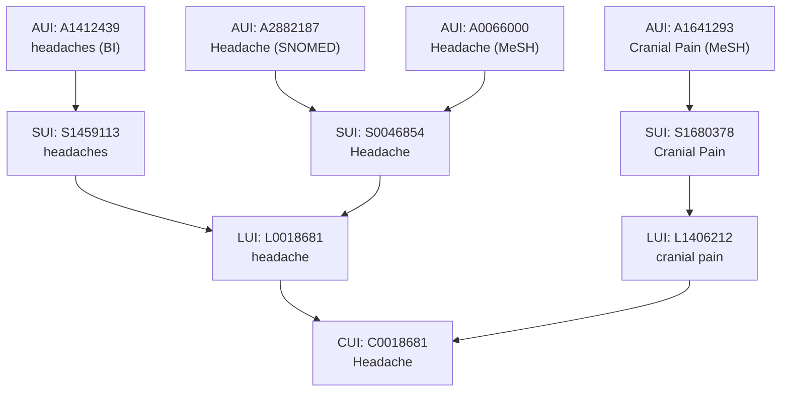
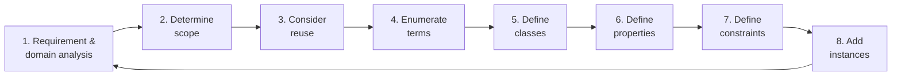

# Course 1 - Data vs. Information — Concepts & Ontology

## 1.1 Concepts & Cognitive Maps

### Core Definitions
* **Concept**: A mental representation and building block of thought that helps humans understand the world. Concepts represent perceived regularities in events;
* **Abstraction**: The process by which concepts generalize from specific examples. *Example: The concept of "dog" includes all breeds, sizes, and colors;*
* **Reasoning Support**: Concepts allow humans to group things together (categorization) and draw inferences (guessing a new animal is an animal based on prior knowledge);
* **Proposition**: A unit of knowledge formed by linking concepts together with linking words;
* **Cognitive Map**: The umbrella term for all visual representations of mental models, including mind maps and concept maps.

### Mind Maps vs. Concept Maps

| Feature | Mind Map | Concept Map |
| :--- | :--- | :--- |
| **Core Question** | What ideas relate to this topic? | How are the concepts related? |
| **Focus** | Single central topic (radiates from center out)| Multiple concepts |
| **Structure** | Tree-like (main and child branches, one keyword per branch) | Network-like and hierarchical (concepts linked to form propositions) |
| **Primary Goal** | Idea generation, creativity, innovation | Knowledge representation, organized knowledge |
| **Complexity** | Low complexity | Medium to high complexity |
| **Understanding Depth** | Surface to moderate depth | Deep understanding |
| **Use Cases** | Lecture notes, brainstorming, personal learning | Knowledge management, ontology design, project planning |

---

## 1.2 Concepts in Artificial Intelligence (AI)

Concepts act as the glue between raw data and intelligent behavior.

* **Machine Learning (Statistical Models)**:
  * **Mechanism**: Concepts are learned automatically from data rather than manually defined;
  * **Representation**: Points in a high-dimensional mathematical space;
  * **Example**: A spam filter learns the concept of "spam" by analyzing thousands of labeled emails.
* **Symbolic AI (Logic-Based Systems)**:
  * **Mechanism**: Concepts are explicitly defined using rules, logic, and ontologies;
  * **Representation**: Structured networks of meaning (Ontologies and Knowledge Graphs);
  * **Example**: A medical expert system defines the concept of "fever" as a body temperature $> 38\text{°C}$.

---

## 1.3 Fundamentals of Ontologies

### The Standard Definition (Gruber, 1993; Studer et al., 1998)
> **Ontology**: A formal, explicit specification of a shared conceptualisation.

* **Formal**: Machine-readable (computers can process it);
* **Explicit**: The types of concepts used and the constraints (rules) on their use are clearly defined;
* **Shared**: Captures consensual knowledge accepted by a group, rather than private to an individual;
* **Conceptualisation**: An abstract, simplified model of a phenomenon in the world that identifies its relevant concepts.

### Ontological Commitment
* **Definition**: An agreement among users/systems on the exact meaning of the vocabulary used to share knowledge;
* **Example**: Resolving ambiguity so two agents know whether the word "pipe" refers to a plumbing tube or a smoking device.

---

## 1.4 Biomedical Ontologies: UMLS & MeSH

### Unified Medical Language System (UMLS)
* **Overview**: A unified resource developed by the U.S. National Library of Medicine (NLM) for machine interpretation of medical language;
* **Problem Solved**: Medical text has many synonyms, abbreviations, and spelling variations. *Example: "Heart Attack", "Myocardial Infarction", and "MI" are different terms for the exact same concept;*
* **Scope**: Integrates 168 source vocabularies across subdomains like clinical repositories (SNOMED CT), genetics (OMIM), literature (MeSH), model organisms (NCBI Taxonomy), anatomy (FMA), and genome annotations (GO).

#### UMLS Identifiers (Bottom-Up Hierarchy)
1. **AUI (Atom Unique Identifier)**: Identifies a specific term entry from a specific source vocabulary. *Example: `A2882187` = "Headache" from SNOMED; `A0066000` = "Headache" from MeSH;*
2. **SUI (String Unique Identifier)**: Groups identical text strings (case-sensitive/spelling-specific) across sources. *Example: `S0046854` = "Headache"; `S1459113` = "headaches";*
3. **LUI (Lexical Unique Identifier)**: Groups strings that are lexical variants (e.g., singular and plural) of the same base term. *Example: `L0018681` links "Headache" and "headaches";*
4. **CUI (Concept Unique Identifier)**: Groups different lexical terms (synonyms) that share the same meaning. *Example: `C0018681` links "headache" (`L0018681`) and "cranial pain" (`L1406212`).*


*(Diagram representation of UMLS Identifier hierarchy)*

#### Three Core Components of UMLS

| Component | Scale | Function & Contents | Example (`aspirin` / `fever`) |
| :--- | :--- | :--- | :--- |
| **1. Lexicon** | > 100,000 lexical entries (single and multi-word) | Stores lexical items, part of speech, and word variants. | **Base**: aspirin (noun)<br/>**Inflectional**: aspirins (plural)<br/>**Derivational**: aspirinic (adj.) |
| **2. Meta-thesaurus** | > 60 terminology families; ~2.5M concepts; ~12M relations | Integrates biomedical vocabularies and cross-references concepts. | **CUI**: `C0004057`<br/>**Preferred Name**: Aspirin<br/>**Synonyms**: ASA, Acetylsalicylic Acid |
| **3. Semantic Network** | 135 high-level categories (semantic types); 54 relations | Categorizes all Meta-thesaurus concepts and defines relations between categories. | **Types for Aspirin**: *Pharmacologic Substance*, *Organic Chemical*<br/>**Relation**: *Pharmacologic Substance* `treats` *Disease or Syndrome*<br/>**Types for Fever**: *Disease or Syndrome*, *Sign or Symptom*, *Finding* |

* **Semantic Network Relations**: Include taxonomic links (`isa`, e.g., *Anatomical Structure* `isa` *Physical Object*) and non-taxonomic relations (`part_of`, `location_of`, `disrupts`, `process_of`, `evaluation_of`).

### MeSH (Medical Subject Headings)
* **Purpose**: Controlled vocabulary used for indexing biomedical literature;
* **Record Structure (Example: `Headache`)**:
  * **Unique ID**: `D006261`;
  * **Scope Note**: Definition of the term (e.g., "The symptom of PAIN in the cranial region...");
  * **Entry Terms**: Synonyms mapped to the heading (e.g., *Cephalgia*, *Cranial Pain*, *Hemicrania*);
  * **Tree Number**: Hierarchical location code (e.g., `C23.888.592.612.441` places *Headache* under *Pathological Conditions* $\rightarrow$ *Signs and Symptoms* $\rightarrow$ *Neurologic Manifestations* $\rightarrow$ *Pain*).

---

## 1.5 Ontological Engineering & Design

### Branches of Ontological Engineering
* **A. Ontology Development**:
  1. Knowledge Elicitation (gathering domain knowledge);
  2. Knowledge Structuring (organizing concepts);
  3. Formalization (translating into logic);
  4. Implementation (coding into an ontology language);
* **B. Ontology Application**: Used in Research, Education, Knowledge Management, and Technology (Semantic Web, Big Data).

### Iterative Ontology Design Lifecycle


*(Diagram representation of Valentina Tamma's Ontology Design Cycle)*

---

## 1.6 OWL (Web Ontology Language) & Protégé

### Tools & Languages
* **Protégé**: A popular Integrated Development Environment (IDE) for building ontologies, supporting visualization (OntoGraf, OWLViz), DL Queries, and automated Reasoners.
* **OWL (Web Ontology Language)**: A family of formal knowledge representation languages based on **Description Logics (DL)** semantics.
* **OWL Syntaxes**: OWL ontologies can be written in multiple syntaxes:
  * **Manchester Syntax** (human-friendly, used in Protégé UI):
    ```text
    Class: Person
    Individual: Ion
        Types: Person
    ```
    
  * **Functional Syntax**:
    ```text
    Declaration(Class(:Person))
    Declaration(NamedIndividual(:Ion))
    ClassAssertion(:Person :Ion)
    ```
   
  * **RDF/XML** (machine-oriented XML serialization).

### Core Elements of OWL
1. **Individuals (Instances)**: Specific concrete objects in the domain (e.g., `Ion`, `Maria`, `Stefan_cel_Mare`).
2. **Classes**: Sets of individuals sharing common characteristics.
   * **Special Classes**: `owl:Thing` (universal root class containing all individuals) and `owl:Nothing` (empty class);
   * **Class Set Relations**: Subset (`SubClassOf`) and Disjointness (`DisjointWith` — classes that cannot share any individuals);
   * **Class Operations**: Union (`or` / $\sqcup$), Intersection (`and` / $\sqcap$), Complement/Negation (`not` / $\neg$);
   * **Defining Classes**:
     * *Intensional*: Defined by necessary and sufficient properties/conditions;
     * *Extensional*: Defined by explicitly listing its member individuals.
3. **Properties**: Binary relations linking elements.
   * **Object Properties**: Link an individual to another individual (e.g., `hasParent`, `hasChild`). Top property is `owl:topObjectProperty`;
   * **Data Properties**: Link an individual to a literal datatype value (e.g., strings, numbers);
   * **Annotation Properties**: Add metadata/comments to ontology elements.

### Property Mechanics & Characteristics
* **Domain**: The class of the subject (starting point) of a property. *Example: Domain of `hasParent` is `Child`;*
* **Range**: The class of the object (target) of a property. *Example: Range of `hasParent` is `Parent`;*
* **Sub-properties & Chains**: Properties can form hierarchies. *Example: `hasParent` is a `SubPropertyOf` `hasAncestor`;*
* **Logical Characteristics**:
  * **Inverse Of**: If $A$ `hasParent` $B$, then $B$ `hasChild` $A$. Similarly, `hasAncestor` is the inverse of `isAncestorOf`;
  * **Transitive**: If $A$ relates to $B$, and $B$ relates to $C$, then $A$ automatically relates to $C$. *Example: `hasAncestor` is transitive. Because `hasParent` is a sub-property of `hasAncestor`, a reasoner infers multi-generational ancestors automatically via DL Queries;*
  * **Symmetric**: If $A$ relates to $B$, then $B$ relates to $A$ (e.g., `hasSibling`);
  * **Asymmetric**: If $A$ relates to $B$, $B$ cannot relate to $A$;
  * **Functional**: An individual can relate to **at most one** (0 or 1) distinct value in the range;
  * **Inverse Functional**: The inverse property is functional;
  * **Reflexive / Irreflexive**: Whether an individual always relates to itself / never relates to itself.

---

## 1.7 Constraints, Axioms & Reasoning Patterns

### Types of Property Restrictions (Constraints)

| Restriction Type | Protégé (Manchester) Syntax | Description Logic (DL) | Meaning |
| :--- | :--- | :--- | :--- |
| **Existential Quantifier** | `<Property> some <Class>` | $\exists \text{Property}.\text{Class}$ | Has **at least one** value from the specified class. |
| **Universal Quantifier** | `<Property> only <Class>` | $\forall \text{Property}.\text{Class}$ | **All** values for this property must come from the specified class (closure restriction). |
| **Cardinality** | `<Property> exactly n <Class>`<br/>`<Property> min n <Class>`<br/>`<Property> max n <Class>` | $= n\ \text{Property}.\text{Class}$<br/>$\ge n\ \text{Property}.\text{Class}$<br/>$\le n\ \text{Property}.\text{Class}$ | Restricts the exact, minimum, or maximum number of distinct linked individuals. |
| **Value Restriction** | `<Property> value <Individual>` | $\ni \text{Property}:\text{Individual}$ | Links to one specific named individual (e.g., `hasAncestor value Stefan_cel_Mare`). |

### Practical Modeling Examples in Protégé

#### I. General Class Axiom (The "Duck" Test)
* **Rule**: "If it walks like a duck and talks like a duck, it is a duck."
* **Formalization**:
  ```text
  (talksLike some Duck) and (walksLike some Duck) SubClassOf Duck
  ```
 

#### II. Asserted vs. Inferred Hierarchies (The Pizza Ontology)
A **Reasoner** computes logical consequences to build an **Inferred Class Hierarchy** from an **Asserted Class Hierarchy**:

* **Intersection (`and`)**:
  * *Definition*: `CheesyAndVegetarianPizza` $\equiv$ `Pizza and VegetarianPizza and CheeseyPizza`;
  * *Reasoner Inference*: Automatically places `CheesyAndVegetarianPizza` as a subclass under **both** `CheeseyPizza` and `VegetarianPizza`.
* **Union (`or`)**:
  * *Definition*: `CheeseyOrVegetarianPizza` has superclass `VegetarianPizza or CheeseyPizza` (instead of an equivalence definition);
  * *Reasoner Trap*: If defined merely as a subclass (`Superclasses`) rather than `Equivalent To`, the reasoner **does not** recognize `CheeseyPizza` and `VegetarianPizza` as subclasses of `CheeseyOrVegetarianPizza`.
* **Complement (`not`)**:
  * *Definition*: `VegetarianTopping` $\equiv$ `PizzaTopping and not MeatTopping and not FishTopping`;
  * *Reasoner Inference*: Automatically classifies `CheeseTopping`, `FruitTopping`, `HerbSpiceTopping`, `NutTopping`, `SauceTopping`, and `VegetableTopping` underneath `VegetarianTopping`.
  * *Definition*: `NonVegetarianTopping` $\equiv$ `PizzaTopping and not VegetarianTopping`;
  * *Reasoner Inference*: Automatically classifies `FishTopping` and `MeatTopping` underneath `NonVegetarianTopping`.

#### III. The Closure Axiom Pattern (Margherita Pizza)
* **Requirement**: "Margherita pizzas have Tomato and Mozzarella for topping, and **only** these."
* **Why both `some` and `only` are required**: Using `some` ensures the toppings are present; adding `only` prevents any extra toppings (like meat) from being added.
* **Description Logic Formula**:
  $$\text{Margherita} \sqsubseteq \text{Pizza} \sqcap (\exists \text{hasTopping}.\text{Mozzarella}) \sqcap (\exists \text{hasTopping}.\text{Tomato}) \sqcap (\forall \text{hasTopping}.(\text{Mozzarella} \sqcup \text{Tomato}))$$
 
* **Protégé Manchester Syntax (Approach 1 — Closure)**:
  ```text
  Superclasses:
      NamedPizza
      hasTopping some MozzarellaTopping
      hasTopping some TomatoTopping
      hasTopping only (MozzarellaTopping or TomatoTopping)
  ```
 
* **Protégé Manchester Syntax (Approach 2 — Cardinality)**:
  ```text
  EquivalentTo:
      (hasTopping some MozzarellaTopping)
      and (hasTopping some TomatoTopping)
      and (hasTopping exactly 2 Thing)
  ```
 

---

## 1.8 Open World vs. Closed World Assumption

| Feature | Closed World Assumption (CWA) | Open World Assumption (OWA) |
| :--- | :--- | :--- |
| **Core Premise** | The system has **complete** information. | The system has **incomplete** information (like the Web). |
| **Missing Information** | Anything that cannot be found/proven is assumed **false**. | Anything that cannot be found is **possible** (might be true unless explicitly proven false). |
| **Negation Style** | **Negation as failure** (failing to find a fact proves its negation). | **Negation as contradiction** (only false if it causes a logical contradiction). |
| **Reasoning Goal** | Queries evaluate strictly against known facts in a database/program. | Reasoners evaluate what holds true across any world consistent with the model. |
| **Typical Environment** | Traditional databases, Prolog. | OWL Ontologies, Semantic Web. |

### Case Study 1: OWA & Unique Name Assumption (The "Boot" Example)
* **Axiom**: "An invention satisfies **exactly 1** need" (`Invention SubClassOf satisfy exactly 1 Need`).
* **Facts Asserted**:
  * `boot Type Invention`
  * `boot satisfy move` (`move Type Need`)
  * `boot satisfy eat` (`eat Type Need`)
* **Scenario A (No Disjointness between `move` and `eat`)**:
  * **Result**: The ontology is **consistent** (Everything is OK!).
  * **Why**: Under OWA (and without a Unique Name Assumption), the reasoner does not assume `move` and `eat` are different just because they have different names. To satisfy the `exactly 1` rule, the reasoner infers that `move` is the **`Same Individual As`** `eat` (`move = eat`).
* **Scenario B (Asserting `eat DifferentFrom move`)**:
  * **Result**: The ontology becomes **inconsistent** (`owl:Thing SubClassOf owl:Nothing`), and the reasoner halts.
  * **Why**: `boot` is linked to 2 explicitly distinct `Need` individuals, directly contradicting the `satisfy exactly 1 Need` constraint.

### Case Study 2: CWA & Missing Specifications (Einstein's Riddle in Prolog)
* **The Riddle**:
  * There are three houses (each painted a different color, with inhabitants of different nationalities owning different pets).
  * Fact 1: In the green house there is a snake.
  * Fact 2: The American owns the dog.
  * Fact 3: The Englishman lives in the red house.
  * Unknowns to place: `Japanese`, `horse`, `blue`.
* **Flawed Prolog Implementation**:
  ```prolog
  house(englishman, _, red).
  house(american, dog, _).
  house(_, snake, green).
  ```
 
* **Why it Fails**:
  * Prolog only knows the 3 clauses explicitly written; it is missing the explicit specification that there are *only* three houses and that the three clauses must unify/merge into those three distinct houses;
  * Using the anonymous variable `_` allows Prolog to match any query (`house(X, _, blue)` returns `X = american`, and `house(japanese, X, _)` returns `X = snake`) by binding free variables independently rather than solving the global constraints of the 3 houses.