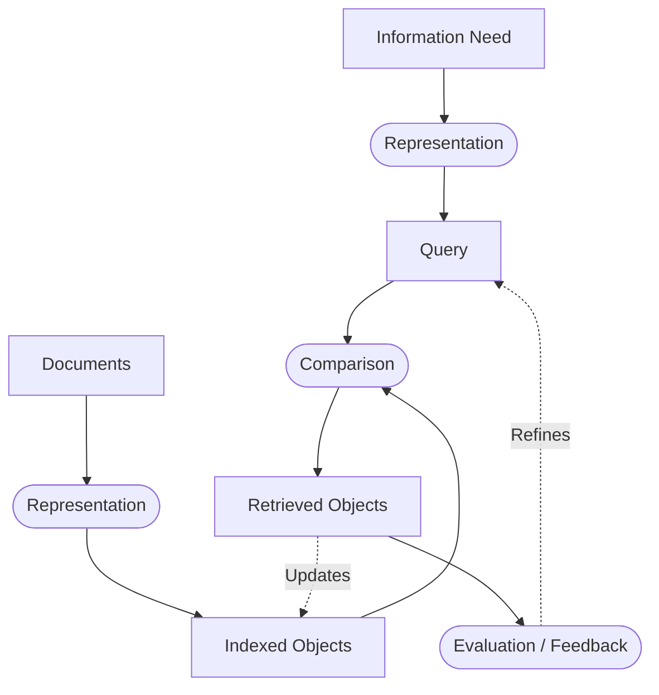
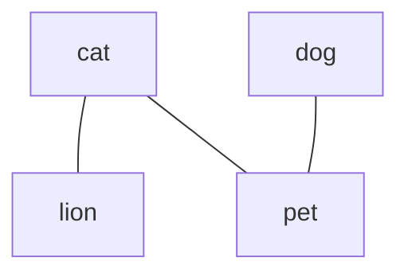

# Course 3 - Vector Space Model (VSM) for Information Retrieval

---

## 3.1 Fundamentals of Information Retrieval (IR)

### Definition
**Information Retrieval (IR)** is the process of finding material of an **unstructured nature** (typically text) from within **large collections** to satisfy an **information need** (Manning);
* **Unstructured Data:** Data that does not have a clear, semantically overt, easy-for-a-computer structure (unlike relational databases);
* **Information Need:** The topic about which the user desires to know more;
* **Query:** What the user actually types into the search system to represent their information need.

### Basic IR Process
The retrieval workflow translates both user needs and raw documents into comparable representations:



* **Ad-hoc Retrieval vs. Filtering:**
* **Ad-hoc Retrieval:** The document collection remains relatively static while new queries are submitted continuously;
* **Filtering:** The user profile (query) remains static while new documents stream into the system to be evaluated against the profile.

---

## 3.2 Overview of Retrieval Models

**Retrieval Models** define the mathematical framework used to represent documents and queries and to compare them.

| Category | Specific Models | Core Mechanism | Match Type |
| --- | --- | --- | --- |
| **Boolean (Set-Based)** | • Standard Boolean<br> • Extended Boolean / Fuzzy | Documents and queries are sets of terms combined with logical operators (`AND`, `OR`, `NOT`). | **Exact Match** (Document either matches or does not) |
| **Algebraic** | • **Vector Space Model (VSM)**<br> • Latent Semantic Indexing (LSI) | Documents and queries are represented as vectors in a multi-dimensional space. | **Best Match** (Ranks documents by degree of similarity) |
| **Probabilistic** | • Bayesian Inference<br> • Language Models | Estimates the probability that a document is relevant to a given query. | **Best Match** |
| **Citation Analysis** | • Hubs & Authorities (HITS)<br> • PageRank (Google) | Analyzes link structures and citations between documents to determine authority/importance. | **Graph / Ranking** |

---

## 3.3 Document Representation

To process text mathematically, documents are converted into numerical representations by ignoring grammar and word order:

1. **Set of Words:** Tracks only the presence or absence of unique words in a document (binary);
2. **Bag of Words (BoW):** Tracks the exact words and how many times they appear, ignoring word order;
3. **Document-Term Matrix:** A mathematical table mapping $m$ documents (rows) against $n$ unique vocabulary terms (columns).

$$\begin{pmatrix} & T_1 & T_2 & \cdots & T_n \\  D_1 & w_{11} & w_{12} & \cdots & w_{1n} \\  D_2 & w_{21} & w_{22} & \cdots & w_{2n} \\  \vdots & \vdots & \vdots & \ddots & \vdots \\  D_m & w_{m1} & w_{m2} & \cdots & w_{mn} \end{pmatrix}$$

### Weighting Schemes ($w_{ij}$)

The numerical value $w_{ij}$ (attribute of term $j$ in document $i$) can be defined as:

* **Boolean:** $1$ if the term is present in the document, $0$ otherwise;
* **Term Frequency (TF):** Count of how many times the term appears in the document;
* **Term Weight:** Calculated statistical importance (e.g., TF-IDF).

---

## 3.4 Vector Space Model (VSM)

Introduced in the SMART system (1960s) and used in early versions of Google, **VSM** represents each document and query as a vector in an $n$-dimensional space, where $n$ is the number of unique terms in the vocabulary. Modern search engines combine VSM with Machine Learning (ML) and Neural Networks (NN).

### Distance Metrics (Dissimilarity)

**Distance** measures how far apart two vectors $\vec{x}$ and $\vec{y}$ are in the vector space. Smaller distance means higher similarity.

* **Manhattan Distance ($L_1$):** Sum of absolute differences between coordinates;

$$d_{\text{Manhattan}}(\vec{x}, \vec{y}) = \sum_{i} \vert{}x_i - y_i\vert{}$$

* **Euclidean Distance ($L_2$):** Straight-line distance between two points;

$$d_{\text{Euclidean}}(\vec{x}, \vec{y}) = \sqrt{\sum_{i} (x_i - y_i)^2}$$

* **Minkowski Distance ($L_p$):** Generalized distance metric (where $p=1$ is Manhattan and $p=2$ is Euclidean).

$$d_{\text{Minkowski}}(\vec{x}, \vec{y}) = \left( \sum_{i} \vert{}x_i - y_i\vert{}^p \right)^{\frac{1}{p}}$$

### Similarity Metrics

**Similarity** measures how closely aligned two vectors are. Higher values mean greater relevance.

* **Dot Product (Inner Product):** Multiplies corresponding term weights and sums the result. Unnormalized; favors long documents with large values;

$$\text{sim}_{\text{dot}}(\vec{x}, \vec{y}) = \vec{x} \cdot \vec{y} = \sum_{i} x_i \cdot y_i$$

* **Cosine Similarity:** Measures the cosine of the angle between two vectors by dividing their dot product by the product of their Euclidean lengths (norms). Normalizes for document length.

$$\text{sim}_{\text{cos}}(\vec{x}, \vec{y}) = \frac{\vec{x} \cdot \vec{y}}{\Vert{}\vec{x}\Vert{}_2 \Vert{}\vec{y}\Vert{}_2} = \frac{\sum_{i} x_i \cdot y_i}{\sqrt{\sum_{i} x_i^2} \cdot \sqrt{\sum_{i} y_i^2}}$$

### Converting Between Distance and Similarity

Any **monotonically decreasing transformation** converts similarity $s(x,y)$ into distance $d(x,y)$, and any **monotonically increasing transformation** converts them the other way around:

* $s(x, y) = \frac{1}{d(x, y)}$
* $s(x, y) = \frac{1}{d(x, y) + 0.5}$ (prevents division by zero when $d=0$)
* $d(x, y) = 1 - s(x, y)$ (used when similarity is bounded in $[0, 1]$)

---

## 3.5 Worked Vector Examples

### Example 1: Binary Unit Vectors

Given vectors $A(0,1)$, $B(1,0)$, and Query $Q(1,1)$:

* **Manhattan Distance:** $d_{\text{Manhattan}}(Q, A) = \vert{}1-0\vert{} + \vert{}1-1\vert{} = 1$ (Same for $B$)
* **Euclidean Distance:** $d_{\text{Euclidean}}(Q, A) = \sqrt{(1-0)^2 + (1-1)^2} = 1$ (Same for $B$)
* **Dot Product:** $Q \cdot A = 1(0) + 1(1) = 1$
* **Cosine Similarity:** $\text{sim}_{\text{cos}}(Q, A) = \frac{1}{\sqrt{1^2+1^2}\sqrt{0^2+1^2}} = \frac{1}{\sqrt{2}} \approx 0.707$

### Example 2: Scaling vs. Angle

Given query $q(2,2)$ and documents $x(0.5, 1.5)$, $y(4,4)$, $z(8,6)$:

| Document Vector | Euclidean Distance $d(q, \cdot)$ | Cosine Similarity $\text{sim}_{\text{cos}}(q, \cdot)$ | Key Takeaway |
| --- | --- | --- | --- |
| **$x(0.5, 1.5)$** | $\approx 1.58$ (Closest in space) | $\approx 0.89$ (Lowest angle match) | Close to $q$ in magnitude, but points in a different direction. |
| **$y(4, 4)$** | $\approx 2.82$ | $1.00$ (Exact angle match) | $y$ is simply $q$ scaled by $2$. Cosine ignores length and yields a perfect match. |
| **$z(8, 6)$** | $\approx 7.21$ (Furthest in space) | $\approx 0.99$ (Very close angle) | Large term counts push $z$ far away in Euclidean space, but its term ratio is nearly identical to $q$. |

---

## 3.6 Vector Norms and Length Normalization

### Vector Norms ($L_p$)

A **norm** measures the length (magnitude) of a vector $\vec{x} = (x_1, x_2, \dots, x_n)$:

* **General $L_p$ Norm:**

$$\Vert{}\vec{x}\Vert{}_p = \left( \sum_{i=1}^{n} \vert{}x_i\vert{}^p \right)^{\frac{1}{p}}$$

* **Euclidean Norm ($p=2$):** $\Vert{}\vec{x}\Vert{}_2 = \sqrt{\sum_{i=1}^{n} \vert{}x_i\vert{}^2}$
* **Maximum Norm ($p=\infty$):** Takes the single largest coordinate value.

$$\Vert{}\vec{x}\Vert{}_\infty = \max(\vert{}x_1\vert{}, \vert{}x_2\vert{}, \dots, \vert{}x_n\vert{})$$

* **Norm Inequality Property:** If $1 \le p \le q \le \infty$, then:

$$\Vert{}\vec{x}\Vert{}_\infty \le \Vert{}\vec{x}\Vert{}_q \le \Vert{}\vec{x}\Vert{}_p \le \Vert{}\vec{x}\Vert{}_1$$

### Why Normalize? (The Repetition Problem)

Consider a query and three documents:

* $Q$: *"Do you like dogs?"*
* $D_1$: *"I like cats and dogs!"*
* $D_2$: *"I like cats and dogs."* (repeated 5 times)
* $D_3$: *"It's raining cats and dogs."* (repeated 20 times)

Without normalization (using simple dot product), $D_2$ scores 5 times higher than $D_1$, and $D_3$ scores even higher simply due to repetition. Dividing by the vector norm (**Cosine Normalization**) scales all vectors to unit length, giving $D_1$ and $D_2$ the exact same similarity score.

### Pivoted Document Length Normalization

* **The Flaw of Standard Cosine:** Empirical experiments (Singhal et al., SIGIR 1996) comparing retrieval probability against actual relevance across document lengths show that standard **cosine normalization over-penalizes long documents** and **favors short documents** (short documents are retrieved more often than they are relevant, while long documents are retrieved less often than they are relevant);
* **The Solution:** **Rotate** the normalization line clockwise around a **pivot ($piv$)** point (where retrieval probability equals relevance probability) using a **slope** parameter ($\text{slope} \in (0,1)$, typically $0.60 - 0.80$, achieving $+11.9\%$ retrieval improvement at $\text{slope} = 0.65 - 0.70$).

```
Normalization Factor
  ^
  |              /  Original Normalization
  |             /
  |            /   \
  |           /     v
  |          /-------- New Normalization (Rotated by slope)
  |         /|
  |        / |
  |   ----/--+------------
  |      /   |
  |     /    |
  +----------+-----------------> Document Length
            piv
```

* **Pivoted Normalization Formula:**

$$\text{norm}_{\text{new}}(d) = \text{slope} \times \text{norm}_{\text{orig}}(d) + (1 - \text{slope}) \times piv$$

- **Pivoted Unique Approximation (Manning):** Uses the count of unique terms in document \(d\) as the base length measure:

$$\text{norm}(d) = \text{slope} \times \text{uniqueTerms}(d) + (1 - \text{slope}) \times \text{piv}$$
  
---

## 3.7 From Set-Based Similarity to VSM

Set-based similarity formulas (operating on binary sets $X$ and $Y$) generalize directly into algebraic vector formulas (operating on real-valued vectors $\vec{x}$ and $\vec{y}$):

| Measure | Set-Based Formula (Sets $X, Y$) | Vector-Based Formula (Vectors $\vec{x}, \vec{y}$) |
| --- | --- | --- |
| **Simple Matching** | $\Vert{}X \cap Y\Vert{}$ | $\sum x_i \cdot y_i$ |
| **Dice Coefficient** | $\frac{2\Vert{}X \cap Y\Vert{}}{\Vert{}X\Vert{} + \Vert{}Y\Vert{}}$ | $\frac{2\sum x_i \cdot y_i}{\sum x_i^2 + \sum y_i^2}$ |
| **Jaccard Coefficient** | $\frac{\Vert{}X \cap Y\Vert{}}{\Vert{}X\Vert{} + \Vert{}Y\Vert{} - \Vert{}X \cap Y\Vert{}}$ | $\frac{\sum x_i \cdot y_i}{\sum x_i^2 + \sum y_i^2 - \sum x_i \cdot y_i}$ |
| **Cosine Similarity** | $\frac{\Vert{}X \cap Y\Vert{}}{\sqrt{\Vert{}X\Vert{}} \cdot \sqrt{\Vert{}Y\Vert{}}}$ | $\frac{\sum x_i \cdot y_i}{\sqrt{\sum x_i^2} \cdot \sqrt{\sum y_i^2}}$ |

---

## 3.8 Limitations of Basic VSM & Modern Extensions (EVSM)

### Limitations of Basic VSM

Basic VSM assumes all terms are mutually orthogonal (independent). It fails to account for:

1. **Word Similarity (Synonymy):** Different words with the same meaning (e.g., *"car"* and *"automobile"*) do not match unless both appear in the text;
2. **Polysemy:** The same word having multiple meanings depending on context (e.g., *"bank"* of a river vs. financial *"bank"*);
3. **Word Position & Order:** Bag-of-words destroys syntax, phrase structure, and word proximity.

### Modern Extended Vector Space Model (EVSM)

**Goal:** Incorporate context, semantic meaning, and user intent into vector comparisons.

* **User Feedback:** Relevance Feedback and Query Expansion (modifying query vectors based on user clicks/selections);
* **Context-Aware Matching:** Incorporating word order, term proximity, and term co-occurrence;
* **Semantic Enrichment:** Using NLP and Deep Learning to handle synonymy and polysemy (e.g., **WordNet**, **BERT**, deep query understanding).

---

## 3.9 Mathematical Formulation of Thesaurus-Based EVSM

To allow non-identical but related terms to contribute to document-query similarity, EVSM introduces a **thesaurus** or **word similarity matrix**.

### 1. Thesaurus Triples Approach

A **simple thesaurus** $T$ is a collection of triples:

$$T = \{(t_i, t_k, \alpha_{ik}) \mid t_i, t_k \in V, \alpha_{ik} \in (0, 1]\}$$

where $V$ is the vocabulary and $\alpha_{ik}$ is the degree of similarity between term $t_i$ and term $t_k$.

* *Examples:* `("person", "human", 1.00)`, `("car", "Toyota", 0.50)`.

**Extended Cosine Similarity Formula:**
Adds cross-term matches weighted by $\alpha_{ik}$ to the standard dot product numerator:

$$\text{sim}(d, q) = \frac{\sum_{i=1}^{M} d_i \cdot q_i + \sum_{(t_i, t_k, \alpha_{ik}) \in T} \alpha_{ik} \cdot d_i \cdot q_k}{\sqrt{\sum_{i=1}^{M} d_i^2 \cdot \sum_{i=1}^{M} q_i^2}}$$

### 2. Word Similarity Matrix Approach

Given a vocabulary $V$ and a **Word Similarity Matrix $S$** where $S_{u,v}$ represents the similarity between word $u$ and word $v$ (with $S_{w,w} = 1$):

* **Standard VSM (Inner Product):**

$$\text{sim}(D_1, D_2) = \sum_{w} D_{1_w} \times D_{2_w}$$

* **Extended VSM (with Similarity Matrix $S$):**

$$\text{sim}(D_1, D_2) = \sum_{u} \sum_{v} D_{1_u} \times D_{2_v} \times S_{u,v}$$

### Worked Example: EVSM with Word Similarity

* **$D_1$:** *"He wants a lion pet."* $\rightarrow$ Relevant vocabulary terms: `lion`, `pet`
* **$D_2$:** *"I have a cat and a dog."* $\rightarrow$ Relevant vocabulary terms: `cat`, `dog`
* **Vocabulary:** `{cat, dog, lion, pet}`
* **Semantic Graph Relationships:**
* `lion` is linked to `cat` ($S_{\text{lion, cat}} > 0$)
* `cat` is linked to `pet` ($S_{\text{cat, pet}} > 0$)
* `dog` is linked to `pet` ($S_{\text{dog, pet}} > 0$)



* **Comparison:**
* **In Standard VSM:** $D_1$ and $D_2$ share zero exact vocabulary words (`{lion, pet}` $\cap$ `{cat, dog}` $= \emptyset$), resulting in $\text{sim}(D_1, D_2) = 0$;
* **In Extended VSM:** Because `lion` relates to `cat`, and both `cat` and `dog` relate to `pet` in matrix $S$, the double summation $\sum_{u} \sum_{v} D_{1_u} D_{2_v} S_{u,v}$ yields a positive similarity score ($\text{sim}(D_1, D_2) > 0$), successfully matching the documents by meaning.

---
