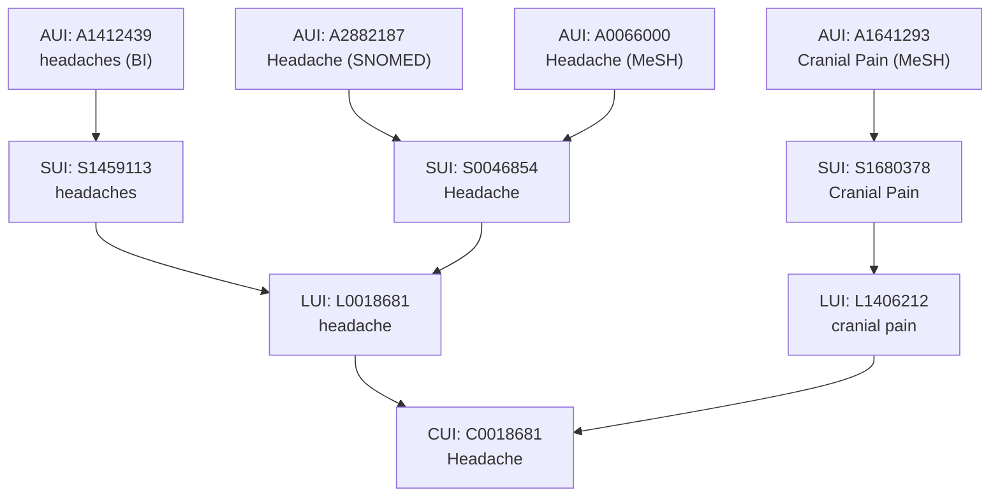
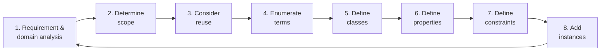
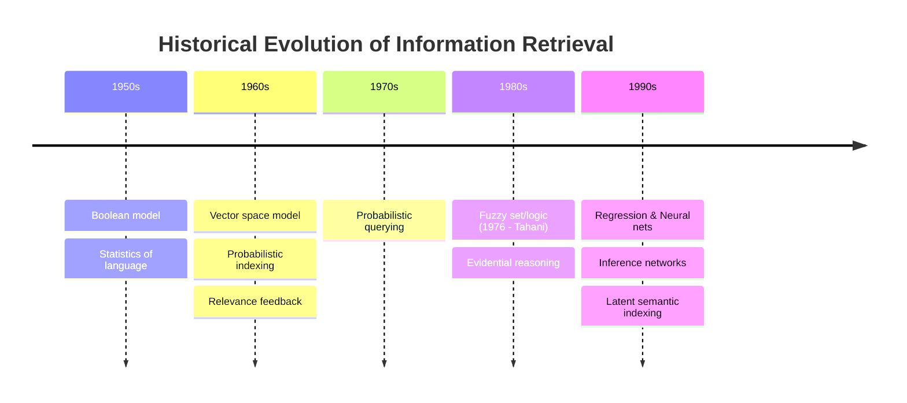
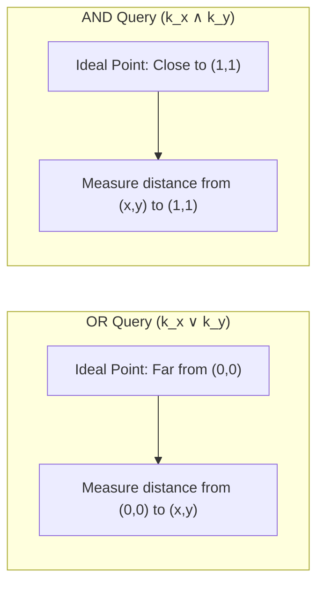

# Course 1 - Data vs. Information — Concepts & Ontology

---

## 1.1 Concepts & Cognitive Maps

---

### Core Definitions
* **Concept**: A mental representation and building block of thought that helps humans understand the world. Concepts represent perceived regularities in events;
* **Abstraction**: The process by which concepts generalize from specific examples. *Example: The concept of "dog" includes all breeds, sizes, and colors*;
* **Reasoning Support**: Concepts allow humans to group things together (categorization) and draw inferences (guessing a new animal is an animal based on prior knowledge);
* **Proposition**: A unit of knowledge formed by linking concepts together with linking words;
* **Cognitive Map**: The umbrella term for all visual representations of mental models, including mind maps and concept maps.

### Mind Maps vs. Concept Maps

| Feature | Mind Map | Concept Map |
| :--- | :--- | :--- |
| **Core Question** | What ideas relate to this topic? | How are the concepts related? |
| **Focus** | Single central topic (radiates from center out)| Multiple concepts |
| **Structure** | Tree-like (main and child branches, one keyword per branch) | Network-like and hierarchical (concepts linked to form propositions) |
| **Primary Goal** | Idea generation, creativity, innovation | Knowledge representation, organized knowledge |
| **Complexity** | Low complexity | Medium to high complexity |
| **Understanding Depth** | Surface to moderate depth | Deep understanding |
| **Use Cases** | Lecture notes, brainstorming, personal learning | Knowledge management, ontology design, project planning |

---

## 1.2 Concepts in Artificial Intelligence (AI)

Concepts act as the glue between raw data and intelligent behavior.

* **Machine Learning (Statistical Models)**:
  * **Mechanism**: Concepts are learned automatically from data rather than manually defined;
  * **Representation**: Points in a high-dimensional mathematical space;
  * **Example**: A spam filter learns the concept of "spam" by analyzing thousands of labeled emails.
* **Symbolic AI (Logic-Based Systems)**:
  * **Mechanism**: Concepts are explicitly defined using rules, logic, and ontologies;
  * **Representation**: Structured networks of meaning (Ontologies and Knowledge Graphs);
  * **Example**: A medical expert system defines the concept of "fever" as a body temperature $> 38\text{°C}$.

---

## 1.3 Fundamentals of Ontologies

### The Standard Definition (Gruber, 1993; Studer et al., 1998)
> **Ontology**: A formal, explicit specification of a shared conceptualisation.

* **Formal**: Machine-readable (computers can process it);
* **Explicit**: The types of concepts used and the constraints (rules) on their use are clearly defined;
* **Shared**: Captures consensual knowledge accepted by a group, rather than private to an individual;
* **Conceptualisation**: An abstract, simplified model of a phenomenon in the world that identifies its relevant concepts.

### Ontological Commitment
* **Definition**: An agreement among users/systems on the exact meaning of the vocabulary used to share knowledge;
* **Example**: Resolving ambiguity so two agents know whether the word "pipe" refers to a plumbing tube or a smoking device.

---

## 1.4 Biomedical Ontologies: UMLS & MeSH

### Unified Medical Language System (UMLS)
* **Overview**: A unified resource developed by the U.S. National Library of Medicine (NLM) for machine interpretation of medical language;
* **Problem Solved**: Medical text has many synonyms, abbreviations, and spelling variations. *Example: "Heart Attack", "Myocardial Infarction", and "MI" are different terms for the exact same concept*;
* **Scope**: Integrates 168 source vocabularies across subdomains like clinical repositories (SNOMED CT), genetics (OMIM), literature (MeSH), model organisms (NCBI Taxonomy), anatomy (FMA), and genome annotations (GO).

#### UMLS Identifiers (Bottom-Up Hierarchy)
1. **AUI (Atom Unique Identifier)**: Identifies a specific term entry from a specific source vocabulary. *Example: `A2882187` = "Headache" from SNOMED; `A0066000` = "Headache" from MeSH*;
2. **SUI (String Unique Identifier)**: Groups identical text strings (case-sensitive/spelling-specific) across sources. *Example: `S0046854` = "Headache"; `S1459113` = "headaches"*;
3. **LUI (Lexical Unique Identifier)**: Groups strings that are lexical variants (e.g., singular and plural) of the same base term. *Example: `L0018681` links "Headache" and "headaches"*;
4. **CUI (Concept Unique Identifier)**: Groups different lexical terms (synonyms) that share the same meaning. *Example: `C0018681` links "headache" (`L0018681`) and "cranial pain" (`L1406212`)*.



*(Diagram representation of UMLS Identifier hierarchy)*

#### Three Core Components of UMLS

| Component | Scale | Function & Contents | Example (`aspirin` / `fever`) |
| :--- | :--- | :--- | :--- |
| **1. Lexicon** | > 100,000 lexical entries (single and multi-word) | Stores lexical items, part of speech, and word variants. | **Base**: aspirin (noun)<br/>**Inflectional**: aspirins (plural)<br/>**Derivational**: aspirinic (adj.) |
| **2. Meta-thesaurus** | > 60 terminology families; ~2.5M concepts; ~12M relations | Integrates biomedical vocabularies and cross-references concepts. | **CUI**: `C0004057`<br/>**Preferred Name**: Aspirin<br/>**Synonyms**: ASA, Acetylsalicylic Acid |
| **3. Semantic Network** | 135 high-level categories (semantic types); 54 relations | Categorizes all Meta-thesaurus concepts and defines relations between categories. | **Types for Aspirin**: *Pharmacologic Substance*, *Organic Chemical*<br/>**Relation**: *Pharmacologic Substance* `treats` *Disease or Syndrome*<br/>**Types for Fever**: *Disease or Syndrome*, *Sign or Symptom*, *Finding* |

* **Semantic Network Relations**: Include taxonomic links (`isa`, e.g., *Anatomical Structure* `isa` *Physical Object*) and non-taxonomic relations (`part_of`, `location_of`, `disrupts`, `process_of`, `evaluation_of`).

### MeSH (Medical Subject Headings)
* **Purpose**: Controlled vocabulary used for indexing biomedical literature;
* **Record Structure (Example: `Headache`)**:
  * **Unique ID**: `D006261`;
  * **Scope Note**: Definition of the term (e.g., "The symptom of PAIN in the cranial region...");
  * **Entry Terms**: Synonyms mapped to the heading (e.g., *Cephalgia*, *Cranial Pain*, *Hemicrania*);
  * **Tree Number**: Hierarchical location code (e.g., `C23.888.592.612.441` places *Headache* under *Pathological Conditions* $\rightarrow$ *Signs and Symptoms* $\rightarrow$ *Neurologic Manifestations* $\rightarrow$ *Pain*).

---

## 1.5 Ontological Engineering & Design

### Branches of Ontological Engineering
* **A. Ontology Development**:
  1. Knowledge Elicitation (gathering domain knowledge);
  2. Knowledge Structuring (organizing concepts);
  3. Formalization (translating into logic);
  4. Implementation (coding into an ontology language);
* **B. Ontology Application**: Used in Research, Education, Knowledge Management, and Technology (Semantic Web, Big Data).

### Iterative Ontology Design Lifecycle



*(Diagram representation of Valentina Tamma's Ontology Design Cycle)*

---

## 1.6 OWL (Web Ontology Language) & Protégé

### Tools & Languages
* **Protégé**: A popular Integrated Development Environment (IDE) for building ontologies, supporting visualization (OntoGraf, OWLViz), DL Queries, and automated Reasoners;
* **OWL (Web Ontology Language)**: A family of formal knowledge representation languages based on **Description Logics (DL)** semantics;
* **OWL Syntaxes**: OWL ontologies can be written in multiple syntaxes:
  * **Manchester Syntax** (human-friendly, used in Protégé UI):
    ```text
    Class: Person
    Individual: Ion
        Types: Person
    ```
    
  * **Functional Syntax**:
    ```text
    Declaration(Class(:Person))
    Declaration(NamedIndividual(:Ion))
    ClassAssertion(:Person :Ion)
    ```
    
  * **RDF/XML** (machine-oriented XML serialization).

### Core Elements of OWL
1. **Individuals (Instances)**: Specific concrete objects in the domain (e.g., `Ion`, `Maria`, `Stefan_cel_Mare`);
2. **Classes**: Sets of individuals sharing common characteristics:
   * **Special Classes**: `owl:Thing` (universal root class containing all individuals) and `owl:Nothing` (empty class);
   * **Class Set Relations**: Subset (`SubClassOf`) and Disjointness (`DisjointWith` — classes that cannot share any individuals);
   * **Class Operations**: Union (`or` / $\sqcup$), Intersection (`and` / $\sqcap$), Complement/Negation (`not` / $\neg$);
   * **Defining Classes**:
     * *Intensional*: Defined by necessary and sufficient properties/conditions;
     * *Extensional*: Defined by explicitly listing its member individuals.
3. **Properties**: Binary relations linking elements:
   * **Object Properties**: Link an individual to another individual (e.g., `hasParent`, `hasChild`). Top property is `owl:topObjectProperty`;
   * **Data Properties**: Link an individual to a literal datatype value (e.g., strings, numbers);
   * **Annotation Properties**: Add metadata/comments to ontology elements.

### Property Mechanics & Characteristics
* **Domain**: The class of the subject (starting point) of a property. *Example: Domain of `hasParent` is `Child`*;
* **Range**: The class of the object (target) of a property. *Example: Range of `hasParent` is `Parent`*;
* **Sub-properties & Chains**: Properties can form hierarchies. *Example: `hasParent` is a `SubPropertyOf` `hasAncestor`*;
* **Logical Characteristics**:
  * **Inverse Of**: If $A$ `hasParent` $B$, then $B$ `hasChild` $A$. Similarly, `hasAncestor` is the inverse of `isAncestorOf`;
  * **Transitive**: If $A$ relates to $B$, and $B$ relates to $C$, then $A$ automatically relates to $C$. *Example: `hasAncestor` is transitive. Because `hasParent` is a sub-property of `hasAncestor`, a reasoner infers multi-generational ancestors automatically via DL Queries*;
  * **Symmetric**: If $A$ relates to $B$, then $B$ relates to $A$ (e.g., `hasSibling`);
  * **Asymmetric**: If $A$ relates to $B$, $B$ cannot relate to $A$;
  * **Functional**: An individual can relate to **at most one** (0 or 1) distinct value in the range;
  * **Inverse Functional**: The inverse property is functional;
  * **Reflexive / Irreflexive**: Whether an individual always relates to itself / never relates to itself.

---

## 1.7 Constraints, Axioms & Reasoning Patterns

### Types of Property Restrictions (Constraints)

| Restriction Type | Protégé (Manchester) Syntax | Description Logic (DL) | Meaning |
| :--- | :--- | :--- | :--- |
| **Existential Quantifier** | `<Property> some <Class>` | $\exists \text{Property}.\text{Class}$ | Has **at least one** value from the specified class. |
| **Universal Quantifier** | `<Property> only <Class>` | $\forall \text{Property}.\text{Class}$ | **All** values for this property must come from the specified class (closure restriction). |
| **Cardinality** | `<Property> exactly n <Class>`<br/>`<Property> min n <Class>`<br/>`<Property> max n <Class>` | $= n\ \text{Property}.\text{Class}$<br/>$\ge n\ \text{Property}.\text{Class}$<br/>$\le n\ \text{Property}.\text{Class}$ | Restricts the exact, minimum, or maximum number of distinct linked individuals. |
| **Value Restriction** | `<Property> value <Individual>` | $\ni \text{Property}:\text{Individual}$ | Links to one specific named individual (e.g., `hasAncestor value Stefan_cel_Mare`). |

### Practical Modeling Examples in Protégé

#### I. General Class Axiom (The "Duck" Test)
* **Rule**: "If it walks like a duck and talks like a duck, it is a duck."
* **Formalization**:
  ```text
  (talksLike some Duck) and (walksLike some Duck) SubClassOf Duck
  ```
 
#### II. Asserted vs. Inferred Hierarchies (The Pizza Ontology)
A **Reasoner** computes logical consequences to build an **Inferred Class Hierarchy** from an **Asserted Class Hierarchy**:

* **Intersection (`and`)**:
  * *Definition*: `CheesyAndVegetarianPizza` $\equiv$ `Pizza and VegetarianPizza and CheeseyPizza`;
  * *Reasoner Inference*: Automatically places `CheesyAndVegetarianPizza` as a subclass under **both** `CheeseyPizza` and `VegetarianPizza`.
* **Union (`or`)**:
  * *Definition*: `CheeseyOrVegetarianPizza` has superclass `VegetarianPizza or CheeseyPizza` (instead of an equivalence definition);
  * *Reasoner Trap*: If defined merely as a subclass (`Superclasses`) rather than `Equivalent To`, the reasoner **does not** recognize `CheeseyPizza` and `VegetarianPizza` as subclasses of `CheeseyOrVegetarianPizza`.
* **Complement (`not`)**:
  * *Definition*: `VegetarianTopping` $\equiv$ `PizzaTopping and not MeatTopping and not FishTopping`;
  * *Reasoner Inference*: Automatically classifies `CheeseTopping`, `FruitTopping`, `HerbSpiceTopping`, `NutTopping`, `SauceTopping`, and `VegetableTopping` underneath `VegetarianTopping`.
  * *Definition*: `NonVegetarianTopping` $\equiv$ `PizzaTopping and not VegetarianTopping`;
  * *Reasoner Inference*: Automatically classifies `FishTopping` and `MeatTopping` underneath `NonVegetarianTopping`.

#### III. The Closure Axiom Pattern (Margherita Pizza)
* **Requirement**: "Margherita pizzas have Tomato and Mozzarella for topping, and **only** these."
* **Why both `some` and `only` are required**: Using `some` ensures the toppings are present; adding `only` prevents any extra toppings (like meat) from being added.
* **Description Logic Formula**:
  $$\text{Margherita} \sqsubseteq \text{Pizza} \sqcap (\exists \text{hasTopping}.\text{Mozzarella}) \sqcap (\exists \text{hasTopping}.\text{Tomato}) \sqcap (\forall \text{hasTopping}.(\text{Mozzarella} \sqcup \text{Tomato}))$$
 
* **Protégé Manchester Syntax (Approach 1 — Closure)**:
  ```text
  Superclasses:
      NamedPizza
      hasTopping some MozzarellaTopping
      hasTopping some TomatoTopping
      hasTopping only (MozzarellaTopping or TomatoTopping)
  ```
 
* **Protégé Manchester Syntax (Approach 2 — Cardinality)**:
  ```text
  EquivalentTo:
      (hasTopping some MozzarellaTopping)
      and (hasTopping some TomatoTopping)
      and (hasTopping exactly 2 Thing)
  ```
 
---

## 1.8 Open World vs. Closed World Assumption

| Feature | Closed World Assumption (CWA) | Open World Assumption (OWA) |
| :--- | :--- | :--- |
| **Core Premise** | The system has **complete** information. | The system has **incomplete** information (like the Web). |
| **Missing Information** | Anything that cannot be found/proven is assumed **false**. | Anything that cannot be found is **possible** (might be true unless explicitly proven false). |
| **Negation Style** | **Negation as failure** (failing to find a fact proves its negation). | **Negation as contradiction** (only false if it causes a logical contradiction). |
| **Reasoning Goal** | Queries evaluate strictly against known facts in a database/program. | Reasoners evaluate what holds true across any world consistent with the model. |
| **Typical Environment** | Traditional databases, Prolog. | OWL Ontologies, Semantic Web. |

### Case Study 1: OWA & Unique Name Assumption (The "Boot" Example)
* **Axiom**: "An invention satisfies **exactly 1** need" (`Invention SubClassOf satisfy exactly 1 Need`);
* **Facts Asserted**:
  * `boot Type Invention`
  * `boot satisfy move` (`move Type Need`)
  * `boot satisfy eat` (`eat Type Need`)
* **Scenario A (No Disjointness between `move` and `eat`)**:
  * **Result**: The ontology is **consistent** (Everything is OK!);
  * **Why**: Under OWA (and without a Unique Name Assumption), the reasoner does not assume `move` and `eat` are different just because they have different names. To satisfy the `exactly 1` rule, the reasoner infers that `move` is the **`Same Individual As`** `eat` (`move = eat`).
* **Scenario B (Asserting `eat DifferentFrom move`)**:
  * **Result**: The ontology becomes **inconsistent** (`owl:Thing SubClassOf owl:Nothing`), and the reasoner halts;
  * **Why**: `boot` is linked to 2 explicitly distinct `Need` individuals, directly contradicting the `satisfy exactly 1 Need` constraint.

### Case Study 2: CWA & Missing Specifications (Einstein's Riddle in Prolog)
* **The Riddle**:
  * There are three houses (each painted a different color, with inhabitants of different nationalities owning different pets);
  * Fact 1: In the green house there is a snake;
  * Fact 2: The American owns the dog;
  * Fact 3: The Englishman lives in the red house;
  * Unknowns to place: `Japanese`, `horse`, `blue`.
* **Flawed Prolog Implementation**:
  ```prolog
  house(englishman, _, red).
  house(american, dog, _).
  house(_, snake, green).
  ```
 
* **Why it Fails**:
  * Prolog only knows the 3 clauses explicitly written; it is missing the explicit specification that there are *only* three houses and that the three clauses must unify/merge into those three distinct houses;
  * Using the anonymous variable `_` allows Prolog to match any query (`house(X, _, blue)` returns `X = american`, and `house(japanese, X, _)` returns `X = snake`) by binding free variables independently rather than solving the global constraints of the 3 houses.

---

# Course 2 - Boolean and Set Theoretic Models in Information Retrieval

**Information Retrieval (IR)** is the process of finding relevant documents from a large collection based on a user's search request (called a **query**).

---

## 2.1 Historical Evolution of IR



* **Vector Space Model**: Represents text documents as lists of numbers (vectors) in a multi-dimensional space to measure similarity;
* **Probabilistic Indexing / Querying**: Uses probability theory to estimate the chance that a document is relevant to a query;
* **Relevance Feedback**: A feature where the system takes user input on initial search results to improve the next set of results;
* **Fuzzy Set / Logic**: A form of math where items can belong to a group partially (using values between 0 and 1) rather than strictly yes (1) or no (0);
* **Evidential Reasoning**: Combining evidence from multiple sources to calculate the likelihood that a document matches a query;
* **Regression & Neural Nets**: Machine learning methods that learn patterns from data to predict document relevance;
* **Inference Networks**: Graph models that treat finding relevant documents as a process of logical deduction and probability;
* **Latent Semantic Indexing**: A mathematical technique that finds hidden relationships between words and concepts across documents.

---

## 2.2 The Boolean Model

The **Boolean Model** is one of the simplest IR models and served as the primary commercial retrieval tool for three decades.

### Core Mechanics

* **Document Representation**: Each document is viewed as a **set** (a collection of distinct items) of words, called **terms**. Each term is strictly present (1) or absent (0);
* **Queries**: Written as **Boolean expressions**, which are logical statements that join search terms using the operators `AND`, `OR`, and `NOT`;
* **Output**: Exact match only. A document either satisfies the logical condition or it does not.

### Real-World Applications

#### LinkedIn (Professional Networking Search)

* **`NOT`**: Excludes terms (e.g., `programmer NOT manager`);
* **`OR`**: Matches at least one term (e.g., `sales OR marketing OR advertising`);
* **`AND`**: Requires all terms (e.g., `accountant AND finance AND CPA`). Multiple terms use `AND` automatically by default;
* **Quotes (`"..."`)**: Matches an exact phrase;
* **Parentheses `(...)**`: Groups operators to control logical order;
* *Example*: `("Machine Learning Engineer" OR "AI Engineer") AND Python NOT Intern` finds profiles with either job title that mention Python, excluding interns.


#### Westlaw (Commercial Legal Search Service)

Launched in 1975, Westlaw searches tens of terabytes of data for over 500,000 subscribers using Boolean operators and proximity expanders.

* *Example Query*: `host! /p (responsib! or liab!) /p (intoxicat! or drunk!) /p guest` (Checks if a host is responsible for drunk guests by requiring terms to appear in the same paragraph).

| Operator / Symbol | Meaning | Example | Explanation |
| --- | --- | --- | --- |
| **`&`** | Logical `AND` | `narcotics & warrant` | Both words must appear. |
| **`OR`** or **space** | Logical `OR` | `attorney or lawyer` | Either word must appear. |
| **`%`** | But not (`NOT`) | `tax % investment` | Contains "tax", excludes "investment". |
| **`"..."`** | Exact phrase | `"res ipsa loquitur"` | Words must appear together in exact order. |
| **`/s`** | Same sentence | `design /s defect` | Words appear in the same sentence. |
| **`+s`** | Preceding in sentence | `attorney +s fee` | First word appears before second in same sentence. |
| **`/p`** | Same paragraph | `hearsay /p utterance` | Words appear in the same paragraph. |
| **`+p`** | Preceding in paragraph | `exception +p non-liability` | First word appears before second in same paragraph. |
| **`/n`** | Within $n$ terms | `personal /3 jurisdiction` | Words appear within 3 words of each other. |
| **`+n`** | Preceding within $n$ terms | `capital +3 gain` | First word appears within 3 words before the second. |
| **`!`** | Root expander (wildcard) | `object!` | Matches words starting with root (*object, objected, objecting*). |
| **`*`** | Universal character | `withdr*w` | Replaces a single character (*withdraw, withdrew*). |
| **`#`** | Turn off plurals/equivalents | `#damage` | Matches exact word *damage*, excludes *damages*. |

### Characteristics Summary

| Advantages | Disadvantages |
| --- | --- |
| Clean mathematical formalism. | Functions more like exact data retrieval than information retrieval. |
| Easy to implement. | Hard for users to translate natural text needs into complex Boolean logic. |
| Intuitive concept. | All terms have equal weight (importance). |
|  | **No ranked output** and **no partial matching**. |

---

## 2.3 Documents as Sets: Similarity Measures

When comparing two documents (or a query and a document) represented as sets of terms $A$ and $B$, **similarity measures** calculate how alike they are based on shared and unshared terms.

### Notation

* $\vert{}A\vert{}$: **Cardinality** (the total number of unique terms in set $A$);
* $\vert{}A \cap B\vert{}$: **Intersection** (the number of terms present in both $A$ and $B$);
* $\vert{}A \cup B\vert{}$: **Union** (the total number of unique terms across both $A$ and $B$, where $\vert{}A \cup B\vert{} = \vert{}A\vert{} + \vert{}B\vert{} - \vert{}A \cap B\vert{}$);
* $\vert{}A \setminus B\vert{}$: **Set Difference** (the number of terms in $A$ that are not in $B$).

### Similarity Formulas

| Measure | Formula | Key Concept |
| --- | --- | --- |
| **Simple-Matching** | $$sim_{simple-matching}(A,B) = \Vert{}A \cap B\Vert{}$$
 | Counts raw shared terms. |
| **Overlap** | $$sim_{overlap}(A,B) = \frac{\Vert{}A \cap B\Vert{}}{\min(\Vert{}A\Vert{}, \Vert{}B\Vert{})}$$
 | Shared terms divided by the size of the smaller set. |
| **Dice** | $$sim_{Dice}(A,B) = \frac{2 \cdot \Vert{}A \cap B\Vert{}}{\Vert{}A\Vert{} + \Vert{}B\Vert{}}$$
 | Twice the shared terms divided by total combined sizes. |
| **Jaccard** | $$sim_{Jaccard}(A,B) = \frac{\Vert{}A \cap B\Vert{}}{\Vert{}A \cup B\Vert{}}$$
 | Shared terms divided by the union of both sets. |
| **Tversky Index** | $$sim_{Tversky}(A,B) = \frac{\Vert{}A \cap B\Vert{}}{\Vert{}A \cap B\Vert{} + \alpha\Vert{}A \setminus B\Vert{} + \beta\Vert{}B \setminus A\Vert{}}$$
 | Asymmetric measure using weights $\alpha$ and $\beta$ for unshared terms. |
| **Cosine ($cos$)** | $$sim_{cos}(A,B) = \frac{\Vert{}A \cap B\Vert{}}{\Vert{}A\Vert{}^{1/2} \cdot \Vert{}B\Vert{}^{1/2}}$$
 | Shared terms normalized by the square roots of set sizes. |

### Mathematical Relationships

For any two non-empty sets $A$ and $B$, Jaccard and Dice are monotonically related (one increases as the other increases):

$$sim_{Jaccard}(A,B) = \frac{sim_{Dice}(A,B)}{2 - sim_{Dice}(A,B)}$$

*(Note: Because this relationship is strictly increasing, it is mathematically impossible to find sets $A, B, C, D$ where $sim_{Dice}(A,B) > sim_{Dice}(C,D)$ and $sim_{Jaccard}(A,B) < sim_{Jaccard}(C,D)$ simultaneously).*

---

## 2.4 Fuzzy Set and Logic Models in IR

Natural language concepts (like "cold", "warm", "cheap") do not have sharp boundaries. **Fuzzy Set Theory** handles this vagueness by allowing gradual membership.

### Core Definitions

* **Universe of Discourse ($U$)**: The complete collection of all possible items (e.g., all documents in a database);
* **Fuzzy Subset ($A$)**: A group within $U$ representing a query term or concept;
* **Membership Function ($\mu_A: U \rightarrow [0,1]$)**: A rule that assigns each item $u \in U$ a score $\mu_A(u)$ between $0$ (completely outside the group) and $1$ (completely inside the group). Values between $0$ and $1$ represent partial membership.

### Standard Fuzzy Set Operations

* **Complement (`NOT`)**: 
$$\mu_{\bar{A}}(u) = 1 - \mu_A(u)$$

* **Union (`OR`)**: 
$$\mu_{A \cup B}(u) = \max(\mu_A(u), \mu_B(u))$$

* **Intersection (`AND`)**: 
$$\mu_{A \cap B}(u) = \min(\mu_A(u), \mu_B(u))$$

> **Limitation of Min/Max**: Standard $\min$ and $\max$ operations lack sensitivity to changes in non-extreme values. For example, $\min(0.2, 0.8) = 0.2$ and $\min(0.2, 0.3) = 0.2$. Using an algebraic product is often preferred for smoother scoring.

### Assigning Membership Degrees in IR

How to calculate how strongly a term belongs to a document:

1. **Term Frequency (TF)**: How often a word appears in a document, divided by the maximum frequency of any word in that document: $tf / \max(tf)$;
2. **TF-IDF Weights**: **Term Frequency-Inverse Document Frequency** (a statistical score measuring how important a word is to a document across a whole collection), normalized by the maximum score: $\text{tf-idf} / \max(\text{tf-idf})$;
3. **Domain Experts**: Manually assigned scores;
4. **Custom Functions for Vague Concepts**:
* *Example*: Defining a "cheap" hotel based on price $p$:

$$\mu_{cheap}(p) = \begin{cases} 1 & p \le 50 \\ \frac{150 - p}{100} & 50 < p < 150 \\ 0 & p \ge 150 \end{cases}$$

5. **Machine Learning (ML)** & **Term Similarity**: If document $D$ does not contain the word "car" but contains "vehicle", and $\text{similarity}(\text{car}, \text{vehicle}) = 0.91$, then $\mu_D(\text{car}) = 0.91$.

#### Example: Fuzzy Query Evaluation

Query: `cheap AND in_Cluj-Napoca AND good_reviews`

| Hotel | Price | μ(cheap) | μ(in_Cluj-Napoca) | μ(good_reviews) | Fuzzy AND Score (min) |
|:---:|---:|---:|---:|---:|---:|
| **H1** | 50 | 0.9 | 1.0 | 0.7 | min(0.9, 1.0, 0.7) = **0.7** |
| **H2** | 80 | 0.6 | 1.0 | 0.9 | min(0.6, 1.0, 0.9) = **0.6** |
| **H3** | 40 | 1.0 | 1.0 | 0.8 | min(1.0, 1.0, 0.8) = **0.8** |
| **H4** | 30 | 1.0 | 0.0 | 1.0 | min(1.0, 0.0, 1.0) = **0.0** |

*Result Ranking*: H3 (0.8) > H1 (0.7) > H2 (0.6) > H4 (0.0).

---

### Model 1: Tahani's Fuzzy Logic Model (1976)

* **Document Representation**: A set of index terms with pre-assigned weights $W_{ki} \in [0,1]$;
* *Example*: $d_1 = (\text{and } \langle\text{jazz}, 0.4\rangle \langle\text{sax}, 0.3\rangle \langle\text{Coltrane}, 0.5\rangle)$

* **Closed World Assumption**: Any term $t$ not listed in document $d$ is assumed to have a weight of zero: $\langle t, 0 \rangle$;
* **Query Evaluation**: Evaluates Boolean queries $q_j$ on document $d_i$ using standard fuzzy operators:
* Single term: 
$$\mu(d_i, t_k) = W_{ki}$$

* Negation: 
$$\mu(d_i, (\text{not } q_j)) = 1 - \mu(d_i, q_j)$$

* Conjunction: 
$$\mu(d_i, (\text{and } q_1 \dots q_n)) = \min\{\mu(d_i, q_1), \dots, \mu(d_i, q_n)\}$$

* Disjunction: 
$$\mu(d_i, (\text{or } q_1 \dots q_n)) = \max\{\mu(d_i, q_1), \dots, \mu(d_i, q_n)\}$$

---

### Model 2: Ogawa, Morita, and Kobayashi Model (1991)

Overcomes the sensitivity limits of Tahani's model by using a **keyword connection matrix** (a mathematical table showing how often words appear together, acting like a thesaurus) and algebraic products instead of $\min/\max$.

#### 1. Keyword Connection Matrix (Correlation Factor)

Measures how closely related term $k_i$ and term $k_l$ are across the collection:


$$c_{i,l} = \frac{n_{i,l}}{n_i + n_l - n_{i,l}}$$

* $n_i$: Number of documents containing term $k_i$;
* $n_l$: Number of documents containing term $k_l$;
* $n_{i,l}$: Number of documents containing both $k_i$ and $k_l$.

#### 2. Document-Term Membership ($\mu_{i,j}$)

Calculates how strongly document $d_j$ belongs to the fuzzy set $D_i$ of term $k_i$, even if $k_i$ is not explicitly in $d_j$ (via related terms $k_l \in d_j$):

$$\mu_{i,j} = 1 - \prod_{k_l \in d_j} (1 - c_{i,l})$$

*(Note: $\prod$ is the **product operator**, meaning all terms inside are multiplied together).*

#### 3. Complex Query Evaluation

Queries are converted into **Disjunctive Normal Form (DNF)**—a standard logical structure written as a series of `AND` clauses (called **conjunctive components**, $cc$) joined by `OR`s.

* **Example**: For a 3-term query $q = a \land (b \lor \neg c)$, the DNF breaks down into three mutually exclusive conjunctive components ($cc_1 + cc_2 + cc_3$):
* $cc_1 = a \land b \land c \implies \mu_{cc_1, j} = \mu_{a,j}\mu_{b,j}\mu_{c,j}$
* $cc_2 = a \land b \land \neg c \implies \mu_{cc_2, j} = \mu_{a,j}\mu_{b,j}(1 - \mu_{c,j})$
* $cc_3 = a \land \neg b \land \neg c \implies \mu_{cc_3, j} = \mu_{a,j}(1 - \mu_{b,j})(1 - \mu_{c,j})$

* **Final Query Score ($\mu_{q,j}$)**: Combined using an algebraic sum:

$$\mu_{q,j} = 1 - \prod_{i=1}^{3} (1 - \mu_{cc_i, j})$$

$$\mu_{q,j} = 1 - (1 - \mu_{a,j}\mu_{b,j}\mu_{c,j}) \times (1 - \mu_{a,j}\mu_{b,j}(1 - \mu_{c,j})) \times (1 - \mu_{a,j}(1 - \mu_{b,j})(1 - \mu_{c,j}))$$

#### Practice Setup (Ogawa)

To compute similarity between query $Q =$ `gold AND silver AND truck` and documents:

* $D_1$: *"Shipment of gold damaged in a fire"*
* $D_2$: *"Delivery of silver arrived in a silver truck"*
* $D_3$: *"Shipment of gold arrived in a truck"*

1. Extract the 8 index dimensions: *arrived, damaged, delivery, fire, gold, silver, shipment, truck*;
2. Count document occurrences ($n_i, n_l, n_{i,l}$) across $D_1, D_2, D_3$ to build the matrix $c_{i,l}$;
3. Compute $\mu_{i,j}$ for query terms (*gold, silver, truck*) for each document;
4. Multiply the memberships for `AND`: $\mu_{Q,j} = \mu_{\text{gold},j} \times \mu_{\text{silver},j} \times \mu_{\text{truck},j}$.

---

## 2.5 Extended Boolean Model (Salton, Fox, and Wu, 1983)

The **Extended Boolean Model** bridges the standard Boolean model and the Vector Space model. It uses normalized real-number term weights ($x_i \in [0,1]$) to allow partial matching and ranked outputs based on geometric distance.

### Geometric Intuition (2-Term Example: $k_x$ and $k_y$)

Let a document $d$ have weight $x$ for term $k_x$ and weight $y$ for term $k_y$. The document is plotted as a point $(x,y)$ in a 2D square from $(0,0)$ to $(1,1)$.



* **For `OR` Queries ($q_{or} = k_x \lor k_y$)**: We want the document to be as far as possible from total absence $(0,0)$.

$$sim(q_{or}, d) = \sqrt{\frac{x^2 + y^2}{2}}$$

* **For `AND` Queries ($q_{and} = k_x \land k_y$)**: We want the document to be as close as possible to total presence $(1,1)$.

$$sim(q_{and}, d) = 1 - \sqrt{\frac{(1 - x)^2 + (1 - y)^2}{2}}$$

### Generalization: $m$ Terms and $p$-norm

For a document $d_i$ with $m$ query term weights $(x_1, x_2, \dots, x_m)$, the distance metric is generalized using a parameter $p \in [1, \infty]$ (called the **$p$-norm**, which controls how strictly the Boolean operators behave):

* **Generalized `OR**`: $q_{or} = k_1 \lor^p k_2 \lor^p \dots \lor^p k_m$

$$sim(q_{or}, d_i) = \left( \frac{x_1^p + x_2^p + \dots + x_m^p}{m} \right)^{\frac{1}{p}}$$

* **Generalized `AND**`: $q_{and} = k_1 \land^p k_2 \land^p \dots \land^p k_m$

$$sim(q_{and}, d_i) = 1 - \left( \frac{(1 - x_1)^p + (1 - x_2)^p + \dots + (1 - x_m)^p}{m} \right)^{\frac{1}{p}}$$

*(Note: Slide 27 shows an outer exponent of $p$, which is a common typographical shorthand in slides for the $p$-th root $\frac{1}{p}$. Complex nested queries like $(k_1 \land k_2) \lor k_3$ are evaluated recursively from the inside out).*

### Behavior of Parameter $p$

| Parameter Value | Resulting Model Behavior | Formula Simplification |
| --- | --- | --- |
| **$p = 1$** | **Vector Space Model** (inner product). | `AND` and `OR` become identical: $sim(q_{or}, d_i) = sim(q_{and}, d_i) = \frac{x_1 + \dots + x_m}{m}$. Distinction between Boolean operators disappears. |
| **$p = 2$** | **Euclidean Distance** (Standard Extended Boolean). | Uses standard straight-line geometric distance in space. |
| **$p \rightarrow \infty$** | **Fuzzy Logic Model**. | `OR` approaches $\max(x_1, \dots, x_m)$ and `AND` approaches $\min(x_1, \dots, x_m)$. |

---

## 2.6 Master Comparison of Models

| Feature | Standard Boolean | Set Similarity (Dice/Jaccard) | Fuzzy Logic (Tahani) | Fuzzy Logic (Ogawa) | Extended Boolean ($p$-norm) |
| --- | --- | --- | --- | --- | --- |
| **Term Weights** | Binary $\{0, 1\}$ | Binary $\{0, 1\}$ | Continuous $[0, 1]$ | Continuous $[0, 1]$ | Continuous $[0, 1]$ |
| **Query Structure** | Boolean expressions | Set of words | Boolean expressions | Boolean (DNF) | Boolean expressions |
| **Partial Matching** | No | Yes | Yes | Yes | Yes |
| **Ranked Output** | No | Yes | Yes | Yes | Yes |
| **Term Correlation** | No | No | No | Yes (Connection Matrix) | No |
| **Core Math** | Logic gates | Set cardinality | $\min$ / $\max$ | Algebraic product | Geometric $p$-norm distance |

---
