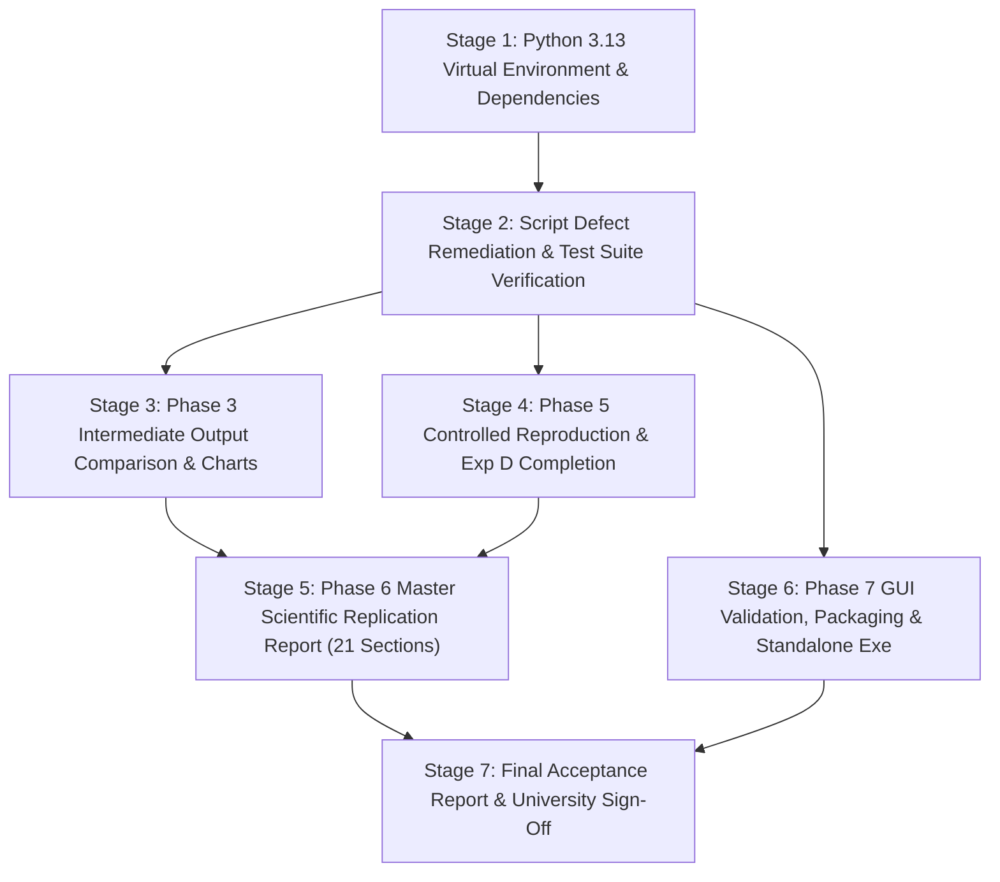

# Remaining Implementation Roadmap
## Agent-OM: Scientific Replication, Local Adaptation & Windows Desktop Application

**Roadmap Date:** 2026-11-15  
**Version:** 1.0 (Post-Audit Implementation Plan)  
**Baseline Document:** `docs/current_implementation_audit.md`  
**Governing Standard:** ASL University Assessment & Scientific Replication Guidelines

---

## 1. Prioritization & Dependency Structure

The roadmap is strictly sequenced so that prerequisite runtimes and bug fixes are completed before generating downstream scientific artifacts, compiling university reports, and packaging the desktop executable.

---

## 2. Detailed Task Breakdown

### Stage 1: Environment & Dependency Provisioning
* **Priority:** Critical (P0) — Blocks all automated execution and testing.
* **Objective:** Establish an isolated Python 3.13 virtual environment containing all required application and GUI dependencies.
* **Actions:**
  1. Initialize `.venv` using `py -3.13 -m venv .venv` under the project root.
  2. Upgrade `pip`, `setuptools`, `wheel`.
  3. Install core dependencies from `requirements.txt` (`rdflib`, `breame`, `pandas`, `numpy`, `psycopg2-binary`, `asyncpg`, `pgvector`, `ollama`, `langchain-core`, `langchain-ollama`, `langchain-text-splitters`, `pyyaml`, `python-dotenv`, `pytest`, `tqdm`, `colorama`).
  4. Install GUI and packaging dependencies: `PySide6>=6.8.0`, `matplotlib>=3.9.0`, `pyinstaller>=6.11.0`.
  5. Verify interpreter version (`Python 3.13.x`) and package inventory.
* **Deliverable:** Active `.venv` capable of executing all test modules and scripts.

---

### Stage 2: Code Quality, Defect Remediation & Regression Testing
* **Priority:** High (P1) — Ensures code reliability before generating reports.
* **Objective:** Resolve identified import defects and run the automated test suite.
* **Actions:**
  1. Fix import paths in `scripts/generate_replication_comparisons_and_charts.py`:
     - Change `from src.matching.reciprocal_merger import ReciprocalMerger` to `from src.matching.merger import ReciprocalMerger`.
     - Change `from src.retrieval.rrf import reciprocal_rank_fusion` to `from src.retrieval.rank_fusion import reciprocal_rank_fusion`.
  2. Ensure test modules cleanly resolve ontology dataset paths using existing entity snapshots or mock fixtures if raw XML files are outside tree.
  3. Execute `.venv\Scripts\python.exe -m pytest tests -v`.
  4. Verify all 17 test modules pass (118+ individual tests).
* **Deliverable:** Clean test execution report with 0 errors and 0 failures.

---

### Stage 3: Phase 3 Intermediate Output Comparison (17 Dimensions)
* **Priority:** High (P1) — Core scientific parity requirement.
* **Objective:** Generate 17-point structural and intermediate comparison data between the upstream baseline (`phase1_cmt_confof_agent_om_lite_v1`) and local parity (`phase5_expC_local_parity_run1`).
* **Actions:**
  1. Execute `scripts/generate_replication_comparisons_and_charts.py` with `.venv`.
  2. Produce comparison artifacts in `output/replication_runs/comparisons/`:
     - `intermediate_comparison_17_points.json`
     - `intermediate_comparison_summary.csv`
     - `prf1_comparison.png`
     - `runtime_and_calls.png`
     - `stage_attrition.png`
     - `threshold_sensitivity.png`
     - `precision_recall_scatter.png`
  3. Author `docs/phase3_intermediate_comparison_report.md` documenting:
     - Entity extraction parity (CMT: 88, ConfOf: 74).
     - Chunking and tokenization behavior.
     - Vector dimensionality and cosine similarity distributions.
     - RRF ranking order and tie-breaking.
     - Score-group validation attrition and prompt formatting parity.
     - Reciprocal merger inner-join equivalence.
* **Deliverable:** `docs/phase3_intermediate_comparison_report.md` and comparison figures.

---

### Stage 4: Phase 5 Controlled Experimental Reproduction & Exp D
* **Priority:** High (P1) — Scientific validation of local adaptations.
* **Objective:** Complete the experimental matrix, including the `local_adapted` profile, threshold sensitivity, and repeatability analysis.
* **Actions:**
  1. Complete `phase5_expD_local_adapted_run1` using `scripts/run_local_replication.py`.
  2. Aggregate cross-experiment results:
     - Upstream Agent-OM-Lite baseline vs Local Parity Run 1 vs Run 2 vs Run 3.
     - Deterministic tool router vs LLM JSON tool router.
     - `upstream_lite_parity` vs `local_adapted` profile.
  3. Compile candidate attrition tables across all pipeline stages (syntactic, lexical, semantic, LLM validation, reciprocal merger).
  4. Author `docs/phase5_experimental_reproduction_report.md`.
* **Deliverable:** `docs/phase5_experimental_reproduction_report.md` with complete statistical tables.

---

### Stage 5: Phase 6 Master Scientific Replication Report (21 Sections)
* **Priority:** Critical (P0) — Primary academic deliverable for university grading.
* **Objective:** Produce the comprehensive, scientifically rigorous final replication report in `docs/final_replication_report.md`.
* **Required 21 Sections:**
  1. Title, Authorship, Affiliation & Academic Context.
  2. Executive Summary & Abstract.
  3. Research Background & Problem Formulation (Ontology Matching & LLMs).
  4. Original Agent-OM Architecture & Siamese Agent Methodology.
  5. Original Research Methodology & Benchmark Analysis (PVLDB 2024 / OAEI).
  6. Upstream Source Repository Audit & Architecture (`qzc438/ontology-llm`).
  7. Local Implementation Architecture (`src/` decomposition).
  8. Python 3.13 Compatibility & Modern Dependency Modernization.
  9. Local Inference Engine (Ollama, `llama3:8b`, `LlamaEmbeddingBridge`).
  10. Database Architecture & Vector Indexing (PostgreSQL & pgvector).
  11. Retrieval Agent Replication (Parsing, Extraction, Chunking, Embedding).
  12. Matching Agent Replication (Multi-source Retrieval, RRF, Validation, Reciprocal Merger).
  13. Algorithmic Parity Analysis & Discrepancy Resolution (DISC-01 through DISC-09).
  14. Experimental Setup & Benchmark Dataset (CMT–ConfOf Conference Track).
  15. Evaluation Methodology, Alignment API Semantics & Metric Definitions.
  16. Upstream Agent-OM-Lite Baseline Results (162 Entities).
  17. Local Parity Reproduction Results & Cross-Run Repeatability.
  18. Intermediate Output Parity Analysis (17 Dimensions).
  19. Ablation Studies (Tool Routing, Validation Prompts, Reciprocal Merger).
  20. Threats to Validity, Hardware Sensitivities & Known Limitations.
  21. Conclusions, Academic Lessons & Future Work.
* **Deliverable:** `docs/final_replication_report.md` with KaTeX formulas, tables, and figure links.

---

### Stage 6: Phase 7 GUI Validation, PyInstaller Packaging & Standalone Exe
* **Priority:** High (P1) — Demonstrable software engineering artifact.
* **Objective:** Verify GUI operation and compile a standalone Windows desktop executable.
* **Actions:**
  1. Author `agent_om.spec` for PyInstaller (`--onedir`), bundling UI assets, configurations, and templates while keeping database and Ollama external.
  2. Execute `scripts/build_exe.ps1` to produce `dist/AgentOM/AgentOM.exe` and `dist/AgentOM.exe`.
  3. Execute automated headless self-test:
     `.\dist\AgentOM\AgentOM.exe --self-test`
  4. Verify that all 10 screens initialize without error outside the development environment.
  5. Update `docs/USER_GUIDE.md` with instructions for launching both source and executable versions.
* **Deliverable:** Verified `dist/AgentOM/AgentOM.exe` passing `--self-test`.

---

### Stage 7: Final Acceptance Report & University Sign-Off
* **Priority:** Medium (P2) — Final project completion certificate.
* **Objective:** Produce `docs/final_acceptance_report.md` auditing all 20 Master Acceptance Criteria.
* **Actions:**
  1. Inspect and verify every acceptance criterion from Section 14 of the Master Specification.
  2. Document SHA-256 digests of all deliverables.
  3. Confirm absolute compliance with filesystem and database rules.
  4. Author `docs/final_acceptance_report.md`.
* **Deliverable:** `docs/final_acceptance_report.md`.

---

## 3. Execution Schedule & Milestones

| Stage | Target Completion | Key Checkpoint | Success Metric |
| :--- | :---: | :--- | :--- |
| **Stage 1: Virtualenv** | Immediate | Active Python 3.13 `.venv` | `python -c "import PySide6, rdflib, langchain_core"` succeeds |
| **Stage 2: Code Quality** | Immediate | Script fix & pytest | `pytest tests/` reports 118+ passed, 0 failed |
| **Stage 3: Phase 3** | Step 3 | 17-point comparisons & charts | 5 PNG charts generated + `phase3_intermediate_comparison_report.md` |
| **Stage 4: Phase 5** | Step 4 | Complete Exp D | Full comparison across Exp C (1-3), Router (det/llm), and Exp D |
| **Stage 5: Phase 6** | Step 5 | Final Scientific Report | Complete 21-section `final_replication_report.md` |
| **Stage 6: Phase 7** | Step 6 | PyInstaller build | `AgentOM.exe --self-test` exits 0 with `screens_verified: 10` |
| **Stage 7: Acceptance** | Step 7 | Final Acceptance Report | `final_acceptance_report.md` verifying all 20 criteria |

