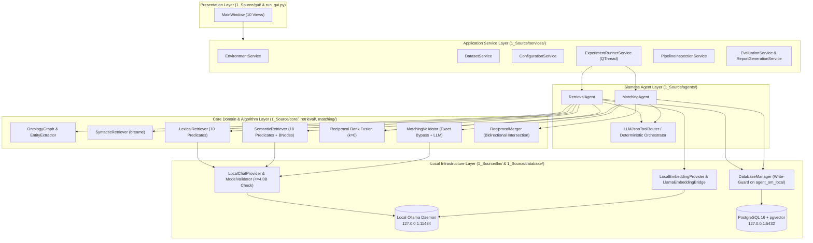
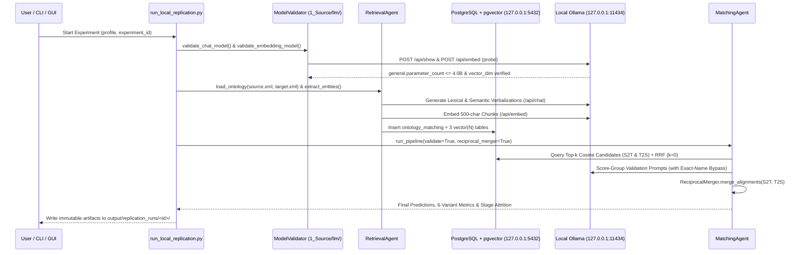

# System Architecture — Agent-OM Local Replication and Desktop Workbench

## 1. Architectural Overview

Agent-OM implements a **Modular Layered and Siamese Agent Architecture**. The system separates user interface presentation (`1_Source/gui/`), application services (`1_Source/services/`), domain agent orchestration (`1_Source/agents/`), retrieval and matching algorithms (`1_Source/retrieval/`, `1_Source/matching/`), local LLM and embedding providers (`1_Source/llm/`), and relational-vector persistence (`1_Source/database/`).

---

## 2. Component Responsibilities and Dependencies

1. **Presentation Layer (`1_Source/gui/views/`, `1_Source/gui/main_window.py`):**
   - Renders 10 screens using `PySide6.QtWidgets` and `matplotlib.backends.backend_qtagg`.
   - Never executes blocking I/O, SQL queries, or HTTP calls directly on the Qt event thread; delegates all long-running runs to `ExperimentRunnerService` (`QThread`).
2. **Service Layer (`1_Source/services/` / `1_Source/gui/services/`):**
   - `EnvironmentService`, `DatabaseService`, and `OllamaService` inspect local loopback sockets and database schemas.
   - `ConfigurationService` validates the 7 profiles (`AppConfig`) and enforces database write protection and strict $\le 4.0\text{B}$ model constraints.
   - `PipelineInspectionService`, `ArtifactComparisonService`, `EvaluationService`, and `ReportGenerationService` load run bundles and compute 17-point comparisons.
3. **Siamese Agent Layer (`1_Source/agents/`):**
   - `RetrievalAgent` coordinates ontology parsing, entity extraction, 3-view representation generation, vector ingestion, and directional candidate retrieval.
   - `MatchingAgent` coordinates directional RRF candidate grouping, exact-name bypasses, score-group LLM validation, and reciprocal alignment merging.
4. **LLM & Embedding Provider Layer (`1_Source/llm/`):**
   - `OllamaClient` manages loopback HTTP calls to `127.0.0.1:11434`.
   - `ModelRegistry` and `ModelValidator` inspect `/api/show` (`general.parameter_count`), block models exceeding $4,000,000,000$ parameters in strict $\le 4\text{B}$ profiles, and probe live embedding dimensions.
5. **Database Layer (`1_Source/database/database_manager.py`):**
   - Manages synchronous `psycopg2` connections with `pgvector` registration, creates `ontology_matching` and the three `vector(N)` chunk tables, executes cosine similarity queries (`1 - (embedding <=> query) >= threshold`), and blocks destructive operations on `agent_om_local`.

---

## 3. End-to-End Execution Data Flow

