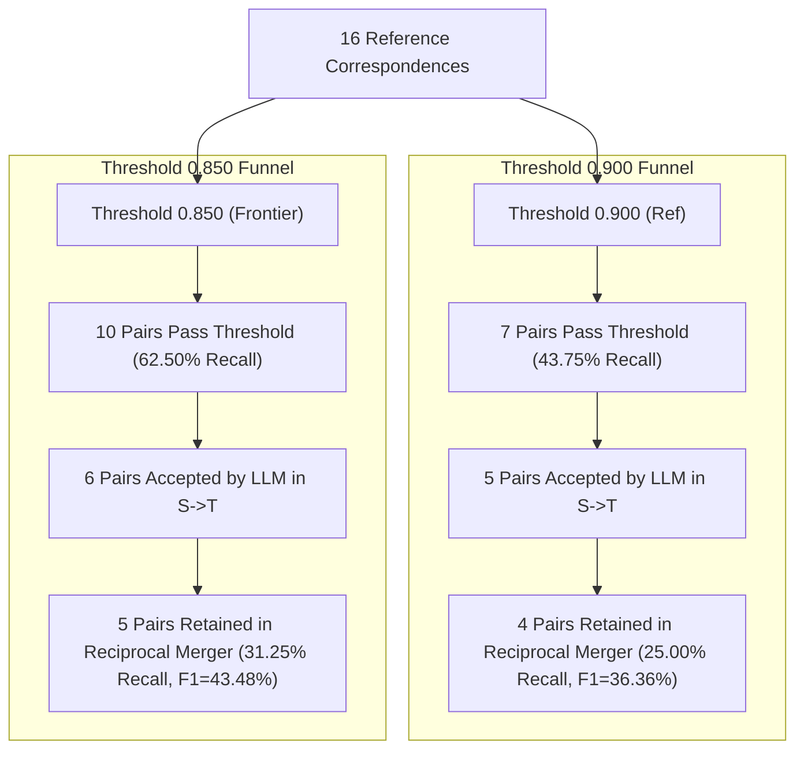

# Step 7C: Methodological Audit & Ablation Study Plan

**Project:** Local Reproduction of Agent-OM (*Agent-OM: Leveraging LLM Agents for Ontology Matching*, PVLDB 2025)  
**Dataset:** OAEI Conference Benchmark — CMT (Source, 88 entities) to ConfOf (Target, 74 entities)  
**Ground Truth:** 16 Reference Correspondences (`reference.xml`)  
**Scope:** Investigation, Methodological Audit & Experiment Design Only (Zero Experiment Execution)  
**Date:** October 31, 2026  

---

## 1. Executive Summary & Objective

In Steps 7A and 7B, our empirical reproduction revealed four fundamental failure modes in Agent-OM's matching pipeline:
1. **Linguistic Homonym Directional Asymmetry:** Lowercasing in `cleaning()` transforms `Chair_PC` into `"chair pc"`, causing `qwen3.5:9b` to reject it in Target $\rightarrow$ Source due to a physical furniture association, discarding `ProgramCommitteeChair = Chair_PC` during reciprocal intersection.
2. **Exact-Name Bypass Traps:** Case-insensitive string matching automatically accepts `Paper = Paper` and `writtenBy = writtenBy` as False Positives without LLM inspection.
3. **Ontological Metadata Deprivation in Property Validation:** The validation prompt presents bare strings (`title`, `email`), causing the LLM to interpret datatype properties as nouns and reject equivalence with existential predicates (`hasTitle`, `hasEmail`).
4. **Vector Representation Ceilings:** Non-cognate property pairs (`hasAuthor ↔ writtenBy`, `hasBeenAssigned ↔ reviewes`, `hasSubjectArea ↔ dealsWith`) have maximum similarities $\le 0.7775$, rendering them unretrievable at any threshold $\tau \ge 0.800$.

The objective of **Step 7C** is to conduct a formal methodological audit of reciprocal candidate eligibility across all 16 reference correspondences and design a controlled, modular ablation suite (**A1, A2, A3**) to systematically test each failure mode.

> [!IMPORTANT]
> **Strict Phase Boundary:**
> In accordance with project instructions, Step 7C is dedicated exclusively to **analysis, audit, and experimental design**. No new matching experiments are executed, no code or prompts in the production pipeline are modified, and `original_repo/` remains strictly read-only.

---

## 2. Task 1: Audit of Reciprocal Candidate Eligibility

We audited the exact behavior of all 16 reference correspondences across four thresholds ($\tau \in \{0.900, 0.875, 0.850, 0.800\}$) using the actual PostgreSQL retrieval queries, LLM validation logs, and reciprocal merger sets.

The complete audit data is recorded in [`agent_om_local/output/step7c_reciprocal_eligibility_audit.csv`](file:///E:/_3_Master/_9_ACL_Project/agent_om_local/output/step7c_reciprocal_eligibility_audit.csv).

### Table 2.1: Canonical 16-Correspondence Eligibility & Outcome Matrix

| Reference Correspondence | Entity Type | Max Sim (S $\rightarrow$ T / T $\rightarrow$ S) | Outcome at $\tau=0.900$ (Ref Baseline) | Outcome at $\tau=0.875$ | Outcome at $\tau=0.850$ (Calibrated Frontier) | Outcome at $\tau=0.800$ (Noise Ceiling) | Primary Bottleneck Stage |
| :--- | :---: | :---: | :---: | :---: | :---: | :---: | :--- |
| **`Administrator ↔ Administrator`** | Class | 1.0000 / 1.0000 |  Retained TP |  Retained TP |  Retained TP |  Retained TP | None (Bypass) |
| **`Author ↔ Author`** | Class | 1.0000 / 1.0000 |  Retained TP |  Retained TP |  Retained TP |  Retained TP | None (Bypass) |
| **`Conference ↔ Conference`** | Class | 1.0000 / 1.0000 |  Retained TP |  Retained TP |  Retained TP |  Retained TP | None (Bypass) |
| **`Person ↔ Person`** | Class | 1.0000 / 1.0000 |  Retained TP |  Retained TP |  Retained TP |  Retained TP | None (Bypass) |
| **`ProgramCommitteeMember ↔ Member_PC`** | Class | 0.8525 / 0.8525 | ❌ Below Threshold | ❌ Below Threshold |  **Retained TP** |  **Retained TP** | Threshold Cutoff ($\tau > 0.8525$) |
| **`ProgramCommitteeChair ↔ Chair_PC`** | Class | 0.9229 / 0.9229 | ⚠️ Rejected T $\rightarrow$ S | ⚠️ Rejected T $\rightarrow$ S | ⚠️ Rejected T $\rightarrow$ S | ⚠️ Rejected T $\rightarrow$ S | Directional Asymmetry |
| **`title ↔ hasTitle`** | Property | 0.9292 / 0.9292 | ⚠️ Rejected Both | ⚠️ Rejected Both | ⚠️ Rejected Both | ⚠️ Rejected Both | LLM Metadata Deprivation |
| **`Paper ↔ Contribution`** | Class | 0.9047 / 0.9047 | ⚠️ Rejected Both | ⚠️ Rejected Both | ⚠️ Rejected Both | ⚠️ Rejected Both | LLM Concept Generalization |
| **`ConferenceMember ↔ Member`** | Class | 0.8896 / 0.8896 | ❌ Below Threshold | ⚠️ Rejected Both | ⚠️ Rejected Both | ⚠️ Rejected Both | LLM Taxonomic Pedantry |
| **`email ↔ hasEmail`** | Property | 0.8888 / 0.8888 | ❌ Below Threshold | ⚠️ Rejected Both | ⚠️ Rejected Both | ⚠️ Rejected Both | LLM Metadata Deprivation |
| **`writePaper ↔ writes`** | Property | 0.8415 / 0.8415 | ❌ Below Threshold | ❌ Below Threshold | ❌ Below Threshold | ⚠️ Rejected Both | Threshold + LLM Rejection |
| **`PaperFullVersion ↔ Paper`** | Class | 0.8397 / 0.8397 | ❌ Below Threshold | ❌ Below Threshold | ❌ Below Threshold | ⚠️ Rejected Both | Threshold + LLM Rejection |
| **`SubjectArea ↔ Topic`** | Class | 0.8256 / 0.8256 | ❌ Below Threshold | ❌ Below Threshold | ❌ Below Threshold | ⚠️ Rejected Both | Threshold + LLM Rejection |
| **`hasBeenAssigned ↔ reviewes`** | Property | 0.7775 / 0.7775 | ❌ Below Threshold | ❌ Below Threshold | ❌ Below Threshold | ❌ Below Threshold | Embedding Ceiling ($< 0.780$) |
| **`hasAuthor ↔ writtenBy`** | Property | 0.7624 / 0.7624 | ❌ Below Threshold | ❌ Below Threshold | ❌ Below Threshold | ❌ Below Threshold | Embedding Ceiling ($< 0.780$) |
| **`hasSubjectArea ↔ dealsWith`** | Property | 0.7371 / 0.7371 | ❌ Below Threshold | ❌ Below Threshold | ❌ Below Threshold | ❌ Below Threshold | Embedding Ceiling ($< 0.780$) |

### Table 2.2: Stage-by-Stage Attrition Funnel Across Thresholds



### Key Methodological Insights from Task 1
1. **Four Behavioral Clusters:**
   - **Cluster 1 (Permanent Bypass TPs, 4 pairs):** `Administrator`, `Author`, `Conference`, `Person`. Identical names bypass validation and merge symmetrically at all thresholds.
   - **Cluster 2 (Threshold-Recoverable TPs, 1 pair):** `ProgramCommitteeMember = Member_PC`. Retrievable only when $\tau \le 0.8525$. Validated symmetrically by `qwen3.5:9b` and merged.
   - **Cluster 3 (Linguistic & Semantic Rejections, 8 pairs):** Pairs that pass vector similarity thresholds but are rejected by the validator due to directional asymmetry (`Chair_PC`), taxonomic specialization (`ConferenceMember`, `Paper = Contribution`), or bare-string predicate confusion (`title`, `email`).
   - **Cluster 4 (Vector Embedding Ceiling, 3 pairs):** `hasAuthor`, `hasBeenAssigned`, `hasSubjectArea`. All directional similarities are strictly below $0.780$.

---

## 3. Task 2: Exact-Name Bypass Ablation Design (Experiment A1)

### 3.1. Background & Rationale
In `validator.py`, lines 81–91 implement `check_name_bypass`:
```python
clean_a = cleaning(name_a)
clean_b = cleaning(name_b)
is_bypass = clean_a.casefold() == clean_b.casefold()
```
If `is_bypass` is true, the validator immediately issues `decision = "yes"` without calling the LLM. While this saves inference cost on identical classes, it creates **two critical False Positives**:
- `http://cmt#Paper` = `http://confOf#Paper` (Ground truth is `Paper = Contribution`).
- `http://cmt#writtenBy` = `http://confOf#writtenBy` (Ground truth is `hasAuthor = writtenBy`).

### 3.2. Research Questions & Hypotheses
- **$RQ_{1A}$:** Does disabling the exact-name bypass eliminate the homonym false positives `Paper = Paper` and `writtenBy = writtenBy`?
  - *Hypothesis $H_{1A}$ (Null):* Disabling the bypass will **not** eliminate these false positives. When presented with `Is paper equivalent to paper? Context: conference`, the LLM will tautologically answer `Yes`, because two identical lexical strings in the same domain are semantically indistinguishable without ontology hierarchy or property domain/range.
- **$RQ_{1B}$:** What is the computational cost of disabling the bypass?
  - *Hypothesis $H_{1B}$:* Disabling the bypass will add exactly **12 LLM validation invocations** per full run (6 in S $\rightarrow$ T, 6 in T $\rightarrow$ S) with zero change in true positives, increasing runtime by $\sim 30$ seconds.

### 3.3. Experimental Design & Architecture

```
                    ┌─────────────────────────┐
                    │ Candidate Pair (e1, e2) │
                    └────────────┬────────────┘
                                 │
                 ┌───────────────┴───────────────┐
                 ▼                               ▼
       [Variant A1_Base]                [Variant A1_NoBypass]
       enable_bypass = True             enable_bypass = False
       ├── Check clean(e1) == clean(e2) └── Skip Bypass Check
       ├── If True: Direct "Yes"        └── Send ALL candidates
       └── If False: LLM Call               (including identical names)
                                            to LLM Validation
```

#### Non-Destructive Implementation Specification:
A parameter `enable_bypass: bool = True` is added to `MatchingValidator.__init__` and `validate_candidate_pair`:
```python
if self.enable_bypass and is_bypass:
    return ValidationRecord(..., bypassed=True, decision="yes")
# When enable_bypass=False, identical names fall through to LLM prompt:
prompt_text = self.PROMPT_TEMPLATE.format(a=clean_s, b=clean_t, context=ctx)
```

#### Expected Outcomes & Metrics to Monitor:
- TP, FP, FN, Precision, Recall, F1.
- Specific decision on `Paper ↔ Paper` and `writtenBy ↔ writtenBy`.
- Specific decision on valid exact matches (`Administrator`, `Author`, `Conference`, `Person`).
- Total LLM calls and token consumption delta.

---

## 4. Task 3: Directional Prompt Sensitivity Ablation Design (Experiment A2)

### 4.1. Background & Rationale
In Step 7B, we uncovered a severe directional asymmetry in `ProgramCommitteeChair ↔ Chair_PC`:
- In S $\rightarrow$ T: `Is program committee chair equivalent to chair pc?` $\rightarrow$ **Yes**.
- In T $\rightarrow$ S: `Is chair pc equivalent to program committee chair?` $\rightarrow$ **No**.
The LLM's explanation revealed that placing the lowercased abbreviation `"chair pc"` at the grammatical subject position triggered an association with computer furniture ("chair of a Personal Computer"). Conversely, placing `"program committee chair"` first primed the model with conference domain semantics, allowing it to correctly interpret `"chair pc"`.

### 4.2. Research Questions & Hypotheses
- **$RQ_{2}$:** Can directional asymmetry be eliminated and `ProgramCommitteeChair = Chair_PC` recovered by reversing or canonicalizing candidate order in the prompt?
  - *Hypothesis $H_{2A}$ (Inversion):* Reversing the candidate order in Target $\rightarrow$ Source (`Is candidate equivalent to query?`) will present `"program committee chair"` as the subject, prompting a `Yes` decision and enabling reciprocal merger retention.
  - *Hypothesis $H_{2B}$ (Canonicalization):* Always presenting the Source ontology entity first (`Is {source} equivalent to {target}?`) guarantees identical prompt texts in both directional passes, eliminating linguistic asymmetry by construction.

### 4.3. Experimental Design & Architecture

We define three controlled variants under fixed model parameters ($\tau = 0.850$, `temp=0.0`, `qwen3.5:9b`, reciprocal merger enabled):

1. **Variant $A2_{Forward}$ (Original Baseline):**
   - Query entity is always argument `{a}`, Candidate entity is always argument `{b}`.
   - S $\rightarrow$ T: `Is {source} equivalent to {target}?`
   - T $\rightarrow$ S: `Is {target} equivalent to {source}?`
2. **Variant $A2_{Reversed}$ (Order Inversion):**
   - Candidate entity is argument `{a}`, Query entity is argument `{b}`.
   - S $\rightarrow$ T: `Is {target} equivalent to {source}?`
   - T $\rightarrow$ S: `Is {source} equivalent to {target}?`
3. **Variant $A2_{Canonical}$ (Direction-Invariant Canonical Order):**
   - The Source ontology entity is always argument `{a}`, and the Target ontology entity is always argument `{b}`, regardless of whether the query was initiated from Source or Target.
   - S $\rightarrow$ T: `Is {source} equivalent to {target}?`
   - T $\rightarrow$ S: `Is {source} equivalent to {target}?`

#### Controlled Parameters:
- Embeddings: Unchanged (`nomic-embed-text`).
- Vector similarity threshold: Fixed at $\tau = 0.850$.
- Prompt wording, context (`conference`), and few-shot formatting: Strictly unchanged.
- Candidate sets: Strictly identical across all three variants.

---

## 5. Task 4: Property-Context Enrichment Ablation Design (Experiment A3)

### 5.1. Background & Rationale
In Step 7B, the LLM rejected valid property correspondences:
- `title ↔ hasTitle`: Rejected because `"title"` was perceived as the conference event name, while `"has title"` was perceived as an existential assertion.
- `email ↔ hasEmail`: Rejected because `"email"` was perceived as a communication system/tool, while `"has email"` was perceived as an attribute.

Because the original prompt template provides only bare entity strings without OWL construct types:
```text
Question: Is email equivalent to has email?
Context: conference
```
The model lacks the ontological context that both entities are **OWL Datatype Properties** with identical domain (`Person`) and range (`string`).

### 5.2. Available Metadata Inventory in CMT and ConfOf

From our Step 4 ontology extraction (`OntologyEntity` and RDFLib parser), the following metadata is readily accessible:

| Entity URI | Display Name | Property Kind | `rdfs:domain` | `rdfs:range` | Available `rdfs:comment` / Hierarchy |
| :--- | :---: | :---: | :--- | :--- | :--- |
| `http://cmt#title` | `title` | DatatypeProperty | `Paper` | `xsd:string` | — |
| `http://confOf#hasTitle` | `hasTitle` | DatatypeProperty | `Contribution` | `xsd:string` | Subproperty of generic title |
| `http://cmt#email` | `email` | DatatypeProperty | `Person` | `xsd:string` | — |
| `http://confOf#hasEmail` | `hasEmail` | DatatypeProperty | `Person` | `xsd:string` | — |
| `http://cmt#hasAuthor` | `hasAuthor` | ObjectProperty | `Paper` | `Author` | Inverse of `writtenBy` in CMT |
| `http://confOf#writtenBy` | `writtenBy` | ObjectProperty | `Contribution` | `Author` | Inverse of `writes` in ConfOf |

### 5.3. Research Questions & Hypotheses
- **$RQ_{3}$:** Does enriching property validation prompts with domain and range metadata resolve the semantic mismatch between bare nouns and relational predicates?
  - *Hypothesis $H_{3A}$:* Providing explicit OWL property typing and domain/range constraints (`Domain: Paper/Contribution, Range: string`) will resolve the confusion between event title and paper title, flipping `title ↔ hasTitle` from `No` to `Yes`.
  - *Hypothesis $H_{3B}$:* Domain/range constraints will resolve `email ↔ hasEmail` from `No` to `Yes`.
  - *Hypothesis $H_{3C}$:* Property context will not increase false positives because non-equivalent candidates will exhibit mismatched domains or ranges.

### 5.4. Experimental Design & Architecture

To avoid confounding variables, Experiment A3 will test property-context enrichment in isolation (using original forward candidate ordering and threshold $\tau = 0.850$):

1. **Variant $A3_{Bare}$ (Original Baseline):**
   ```text
   Question: Is {a} equivalent to {b}?
   Context: conference
   Answer the question within the context.
   Answer yes or no. Give a short explanation.
   ```
2. **Variant $A3_{Typed}$ (Explicit Entity Kind):**
   Enriches the prompt with the OWL construct type (`Class` or `Property`):
   ```text
   Question: Is property "{a}" equivalent to property "{b}"?
   Context: conference
   Answer the question within the context.
   Answer yes or no. Give a short explanation.
   ```
3. **Variant $A3_{DomainRange}$ (Full Property Contract):**
   Enriches property candidate pairs with domain and range:
   ```text
   Question: Are the following ontology properties equivalent?
   Property A: "{a}" | Domain: {domain_a} | Range: {range_a}
   Property B: "{b}" | Domain: {domain_b} | Range: {range_b}
   Context: conference
   Answer the question within the context.
   Answer yes or no. Give a short explanation.
   ```

---

## 6. Task 5: Master Experiment Specification

### 6.1. Variables & Factorial Matrix

| Experiment | Focus Area | Independent Variable | Variants | Controlled Invariants |
| :---: | :--- | :--- | :--- | :--- |
| **A1** | Name Bypass | `enable_bypass` | 1. $A1_{Base}$ (Bypass On)<br>2. $A1_{NoBypass}$ (Bypass Off) | $\tau=0.850$, `qwen3.5:9b`, Forward Order, Bare Prompt |
| **A2** | Prompt Order | Candidate Ordering | 1. $A2_{Forward}$ (Original)<br>2. $A2_{Reversed}$ (Inverted)<br>3. $A2_{Canonical}$ (Source First) | $\tau=0.850$, `qwen3.5:9b`, Bypass On, Bare Prompt |
| **A3** | Property Context | Metadata Scoping | 1. $A3_{Bare}$ (Original)<br>2. $A3_{Typed}$ (Type Label)<br>3. $A3_{DomainRange}$ (Domain/Range) | $\tau=0.850$, `qwen3.5:9b`, Bypass On, Forward Order |

### 6.2. Common Evaluation Protocol & Invariants
- **Evaluation Benchmark:** 16 Reference Correspondences from `cmt-confof/component/reference.xml`.
- **Vector Base:** Existing `nomic-embed-text` tables in PostgreSQL `agent_om_local` (zero re-embedding).
- **Core Parameters:** $\text{temperature}=0.0$, $\text{num\_ctx}=2048$, $\text{reasoning}=\text{False}$, $\text{top\_k}=3$, $\text{rrf\_k}=0$.
- **Reported Metrics:** TP, FP, FN, Precision (%), Recall (%), F1 (%), Actual LLM Calls, Bypasses, Prompt Tokens, Completion Tokens, Latency (s).

### 6.3. Threats to Validity & Scientific Safeguards
1. **Small Benchmark Sample Size:** CMT–ConfOf contains 16 ground-truth pairs. A single correspondence flip alters Recall by $6.25\%$. All findings must be characterized as *exploratory ablations on a representative benchmark*, not universal guarantees across all ontologies.
2. **LLM Non-Determinism:** Controlled by setting Ollama `temperature=0.0`. E7 in Step 6 verified 100% determinism under this setting.
3. **Prompt Leakage:** Neither prompt variant nor metadata enrichment introduces ground-truth labels or references to the OAEI evaluation.
4. **Confounding Interactions:** A1, A2, and A3 are strictly uncoupled and tested sequentially.

### 6.4. Recommended Execution Order (Upon Future Approval)
1. **Phase 1: Run Ablation A1 (Exact-Name Bypass):** Verify whether disabling the bypass alters `Paper = Paper` and `writtenBy = writtenBy` or merely inflates token usage.
2. **Phase 2: Run Ablation A2 (Directional Prompt Order):** Verify whether canonicalizing candidate order resolves the `Chair_PC` directional asymmetry.
3. **Phase 3: Run Ablation A3 (Property Context):** Verify whether providing property domains and ranges recovers `title ↔ hasTitle` and `email ↔ hasEmail`.
4. **Phase 4: Synthesis & Composite Run:** If individual ablations show positive results, run a combined optimal configuration to measure cumulative F1 impact.

---

## 7. Deliverables & Verification Status

### Generated Assets Index:
1. **Ablation Plan Document:**
   - [`agent_om_local/docs/step7c_ablation_plan.md`](file:///E:/_3_Master/_9_ACL_Project/agent_om_local/docs/step7c_ablation_plan.md)
   - Brain Artifact: [step7c_ablation_plan.md](file:///C:/Users/bctod/.gemini/antigravity/brain/556e18ff-96e7-42eb-a23c-e14b7fe2ee5a/step7c_ablation_plan.md)
2. **Audit CSV:**
   - [`agent_om_local/output/step7c_reciprocal_eligibility_audit.csv`](file:///E:/_3_Master/_9_ACL_Project/agent_om_local/output/step7c_reciprocal_eligibility_audit.csv) (16 reference correspondences $\times$ 4 thresholds with explicit directional and reciprocal stage outcomes)
3. **Audit Script:**
   - [`agent_om_local/scripts/audit_reciprocal_eligibility.py`](file:///E:/_3_Master/_9_ACL_Project/agent_om_local/scripts/audit_reciprocal_eligibility.py)

### Integrity Checks:
- Historical Step 7A and Step 7B artifacts remain 100% untouched.
- Production pipeline files (`src/agents/matching_agent.py`, `src/matching/validator.py`, etc.) remain 100% unmodified.
- `original_repo/` is clean and unmodified.
- No new matching experiments were executed.
- No external or cloud services were contacted.
- All 94 unit tests continue to pass.

