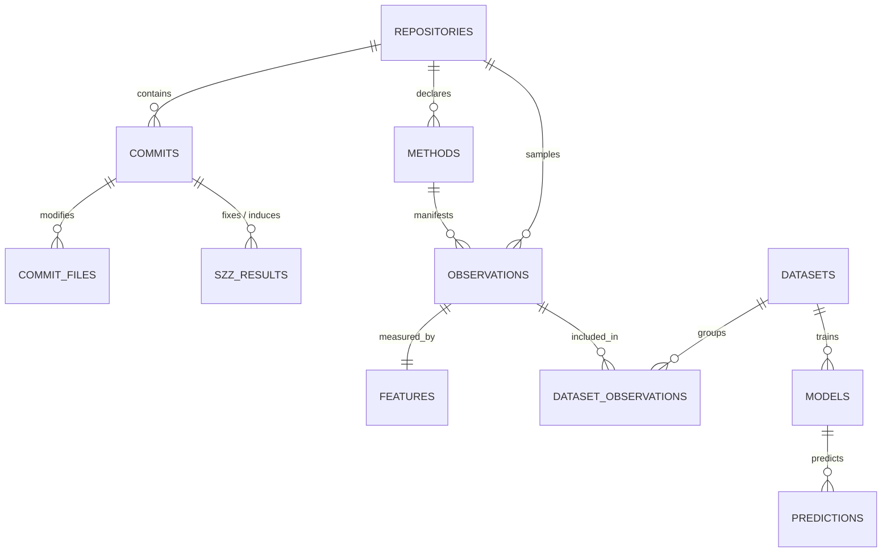

# SQLite Database Schema Specification

**Database File:** `1_Database/SQLite/bug_detection.db`  
**Engine:** SQLite 3 (WAL mode enabled, Foreign Key enforcement active)  
**System:** CISE Project 2 — Machine Learning-Based Software Defect Prediction for C# Source Code  

---

## 1. Relational Entity Overview



---

## 2. Table Definitions

### 2.1 `repositories`
Tracks target open-source C# repositories mined from GitHub.

| Column | Type | Constraints | Description |
| :--- | :--- | :--- | :--- |
| `id` | `INTEGER` | PRIMARY KEY AUTOINCREMENT | Unique repository identifier |
| `full_name` | `TEXT` | UNIQUE NOT NULL | GitHub `owner/repo` path (e.g. `App-vNext/Polly`) |
| `name` | `TEXT` | NOT NULL | Short repository name |
| `owner` | `TEXT` | NOT NULL | Repository owner or organization |
| `url` | `TEXT` | NOT NULL | HTTPS clone URL |
| `description` | `TEXT` | | Project description |
| `license` | `TEXT` | | Software license (e.g. Apache-2.0, MIT) |
| `default_branch` | `TEXT` | DEFAULT 'main' | Primary git branch |
| `stars` | `INTEGER` | DEFAULT 0 | GitHub stargazers count |
| `forks` | `INTEGER` | DEFAULT 0 | Fork count |
| `size_kb` | `INTEGER` | DEFAULT 0 | Repository size in KB |
| `is_cloned` | `INTEGER` | DEFAULT 0 | 1 if cloned locally, 0 otherwise |
| `local_path` | `TEXT` | | Relative directory path on disk |
| `status` | `TEXT` | DEFAULT 'registered' | Pipeline state: `registered`, `cloning`, `cloned`, `failed`, `updated` |
| `last_sync_at` | `TIMESTAMP` | | Last git fetch/pull timestamp |
| `collected_at` | `TIMESTAMP` | DEFAULT CURRENT_TIMESTAMP | Initial registration timestamp |
| `updated_at` | `TIMESTAMP` | DEFAULT CURRENT_TIMESTAMP | Last record modification timestamp |

### 2.2 `commits`
Stores commit log metadata and heuristic bug-fix classification results.

| Column | Type | Constraints | Description |
| :--- | :--- | :--- | :--- |
| `id` | `INTEGER` | PRIMARY KEY AUTOINCREMENT | Unique commit record identifier |
| `repository_id` | `INTEGER` | NOT NULL, FK -> `repositories(id)` | Parent repository |
| `commit_sha` | `TEXT` | NOT NULL | Full 40-character git commit SHA-1 |
| `parent_sha` | `TEXT` | | Primary parent commit SHA-1 |
| `parent_shas` | `TEXT` | | JSON list of all parent commit SHAs |
| `author_name` | `TEXT` | | Author name |
| `author_email` | `TEXT` | | Author email address |
| `committed_date` | `TIMESTAMP` | | Author commit timestamp |
| `committer_date` | `TIMESTAMP` | | Committer timestamp |
| `message` | `TEXT` | | Full commit message text |
| `files_changed_count` | `INTEGER` | DEFAULT 0 | Total number of modified files |
| `insertions` | `INTEGER` | DEFAULT 0 | Total lines added |
| `deletions` | `INTEGER` | DEFAULT 0 | Total lines deleted |
| `modifies_csharp` | `INTEGER` | DEFAULT 0 | 1 if commit touches `.cs` files |
| `is_bug_fix` | `INTEGER` | DEFAULT 0 | 1 if commit matches bug-fixing regex patterns |
| `bug_fix_confidence` | `REAL` | DEFAULT 0.0 | Confidence score in $[0.0, 1.0]$ |
| `bug_fix_evidence` | `TEXT` | | JSON metadata of regex match groups and issue references |
| `analyzed_at` | `TIMESTAMP` | | Timestamp of bug-fix detection analysis |

### 2.3 `commit_files`
Granular file modifications per commit.

| Column | Type | Constraints | Description |
| :--- | :--- | :--- | :--- |
| `id` | `INTEGER` | PRIMARY KEY AUTOINCREMENT | Unique record identifier |
| `commit_id` | `INTEGER` | NOT NULL, FK -> `commits(id)` | Parent commit |
| `file_path` | `TEXT` | NOT NULL | Relative path inside the repository |
| `change_type` | `TEXT` | NOT NULL | Git status: `A` (added), `M` (modified), `D` (deleted), `R` (renamed) |
| `insertions` | `INTEGER` | DEFAULT 0 | Lines inserted in file |
| `deletions` | `INTEGER` | DEFAULT 0 | Lines deleted in file |
| `is_csharp` | `INTEGER` | DEFAULT 0 | 1 if file passes production C# filter |

### 2.4 `szz_results`
Traces bug-fixing deletions back to Bug-Inducing Commits (BICs) via git blame.

| Column | Type | Constraints | Description |
| :--- | :--- | :--- | :--- |
| `id` | `INTEGER` | PRIMARY KEY AUTOINCREMENT | Unique trace record identifier |
| `repository_id` | `INTEGER` | NOT NULL, FK -> `repositories(id)` | Parent repository |
| `fixing_commit_sha` | `TEXT` | NOT NULL | Bug-fixing commit hash |
| `inducing_commit_sha`| `TEXT` | NOT NULL | Bug-inducing commit hash identified by blame |
| `file_path` | `TEXT` | NOT NULL | Production source file path |
| `deleted_line_number`| `INTEGER` | | Line number deleted in fixing commit |
| `deleted_line_content`| `TEXT` | | Deleted source line content |
| `inducing_line_number`| `INTEGER` | | Line number blamed in inducing commit |
| `confidence` | `REAL` | DEFAULT 1.0 | SZZ heuristic attribution confidence |
| `evidence` | `TEXT` | | Blame command flags and whitespace normalization details |
| `created_at` | `TIMESTAMP` | DEFAULT CURRENT_TIMESTAMP | Extraction timestamp |

### 2.5 `methods`
Method inventory extracted across mined revisions.

| Column | Type | Constraints | Description |
| :--- | :--- | :--- | :--- |
| `id` | `INTEGER` | PRIMARY KEY AUTOINCREMENT | Unique method identifier |
| `repository_id` | `INTEGER` | NOT NULL, FK -> `repositories(id)` | Parent repository |
| `file_path` | `TEXT` | NOT NULL | Path to containing `.cs` file |
| `class_name` | `TEXT` | NOT NULL | Name of declaring class or struct |
| `method_name` | `TEXT` | NOT NULL | Identifier name of the method |
| `method_signature` | `TEXT` | NOT NULL | Complete signature with parameter types |
| `start_line` | `INTEGER` | | 1-based start line number in file |
| `end_line` | `INTEGER` | | 1-based end line number in file |
| `is_static` | `INTEGER` | DEFAULT 0 | Boolean flag (1/0) |
| `is_async` | `INTEGER` | DEFAULT 0 | Boolean flag (1/0) |
| `is_generic` | `INTEGER` | DEFAULT 0 | Boolean flag (1/0) |
| `visibility` | `TEXT` | DEFAULT 'private' | `public`, `internal`, `protected`, or `private` |

### 2.6 `observations`
The core ground-truth table pairing extracted C# method source code with defect labels.

| Column | Type | Constraints | Description |
| :--- | :--- | :--- | :--- |
| `id` | `INTEGER` | PRIMARY KEY AUTOINCREMENT | Unique observation identifier |
| `method_id` | `INTEGER` | FK -> `methods(id)` | Optional link to method catalog |
| `repository_id` | `INTEGER` | NOT NULL, FK -> `repositories(id)` | Source repository |
| `commit_sha` | `TEXT` | NOT NULL | Commit SHA where method was sampled |
| `parent_sha` | `TEXT` | | Pre-fix parent commit SHA (for Label 1) |
| `bug_fix_commit_sha`| `TEXT` | | Fixing commit SHA (for Label 1) |
| `file_path` | `TEXT` | NOT NULL | Source file relative path |
| `class_name` | `TEXT` | NOT NULL | Class name |
| `method_name` | `TEXT` | NOT NULL | Method name |
| `method_signature` | `TEXT` | NOT NULL | Full method signature |
| `source_code` | `TEXT` | NOT NULL | Verbatim C# method body |
| `corrected_code` | `TEXT` | | Post-fix version of method body (if available) |
| `label` | `INTEGER` | NOT NULL | `1` = Buggy, `0` = Candidate Non-Buggy, `-1` = Uncertain |
| `label_confidence` | `REAL` | DEFAULT 1.0 | Label confidence score |
| `evidence_category`| `TEXT` | NOT NULL | Category: `szz_bic`, `stable_version`, `manual_audit` |
| `bug_fixing_commit_message` | `TEXT` | | Commit message of the associated bug fix |
| `issue_or_pr_url` | `TEXT` | | Associated issue tracker URL (if detected) |
| `created_at` | `TIMESTAMP` | DEFAULT CURRENT_TIMESTAMP | Record creation timestamp |

### 2.7 `features`
The 26 Roslyn-extracted static code metrics associated 1:1 with each observation.

| Column | Type | Constraints | Metric Family | Description |
| :--- | :--- | :--- | :--- | :--- |
| `id` | `INTEGER` | PRIMARY KEY AUTOINCREMENT | - | Unique feature record |
| `observation_id` | `INTEGER` | UNIQUE NOT NULL, FK -> `observations(id)` | - | Associated observation |
| `loc` | `INTEGER` | | Size | Physical lines of code |
| `method_length` | `INTEGER` | | Size | Character span of method declaration |
| `num_statements` | `INTEGER` | | Size | Count of executable statements |
| `num_parameters` | `INTEGER` | | Size | Number of formal parameters |
| `num_local_vars` | `INTEGER` | | Size | Number of local variable declarations |
| `num_returns` | `INTEGER` | | Structural | Count of `return` statements |
| `num_assignments` | `INTEGER` | | Structural | Assignment operators count |
| `cyclomatic_complexity` | `INTEGER` | | Complexity | McCabe cyclomatic complexity $M = \pi + 1$ |
| `max_nesting_depth`| `INTEGER` | | Complexity | Deepest lexical nesting level of blocks |
| `num_conditionals`| `INTEGER` | | Complexity | Number of `if` and `switch` statements |
| `num_boolean_expressions` | `INTEGER`| | Complexity | Boolean operators (`&&`, `\|\|`, `!`) |
| `num_logical_operators` | `INTEGER`| | Complexity | Bitwise/logical operators (`&`, `\|`, `^`) |
| `num_loops` | `INTEGER` | | Complexity | `for`, `foreach`, `while`, `do-while` count |
| `num_try_catch` | `INTEGER` | | Exception | Exception handling blocks |
| `num_throw` | `INTEGER` | | Exception | Explicit `throw` statements |
| `num_method_calls`| `INTEGER` | | Coupling | Invocations of member/static methods |
| `num_field_references` | `INTEGER`| | Coupling | Field identifier accesses |
| `num_property_references` | `INTEGER` | | Coupling | Property getter/setter accesses |
| `is_static` | `INTEGER` | DEFAULT 0 | OOP Flag | 1 if declared with `static` keyword |
| `is_async` | `INTEGER` | DEFAULT 0 | OOP Flag | 1 if declared with `async` keyword |
| `is_generic` | `INTEGER` | DEFAULT 0 | OOP Flag | 1 if method declares generic type parameters |
| `num_comments` | `INTEGER` | DEFAULT 0 | Documentation | Comments within method body |
| `num_lambdas` | `INTEGER` | DEFAULT 0 | Functional | Lambda expressions and anonymous delegates |
| `num_linq_operations` | `INTEGER` | DEFAULT 0 | Functional | LINQ query comprehension and chaining |
| `raw_metrics_json`| `TEXT` | | Raw Output | JSON dictionary of analyzer output |
| `extracted_at` | `TIMESTAMP` | DEFAULT CURRENT_TIMESTAMP | - | Extraction timestamp |

### 2.8 `datasets`, `dataset_observations`, `models`, `predictions`
Versioned snapshots, training registry, and live inference logs.

- **`datasets`**: Defines exported datasets (`name`, `version`, `total_count`, `buggy_count`, `non_buggy_count`, `feature_names`, `export_path`).
- **`dataset_observations`**: Many-to-many junction table between `datasets` and `observations`.
- **`models`**: Tracks serialized models (`name`, `algorithm`, `parameters_json`, `metrics_json`, `feature_names_json`, `model_file_path`).
- **`predictions`**: Persists real-time predictions executed via UI or CLI (`model_name`, `method_name`, `metrics_json`, `predicted_label`, `risk_score`, `risk_category`).

---

## 3. Database Indexes

```sql
CREATE INDEX idx_commits_repo ON commits(repository_id);
CREATE INDEX idx_commits_sha ON commits(commit_sha);
CREATE INDEX idx_commits_bugfix ON commits(is_bug_fix);
CREATE INDEX idx_commit_files_commit ON commit_files(commit_id);
CREATE INDEX idx_szz_fixing ON szz_results(fixing_commit_sha);
CREATE INDEX idx_szz_inducing ON szz_results(inducing_commit_sha);
CREATE INDEX idx_observations_repo ON observations(repository_id);
CREATE INDEX idx_observations_label ON observations(label);
CREATE INDEX idx_observations_commit ON observations(commit_sha);
CREATE INDEX idx_features_obs ON features(observation_id);
CREATE INDEX idx_predictions_model ON predictions(model_id);
CREATE INDEX idx_predictions_created ON predictions(created_at);
```

