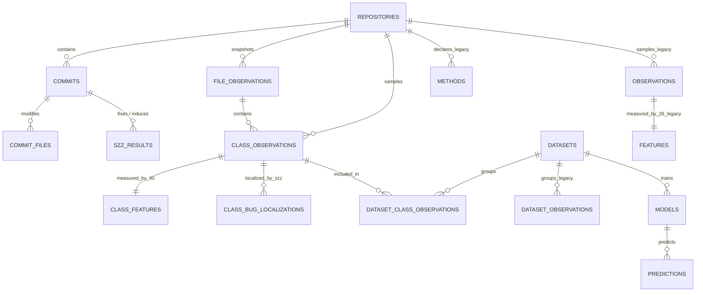

# SQLite Database Schema Specification (v4.0.0)

**Database File:** `1_Database/SQLite/bug_detection.db`  
**Engine:** SQLite 3 (WAL mode enabled, Foreign Key enforcement active)  
**System:** CISE Project 2 — Machine Learning-Based C# Bug Detection Classifier  

---

## 1. Relational Entity Overview



---

## 2. Primary Class/File-Level, Localization & Collection Tables

### 2.1 `repositories` (`246` rows in live DB)
Tracks discovered, selected, excluded, and processed open-source C# repositories.

| Column | Type | Constraints | Description |
| :--- | :--- | :--- | :--- |
| `id` | `INTEGER` | PRIMARY KEY AUTOINCREMENT | Unique repository identifier |
| `full_name` | `TEXT` | UNIQUE NOT NULL | GitHub `owner/repo` slug |
| `name` / `owner` / `url` | `TEXT` | NOT NULL | Repository identity and clone URL |
| `description` / `license` / `language` | `TEXT` | | Description, SPDX license identifier, and primary GitHub language (`C#`) |
| `default_branch` | `TEXT` | DEFAULT 'main' | Primary git branch |
| `stars` / `forks` / `size_kb` | `INTEGER` | DEFAULT 0 | Popularity and repository size metrics |
| `is_cloned` / `local_path` / `status` | `INTEGER` / `TEXT` | | Local clone tracking and pipeline state (`registered`, `cloned`, `synced`, `processed`, `excluded`, `failed`) |
| `selection_score` / `selection_rank` | `REAL` / `INTEGER` | | Discovery star ranking score and rank |
| `selection_reason` / `exclusion_reason` | `TEXT` | | Explicit audit rationale for inclusion or exclusion |
| `is_selected` / `is_fork` / `is_archived` | `INTEGER` | DEFAULT 0/1 | Selection and GitHub status flags |
| `pushed_at` / `created_at_gh` | `TEXT` | | GitHub activity timestamps |
| `production_cs_files_count` / `commits_mined_count` / `bug_fixes_count` / `szz_traces_count` / `class_observations_count` | `INTEGER` | DEFAULT 0 | Per-repository mining summary counts |
| `processing_error` / `collection_run_id` | `TEXT` | | Failure diagnostics and collection batch identifier |

### 2.2 `repository_collection_runs`
Tracks resumable multi-repository collection runs (`run_id`, `target_repositories`, `discovered_count`, `selected_count`, `processed_count`, `excluded_count`, `failed_count`, `status`, `config_json`, `checkpoint_path`, `started_at`, `completed_at`).

### 2.3 `file_observations`
Tracks analyzed `.cs` source file revisions (`repository_id`, `commit_sha`, `file_path`, `total_lines`, `namespace_count`, `class_count`, `method_count`, `file_fingerprint`, `created_at`). Unique on `(repository_id, commit_sha, file_path)`.

### 2.4 `class_observations` (`9,648` rows in live DB)
Primary prediction unit pairing C# class/struct/record declarations with SZZ defect provenance, localization status, and fingerprints.

| Column | Type | Constraints | Description |
| :--- | :--- | :--- | :--- |
| `id` | `INTEGER` | PRIMARY KEY AUTOINCREMENT | Unique class observation identifier |
| `file_observation_id` | `INTEGER` | FK -> `file_observations(id)` | Enclosing file revision record |
| `repository_id` | `INTEGER` | NOT NULL, FK -> `repositories(id)` | Source repository |
| `commit_sha` / `parent_sha` | `TEXT` | | Sampled revision SHA (pre-fix parent for Label 1, `HEAD` for Label 0) |
| `bug_fix_commit_sha` / `bug_inducing_commit_sha` | `TEXT` | | Fixing commit SHA and comma-separated blamed BIC SHAs |
| `file_path` / `namespace_name` | `TEXT` | | Production `.cs` relative path and enclosing namespace |
| `class_name` / `qualified_class_name` / `type_kind` | `TEXT` | | Type identifier, full qualified name, and `class` / `struct` / `record` |
| `start_line` / `end_line` / `is_nested` / `enclosing_type_name` | `INTEGER` / `TEXT` | | 1-based line bounds and nesting metadata |
| `source_code` / `corrected_code` | `TEXT` | | Pre-fix/sampled source and post-fix reference code |
| `source_fingerprint` / `structural_fingerprint` | `TEXT` | NOT NULL | SHA-256 hashes for exact and comment/whitespace-normalized deduplication |
| `label` / `label_confidence` | `INTEGER` / `REAL` | NOT NULL | `1` = `BUG` (Defect-positive class), `0` = `CLEAN` (Candidate-clean class), `-1` = Uncertain |
| `szz_trace_count` / `blamed_lines_json` | `INTEGER` / `TEXT` | | Number and list of SZZ blamed line numbers in class |
| `localization_status` | `TEXT` | DEFAULT 'unavailable' | v4 provenance status: `verified_historical`, `class_only`, `not_applicable`, or `unavailable` |
| `affected_methods_json` | `TEXT` | DEFAULT '[]' | JSON summary of enclosing SZZ-blamed methods and spans |
| `affected_line_ranges_json` | `TEXT` | DEFAULT '[]' | JSON list of compressed contiguous affected line ranges (`{"start": int, "end": int}`) |
| `evidence_category` / `bug_fixing_commit_message` / `review_status` | `TEXT` | | `szz_class_bic`, `stable_head_class`, manual overrides, and commit message |

### 2.5 `class_bug_localizations` (v4.0.0 — `7,361` rows in live DB)
Stores verified historical SZZ method- and line-range bug localization provenance linked to `class_observations(id)`. Unique constraint on `(class_observation_id, method_signature, bug_fix_commit_sha)`.

| Column | Type | Constraints | Description |
| :--- | :--- | :--- | :--- |
| `id` | `INTEGER` | PRIMARY KEY AUTOINCREMENT | Localization record ID |
| `class_observation_id` | `INTEGER` | NOT NULL, FK -> `class_observations(id)` | Enclosing class observation (`ON DELETE CASCADE`) |
| `repository_id` | `INTEGER` | NOT NULL, FK -> `repositories(id)` | Source repository |
| `commit_sha` | `TEXT` | NOT NULL | Pre-fix parent revision SHA |
| `bug_fix_commit_sha` | `TEXT` | | Fixing commit SHA providing historical proof |
| `bug_inducing_commit_sha` | `TEXT` | | Blamed bug-inducing commit SHA(s) |
| `file_path` / `qualified_class_name` | `TEXT` | | Enclosing file path and qualified class name |
| `method_name` / `method_signature` | `TEXT` | | Enclosing method identifier and full signature (nullable if class/field-level diff) |
| `method_start_line` / `method_end_line` | `INTEGER` | | 1-based enclosing method span in pre-fix source |
| `affected_lines_json` | `TEXT` | NOT NULL DEFAULT '[]' | JSON list of individual blamed line numbers |
| `affected_line_ranges_json` | `TEXT` | NOT NULL DEFAULT '[]' | Compressed contiguous `[start, end]` line ranges |
| `localization_status` | `TEXT` | NOT NULL DEFAULT 'verified_historical' | Provenance tag (`verified_historical` / `class_only` / `unavailable`) |
| `szz_confidence` | `REAL` | DEFAULT 0.85 | Confidence of SZZ mapping |

### 2.6 `class_features` (`9,648` rows in live DB)
Stores the 40 static Roslyn class-level features (schema version `3.0.0`) linked 1:1 to `class_observations(id)`.

---

## 3. Commits, SZZ, Datasets, Models & Predictions

- **`commits` (`46,053`) & `commit_files` (`405,930`) & `szz_results` (`24,166`)**: Commit history, bug-fix scores, per-file diff stats, and `git blame -w -M -C` BIC traces.
- **`datasets` (`3`) & `dataset_class_observations` (`9,588`) & `dataset_observations`**: Versioned snapshots across both `granularity='class'` (ID 3: `csharp_class_top200_v4`, `9,588` rows) and historical `granularity='method'` (ID 1: `csharp_empirical_v1` `483` rows; ID 2: `csharp_empirical_v2` `578` rows).
- **`models`**: Unified model metadata registry (`name`, `algorithm`, `version`, `granularity` in `{class, method, method_localizer}`, `dataset_id`, `dataset_version`, `decision_threshold`, `threshold_selection_criterion`, `parameters_json`, `metrics_json`, `feature_names_json`, `model_file_path`).
- **`predictions`**: Inference audit log including v4 columns `classification_label` (`BUG` / `CLEAN`) and `localization_json` (provenance-tagged verified historical SZZ or ML suspicious methods), alongside `granularity`, `dataset_version`, `decision_threshold`, `class_name`, `namespace_name`, `file_name`, `start_line`, `end_line`, `method_count`, `loc`, `cyclomatic_complexity`, `file_summary_json`, `predicted_label`, `risk_score`, `risk_category`, and `created_at`.

---

## 4. Historical Method-Level Tables (Preserved)

`methods`, `observations` (`877` rows), `features`, and `dataset_observations` remain untouched in `1_Database/SQLite/bug_detection.db` for backward compatibility with Datasets #1 (`v1.0.0`) and #2 (`v2.0.0`). An unmodified pre-migration snapshot is preserved at `1_Database/SQLite/bug_detection_method_v2_archive.db`.

---

## 5. Database Indexes

```sql
CREATE INDEX IF NOT EXISTS idx_commits_repo ON commits(repository_id);
CREATE INDEX IF NOT EXISTS idx_commits_sha ON commits(commit_sha);
CREATE INDEX IF NOT EXISTS idx_commits_bugfix ON commits(is_bug_fix);
CREATE INDEX IF NOT EXISTS idx_commit_files_commit ON commit_files(commit_id);
CREATE INDEX IF NOT EXISTS idx_szz_fixing ON szz_results(fixing_commit_sha);
CREATE INDEX IF NOT EXISTS idx_szz_inducing ON szz_results(inducing_commit_sha);
CREATE INDEX IF NOT EXISTS idx_observations_repo ON observations(repository_id);
CREATE INDEX IF NOT EXISTS idx_observations_label ON observations(label);
CREATE INDEX IF NOT EXISTS idx_observations_commit ON observations(commit_sha);
CREATE INDEX IF NOT EXISTS idx_features_obs ON features(observation_id);
CREATE INDEX IF NOT EXISTS idx_file_obs_repo ON file_observations(repository_id);
CREATE INDEX IF NOT EXISTS idx_class_obs_repo ON class_observations(repository_id);
CREATE INDEX IF NOT EXISTS idx_class_obs_label ON class_observations(label);
CREATE INDEX IF NOT EXISTS idx_class_obs_commit ON class_observations(commit_sha);
CREATE INDEX IF NOT EXISTS idx_class_obs_fp ON class_observations(source_fingerprint);
CREATE INDEX IF NOT EXISTS idx_class_obs_struct_fp ON class_observations(structural_fingerprint);
CREATE INDEX IF NOT EXISTS idx_class_features_obs ON class_features(class_observation_id);
CREATE INDEX IF NOT EXISTS idx_class_bug_loc_obs ON class_bug_localizations(class_observation_id);
CREATE INDEX IF NOT EXISTS idx_class_bug_loc_repo ON class_bug_localizations(repository_id);
CREATE INDEX IF NOT EXISTS idx_predictions_model ON predictions(model_id);
CREATE INDEX IF NOT EXISTS idx_predictions_created ON predictions(created_at);
CREATE INDEX IF NOT EXISTS idx_predictions_granularity ON predictions(granularity);
```
