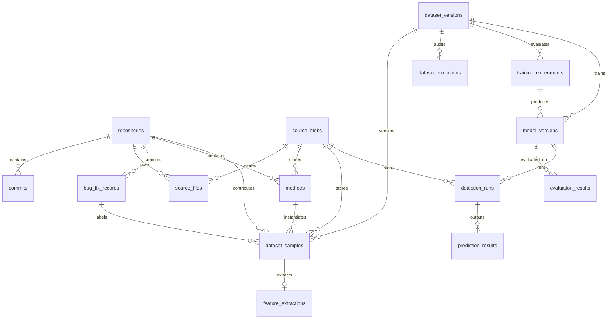

# Database Schema v5.0.0 (`bug_detector_v5.db`)

**Engine:** SQLite 3 (WAL mode, `PRAGMA foreign_keys = ON`)  
**Database File:** `1_Database/SQLite/bug_detector_v5.db`  
**Initial Migration:** `2_SourceCode/bug_detector/db/migrations/001_initial_v5.sql`

## Entity-Relationship Diagram

## Table Reference

| Table | Purpose | Key Constraints |
| --- | --- | --- |
| `schema_migrations` | Applied SQL migration tracking | PK `migration_id` |
| `repositories` | Source repository identity and URL | PK `repository_id` |
| `commits` | Commit SHAs, parent SHAs, bug-fix classification | PK `commit_id`, UNIQUE `(repository_id, commit_sha)` |
| `source_blobs` | Content-addressed C# raw/normalized source text | PK `source_hash` (avoids redundant storage) |
| `source_files` | File path + syntax/semantic diagnostics per commit | PK `source_file_id`, FK `file_hash -> source_blobs` |
| `bug_fix_records` | Defect category, severity, and fix reference | PK `bug_fix_id`, FK `repository_id` |
| `methods` | Extracted C# methods/constructors, line spans, flags | PK `method_id`, FK `source_hash -> source_blobs` |
| `dataset_versions` | Versioned corpus aggregates and SHA-256 checksum | PK `dataset_version` |
| `dataset_samples` | Method samples with labels, provenance, and split | PK `sample_id`, `label IN (0, 1)`, FKs to repo/blob/version |
| `dataset_exclusions` | Logged invalid/duplicate/filtered records & reasons | PK `exclusion_id`, FK `dataset_version` |
| `feature_extractions` | Cached Roslyn tokens, APIs, and 5 feature-group JSONs | PK/FK `sample_id -> dataset_samples` |
| `training_experiments` | Experiments A–I metrics, hyperparameters, duration | PK `experiment_id`, FK `dataset_version` |
| `model_versions` | Registered `.joblib` bundles, schemas, thresholds | PK `model_version`, `is_active IN (0, 1)` |
| `evaluation_results` | Split-level metrics (CV, test, hard-neg, temporal) | PK `evaluation_id`, FK `model_version` |
| `detection_runs` | Manual/CLI file analysis executions & syntax status | PK `run_id`, FK `model_version`, `source_hash` |
| `prediction_results` | Method-level `BUG`/`CLEAN`/`UNCERTAIN` & evidence | PK `prediction_id`, FK `run_id` |
