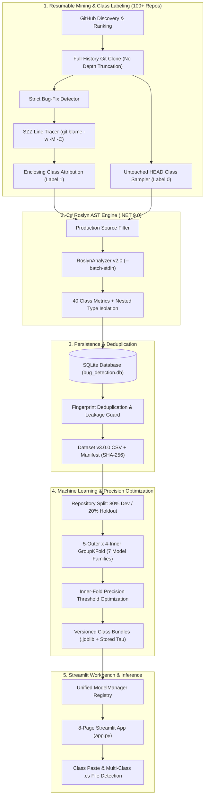

# System Architecture and Design Specification

**Project:** Machine Learning-Based Bug Detection in C# Source Code  
**Institution:** Babeș-Bolyai University — Faculty of Mathematics and Computer Science  
**Programme:** Applied Computational Intelligence (Year 2, Semester 1)  
**Course:** Computational Intelligence in Software Engineering (CISE)  

---

## 1. High-Level Architecture

The system implements a static class- and file-level bug detection pipeline for C# source code combining resumable GitHub repository discovery (100+ repositories), strict bug-fix commit classification, SZZ line-blame attribution, .NET 9.0 Roslyn Abstract Syntax Tree (AST) class/file metric extraction, nested repository-grouped cross-validation with precision-oriented threshold selection, and an 8-page Streamlit workbench.

The system positions its predictions as ML-based static defect indications grounded in historical defect evidence, not formal defect verification.

---

## 2. Component Responsibilities

| Layer / Component | Location | Responsibility |
| :--- | :--- | :--- |
| Data Layer | `1_Database/` | SQLite WAL database (`bug_detection.db`), schema/dataset docs, raw/processed datasets, manifests, and archived method-level DB snapshot (`bug_detection_method_v2_archive.db`). |
| Application Layer | `2_SourceCode/Python/application/` | 8 Streamlit pages: Dashboard, Repository Collection, Bug Analysis & SZZ, Dataset Management, Model Training, Model Evaluation, Real-World Bug Detection, and Settings. |
| Core Configuration | `2_SourceCode/Python/core/` | `PROJECT_ROOT` resolution, collection/ML/prediction settings, and unpickle aliases. |
| Database Services | `2_SourceCode/Python/database/` | Non-destructive SQLite schema migrations (`schema.py`, `connection.py`) and typed CRUD (`repository.py`). |
| ML Engine | `2_SourceCode/Python/ml/` | Repository-grouped splitting, nested `GroupKFold`, precision threshold tuning, 7-family model support, unified `ModelManager`, and `BugPredictor` (class, file, and legacy method modes). |
| Repository Mining | `2_SourceCode/Python/repositories/` | Stratified GitHub search & composite ranking, full-history `RepositoryManager`, and fast `git log --numstat` `CommitCollector`. |
| Pipeline Services | `2_SourceCode/Python/services/` | Strict bug-fix scoring, cached SZZ blame, class/method `LabelManager`, Roslyn `--batch-stdin` bridge, `DatasetBuilder` deduplication, and manifest `DatasetExporter`. |
| Utility Services | `2_SourceCode/Python/utils/` | Logging and centralized production C# path classifier (`is_production_csharp_file()`). |
| C# Roslyn Analyzer | `2_SourceCode/RoslynAnalyzer/` | .NET 9.0 CLI (`Microsoft.CodeAnalysis.CSharp 4.12.0`) extracting 40 isolated class metrics, 26 method metrics, file metadata, warnings, and syntax diagnostics. |
| Automation Scripts | `2_SourceCode/Scripts/` | Resumable 100+ repository collection (`run_100_repo_class_pipeline.py`) and class-level ML optimization (`run_class_model_optimization.py`), alongside preserved legacy scripts. |
| Verification Suite | `2_SourceCode/Tests/` | Unit and integration `pytest` suite covering Roslyn class/nested isolation, collection, SZZ, DB migrations, ML precision tuning, prediction, and UI modules. |
| Test Results | `3_TestResults/` | Class-level optimization artifacts (`3_TestResults/ClassModelOptimization/`) and preserved historical method-level reports. |
| Build Assets | `4_AppBuild/` | Versioned class-level and preserved historical method-level `.joblib` bundles, release notes, and Windows launcher. |

---

## 3. Data Flow

1. **Repository Discovery & Ranking:** `GitHubClient.discover_csharp_repositories()` paginates stratified GitHub search queries, filters out forks/archived/empty/non-C# repositories, and ranks candidates by composite popularity, recency, and size score.
2. **Full-History Cloning & Fast Commit Mining:** `RepositoryManager` performs `--no-tags` full-history clones and `CommitCollector.extract_and_persist_fast()` parses recent commits and file modifications.
3. **Bug-Fix Scoring & SZZ Tracing:** `BugFixDetector` applies strict heuristic filters and `SZZAnalyzer` runs `git blame -w -M -C --porcelain` on modified/deleted production `.cs` lines.
4. **Class-Level Labeling & Roslyn Extraction:** `LabelManager` maps SZZ traces to the innermost enclosing class/struct/record in the pre-fix parent commit (`label = 1`), samples substantive candidate-clean classes from untouched `HEAD` files (`label = 0`), and persists 40 isolated Roslyn class metrics per observation (`feature_schema_version = 3.0.0`).
5. **Deduplication & Manifest Export:** `DatasetBuilder` enforces production-only paths, deduplicates exact source fingerprints and redundant structural revisions, prevents conflicting clean labels, and exports Dataset #3 (`csharp_class_empirical_v3 v3.0.0`) with a SHA-256 manifest.
6. **Repository-Grouped ML & Precision Optimization:** `run_class_model_optimization.py` isolates ~20% of repositories as an untouched holdout, optimizes thresholds via inner 4-fold `GroupKFold` across 7 model families inside the ~80% development corpus, and serializes versioned `.joblib` bundles containing their stored `decision_threshold`.
7. **Class & Multi-Class File Inference:** `BugPredictor.predict_csharp_file()` independently scores every class in a submitted class or `.cs` file using `predict_proba()` + stored `decision_threshold`, computes file-level risk aggregations, and logs full provenance in SQLite.
