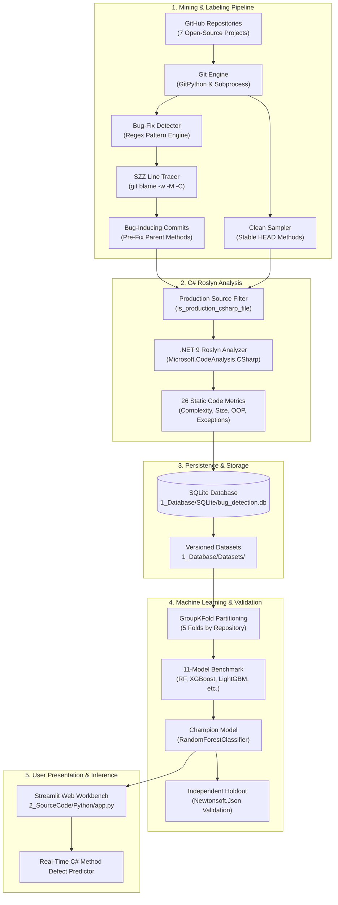

# System Architecture & Design Specification

**Project:** Machine Learning-Based Software Defect Prediction for C# Source Code  
**Institution:** Babeș-Bolyai University — Faculty of Mathematics and Computer Science  
**Master:** Applied Computational Intelligence (Year 2, Semester 1)  
**Course:** Computational Intelligence in Software Engineering (CISE)  

---

## 1. High-Level Architecture

The system provides an end-to-end empirical defect prediction pipeline tailored for C# source code. It unifies Git repository mining, SZZ vulnerability attribution, Roslyn Abstract Syntax Tree (AST) static metric extraction, group-aware cross-validation, and an interactive Streamlit graphical workbench.

---

## 2. Component Responsibilities

| Layer / Component | Location | Primary Responsibilities |
| :--- | :--- | :--- |
| **Data Layer** | `1_Database/` | SQLite database storing repositories, commits, SZZ traces, methods, observations, features, and model registry; versioned CSV datasets. |
| **Application Layer** | `2_SourceCode/Python/application/` | Streamlit interactive UI containing 8 specialized pages for repository management, SZZ inspection, dataset export, model training, evaluation, and live defect prediction. |
| **Core Configuration** | `2_SourceCode/Python/core/` | Dynamic `PROJECT_ROOT` resolution, storage path defaults, environment variables, hyperparameter specifications. |
| **Database Services** | `2_SourceCode/Python/database/` | SQLite connection management, foreign-key enforcement, CRUD operations, transaction wrappers, database schema. |
| **ML Engine** | `2_SourceCode/Python/ml/` | Preprocessing, GroupKFold cross-validation, 11-classifier benchmarking, probability threshold tuning, model serialization and loading. |
| **Repository Mining** | `2_SourceCode/Python/repositories/` | GitHub REST API client, local git repository clone/fetch management, commit history traversal. |
| **Pipeline Services** | `2_SourceCode/Python/services/` | Regex-based bug-fix detection, SZZ line blaming, production file filtering, Roslyn subprocess client bridge. |
| **Utility Services** | `2_SourceCode/Python/utils/` | Centralized logging, heuristic production/test source classifier. |
| **C# Roslyn Analyzer** | `2_SourceCode/RoslynAnalyzer/` | High-performance .NET 9 CLI application utilizing `Microsoft.CodeAnalysis.CSharp` to parse ASTs and compute 26 static software metrics. |
| **Verification Suite** | `2_SourceCode/Tests/` | 16 test modules covering unit, integration, and empirical pipeline functionality. |
| **Test Evidence** | `3_TestResults/` | Authoritative cross-validation JSON/CSVs, holdout test results, audit reports, and regression logs. |
| **Distribution Builds** | `4_AppBuild/` | Windows launcher scripts, frozen model joblib bundles, and release notes. |

---

## 3. Data Flow Architecture

1. **Repository Ingestion:** Target C# projects are cloned into local workspace.
2. **Commit Filtering:** Commits modifying `.cs` files are inspected for bug-fixing keywords (`fix`, `bug`, `issue`, `resolve`, etc.).
3. **SZZ Attribution:** Deleted or modified code lines are traced back to their introducing commit using `git blame -w -M -C`.
4. **AST Metric Extraction:** Roslyn extracts the enclosing method and calculates 26 static features directly on the pre-fix revision for buggy instances and stable HEAD for clean instances.
5. **Observation Persistence:** Methods and feature vectors are stored in SQLite and exported to versioned CSVs (`1_Database/Datasets/`).
6. **Group-Aware Evaluation:** Models are evaluated using 5-fold `GroupKFold` split on repository boundaries, guaranteeing that no methods from the same repository appear in both training and test sets simultaneously.
7. **Serving & Inference:** The champion Random Forest model is bundled with its preprocessor and deployed via the Streamlit interface for live interactive developer risk scoring.

