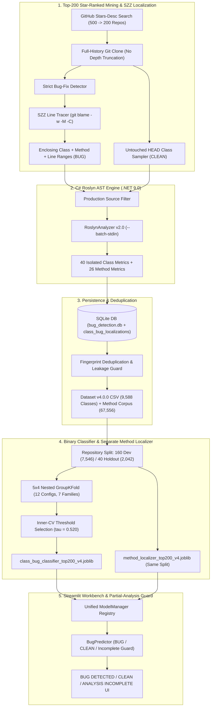

# System Architecture and Design Specification (`v4.0.0`)

**Project:** Machine Learning-Based C# Bug Detection Classifier  
**Institution:** Babeș-Bolyai University — Faculty of Mathematics and Computer Science  
**Programme:** Applied Computational Intelligence (Year 2, Semester 1)  
**Course:** Computational Intelligence in Software Engineering (CISE)  

---

## 1. High-Level Architecture

The system implements a static class- and file-level **C# Bug Detection Classifier (`BUG` / `CLEAN`)** built over a Top-200 star-ranked public GitHub corpus, combining strict bug-fix commit classification, SZZ class+method+line localization, .NET 9.0 Roslyn Abstract Syntax Tree (AST) extraction (`40` class metrics + `26` method metrics), nested repository-grouped cross-validation with inner-CV threshold selection, a separately validated **ML Method Localizer**, and an 8-page Streamlit application.

The system positions its predictions as ML-based static defect detections supported by historical defect evidence—not formal verification—and explicitly separates verified historical SZZ locations from ML-estimated suspicious methods while reporting exact buggy line localization as `unavailable` on unseen source code.

---

## 2. Component Responsibilities

| Layer / Component | Location | Responsibility |
| :--- | :--- | :--- |
| Data Layer | `1_Database/` | SQLite WAL database (`bug_detection.db`), schema/dataset docs, raw/processed datasets (`v1`–`v4`), manifests, and archived method snapshot (`bug_detection_method_v2_archive.db`). |
| Application Layer | `2_SourceCode/Python/application/` | 8 Streamlit pages: Dashboard, Repository Collection, Bug Analysis & SZZ, Dataset Management, Model Training, Model Evaluation, Real-World Bug Detection (`BUG DETECTED` / `CLEAN`), and Settings. |
| Core Configuration | `2_SourceCode/Python/core/` | `PROJECT_ROOT` resolution, `target_repositories=200`, `max_repo_size_kb=120000`, ML targets, and `v4.0.0` app branding. |
| Database Services | `2_SourceCode/Python/database/` | Non-destructive SQLite migrations (`schema.py`, `connection.py`) adding `class_bug_localizations` and typed CRUD (`repository.py`). |
| ML Engine | `2_SourceCode/Python/ml/` | Repository-grouped splitting, nested `GroupKFold`, `select_classifier_threshold()`, 7-family model support, unified `ModelManager`, and `BugPredictor` (`BUG`/`CLEAN`, verified historical vs. ML method localization, syntax-error safety). |
| Repository Mining | `2_SourceCode/Python/repositories/` | `discover_top_csharp_repositories_by_stars()`, full-history `RepositoryManager`, and fast `git log --numstat` `CommitCollector`. |
| Pipeline Services | `2_SourceCode/Python/services/` | Strict bug-fix scoring, cached SZZ blame, class+method+line `LabelManager`, Roslyn `--batch-stdin` bridge, `DatasetBuilder`, and `DatasetExporter`. |
| Utility Services | `2_SourceCode/Python/utils/` | Logging and centralized production C# path classifier (`is_production_csharp_file()`). |
| C# Roslyn Analyzer | `2_SourceCode/RoslynAnalyzer/` | .NET 9.0 CLI (`Microsoft.CodeAnalysis.CSharp 4.12.0`) extracting 40 isolated class metrics, 26 method metrics, file metadata, warnings, and syntax diagnostics. |
| Automation Scripts | `2_SourceCode/Scripts/` | Top-200 star-ranked collector (`run_top200_csharp_pipeline.py`), classifier & localizer optimizer (`run_top200_classifier_optimization.py`), plus preserved `v1`–`v3` scripts. |
| Verification Suite | `2_SourceCode/Tests/` | Automated `pytest` suite covering binary `BUG`/`CLEAN` verdicts, verified SZZ vs. ML localization, syntax-incomplete safety, Top-200 star discovery, threshold tuning, and legacy compatibility. |
| Test Results | `3_TestResults/` | Top-200 classifier & method localizer reports (`3_TestResults/Top200ClassifierOptimization/`) alongside preserved `v1`–`v3` reports. |
| Build Assets | `4_AppBuild/` | Versioned v4 `.joblib` bundles (`class_bug_classifier_top200_v4.joblib`, `method_localizer_top200_v4.joblib`, etc.), preserved v1–v3 bundles, and release notes. |

---

## 3. Data Flow

1. **Top-200 Star-Ranked Discovery:** `GitHubClient.discover_top_csharp_repositories_by_stars()` queries `language:csharp fork:false archived:false` sorted descending by stars, excludes forks/archived/empty/non-C#/oversized repos, and logs explicit exclusion reasons (`500` discovered -> `367` eligible -> `200` processed).
2. **Full-History Cloning & Fast Commit Mining:** `RepositoryManager` performs `--no-tags` full-history clones and `CommitCollector.extract_and_persist_fast()` parses commits (`46,053` commits, `405,930` file diffs).
3. **Bug-Fix Scoring & SZZ Tracing:** `BugFixDetector` applies strict heuristic filters and `SZZAnalyzer` runs `git blame -w -M -C --porcelain` on modified/deleted production `.cs` lines (`24,166` SZZ traces).
4. **Class Labeling & Method/Line Localization:** `LabelManager` maps SZZ deleted lines in the pre-fix parent commit to the innermost enclosing class/struct/record AND enclosing method (`method_name`, `method_signature`, `method_start_line`, `method_end_line`, compressed contiguous `affected_line_ranges`), persisting `7,361` verified historical records in `class_bug_localizations` and extracting `67,556` method observations for method localizer training. Clean classes (`CLEAN`) are sampled from untouched `HEAD` production files.
5. **Deduplication & Export:** `DatasetBuilder` exports Dataset #3 (`csharp_class_top200_v4 v4.0.0`, `9,588` classes, `65` columns, `0` nulls, SHA-256 `c7ff8436...`).
6. **Binary Classifier & Method Localizer Training:** `run_top200_classifier_optimization.py` isolates `40` holdout repos (`2,042` classes) cleanly from `160` dev repos (`7,546` classes), selects thresholds inside `5x4` Nested `GroupKFold`, trains all 7 ML families + `method_localizer_top200_v4.joblib` on the same repository partition, and saves versioned `.joblib` bundles.
7. **Classification, Localization & Partial-Analysis Safety:** `BugPredictor.predict_csharp_file()` runs Roslyn syntax diagnostics + class/method extraction, classifies each valid class independently as `BUG` or `CLEAN` (`confidence` = probability of winning class), looks up verified historical SZZ matches or runs `method_localizer_top200_v4.joblib` for suspicious methods (explicitly marking exact line localization `unavailable` on unseen code), and refuses to label any file `CLEAN` if syntax errors or per-class failures occurred (`ANALYSIS INCOMPLETE` or `BUG (PARTIAL ANALYSIS)`).
