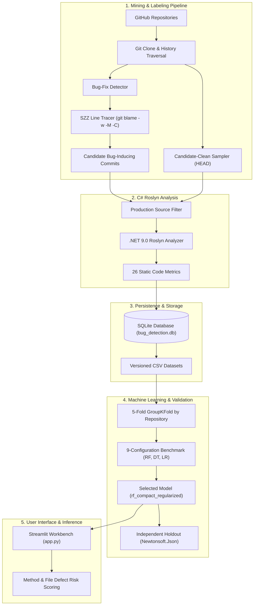

# System Architecture and Design Specification

**Project:** Machine Learning-Based Software Defect Prediction for C# Source Code  
**Institution:** Babeș-Bolyai University — Faculty of Mathematics and Computer Science  
**Programme:** Applied Computational Intelligence (Year 2, Semester 1)  
**Course:** Computational Intelligence in Software Engineering (CISE)  

---

## 1. High-Level Architecture

The system implements a method-level defect prediction pipeline for C# source code combining Git repository mining, SZZ line-blame attribution, Roslyn Abstract Syntax Tree (AST) metric extraction, repository-grouped cross-validation, and a Streamlit user interface.

---

## 2. Component Responsibilities

| Layer / Component | Location | Responsibility |
| :--- | :--- | :--- |
| Data Layer | `1_Database/` | SQLite database storing repositories, commits, SZZ traces, observations, features, and model registry; versioned CSV datasets. |
| Application Layer | `2_SourceCode/Python/application/` | Streamlit interface with 8 pages for repository management, SZZ analysis, dataset export, model training, evaluation, and defect prediction. |
| Core Configuration | `2_SourceCode/Python/core/` | `PROJECT_ROOT` detection, storage path defaults, environment variables, and unpickle module aliases. |
| Database Services | `2_SourceCode/Python/database/` | SQLite connection management, foreign-key enforcement, schema initialization, and CRUD queries. |
| ML Engine | `2_SourceCode/Python/ml/` | In-fold preprocessing, `GroupKFold` cross-validation, multi-model benchmarking, threshold optimization, and inference. |
| Repository Mining | `2_SourceCode/Python/repositories/` | GitHub REST API client, local Git clone/pull management, and commit traversal. |
| Pipeline Services | `2_SourceCode/Python/services/` | Regex bug-fix detection, SZZ line-blame analysis, label management, dataset construction, and Roslyn subprocess bridge. |
| Utility Services | `2_SourceCode/Python/utils/` | Logging configuration and production/test C# file path classification. |
| C# Roslyn Analyzer | `2_SourceCode/RoslynAnalyzer/` | .NET 9.0 CLI application using `Microsoft.CodeAnalysis.CSharp` to parse ASTs and compute 26 static metrics. |
| Verification Suite | `2_SourceCode/Tests/` | 16 test modules (123 automated tests) covering unit and integration behavior. |
| Test Results | `3_TestResults/` | Cross-validation JSON/CSV outputs, holdout evaluation results, audit reports, and test execution reports. |
| Build Assets | `4_AppBuild/` | Frozen `.joblib` model bundles, release notes, and Windows launcher script. |

---

## 3. Data Flow

1. **Repository Ingestion:** Target C# repositories are discovered via the GitHub API (requires network access) and cloned locally with full Git history.
2. **Commit Filtering:** Commits modifying `.cs` files are scored using bug-fixing regex patterns and issue references.
3. **SZZ Attribution:** Deleted or modified production C# lines in bug-fixing commits are traced to candidate bug-inducing commits via `git blame -w -M -C`.
4. **AST Metric Extraction:** Roslyn locates the enclosing method and computes 26 static code metrics on the pre-fix revision for defect-prone observations (Label 1) and on `HEAD` for candidate-clean observations (Label 0).
5. **Observation Persistence:** Method observations and feature vectors are stored in SQLite and exported to versioned CSV snapshots (`1_Database/Datasets/`).
6. **Repository-Grouped Evaluation:** Classifiers are evaluated with 5-fold `GroupKFold` grouped by `repository_id`, isolating repositories between training and validation folds.
7. **Local Inference:** The serialized Random Forest model and fitted preprocessor execute locally in the Streamlit application to score C# methods and files.
