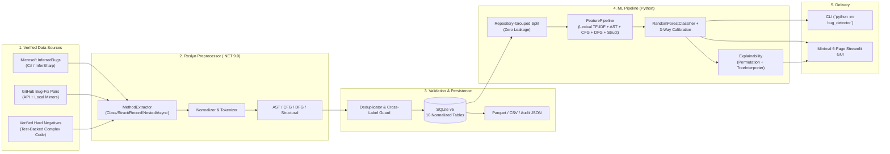

# System Architecture — CISE Bug Detector v5.0.0

## 1. Architectural Reset

Version `5.0.0` replaces the obsolete `v1`–`v4` class-level risk-scoring / SZZ defect-proneness system (archived in `0_LegacyArchive_v1_v4/`) with a modular, method-level **Machine Learning C# Source-Code Bug Detection System** powered by Microsoft Roslyn (`.NET 9.0`) and `scikit-learn` `RandomForestClassifier`.

## 2. End-to-End Component Architecture

## 3. Module Layout (`2_SourceCode/`)

| Component | Path | Responsibility |
| --- | --- | --- |
| Roslyn Preprocessor | `2_SourceCode/RoslynPreprocessor/` | C# parsing, method extraction, normalization, tokenization, AST/CFG/DFG/structural extraction |
| Config & Logging | `2_SourceCode/bug_detector/config/`, `logging_utils.py` | Pydantic v2 validation, JSON persistence (`4_AppBuild/Config/active_config.json`), structured logging |
| Database Layer | `2_SourceCode/bug_detector/db/` | SQLite WAL manager, SQL migrations (`001_initial_v5.sql`), content-addressed blob & experiment CRUD |
| Data Collection | `2_SourceCode/bug_detector/collection/` | InferredBugs ingestor, GitHub API & mirror bug-fix collector, hard-negative collector, deduplicator |
| Preprocessing Bridge | `2_SourceCode/bug_detector/preprocessing/` | Persistent JSONL subprocess bridge to `RoslynPreprocessor.dll` |
| Feature Extractors | `2_SourceCode/bug_detector/features/` | 5 independent, testable extractors + sparse/dense `FeaturePipeline` |
| ML & Evaluation | `2_SourceCode/bug_detector/ml/` | Repository-grouped splitting, Random Forest CV/HPO, Experiments A–I, calibration, predictor |
| Explainability | `2_SourceCode/bug_detector/explainability/` | Held-out permutation importance & exact Saabas tree-path decomposition |
| CLI & Streamlit GUI | `2_SourceCode/bug_detector/cli.py`, `2_SourceCode/gui/` | Headless CLI workflows + 6-page Streamlit interface |
