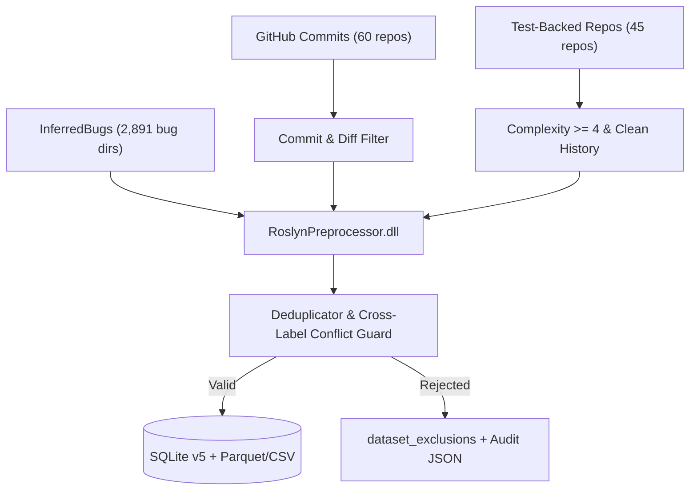

# Data Collection Guide

## 1. End-to-End Pipeline Execution

```bash
PYTHONPATH=2_SourceCode .venv/bin/python -m bug_detector build-dataset
```

This single command:
1. Sparse-clones `microsoft/InferredBugs` (`inferredbugs/csharp`) into `1_Database/External/InferredBugs` if not present.
2. Runs `InferredBugsIngestor`, `GitHubBugFixCollector` (with resumable checkpointing in `1_Database/Datasets/v5/checkpoints/`), and `HardNegativeCollector` over `RoslynPreprocessor.dll`.
3. Enforces deduplication, cross-label conflict removal, and disjoint repository isolation across sources.
4. Exports `1_Database/Datasets/v5/csharp_bug_detection_v5.0.0.parquet`, `.csv`, and `dataset_audit_report_v5.0.0.json`, and persists all records/exclusions into `1_Database/SQLite/bug_detector_v5.db`.

## 2. Live GitHub REST API Mode

To collect directly from arbitrary GitHub repositories via REST API v3:

1. Set `GITHUB_TOKEN=<your_pat>` in `.env` (unauthenticated requests are limited to `60/hr`; authenticated requests allow `5,000/hr`).
2. Run:
```bash
PYTHONPATH=2_SourceCode .venv/bin/python -m bug_detector collect-github --repos owner/repo1 owner/repo2 --max-commits 50 --max-pairs 15
```
`GitHubRestClient` automatically tracks `X-RateLimit-Remaining`/`X-RateLimit-Reset` headers and retries transient HTTP `429`/`5xx` errors with exponential backoff.

## 3. Dataset Pipeline Diagram


