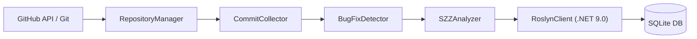

# Empirical Validation and Academic Assessment Report: Machine Learning-Based Software Defect Prediction for C# Source Code

**Project:** Machine Learning-Based Software Defect Prediction for C# Source Code  
**Institution:** Faculty of Mathematics and Computer Science, Babeș-Bolyai University  
**Master's Programme:** Applied Computational Intelligence  
**Course:** Computational Intelligence in Software Engineering (CISE) — Project 2  
**Date:** November 2026  
**Version:** `2.1.0`  

---

## 1. Title, Abstract, Keywords, and Summary

### Title
Empirical Method-Level Software Defect Prediction for C# Applications Using Roslyn Static Code Metrics and Nested Repository-Level Cross-Validation

### Abstract
Method-level software defect prediction estimates the defect-proneness of individual methods to help prioritize code review and testing. This study presents an empirical pipeline for C# source code integrating Git history mining, regex-based bug-fixing commit detection, Śliwerski–Zimmermann–Zeller (SZZ) line-blame attribution, production-code path filtering, and 26 static structural, complexity, and object-oriented metrics extracted via the .NET 9.0 Roslyn compiler platform (`Microsoft.CodeAnalysis.CSharp`). Two versioned dataset snapshots are maintained: Dataset Snapshot #1 (`csharp_empirical_v1`, 483 methods across 3 repositories) and Dataset Snapshot #2 (`csharp_empirical_v2`, 578 production methods across 5 repositories: `Humanizer`, `Serilog`, `MediatR`, `Polly`, and `FluentValidation`).

In the initial baseline experiment, nine configurations across Logistic Regression, Decision Trees, and Random Forests were evaluated using 5-fold repository-grouped cross-validation (`GroupKFold`, $K=5$), selecting `rf_compact_regularized` (`max_depth=8`, `min_samples_leaf=4`, `max_features='sqrt'`). Evaluating that frozen baseline model on an external sixth repository (`JamesNK/Newtonsoft.Json`, 159 methods) yielded $75.47\%$ accuracy, $69.61\%$ precision, $89.87\%$ recall ($71/79$), $0.7845$ F1-score, $0.8209$ ROC-AUC, and $0.1713$ Brier score at the unnested CV threshold $\tau^*=0.40$.

To eliminate selection optimism from choosing models and thresholds on outer out-of-fold predictions, we subsequently executed a controlled nested repository-level optimization experiment ($5$-fold outer `GroupKFold` $\times$ $4$-fold inner `GroupKFold`) across 20 candidate pipelines on Dataset #2 (`Newtonsoft.Json` was excluded). Under nested validation, the baseline `rf_compact_regularized` achieved outer ROC-AUC of $0.7037 \pm 0.1292$, outer PR-AUC of $0.6405 \pm 0.1135$, outer Brier score of $0.2146 \pm 0.0398$, nested threshold F1 of $0.7408 \pm 0.0760$, and pooled OOF F1 of $0.7294$. Strengthening tree regularization and feature subsampling (`max_depth=6`, `min_samples_leaf=6..8`, `max_features='log2'`) improved cross-repository generalization: `rf_nested_opt_v3_depth6_leaf8_log2` achieved outer ROC-AUC $0.7216 \pm 0.1156$, outer Brier $0.2055 \pm 0.0374$, nested threshold F1 $0.7539 \pm 0.0706$, and pooled OOF F1 $0.7406$, while `et_nested_opt_v3_depth6_leaf6_log2` (`ExtraTreesClassifier`) achieved outer ROC-AUC $0.7349 \pm 0.0703$, outer Brier $0.2062 \pm 0.0213$, nested threshold F1 $0.7667 \pm 0.0723$, and pooled OOF F1 $0.7653$ (Recall $91.76\%$, Precision $65.64\%$, Accuracy $72.84\%$).

### Keywords
Software Defect Prediction, C# Source Code, Microsoft Roslyn, SZZ Algorithm, Nested GroupKFold Cross-Validation, Random Forest, Extra Trees, Brier Score.

### Summary Table

| Dimension | Artifact / Scope | Result |
| :--- | :--- | :--- |
| Dataset #1 | `csharp_empirical_v1` (v1.0.0) | 483 methods, 3 repositories (226 defect-prone, 257 candidate-clean) |
| Dataset #2 | `csharp_empirical_v2` (v2.0.0) | 578 methods, 5 repositories (279 defect-prone, 299 candidate-clean, 0 test files) |
| Baseline RF (Nested CV) | `rf_compact_regularized` | Outer ROC-AUC = $0.7037 \pm 0.1292$, Brier = $0.2146 \pm 0.0398$, Nested F1 = $0.7408 \pm 0.0760$, Pooled OOF F1 = $0.7294$ |
| Optimized RF (Nested CV) | `rf_nested_opt_v3_depth6_leaf8_log2` | Outer ROC-AUC = $0.7216 \pm 0.1156$, Brier = $0.2055 \pm 0.0374$, Nested F1 = $0.7539 \pm 0.0706$, Pooled OOF F1 = $0.7406$ |
| Optimized Extra Trees (Nested CV) | `et_nested_opt_v3_depth6_leaf6_log2` | Outer ROC-AUC = $0.7349 \pm 0.0703$, Brier = $0.2062 \pm 0.0213$, Nested F1 = $0.7667 \pm 0.0723$, Pooled OOF F1 = $0.7653$ |
| Historical Baseline Holdout | `JamesNK/Newtonsoft.Json` ($N = 159$, $\tau^* = 0.40$) | Baseline RF only: Accuracy = $75.47\%$, Precision = $69.61\%$, Recall = $89.87\%$, F1 = $0.7845$, ROC-AUC = $0.8209$ |
| Developer Protocol | [DEVELOPER_STUDY_TEMPLATE.md](DEVELOPER_STUDY_TEMPLATE.md) | 24-method double-blind review instrument (unadministered protocol template) |

---

## 2. Problem Formulation

File- and package-level defect prediction requires inspecting large code units, whereas method-level prediction targets individual syntactic units. Empirical defect prediction at the method level faces three technical constraints:
1. **Method Boundary Isolation:** Enclosing methods must be separated from nested local functions and lambda expressions during AST metric extraction.
2. **Intra-Repository Data Leakage:** Random row-level cross-validation places methods from the same repository into both training and test partitions, inflating evaluation metrics due to shared naming and structural conventions.
3. **Labeling Uncertainty and Base-Rate Skew:** Version-control defect labels rely on heuristic commit and blame analysis (SZZ), and real-world defect prevalence ($2\%\text{--}10\%$) is lower than balanced training corpora.

---

## 3. Related Literature

- **Static Software Metrics:** McCabe (1976) defined cyclomatic complexity over control-flow graphs; Halstead (1977) introduced operator/operand volume metrics; Chidamber and Kemerer (1994) formalized object-oriented coupling and structural metrics.
- **SZZ Defect Attribution:** Śliwerski, Zimmermann, and Zeller (2005) traced bug-fixing commits via `git blame` to locate candidate Bug-Inducing Commits (BICs). Kim et al. (2006) and Da Costa et al. (2016) showed that whitespace, comment, and formatting changes must be filtered to reduce false attributions.
- **Cross-Project Defect Prediction:** Zimmermann et al. (2009) and Rahman et al. (2012) demonstrated that random within-project splits overestimate cross-project generalization, motivating repository-level `GroupKFold` validation.

---

## 4. Data Collection and GitHub Mining

Repository discovery and commit extraction are implemented in `RepositoryManager`, `CommitCollector`, and `BugFixDetector`. Network access is required only during GitHub API search and Git cloning; subsequent analysis and inference execute locally.

### 4.1 Repository Selection Criteria
- Language filter `language:csharp`, $\ge 100$ GitHub stars, $\ge 100$ KB size, non-fork (`fork:false`), active (`archived:false`), and permissive open-source license.

### 4.2 Heuristic Bug-Fixing Commit Detection
Each commit $c$ modifying `.cs` files receives a confidence score:
$$\text{Confidence}(c) = \sum w_{\text{match}} - \sum w_{\text{penalty}}$$
- **Positive matches ($w_{\text{match}} \in [0.4, 0.8]$):** Issue-closing patterns (`fixes #123`, `resolves #`) and defect keywords (`bug`, `fix`, `defect`, `crash`, `regression`, `nullreference`, `overflow`).
- **Penalties ($w_{\text{penalty}} \in [0.25, 0.6]$):** Non-defect terms (`typo`, `formatting`, `docs`, `readme`, `release`, `bump version`), zero modified `.cs` files ($-0.35$), or $>30$ modified files ($-0.25$).
- Commits with $\text{Confidence}(c) \ge 0.50$ are classified as candidate bug-fixing commits.

---

## 5. SZZ Line-Blame Attribution

`SZZAnalyzer` traces modified or deleted production lines in candidate bug-fixing commits:
1. **Mainline Parent ($P_0$):** Diffs are computed against `parents[0]` to avoid merge-branch artifacts.
2. **Noise Filtering:** Blank lines, comment lines (`//`, `/*`, `*`), and isolated brace/semicolon tokens (`{`, `}`, `;`) are excluded.
3. **Blame Execution:** `git blame -w -M -C --porcelain` runs on parent $P_0$ to identify the commit ($C_{\text{BIC}}$) that last modified the affected lines.

---

## 6. Method-Level Labeling and Sampling

1. **Defect-Prone (`label = 1`):** Blamed line numbers in $P_0$ are mapped via Roslyn AST to the innermost enclosing `MethodDeclarationSyntax`. Labels represent heuristic SZZ attributions rather than verified ground truth.
2. **Candidate-Clean (`label = 0`):** Production methods at `HEAD` with no recorded SZZ defect traces in the mined commit window are sampled at a ~1:1 ratio per repository. Under the Open-World Assumption, `label = 0` denotes candidate-clean status rather than confirmed defect-free code.
3. **Uncertain (`label = -1`):** Edits outside method bodies are labeled `-1` and excluded from supervised datasets.

---

## 7. Static Code Metrics (26 Roslyn Features)

The .NET 9.0 analyzer (`2_SourceCode/RoslynAnalyzer/RoslynAnalyzer.csproj`) extracts 26 method-level metrics across five groups:

| Group | Metrics | Description |
| :--- | :--- | :--- |
| Size | `loc`, `logical_loc`, `method_length`, `statement_count` | Physical lines, executable statements, character length |
| Interface | `parameter_count`, `local_variable_count`, `return_count` | Parameters, local variables, return statements |
| Complexity | `cyclomatic_complexity`, `max_nesting_depth`, `boolean_operator_count`, `logical_operator_count`, `conditional_expression_count` | McCabe complexity, block nesting depth, boolean/logical/ternary operators |
| Control Flow | `if_count`, `switch_count`, `loop_count`, `try_catch_count`, `throw_count`, `break_continue_count` | Branching, iteration, exception blocks, and jump statements |
| OOP & Modifiers | `method_call_count`, `field_access_count`, `property_access_count`, `assignment_count`, `object_creation_count`, `is_static`, `is_async`, `is_generic` | Invocations, member accesses, assignments, allocations, and modifiers |

---

## 8. Dataset Snapshots

| Property | Dataset #1 (`csharp_empirical_v1`) | Dataset #2 (`csharp_empirical_v2`) | Historical Holdout |
| :--- | :---: | :---: | :---: |
| Version | `1.0.0` | `2.0.0` | — |
| Total Methods | 483 | 578 | 159 |
| Defect-Prone (`1`) | 226 (46.79%) | 279 (48.27%) | 79 (49.69%) |
| Candidate-Clean (`0`) | 257 (53.21%) | 299 (51.73%) | 80 (50.31%) |
| Repositories | 3 (`Humanizer`, `CommandLineParser`, `MediatR`) | 5 (`Humanizer`, `Serilog`, `MediatR`, `Polly`, `FluentValidation`) | 1 (`JamesNK/Newtonsoft.Json`) |
| Missing Values | 0 | 0 | 0 |
| Test File Leaks | 0 | 0 | 0 |

---

## 9. Historical Audit Reconciliation

| Item | Historical Draft Value | Audited Value | Cause of Discrepancy |
| :--- | :---: | :---: | :--- |
| `Humanizer` count | 178 | 291 | Prior draft doubled positive count ($89 \times 2$) instead of summing 139 positive + 152 candidate-clean. |
| `MediatR` count | 105 | 91 | Unfiltered pre-snapshot count vs. exported snapshot count (43 positive + 48 candidate-clean). |
| `FluentValidation` pilot | 34 | 28 | v1 pilot included 3 test fixture methods (6 paired rows); v2 production filter yields 28 rows (14 + 14). |
| `GroupKFold` splits | 2 | 5 | Dataset #2 expanded training repositories from 2 to 5, enabling 5-fold `GroupKFold`. |

See [FINAL_DATASET_INTEGRITY_AUDIT.md](../08_Archive/FINAL_DATASET_INTEGRITY_AUDIT.md) and [EXPERIMENTAL_RESULTS.md](../04_MachineLearning/EXPERIMENTAL_RESULTS.md).

---

## 10. Production Source-Path Filtering

`is_production_csharp_file()` (`2_SourceCode/Python/utils/source_classifier.py`) rejects:
- Non-`.cs` files and build/package directories (`obj/`, `bin/`, `.vs/`, `packages/`).
- Generated files (`*.Designer.cs`, `*.g.cs`, `*.i.cs`, `*.generated.cs`).
- Test directories and projects (`/tests/`, `/test/`, `/specs/`, `/testing/`, `*.Tests`, `*.Specs`, `*.UnitTests`).
- Test filenames (`*Tests.cs`, `*Test.cs`, `*Tester.cs`, `*Fixture.cs`).

---

## 11. Evaluated Classifier Families

Across the baseline and nested optimization studies, six classifier configurations/families were evaluated:
1. **Random Forest (`RandomForestClassifier`):** Bagging ensembles of decision trees varying tree depth (`6, 8, 10, 15`), minimum leaf size (`1, 2, 4, 6, 8`), feature subsampling (`sqrt`, `log2`), and class weighting (`balanced`, `balanced_subsample`, `None`).
2. **Extra Trees (`ExtraTreesClassifier`):** Randomized cut-point ensembles (`n_estimators=200`, `max_depth=6..8`, `min_samples_leaf=4..6`, `max_features='sqrt'` or `'log2'`).
3. **HistGradientBoosting (`HistGradientBoostingClassifier`):** Histogram-based gradient boosted trees with leaf and $L_2$ regularization (`l2_regularization=1.0..5.0`, `min_samples_leaf=20..25`).
4. **Gradient Boosting (`GradientBoostingClassifier`):** Stochastic gradient boosting (`subsample=0.8`, `max_depth=2..3`, `learning_rate=0.03..0.05`).
5. **Logistic Regression (`LogisticRegression`):** $L_2$-regularized linear models (`C=0.1, 1.0`) paired with in-fold `StandardScaler` or `RobustScaler`.
6. **Sigmoid-Calibrated Random Forest (`CalibratedClassifierCV`):** Baseline Random Forest wrapped in internal 3-fold Platt scaling (`method='sigmoid'`).

---

## 12. Validation Design: Baseline 5-Fold vs. Nested $5 \times 4$ `GroupKFold`

Five-fold `GroupKFold` was used for outer validation. Four-fold `GroupKFold` was used for inner model and threshold selection. Each validation fold contained a repository excluded from the corresponding training partition:
- **Outer Loop ($K_{\text{outer}} = 5$):** Holds out one repository per fold (`Humanizer`: 291, `Serilog`: 134, `MediatR`: 91, `Polly`: 34, `FluentValidation`: 28).
- **Inner Loop ($K_{\text{inner}} = 4$):** Within each 4-repository outer training partition, holds out one repository per inner fold to evaluate candidate configurations and select the operating threshold $\tau_{\text{inner}}^*$ on pooled inner out-of-fold predictions.
- **Outer Evaluation:** The pipeline is refitted on the 4 outer-training repositories and evaluated once on the outer validation repository.

---

## 13. In-Fold Preprocessing and Feature Selection

Within every inner and outer fold, median imputation (`SimpleImputer`), zero-variance pruning (`VarianceThreshold`), feature selection (`all_26`, Spearman $|\rho| > 0.85$ correlation pruning `corr_pruned_085`, inner permutation importance `inner_perm_top12`, and `theoretical_core10`), and feature scaling (`StandardScaler` / `RobustScaler`) are fitted strictly on the training slice.

Feature correlation analysis ([feature_correlation.csv](../../3_TestResults/ModelOptimization/feature_correlation.csv)) identified six feature pairs with Spearman $|\rho| \ge 0.85$ (`logical_loc` vs. `statement_count` $\rho = 0.9700$, `loc` vs. `method_length` $\rho = 0.9559$, `max_nesting_depth` vs. `if_count` $\rho = 0.9040$). Constraining per-split feature subsampling (`max_features='log2'`) and minimum leaf size (`min_samples_leaf=6..8`) prevented collinear size metrics from dominating tree splits across repositories.

---

## 14. Baseline vs. Nested Optimization Results

### 14.1 Model Configurations

| Parameter | Baseline RF (`rf_compact_regularized`) | Optimized RF (`rf_nested_opt_v3_depth6_leaf8_log2`) | Optimized Extra Trees (`et_nested_opt_v3_depth6_leaf6_log2`) |
| :--- | ---: | ---: | ---: |
| Estimator | `RandomForestClassifier` | `RandomForestClassifier` | `ExtraTreesClassifier` |
| Estimators | 100 | 200 | 200 |
| Maximum depth | 8 | 6 | 6 |
| Minimum split | 5 | 10 | 8 |
| Minimum leaf | 4 | 8 | 6 |
| Maximum features | `sqrt` | `log2` | `log2` |
| Class weight | `balanced` | `balanced` | `balanced` |
| Random state | 42 | 42 | 42 |

### 14.2 Nested Cross-Validation Performance (`3_TestResults/ModelOptimization/nested_cv_results.csv`)

| Configuration ID | Family | Outer ROC-AUC (Mean ± Std) | Outer PR-AUC (Mean ± Std) | Outer Brier (Mean ± Std) | Outer F1 $\tau=0.50$ (Mean ± Std) | Nested $\tau_{\text{inner}}^*$ F1 (Mean ± Std) | Pooled OOF ROC-AUC | Pooled OOF F1 ($\tau_{\text{inner}}^*$) | Pooled OOF Recall ($\tau_{\text{inner}}^*$) | Pooled OOF Precision ($\tau_{\text{inner}}^*$) | Pooled OOF Accuracy ($\tau_{\text{inner}}^*$) |
| :--- | :--- | :---: | :---: | :---: | :---: | :---: | ---: | ---: | ---: | ---: | ---: |
| `et_depth6_leaf6_log2_bal` | Extra Trees | 0.7349 ± 0.0703 | 0.6443 ± 0.0496 | 0.2062 ± 0.0213 | 0.6867 ± 0.1394 | 0.7667 ± 0.0723 | 0.7470 | 0.7653 | 91.76% | 65.64% | 72.84% |
| `et_depth8_leaf4_sqrt_bal` | Extra Trees | 0.7349 ± 0.0801 | 0.6557 ± 0.0557 | 0.2056 ± 0.0260 | 0.6622 ± 0.1326 | 0.7324 ± 0.0492 | 0.7322 | 0.7492 | 88.89% | 64.75% | 71.28% |
| `rf_compact_corr_pruned` | Random Forest (FS) | 0.7315 ± 0.1142 | 0.6595 ± 0.1103 | 0.2096 ± 0.0280 | 0.6977 ± 0.0241 | 0.7302 ± 0.0533 | 0.7219 | 0.7262 | 90.32% | 60.72% | 67.13% |
| `rf_depth6_leaf8_log2_bal` | Random Forest | 0.7216 ± 0.1156 | 0.6465 ± 0.1026 | 0.2055 ± 0.0374 | 0.7517 ± 0.0709 | 0.7539 ± 0.0706 | 0.7119 | 0.7406 | 88.53% | 63.66% | 70.07% |
| `lr_c01_robust_bal` | Logistic Regression | 0.7146 ± 0.0973 | 0.6495 ± 0.0828 | 0.2345 ± 0.0334 | 0.5722 ± 0.1064 | 0.7316 ± 0.0677 | 0.7350 | 0.7304 | 91.76% | 60.66% | 67.30% |
| `rf_compact_calibrated_sigmoid` | Calibrated RF | 0.7060 ± 0.1219 | 0.6215 ± 0.1056 | 0.2180 ± 0.0334 | 0.6832 ± 0.0630 | 0.7363 ± 0.0679 | 0.6916 | 0.7347 | 90.32% | 61.92% | 68.51% |
| `rf_compact_regularized_baseline` | Baseline RF | 0.7037 ± 0.1292 | 0.6405 ± 0.1135 | 0.2146 ± 0.0398 | 0.6879 ± 0.0243 | 0.7408 ± 0.0760 | 0.7034 | 0.7294 | 88.89% | 61.85% | 68.17% |
| `hgb_lr003_depth3_leaf25_l2_5` | HistGradientBoosting | 0.6937 ± 0.1532 | 0.6363 ± 0.1143 | 0.2177 ± 0.0477 | 0.6862 ± 0.0676 | 0.7383 ± 0.0800 | 0.6883 | 0.7158 | 87.10% | 60.75% | 66.61% |
| `gb_lr003_depth2_leaf12_sub08` | Gradient Boosting | 0.6899 ± 0.1503 | 0.6398 ± 0.1149 | 0.2159 ± 0.0377 | 0.7102 ± 0.0605 | 0.7439 ± 0.0844 | 0.6925 | 0.7398 | 90.68% | 62.47% | 69.20% |

### 14.3 Per-Repository Outer-Fold Breakdown

| Held-Out Repository ($N$) | Metric | Baseline RF (`rf_compact_regularized`) | Optimized RF (`rf_depth6_leaf8_log2_bal`) | Optimized Extra Trees (`et_depth6_leaf6_log2_bal`) |
| :--- | :--- | ---: | ---: | ---: |
| `Humanizr/Humanizer` ($N=291$) | ROC-AUC / Brier | 0.7981 / 0.1839 | 0.7869 / 0.1819 | 0.7983 / 0.1803 |
| | F1 ($\tau = 0.50$ / Nested $\tau_{\text{inner}}^*$) | 0.6866 / 0.7703 | 0.7402 / 0.7744 | 0.7724 / 0.8113 |
| `serilog/serilog` ($N=134$) | ROC-AUC / Brier | 0.5865 / 0.2702 | 0.6377 / 0.2503 | 0.7146 / 0.2231 |
| | F1 ($\tau = 0.50$ / Nested $\tau_{\text{inner}}^*$) | 0.6995 / 0.6842 | 0.7191 / 0.6878 | 0.7891 / 0.7251 |
| `LuckyPennySoftware/MediatR` ($N=91$) | ROC-AUC / Brier | 0.6781 / 0.2210 | 0.6783 / 0.2238 | 0.6306 / 0.2381 |
| | F1 ($\tau = 0.50$ / Nested $\tau_{\text{inner}}^*$) | 0.6593 / 0.6555 | 0.6593 / 0.7027 | 0.5870 / 0.6542 |
| `App-vNext/Polly` ($N=34$) | ROC-AUC / Brier | 0.8997 / 0.1580 | 0.9135 / 0.1449 | 0.8270 / 0.1908 |
| | F1 ($\tau = 0.50$ / Nested $\tau_{\text{inner}}^*$) | 0.6667 / 0.8718 | 0.8750 / 0.8824 | 0.4615 / 0.8649 |
| `FluentValidation` ($N=28$) | ROC-AUC / Brier | 0.5561 / 0.2399 | 0.5918 / 0.2264 | 0.7041 / 0.1985 |
| | F1 ($\tau = 0.50$ / Nested $\tau_{\text{inner}}^*$) | 0.7273 / 0.7222 | 0.7647 / 0.7222 | 0.8235 / 0.7778 |

---

## 15. Probabilistic Prediction Error (Brier Score) vs. Probability Calibration

Brier score ($\text{BS} = \frac{1}{N}\sum_{i=1}^N (\hat{p}_i - y_i)^2$) measures probabilistic prediction error; reporting a Brier score does not establish that a model is calibrated. When post-hoc probability calibration was applied via `CalibratedClassifierCV(method='sigmoid', cv=3)` inside each training fold (`rf_compact_calibrated_sigmoid`), outer Brier error was $0.2180 \pm 0.0334$ compared to $0.2146 \pm 0.0398$ for the uncalibrated baseline RF. Structural regularization (`rf_depth6_leaf8_log2_bal`: $0.2055 \pm 0.0374$; `et_depth6_leaf6_log2_bal`: $0.2062 \pm 0.0213$) achieved lower probabilistic prediction error across repositories without post-hoc sigmoid fitting.

---

## 16. Decision Threshold Selection and Deployed Application Behavior

1. **Nested Inner-Fold Threshold Selection:** In the nested optimization experiment, decision thresholds were selected on inner 4-fold out-of-fold predictions (`[0.40, 0.40, 0.40, 0.35, 0.40]` for `et_nested_opt_v3_depth6_leaf6_log2`, yielding outer mean F1 = $0.7667 \pm 0.0723$ and pooled OOF F1 = $0.7653$; `[0.40, 0.35, 0.30, 0.35, 0.40]` for `rf_nested_opt_v3_depth6_leaf8_log2`, yielding outer mean F1 = $0.7539 \pm 0.0706$ and pooled OOF F1 = $0.7406$).
2. **Comparison with Unnested Threshold Tuning:** For the baseline `rf_compact_regularized` model, unnested threshold selection on outer OOF predictions ($\tau^* = 0.40$) reported pooled F1 = $0.7405$, whereas nested inner-fold threshold selection (`[0.40, 0.40, 0.25, 0.30, 0.35]`) yielded pooled F1 = $0.7294$.
3. **Deployed Application Configuration:** Both `et_nested_opt_v3_depth6_leaf6_log2.joblib` and `rf_nested_opt_v3_depth6_leaf8_log2.joblib` were retrained on all $N = 578$ observations of Dataset #2 and saved in `4_AppBuild/Assets/Models/` alongside the preserved baseline models. In `BugPredictor` (`2_SourceCode/Python/ml/predictor.py`), binary classification (`predicted_label`) calls `self.model.predict(df_proc)` at the nominal $\tau = 0.50$ threshold, while `risk_category` maps `predict_proba()` to Low ($\le 0.30$), Medium ($0.31\text{--}0.60$), and High ($> 0.60$) risk bands.

---

## 17. Historical Baseline Holdout Evaluation (`JamesNK/Newtonsoft.Json`)

In the historical baseline study, the frozen `rf_compact_regularized` model was evaluated on 159 production methods from `Newtonsoft.Json` (79 defect-prone, 80 candidate-clean):

| Metric | Baseline RF Nominal ($\tau = 0.50$) | Baseline RF Unnested CV-Tuned ($\tau^* = 0.40$) |
| :--- | :---: | :---: |
| Accuracy | 74.21% (118/159) | 75.47% (120/159) |
| Precision | 69.79% (67/96) | 69.61% (71/102) |
| Recall | 84.81% (67/79) | 89.87% (71/79) |
| F1-Score | 0.7657 | 0.7845 |
| ROC-AUC / PR-AUC | 0.8209 / 0.7917 | 0.8209 / 0.7917 |
| Brier Score | 0.1713 | 0.1713 |
| Confusion Matrix [TN, FP, FN, TP] | `[51, 29, 12, 67]` | `[49, 31, 8, 71]` |

`Newtonsoft.Json` was not used during the nested optimization experiment. These holdout results belong exclusively to the historical baseline model; the newly optimized models (`et_nested_opt_v3_depth6_leaf6_log2` and `rf_nested_opt_v3_depth6_leaf8_log2`) have not yet been evaluated on a new independent repository.

---

## 18. Error Analysis (`Dataset #2` and Historical Holdout)

### 18.1 Dataset #2 Nested OOF Error Analysis (`et_nested_opt_v3_depth6_leaf6_log2`, $N = 578$)

| Quadrant | Count | Median `loc` (Mean) | Median `logical_loc` (Mean) | Median `cc` (Mean) | Median `nesting` (Mean) | Observation |
| :--- | ---: | :---: | :---: | :---: | :---: | :--- |
| True Positive (TP) | 256 | 18.5 (30.33) | 7.0 (12.67) | 2.0 (4.74) | 1.0 (1.17) | Multi-branch production methods (`91.76%` of positive class captured) |
| True Negative (TN) | 165 | 3.0 (4.06) | 1.0 (1.12) | 1.0 (1.02) | 0.0 (0.02) | Concise single-statement accessors and helpers |
| False Positive (FP) | 134 | 15.0 (18.26) | 5.0 (8.07) | 2.0 (3.43) | 1.0 (0.87) | Candidate-clean methods with elevated structural complexity (`27` have `cc >= 6` or `loc >= 35`) |
| False Negative (FN) | 23 | 5.0 (6.74) | 1.0 (1.13) | 1.0 (1.17) | 0.0 (0.04) | Short methods (`18/23` have `loc <= 12` and `cc <= 2`) with semantic/literal defects |

### 18.2 Representative Historical Holdout Cases (`Newtonsoft.Json`, Baseline RF)

| Case Type | Method | Baseline Probability | Key Metrics | Observation |
| :--- | :--- | ---: | :--- | :--- |
| True Positive | `CalculatePropertyDetails` | 0.9155 | `loc=78`, `cc=22`, `params=11`, `nesting=2` | High branching and parameter count; SZZ linked to null-reference fix (`142f5cb0`). |
| True Positive | `ReadMetadataPropertiesToken` | 0.8870 | `loc=75`, `cc=17`, `statements=59`, `nesting=6` | Deep nesting (6 levels) and high statement density. |
| False Positive | `BsonReader.ReadString` | 0.8514 | `loc=54`, `cc=9`, `statements=35`, `nesting=4` | Complex binary parser with no recorded bug fix in the mined commit window. |
| False Negative | `JContainer.Values` | 0.1944 | `loc=11`, `cc=1`, `statements=1`, `nesting=0` | Single-statement generic wrapper; LINQ type-covariance defect not reflected in AST complexity. |
| False Negative | `JContainer.IsMultiContent` | 0.2279 | `loc=4`, `cc=1`, `statements=1`, `nesting=0` | Short method; static AST metrics do not capture semantic contract errors in 1-statement methods. |

---

## 19. Developer Evaluation Protocol

- **Protocol Instrument:** [DEVELOPER_STUDY_TEMPLATE.md](DEVELOPER_STUDY_TEMPLATE.md) defines a double-blind evaluation protocol over 24 anonymized C# methods sampled across all four confusion matrix quadrants (`commandlineparser/commandline`), scored on 5-point Likert scales for Defect Proneness, Cognitive Complexity, and Review Urgency.
- **Study Status:** No human participant responses were collected during the course project. Qualitative evaluation was performed via automated AST and Git history inspection (Section 18 and [VALIDATION_AND_LIMITATIONS.md](../05_Validation/VALIDATION_AND_LIMITATIONS.md)).

---

## 20. Threats to Validity and Limitations

| Threat Category | Limitation | Scope / Impact |
| :--- | :--- | :--- |
| Construct Validity | Heuristic SZZ blame attribution; candidate-clean (`label = 0`) methods are not confirmed defect-free; temporal difference between historical pre-fix (`label = 1`) and contemporary `HEAD` (`label = 0`) methods; static AST metrics cannot detect semantic defects in short methods. | 18 of 23 false negatives on Dataset #2 occur in methods with `loc <= 12` and `cc <= 2`. |
| Internal Validity | Repository size imbalance across the 5 training repositories (`Humanizer`: 291 vs. `Polly`: 34 and `FluentValidation`: 28); deployment `BugPredictor.predict_from_metrics()` uses `model.predict()` ($\tau = 0.50$) for binary labels while risk bands use `0.30` / `0.60`. | Nested $5 \times 4$ `GroupKFold` isolates repositories between training, selection, and evaluation partitions. |
| External Validity | Only 5 repositories were used for training and nested validation; `Newtonsoft.Json` was used in the historical baseline study, so a new unseen repository is required to evaluate the optimized models externally. | Nested cross-validation results are estimates on Dataset #2, not proof of universal generalization across all C# projects. |
| Conclusion Validity | Balanced ~1:1 evaluation (~48%–50% positive) vs. lower production base rates ($2\%\text{--}10\%$). | At 5% defect prevalence, sensitivity $89.87\%$ and FPR $38.75\%$ yield a Bayesian precision of $\approx 10.88\%$; predictions serve as review prioritization indicators. |

---

## 21. Operational Integration Guidelines

1. **Risk Triage Tiers:** Use probability risk bands (`Low <= 0.30`, `Medium 0.31–0.60`, `High > 0.60`) to prioritize code review and unit test allocation.
2. **Metric Attribution:** Surface the specific Roslyn metrics exceeding complexity thresholds alongside risk scores.
3. **Complementary Analysis:** Pair static AST risk scoring with compiler semantic analysis and unit tests to cover short, low-complexity methods.

---

## 22. Reproducibility Artifacts

| Artifact Type | Path |
| :--- | :--- |
| Datasets | `1_Database/Datasets/Original/csharp_empirical_v1_v1.0.0.csv`, `1_Database/Datasets/Processed/csharp_empirical_v2_v2.0.0.csv` |
| SQLite Database | `1_Database/SQLite/bug_detection.db` |
| Preserved Baseline Models | `4_AppBuild/Assets/Models/exp_final_5fold_v2_best_rf_compact_regularized.joblib`, `4_AppBuild/Assets/Models/rf_csharp_empirical_model.joblib` |
| Optimized Versioned Models | `4_AppBuild/Assets/Models/et_nested_opt_v3_depth6_leaf6_log2.joblib`, `4_AppBuild/Assets/Models/rf_nested_opt_v3_depth6_leaf8_log2.joblib` |
| Experiment & Optimization Scripts | `2_SourceCode/Scripts/run_final_experiment.py`, `2_SourceCode/Scripts/run_independent_holdout_validation.py`, `2_SourceCode/Scripts/run_model_optimization.py` |
| Optimization Artifacts | `3_TestResults/ModelOptimization/` (`optimization_report.md`, `nested_cv_summary.json`, `nested_cv_results.csv`, `model_comparison.csv`, `per_repository_results.csv`, `threshold_analysis.csv`, `feature_importance.csv`, `feature_correlation.csv`, `error_analysis.csv`) |
| Automated Tests | `2_SourceCode/Tests/` (`pytest`, 123 tests) |
