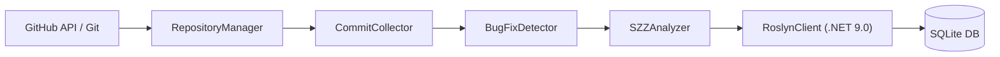

# Empirical Validation and Academic Assessment Report: Machine Learning-Based Software Defect Prediction for C# Source Code

**Project:** Machine Learning-Based Software Defect Prediction for C# Source Code  
**Institution:** Faculty of Mathematics and Computer Science, Babeș-Bolyai University  
**Master's Programme:** Applied Computational Intelligence  
**Course:** Computational Intelligence in Software Engineering (CISE) — Project 2  
**Date:** November 2026  
**Version:** `2.0.0`  

---

## 1. Title, Abstract, Keywords, and Summary

### Title
Empirical Method-Level Software Defect Prediction for C# Applications Using Roslyn Static Code Metrics, 5-Fold Repository-Aware Cross-Validation, and Independent Holdout Evaluation

### Abstract
Method-level software defect prediction estimates the defect-proneness of individual methods to help prioritize code review and testing. This study presents an empirical pipeline for C# source code integrating Git history mining, regex-based bug-fixing commit detection, Śliwerski–Zimmermann–Zeller (SZZ) line-blame attribution, production-code path filtering, and 26 static structural, complexity, and object-oriented metrics extracted via the .NET 9.0 Roslyn compiler platform (`Microsoft.CodeAnalysis.CSharp`). Two versioned dataset snapshots are maintained: Dataset Snapshot #1 (`csharp_empirical_v1`, 483 methods across 3 repositories) and Dataset Snapshot #2 (`csharp_empirical_v2`, 578 production methods across 5 repositories: `Humanizer`, `Serilog`, `MediatR`, `Polly`, and `FluentValidation`).

To prevent intra-repository overlap between training and validation partitions, models are evaluated using 5-fold repository-grouped cross-validation (`GroupKFold`, $N_{\text{repos}}=5, K=5$) across nine configurations from three classifier families: Logistic Regression, Decision Trees, and Random Forests. The regularized Random Forest configuration (`rf_compact_regularized`, `max_depth=8`, `min_samples_leaf=4`) achieved a mean cross-validation F1-score of $0.6859 \pm 0.0247$, accuracy of $0.6734 \pm 0.0491$, ROC-AUC of $0.7025$, and Brier score of $0.2144 \pm 0.0396$ at the nominal threshold $\tau=0.50$. Out-of-fold threshold tuning selected $\tau^* = 0.40$, yielding pooled out-of-fold recall of $87.46\%$ ($244/279$) and F1 of $0.7405$.

An independent sixth repository (`JamesNK/Newtonsoft.Json`, 159 production methods) was evaluated post-freeze. On this holdout set, `rf_compact_regularized` achieved $75.47\%$ accuracy, $69.61\%$ precision, $89.87\%$ recall ($71/79$), $0.7845$ F1-score, $0.8209$ ROC-AUC, and $0.1713$ Brier score at $\tau^*=0.40$. Error analysis indicates that static AST metrics capture complex control-flow defects but do not detect semantic bugs in short, low-complexity methods.

### Keywords
Software Defect Prediction, C# Source Code, Microsoft Roslyn, SZZ Algorithm, GroupKFold Cross-Validation, Random Forest, Probability Calibration, Holdout Validation.

### Summary Table

| Dimension | Artifact / Scope | Result |
| :--- | :--- | :--- |
| Dataset #1 | `csharp_empirical_v1` (v1.0.0) | 483 methods, 3 repositories (226 defect-prone, 257 candidate-clean) |
| Dataset #2 | `csharp_empirical_v2` (v2.0.0) | 578 methods, 5 repositories (279 defect-prone, 299 candidate-clean, 0 test files) |
| Cross-Validation | 5-Fold `GroupKFold` ($\tau = 0.50$) | `rf_compact_regularized`: F1 = $0.6859 \pm 0.0247$, Accuracy = $67.34\%$, Brier = $0.2144$ |
| Threshold Tuning | Pooled out-of-fold ($\tau^* = 0.40$) | Accuracy = $70.42\%$, Precision = $64.21\%$, Recall = $87.46\%$, F1 = $0.7405$ |
| Independent Holdout | `JamesNK/Newtonsoft.Json` ($N = 159$, $\tau^* = 0.40$) | Accuracy = $75.47\%$, Precision = $69.61\%$, Recall = $89.87\%$, F1 = $0.7845$, ROC-AUC = $0.8209$ |
| Developer Protocol | [DEVELOPER_STUDY_TEMPLATE.md](DEVELOPER_STUDY_TEMPLATE.md) | 24-method double-blind review instrument (unadministered protocol template) |

---

## 2. Problem Formulation

File- and package-level defect prediction requires inspecting large code units, whereas method-level prediction targets individual syntactic units. Empirical defect prediction at the method level faces three technical constraints:
1. **Method Boundary Isolation:** Enclosing methods must be separated from nested local functions and lambda expressions during AST metric extraction.
2. **Intra-Repository Data Leakage:** Random row-level cross-validation places methods from the same repository into both training and test partitions, inflating evaluation metrics due to shared naming and structural conventions.
3. **Labeling Uncertainty and Base-Rate Skew:** Version-control defect labels rely on heuristic commit and blame analysis (SZZ), and real-world defect prevalence ($2\%\text{--}10\%$) is lower than balanced training corpora.

---

## 3. Related Literature

- **Static Software Metrics:** McCabe (1976) defined cyclomatic complexity over control-flow graphs; Halstead (1977) introduced operator/operand volume metrics; Chidamber and Kemerer (1994) formalized object-oriented coupling and structural metrics.
- **SZZ Defect Attribution:** Śliwerski, Zimmermann, and Zeller (2005) traced bug-fixing commits via `git blame` to locate candidate Bug-Inducing Commits (BICs). Kim et al. (2006) and Da Costa et al. (2016) showed that whitespace, comment, and formatting changes must be filtered to reduce false attributions.
- **Cross-Project Defect Prediction:** Zimmermann et al. (2009) and Rahman et al. (2012) demonstrated that random within-project splits overestimate cross-project generalization, motivating repository-level `GroupKFold` validation.

---

## 4. Data Collection and GitHub Mining

Repository discovery and commit extraction are implemented in `RepositoryManager`, `CommitCollector`, and `BugFixDetector`. Network access is required only during GitHub API search and Git cloning; subsequent analysis and inference execute locally.

### 4.1 Repository Selection Criteria
- Language filter `language:csharp`, $\ge 100$ GitHub stars, $\ge 100$ KB size, non-fork (`fork:false`), active (`archived:false`), and permissive open-source license.

### 4.2 Heuristic Bug-Fixing Commit Detection
Each commit $c$ modifying `.cs` files receives a confidence score:
$$\text{Confidence}(c) = \sum w_{\text{match}} - \sum w_{\text{penalty}}$$
- **Positive matches ($w_{\text{match}} \in [0.4, 0.8]$):** Issue-closing patterns (`fixes #123`, `resolves #`) and defect keywords (`bug`, `fix`, `defect`, `crash`, `regression`, `nullreference`, `overflow`).
- **Penalties ($w_{\text{penalty}} \in [0.25, 0.6]$):** Non-defect terms (`typo`, `formatting`, `docs`, `readme`, `release`, `bump version`), zero modified `.cs` files ($-0.35$), or $>30$ modified files ($-0.25$).
- Commits with $\text{Confidence}(c) \ge 0.50$ are classified as candidate bug-fixing commits.

---

## 5. SZZ Line-Blame Attribution

`SZZAnalyzer` traces modified or deleted production lines in candidate bug-fixing commits:
1. **Mainline Parent ($P_0$):** Diffs are computed against `parents[0]` to avoid merge-branch artifacts.
2. **Noise Filtering:** Blank lines, comment lines (`//`, `/*`, `*`), and isolated brace/semicolon tokens (`{`, `}`, `;`) are excluded.
3. **Blame Execution:** `git blame -w -M -C --porcelain` runs on parent $P_0$ to identify the commit ($C_{\text{BIC}}$) that last modified the affected lines.

---

## 6. Method-Level Labeling and Sampling

1. **Defect-Prone (`label = 1`):** Blamed line numbers in $P_0$ are mapped via Roslyn AST to the innermost enclosing `MethodDeclarationSyntax`. Labels represent heuristic SZZ attributions rather than verified ground truth.
2. **Candidate-Clean (`label = 0`):** Production methods at `HEAD` with no recorded SZZ defect traces in the mined commit window are sampled at a 1:1 ratio per repository. Under the Open-World Assumption, `label = 0` denotes candidate-clean status rather than confirmed defect-free code.
3. **Uncertain (`label = -1`):** Edits outside method bodies are labeled `-1` and excluded from supervised datasets.

---

## 7. Static Code Metrics (26 Roslyn Features)

The .NET 9.0 analyzer (`2_SourceCode/RoslynAnalyzer/RoslynAnalyzer.csproj`) extracts 26 method-level metrics across five groups:

| Group | Metrics | Description |
| :--- | :--- | :--- |
| Size | `loc`, `logical_loc`, `method_length`, `statement_count` | Physical lines, executable statements, character length |
| Interface | `parameter_count`, `local_variable_count`, `return_count` | Parameters, local variables, return statements |
| Complexity | `cyclomatic_complexity`, `max_nesting_depth`, `boolean_operator_count`, `logical_operator_count`, `conditional_expression_count` | McCabe complexity, block nesting depth, boolean/logical/ternary operators |
| Control Flow | `if_count`, `switch_count`, `loop_count`, `try_catch_count`, `throw_count`, `break_continue_count` | Branching, iteration, exception blocks, and jump statements |
| OOP & Modifiers | `method_call_count`, `field_access_count`, `property_access_count`, `assignment_count`, `object_creation_count`, `is_static`, `is_async`, `is_generic` | Invocations, member accesses, assignments, allocations, and modifiers |

---

## 8. Dataset Snapshots

| Property | Dataset #1 (`csharp_empirical_v1`) | Dataset #2 (`csharp_empirical_v2`) | Independent Holdout |
| :--- | :---: | :---: | :---: |
| Version | `1.0.0` | `2.0.0` | — |
| Total Methods | 483 | 578 | 159 |
| Defect-Prone (`1`) | 226 (46.79%) | 279 (48.27%) | 79 (49.69%) |
| Candidate-Clean (`0`) | 257 (53.21%) | 299 (51.73%) | 80 (50.31%) |
| Repositories | 3 (`Humanizer`, `CommandLineParser`, `MediatR`) | 5 (`Humanizer`, `Serilog`, `MediatR`, `Polly`, `FluentValidation`) | 1 (`JamesNK/Newtonsoft.Json`) |
| Missing Values | 0 | 0 | 0 |
| Test File Leaks | 0 | 0 | 0 |

---

## 9. Historical Audit Reconciliation

| Item | Historical Draft Value | Audited Value | Cause of Discrepancy |
| :--- | :---: | :---: | :--- |
| `Humanizer` count | 178 | 291 | Prior draft doubled positive count ($89 \times 2$) instead of summing 139 positive + 152 candidate-clean. |
| `MediatR` count | 105 | 91 | Unfiltered pre-snapshot count vs. exported snapshot count (43 positive + 48 candidate-clean). |
| `FluentValidation` pilot | 34 | 28 | v1 pilot included 3 test fixture methods (6 paired rows); v2 production filter yields 28 rows (14 + 14). |
| `GroupKFold` splits | 2 | 5 | Dataset #2 expanded training repositories from 2 to 5, enabling 5-fold `GroupKFold`. |

See [FINAL_DATASET_INTEGRITY_AUDIT.md](../08_Archive/FINAL_DATASET_INTEGRITY_AUDIT.md) and [EXPERIMENTAL_RESULTS.md](../04_MachineLearning/EXPERIMENTAL_RESULTS.md).

---

## 10. Production Source-Path Filtering

`is_production_csharp_file()` (`2_SourceCode/Python/utils/source_classifier.py`) rejects:
- Non-`.cs` files and build/package directories (`obj/`, `bin/`, `.vs/`, `packages/`).
- Generated files (`*.Designer.cs`, `*.g.cs`, `*.i.cs`, `*.generated.cs`).
- Test directories and projects (`/tests/`, `/test/`, `/specs/`, `/testing/`, `*.Tests`, `*.Specs`, `*.UnitTests`).
- Test filenames (`*Tests.cs`, `*Test.cs`, `*Tester.cs`, `*Fixture.cs`).

---

## 11. Evaluated Classifier Families

1. **Logistic Regression (`lr_standard_c1`, `lr_balanced_c1`):** Linear classifier with $L_2$ regularization ($C=1.0$) and in-fold `StandardScaler`.
2. **Decision Tree (`dt_shallow_depth4`, `dt_depth8`):** Single CART tree using Gini impurity at `max_depth=4` and `max_depth=8`.
3. **Random Forest (`rf_compact_regularized`, `rf_feature_constrained_log2`, `rf_heavy_bagging_300`, `rf_baseline_balanced`, `rf_deep_capacity`):** Bagging ensembles of 100–300 trees varying maximum depth (`8`, `10`, `12`, `15`), minimum leaf size (`2`, `4`), and feature subsampling (`sqrt`, `log2`).

---

## 12. Repository-Grouped Cross-Validation (`GroupKFold`)

Cross-validation (`2_SourceCode/Python/ml/cross_validation.py`) partitions Dataset #2 into $K=5$ folds grouped by `repository_id`. Each fold holds out one repository for validation (`Humanizer`: 291, `Serilog`: 134, `MediatR`: 91, `Polly`: 34, `FluentValidation`: 28) and trains on the remaining four repositories, ensuring $\text{Train\_Repos} \cap \text{Val\_Repos} = \emptyset$.

---

## 13. In-Fold Preprocessing

Within each fold, `DataPreprocessor` fits median imputation and zero-variance pruning (plus `StandardScaler` for Logistic Regression) exclusively on the training partition before transforming the validation partition.

---

## 14. Multi-Model Cross-Validation Results ($\tau = 0.50$)

| Rank | Configuration ID | Algorithm | F1 (Mean ± Std) | Recall (Mean ± Std) | Precision (Mean ± Std) | Accuracy (Mean ± Std) | ROC-AUC | PR-AUC | Brier Score |
| :---: | :--- | :--- | :---: | :---: | :---: | :---: | ---: | ---: | :---: |
| 1 | `rf_compact_regularized` | Random Forest | 0.6859 ± 0.0247 | 0.7403 ± 0.1557 | 0.6824 ± 0.1202 | 0.6734 ± 0.0491 | 0.7025 | 0.6401 | 0.2144 ± 0.0396 |
| 2 | `rf_feature_constrained_log2` | Random Forest | 0.6385 ± 0.0641 | 0.6831 ± 0.1706 | 0.6384 ± 0.1197 | 0.6369 ± 0.0673 | 0.6974 | 0.6309 | 0.2209 ± 0.0375 |
| 3 | `rf_heavy_bagging_300` | Random Forest | 0.6262 ± 0.0633 | 0.6788 ± 0.1738 | 0.6117 ± 0.0984 | 0.6212 ± 0.0617 | 0.6874 | 0.6277 | 0.2265 ± 0.0376 |
| 4 | `rf_baseline_balanced` | Random Forest | 0.6108 ± 0.1176 | 0.6678 ± 0.1982 | 0.6046 ± 0.1157 | 0.6074 ± 0.0827 | 0.6792 | 0.6200 | 0.2249 ± 0.0410 |
| 5 | `dt_shallow_depth4` | Decision Tree | 0.5734 ± 0.2172 | 0.6166 ± 0.2646 | 0.5573 ± 0.1884 | 0.5721 ± 0.1345 | 0.5849 | 0.5630 | 0.2807 ± 0.0699 |
| 6 | `rf_deep_capacity` | Random Forest | 0.5577 ± 0.0739 | 0.5794 ± 0.1737 | 0.5811 ± 0.1147 | 0.5815 ± 0.0647 | 0.6552 | 0.5982 | 0.2429 ± 0.0435 |
| 7 | `lr_balanced_c1` | Logistic Regression | 0.4989 ± 0.1252 | 0.4538 ± 0.1469 | 0.5994 ± 0.1557 | 0.5709 ± 0.0894 | 0.6225 | 0.5694 | 0.2620 ± 0.0368 |
| 8 | `lr_standard_c1` | Logistic Regression | 0.4890 ± 0.1409 | 0.4360 ± 0.1651 | 0.6095 ± 0.1593 | 0.5744 ± 0.0877 | 0.6231 | 0.5699 | 0.2643 ± 0.0366 |
| 9 | `dt_depth8` | Decision Tree | 0.4695 ± 0.2194 | 0.4907 ± 0.2529 | 0.4844 ± 0.1983 | 0.5050 ± 0.1425 | 0.5097 | 0.5033 | 0.3993 ± 0.1017 |

Depth-regularized Random Forest (`rf_compact_regularized`, `max_depth=8`, `min_samples_leaf=4`) achieved higher cross-repository F1 and lower fold variance ($\pm 0.0247$) than deeper trees (`rf_deep_capacity`, `max_depth=15`, F1 = $0.5577$).

---

## 15. Probability Calibration

Calibration was measured using the Brier score ($\text{BS} = \frac{1}{N}\sum_{i=1}^N (\hat{p}_i - y_i)^2$). `rf_compact_regularized` achieved the lowest mean Brier score across folds ($0.2144 \pm 0.0396$) and $0.1713$ on the independent holdout set.

---

## 16. Out-of-Fold Decision Threshold Optimization

| Threshold ($\tau$) | Accuracy | Precision | Recall | F1-Score | TN | FP | FN | TP |
| :---: | ---: | ---: | ---: | ---: | ---: | ---: | ---: | ---: |
| 0.20 | 0.5848 | 0.5401 | 0.9857 | 0.6978 | 63 | 236 | 4 | 275 |
| 0.30 | 0.6696 | 0.6046 | 0.9498 | 0.7388 | 122 | 177 | 14 | 265 |
| **0.40 ($\tau^*$)** | **0.7042** | **0.6421** | **0.8746** | **0.7405** | **163** | **136** | **35** | **244** |
| 0.45 | 0.6834 | 0.6385 | 0.7993 | 0.7099 | 172 | 127 | 56 | 223 |
| **0.50 (Nominal)** | **0.6713** | **0.6386** | **0.7348** | **0.6833** | **183** | **116** | **74** | **205** |
| 0.55 | 0.6765 | 0.6631 | 0.6703 | 0.6667 | 204 | 95 | 92 | 187 |
| 0.60 | 0.6626 | 0.6828 | 0.5556 | 0.6126 | 227 | 72 | 124 | 155 |
| 0.70 | 0.6211 | 0.7344 | 0.3369 | 0.4619 | 265 | 34 | 185 | 94 |
| 0.80 | 0.5467 | 0.8261 | 0.1362 | 0.2338 | 291 | 8 | 241 | 38 |

Lowering the decision threshold from $\tau=0.50$ to $\tau^*=0.40$ reduces false negatives on pooled out-of-fold predictions from 74 to 35 and increases recall from $73.48\%$ to $87.46\%$.

---

## 17. Independent Holdout Evaluation (`JamesNK/Newtonsoft.Json`)

Evaluating the frozen `rf_compact_regularized` bundle on 159 production methods from `Newtonsoft.Json` (79 defect-prone, 80 candidate-clean):

| Metric | Nominal ($\tau = 0.50$) | CV-Tuned ($\tau^* = 0.40$) |
| :--- | :---: | :---: |
| Accuracy | 74.21% (118/159) | 75.47% (120/159) |
| Precision | 69.79% (67/96) | 69.61% (71/102) |
| Recall | 84.81% (67/79) | 89.87% (71/79) |
| F1-Score | 0.7657 | 0.7845 |
| ROC-AUC | 0.8209 | 0.8209 |
| PR-AUC | 0.7917 | 0.7917 |
| Brier Score | 0.1713 | 0.1713 |
| Confusion Matrix [TN, FP, FN, TP] | `[51, 29, 12, 67]` | `[49, 31, 8, 71]` |

---

## 18. Qualitative Prediction Case Analysis (`Newtonsoft.Json`)

| Case Type | Method | Predicted Probability | Key Metrics | Observation |
| :--- | :--- | ---: | :--- | :--- |
| True Positive | `CalculatePropertyDetails` | 0.9155 | `loc=78`, `cc=22`, `params=11`, `nesting=2` | High branching and parameter count; SZZ linked to null-reference fix (`142f5cb0`). |
| True Positive | `ReadMetadataPropertiesToken` | 0.8870 | `loc=75`, `cc=17`, `statements=59`, `nesting=6` | Deep nesting (6 levels) and high statement density. |
| False Positive | `BsonReader.ReadString` | 0.8514 | `loc=54`, `cc=9`, `statements=35`, `nesting=4` | Complex binary parser with no recorded bug fix in the mined commit window. |
| False Negative | `JContainer.Values` | 0.1944 | `loc=11`, `cc=1`, `statements=1`, `nesting=0` | Single-statement generic wrapper; LINQ type-covariance defect not reflected in AST complexity. |
| False Negative | `JContainer.IsMultiContent` | 0.2279 | `loc=4`, `cc=1`, `statements=1`, `nesting=0` | Short method; static AST metrics do not capture semantic contract errors in 1-statement methods. |

---

## 19. Developer Evaluation Protocol

- **Protocol Instrument:** [DEVELOPER_STUDY_TEMPLATE.md](DEVELOPER_STUDY_TEMPLATE.md) defines a double-blind evaluation protocol over 24 anonymized C# methods sampled across all four confusion matrix quadrants (`commandlineparser/commandline`), scored on 5-point Likert scales for Defect Proneness, Cognitive Complexity, and Review Urgency.
- **Study Status:** No human participant responses were collected during the course project. Qualitative evaluation was performed via automated AST and Git history inspection (Section 18 and [VALIDATION_AND_LIMITATIONS.md](../05_Validation/VALIDATION_AND_LIMITATIONS.md)).

---

## 20. Threats to Validity

| Threat Category | Threat | Mitigation / Scope |
| :--- | :--- | :--- |
| Construct Validity | Heuristic SZZ blame attribution and Open-World Assumption on candidate-clean `HEAD` samples; temporal asymmetry between pre-fix and `HEAD` snapshots. | Whitespace/move flags (`git blame -w -M -C`), comment filtering, and explicit distinction between candidate-clean and defect-free code. |
| Internal Validity | Threshold $\tau^* = 0.40$ tuned on pooled out-of-fold predictions without nested CV. | Threshold frozen prior to one-shot evaluation on `Newtonsoft.Json` ($F_1 = 0.7845$, Recall $= 89.87\%$). |
| External Validity | Evaluation bounded to 6 open-source C# libraries and 26 static AST metrics. | Repository-grouped splits test cross-repository transfer across 6 distinct domains. |
| Conclusion Validity | Balanced 1:1 evaluation (~48%–50% positive) vs. lower production base rates ($2\%\text{--}10\%$). | Bayesian base-rate calculation reported (~10.9% precision at 5% prevalence); outputs framed as risk prioritization indicators. |

---

## 21. Operational Integration Guidelines

1. **Risk Triage Tiers:** Low risk ($\hat{p} < 0.40$), Medium risk ($0.40 \le \hat{p} < 0.70$), and High risk ($\hat{p} \ge 0.70$) for prioritizing code review and unit testing.
2. **Metric Attribution:** Surface the specific Roslyn metrics exceeding complexity thresholds alongside risk scores.
3. **Complementary Analysis:** Pair static AST risk scoring with semantic compiler diagnostics and unit testing to cover short, low-complexity methods.

---

## 22. Reproducibility Artifacts

| Artifact Type | Path |
| :--- | :--- |
| Datasets | `1_Database/Datasets/Original/csharp_empirical_v1_v1.0.0.csv`, `1_Database/Datasets/Processed/csharp_empirical_v2_v2.0.0.csv` |
| SQLite Database | `1_Database/SQLite/bug_detection.db` |
| Frozen Model | `4_AppBuild/Assets/Models/exp_final_5fold_v2_best_rf_compact_regularized.joblib` |
| Experiment Scripts | `2_SourceCode/Scripts/run_dataset_expansion.py`, `2_SourceCode/Scripts/run_final_experiment.py`, `2_SourceCode/Scripts/run_independent_holdout_validation.py` |
| Automated Tests | `2_SourceCode/Tests/` (`pytest`, 123 tests) |
