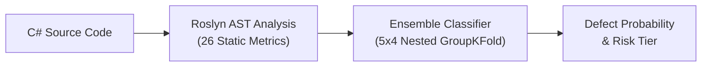

# 01 — Project Overview

**Project:** Machine Learning-Based Software Defect Prediction for C# Source Code  
**Course:** Computational Intelligence in Software Engineering (CISE Project 2)  
**Institution:** Babeș-Bolyai University, Faculty of Mathematics and Computer Science  
**Program:** M.Sc. Applied Computational Intelligence  

---

## 1. System Summary

The system predicts method-level defect risk in C# source code by combining Git/SZZ defect mining, Roslyn syntax tree analysis, and repository-grouped ensemble classifiers.

- **Target Language:** C# (.NET 9.0)
- **Granularity:** Method-level (methods, constructors, accessors)
- **Feature Representation:** 26 static AST and complexity metrics extracted via `Microsoft.CodeAnalysis.CSharp`
- **Validation Protocol:** 5-fold outer $\times$ 4-fold inner nested repository-level `GroupKFold` cross-validation
- **Output:** Defect probability score ($[0.0, 1.0]$), risk tier (`Low <= 0.30`, `Medium 0.31-0.60`, `High > 0.60`), and top feature importances

---

## 2. Motivation

Manual code review and unit testing cannot be applied with equal depth across all methods in large software repositories. Method-level defect prediction provides a quantitative triage signal to prioritize code review effort toward structurally complex or high-risk methods.

---

## 3. Core Implementation Components

1. **Empirical Dataset Construction:** Mined 7 open-source C# repositories (`Humanizr/Humanizer`, `serilog/serilog`, `LuckyPennySoftware/MediatR`, `App-vNext/Polly`, `FluentValidation/FluentValidation`, `commandlineparser/commandline`, and `JamesNK/Newtonsoft.Json`), yielding Dataset #1 ($N = 483$), Dataset #2 ($N = 578$), and an independent historical holdout set ($N = 159$).
2. **SZZ Defect Labeling:** Identified bug-fixing commits via regex classification and traced deleted/modified lines to pre-fix Bug-Inducing Commits (BICs) using `git blame -w -M -C`.
3. **Roslyn Static Metric Engine:** Extracted 26 method-level syntax and complexity metrics from production C# files while excluding test and auto-generated code.
4. **Nested Repository-Level Optimization:** Evaluated 20 model and preprocessing configurations under a $5 \times 4$ nested `GroupKFold` protocol on Dataset #2 (`et_nested_opt_v3_depth6_leaf6_log2`: Outer ROC-AUC `0.7349 ± 0.0703`, Pooled OOF F1 `0.7653`; `rf_nested_opt_v3_depth6_leaf8_log2`: Outer ROC-AUC `0.7216 ± 0.1156`, Outer Brier `0.2055 ± 0.0374`).
5. **Interactive Inspection Application:** Implemented an 8-page Streamlit interface for repository mining, SZZ inspection, dataset export, model training/evaluation, and live C# method scoring.
