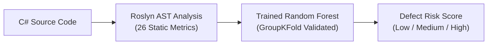

# 01 — Project Overview & Motivation

**Project:** Machine Learning-Based Software Defect Prediction for C# Source Code  
**Course:** Computational Intelligence in Software Engineering (CISE Project 2)  
**Institution:** Babeș-Bolyai University, Faculty of Mathematics and Computer Science  
**Master:** Applied Computational Intelligence  

---

## 1. Project at a Glance

Software defect prediction applies machine learning to identify error-prone source code components before they reach production. 

- **Target Language:** C# (.NET)
- **Granularity:** Method-level (functions, properties, constructors)
- **Approach:** Static syntactic & complexity metrics paired with historical Git/SZZ defect traces
- **Output:** Risk probability score ($[0.0, 1.0]$) and top influential metrics explaining the prediction

---

## 2. Why Defect Prediction Matters

Software defects cost the global software industry billions annually in debugging, security patches, and unplanned downtime. 

Traditional quality assurance techniques (manual code review and comprehensive unit testing) cannot scale uniformly across millions of lines of code.

### The Value Proposition
- **Targeted Code Reviews:** Direct senior developer review effort toward the top 20% most defect-prone methods.
- **Early Warning System:** Catch architectural complexity and defect risk at commit/PR time before code is merged into main branches.
- **Empirical Grounding:** Base quality assessments on objective syntactic and structural measurements rather than subjective intuition.

---

## 3. Core Contributions

1. **Empirical Dataset Construction:** Mined 7 real-world open-source C# projects (`Polly`, `FluentValidation`, `Newtonsoft.Json`, `CommandLine`, `Humanizr`, `Serilog`, `21Questions`).
2. **Roslyn Static Metric Engine:** Extracted 26 method-level AST metrics (McCabe complexity, nesting, lines of code, exception constructs, OOP flags).
3. **SZZ Ground-Truth Labeling:** Traced historical bug fixes back to Bug-Inducing Commits (BICs) using `git blame -w -M -C`.
4. **Group-Aware Evaluation:** Enforced 5-fold `GroupKFold` cross-validation partitioned by repository to eliminate data leakage.
5. **Interactive Workbench:** Developed a complete 8-page Streamlit web application providing live code analysis, model evaluation, and risk visualization.

