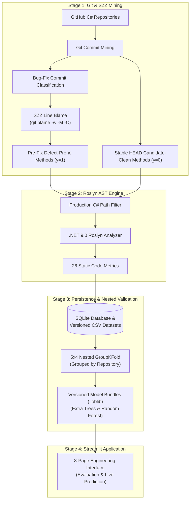
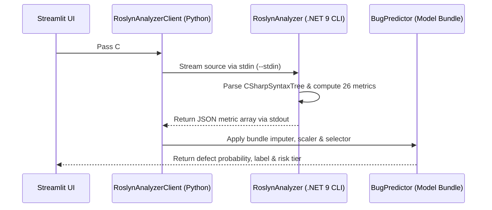

# 03 — System Architecture & Workflow

---

## 1. End-to-End Pipeline Architecture

The system comprises four stages: Git/SZZ mining, Roslyn AST metric extraction, repository-grouped machine learning validation, and the Streamlit application interface.

---

## 2. Technology Stack

- **Python Backend & ML:** Python 3.13, `scikit-learn`, `pandas`, `numpy`, `scipy`, `joblib`, `pydantic`
- **Static Analysis Engine:** C# 13, .NET 9.0 SDK, `Microsoft.CodeAnalysis.CSharp` (Roslyn syntax tree API)
- **Persistence Layer:** SQLite 3 (WAL mode, foreign keys) and SHA-256 checksummed CSV/JSON artifacts
- **Version Control Mining:** Git CLI (`git log`, `git show`, `git blame -w -M -C`) and `GitPython`
- **Web Interface & Verification:** Streamlit 8-page UI and `pytest` automated test suite (123 tests)

---

## 3. Python-to-Roslyn Bridge

- **Subprocess Communication:** C# source code is passed to the compiled `.NET 9.0` analyzer via `stdin` and returned as structured JSON over `stdout`.
- **Bundle Encapsulation:** Each `.joblib` model bundle stores the fitted `SimpleImputer(strategy="median")`, optional `StandardScaler` / feature selector, fitted classifier, feature names, and cross-validation metadata.
