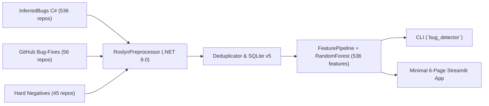

# Slide 3 — System Architecture

- **16-table SQLite schema** with content-addressed `source_blobs`.
- **Persistent JSONL Roslyn bridge** (`RoslynPreprocessor.dll batch`) for deterministic parsing and feature extraction.
