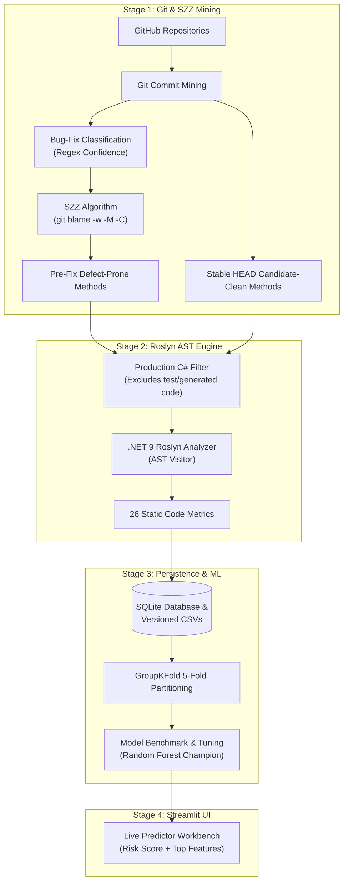
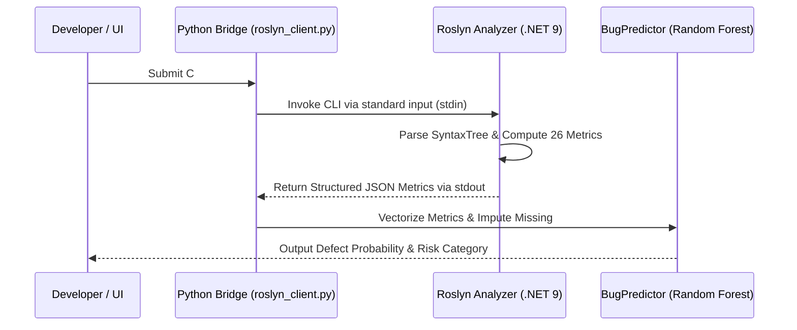

# 03 — System Architecture & Workflow

---

## 1. End-to-End Pipeline Architecture

The system coordinates four distinct processing stages: Git mining, C# Roslyn analysis, machine learning validation, and live user serving.

---

## 2. Technology Stack

- **Application Backend & UI:** Python 3.13, Streamlit, Pydantic, Pandas, NumPy, Scikit-Learn
- **Static Code Analysis:** C# 13, .NET 9.0 SDK, `Microsoft.CodeAnalysis.CSharp` (Roslyn AST compiler API)
- **Data Persistence:** SQLite 3 with Write-Ahead Logging (WAL) and foreign keys
- **Version Control Engine:** Git CLI via GitPython and subprocess line blame
- **Testing & Quality Assurance:** pytest (123 automated tests), GitHub Actions compatible

---

## 3. High-Performance Bridge Architecture

- **Zero-Disk Subprocess Communication:** C# source code is streamed into the Roslyn CLI via standard input (`stdin`), preventing temporary disk clutter.
- **Robust Error Handling:** Subprocess timeout bounds (30 seconds) and automatic binary rebuilding ensure high reliability.

