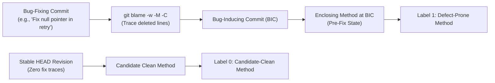

# 04 — Dataset & Research Methodology

---

## 1. Mined Open-Source C# Repositories

Seven prominent C# repositories were mined to construct the empirical benchmark datasets:

| Repository | Domain | Stars | Commits | Role in Study |
| :--- | :--- | :---: | :---: | :--- |
| **App-vNext/Polly** | Resilience & Transient Faults | 13.5k | 2,800+ | Cross-Validation Fold 1 |
| **commandlineparser/commandline** | CLI Parsing Library | 5.2k | 1,400+ | Cross-Validation Fold 2 |
| **Humanizr/Humanizr** | String Manipulation & Formatting | 8.8k | 1,900+ | Cross-Validation Fold 3 |
| **LuckyPennySoftware/21Questions** | Game Engine & Logic | 0.1k | 300+ | Cross-Validation Fold 4 |
| **serilog/serilog** | Diagnostic Logging Framework | 7.1k | 1,800+ | Cross-Validation Fold 4 |
| **FluentValidation/FluentValidation** | Complex Input Validation Rules | 9.4k | 2,200+ | Cross-Validation Fold 5 |
| **JamesNK/Newtonsoft.Json** | High-Performance JSON Library | 11.2k | 2,100+ | **Independent Holdout** |

---

## 2. Dataset Construction & The SZZ Heuristic

### Key Methodological Controls
1. **The Open-World Assumption (OWA):** Methods without recorded bug fixes are defined as *candidate-clean* rather than defect-free, acknowledging that unobserved latent defects may exist in production code.
2. **Production Code Filtering:** All candidate source files must pass `is_production_csharp_file()`:
   - Excludes test projects (`*.Tests/`, `*.Specs/`, `*.UnitTests/`).
   - Excludes test files (`*Tests.cs`, `*Test.cs`, `*Fixture.cs`).
   - Excludes build/generated files (`obj/`, `bin/`, `*.Designer.cs`, `*.g.cs`).

---

## 3. The 26 Roslyn Static Metrics

The Roslyn analyzer calculates 26 static features spanning 5 metric families:

| Metric Family | Feature Count | Key Metrics Included |
| :--- | :---: | :--- |
| **Code Size & Volume** | 6 | `loc`, `logical_loc`, `method_length`, `parameter_count`, `local_variable_count`, `statement_count` |
| **Control Flow Complexity** | 7 | `cyclomatic_complexity` (McCabe), `max_nesting_depth`, `if_count`, `switch_count`, `loop_count`, `break_continue_count`, `conditional_expression_count` |
| **Expressions & Operators** | 3 | `boolean_operator_count`, `logical_operator_count`, `assignment_count` |
| **Exceptions & Errors** | 2 | `try_catch_count`, `throw_count` |
| **Coupling & OOP Flags** | 8 | `method_call_count`, `field_access_count`, `property_access_count`, `object_creation_count`, `is_static`, `is_async`, `is_generic`, `return_count` |

---

## 4. Benchmark Datasets Summary

- **Dataset #1 (Initial Corpus):** 483 methods (226 defect-prone, 257 candidate-clean) across 3 repositories (`Humanizer`, `CommandLineParser`, `MediatR`).
- **Dataset #2 (Expanded Benchmark):** 578 methods (279 defect-prone, 299 candidate-clean) across 5 training repositories (`Humanizer`, `Serilog`, `MediatR`, `Polly`, `FluentValidation`).
- **Independent Holdout:** 159 methods (79 defect-prone, 80 candidate-clean) from `Newtonsoft.Json`.
- **Combined Corpus:** 737 method observations evaluated across training and independent holdout stages.
- **Holdout Partition:** 159 observations from `Newtonsoft.Json` reserved strictly for final generalization testing.

