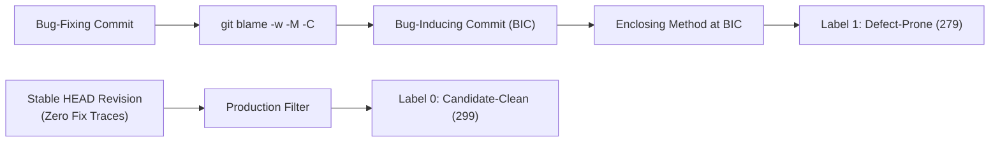

# 04 — Dataset & Research Methodology

---

## 1. Mined Open-Source C# Repositories

Seven open-source C# repositories were mined across Dataset #1, Dataset #2, and the historical external holdout set:

| Repository | Domain | Dataset #1 ($N=483$) | Dataset #2 ($N=578$) | Historical Holdout ($N=159$) | Role in Validation |
| :--- | :--- | ---: | ---: | ---: | :--- |
| `Humanizr/Humanizer` | String & Data Manipulation | 291 | 291 | 0 | Training / Outer Fold 1 |
| `serilog/serilog` | Structured Diagnostic Logging | 0 | 134 | 0 | Training / Outer Fold 2 |
| `LuckyPennySoftware/MediatR` | In-Process Messaging | 91 | 91 | 0 | Training / Outer Fold 3 |
| `App-vNext/Polly` | Resilience & Transient Faults | 0 | 34 | 0 | Training / Outer Fold 4 |
| `FluentValidation/FluentValidation` | Validation Rules Engine | 0 | 28 | 0 | Training / Outer Fold 5 |
| `commandlineparser/commandline` | CLI Argument Parsing | 101 | 0 | 0 | Dataset #1 Only |
| `JamesNK/Newtonsoft.Json` | JSON Serialization | 0 | 0 | 159 | Historical Holdout (Baseline Only) |

### Dataset #2 Repository Breakdown ($N = 578$)

| Repository | Total Methods | Defect-Prone ($y=1$) | Candidate-Clean ($y=0$) | Defect Rate | Share of Corpus |
| :--- | ---: | ---: | ---: | ---: | ---: |
| `Humanizr/Humanizer` | 291 | 155 | 136 | 53.26% | 50.35% |
| `serilog/serilog` | 134 | 49 | 85 | 36.57% | 23.18% |
| `LuckyPennySoftware/MediatR` | 91 | 44 | 47 | 48.35% | 15.74% |
| `App-vNext/Polly` | 34 | 17 | 17 | 50.00% | 5.88% |
| `FluentValidation/FluentValidation` | 28 | 14 | 14 | 50.00% | 4.84% |
| **Total** | **578** | **279** | **299** | **48.27%** | **100.00%** |

---

## 2. SZZ Labeling & Filtering Protocol

- **Open-World Assumption (OWA):** Methods with zero bug-fix blame history are labeled *candidate-clean* ($y=0$), as latent unobserved defects may still exist.
- **Production C# Filter:** `is_production_csharp_file()` excludes test directories (`test/`, `tests/`, `*.Tests/`), test files (`*Test.cs`, `*Tests.cs`, `*Fixture.cs`), build directories (`obj/`, `bin/`), and generated code (`*.Designer.cs`, `*.g.cs`).

---

## 3. The 26 Roslyn Static Metrics

| Metric Category | Count | Metrics |
| :--- | :---: | :--- |
| **Size & Volume** | 6 | `loc`, `logical_loc`, `method_length`, `statement_count`, `parameter_count`, `local_variable_count` |
| **Control-Flow Complexity** | 7 | `cyclomatic_complexity`, `max_nesting_depth`, `if_count`, `switch_count`, `loop_count`, `break_continue_count`, `conditional_expression_count` |
| **Operators & Assignments** | 3 | `boolean_operator_count`, `logical_operator_count`, `assignment_count` |
| **Exception Handling** | 2 | `try_catch_count`, `throw_count` |
| **Coupling & Modifiers** | 8 | `method_call_count`, `field_access_count`, `property_access_count`, `object_creation_count`, `return_count`, `is_static`, `is_async`, `is_generic` |

---

## 4. Nested Repository-Level Validation ($5 \times 4$ `GroupKFold`)

- **Outer Loop (5-Fold `GroupKFold`):** Each outer fold holds out 1 of the 5 repositories in Dataset #2 for unbiased cross-repository testing while training on the remaining 4 repositories.
- **Inner Loop (4-Fold `GroupKFold`):** Within each outer training split, a 4-fold inner `GroupKFold` (holding out 1 training repository per inner fold) generates inner out-of-fold probability predictions.
- **Leakage Prevention:** Median imputation, optional scaling, correlation/SelectKBest feature filtering, and decision threshold selection ($\tau \in [0.30, 0.70]$, step $0.05$) are fitted strictly inside the training partition of each fold. `JamesNK/Newtonsoft.Json` was completely excluded from the optimization pipeline.
