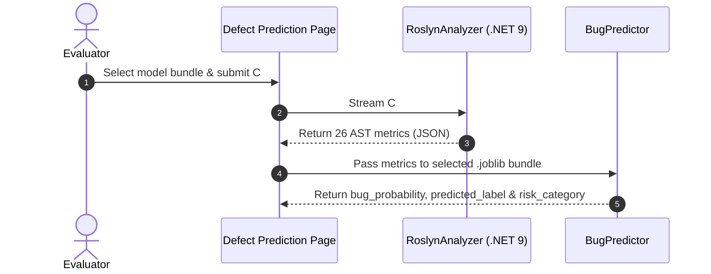

# 06 — Application Demonstration & Interactive Usage

---

## 1. Streamlit Engineering Interface

The application provides an 8-page Streamlit interface for executing and inspecting the defect prediction pipeline:

| Page | Module | Primary Functionality |
| :---: | :--- | :--- |
| 1 | `dashboard.py` | Database entity counts, pipeline summary, and SQLite registered model inspection |
| 2 | `repo_collection.py` | GitHub C# repository search, metadata inspection, and local Git cloning |
| 3 | `bug_analysis.py` | Bug-fix commit classification, SZZ blame tracing, and Roslyn metric extraction |
| 4 | `dataset_management.py` | Dataset filtering, metric distribution inspection, and versioned CSV export |
| 5 | `model_training.py` | Interactive classifier training (`RandomForest`, `GradientBoosting`, `LogisticRegression`, `SVM`, `NeuralNetwork`) |
| 6 | `model_evaluation.py` | Model bundle comparison, confusion matrix, and feature importance inspection |
| 7 | `bug_prediction.py` | Real-time C# method Roslyn analysis and defect probability scoring |
| 8 | `settings.py` | Path diagnostics, Roslyn binary status, and risk threshold configuration |

---

## 2. Deployed Model Bundles & Selection Order

`ModelManager.list_saved_models()` discovers all 4 `.joblib` bundles in `4_AppBuild/Assets/Models/` and orders the nested-optimized models first on the **Model Evaluation** and **Defect Prediction** pages:

| Selection Order | Bundle Identifier | Algorithm | Training Corpus | Outer ROC-AUC | Pooled OOF F1 |
| :---: | :--- | :--- | :--- | :---: | :---: |
| **1 (Default)** | `et_nested_opt_v3_depth6_leaf6_log2` | `ExtraTreesClassifier` | Dataset #2 ($N=578$, 26 features) | 0.7349 $\pm$ 0.0703 | 0.7653 |
| **2** | `rf_nested_opt_v3_depth6_leaf8_log2` | `RandomForestClassifier` | Dataset #2 ($N=578$, 26 features) | 0.7216 $\pm$ 0.1156 | 0.7406 |
| **3 (Baseline)** | `exp_final_5fold_v2_best_rf_compact_regularized` | `RandomForestClassifier` | Dataset #2 ($N=578$, 26 features) | 0.7037 $\pm$ 0.1292 | 0.7294 |
| **4 (Dataset #1)** | `rf_csharp_empirical_model` | `RandomForestClassifier` | Dataset #1 ($N=382$ train, 25 features) | 0.5944 (Holdout) | 0.4839 (Holdout) |

*Note:* The **Dashboard** page queries `db.list_models()` directly on the frozen SQLite database (`1_Database/SQLite/bug_detection.db`), which displays the historical Dataset #1 record (`rf_csharp_empirical_model`), whereas **Model Evaluation** and **Defect Prediction** load all 4 filesystem bundles via `ModelManager`.

---

## 3. Live Prediction & Threshold Behavior

### Verified Threshold Configuration in `BugPredictor` (`2_SourceCode/Python/ml/predictor.py`)
1. **Continuous Defect Probability (`bug_probability`):** Computed via `self.model.predict_proba(df_proc)[0][1]`.
2. **Binary Classification (`predicted_label`):** Computed via `self.model.predict(df_proc)[0]`, which applies `scikit-learn`'s nominal $\tau = 0.50$ threshold (rather than the nested CV inner thresholds $\tau \in [0.30, 0.40]$ or fixed $\tau = 0.40$ used to compute bundle `confusion_matrix` metadata).
3. **Risk Tier Categorization (`risk_category`):** Determined from `PredictionSettings` (`config.py`):

| Risk Category | Probability Condition | Operational Interpretation |
| :--- | :---: | :--- |
| **Low Risk** | $P \le 0.30$ | Below both the nested CV operating range ($\tau \in [0.30, 0.40]$) and the nominal 0.50 boundary |
| **Medium Risk** | $0.30 < P \le 0.60$ | Spans the nested CV operating thresholds ($\tau = 0.35\text{--}0.40$) and the nominal 0.50 boundary |
| **High Risk** | $P > 0.60$ | Elevated structural complexity and defect probability |
