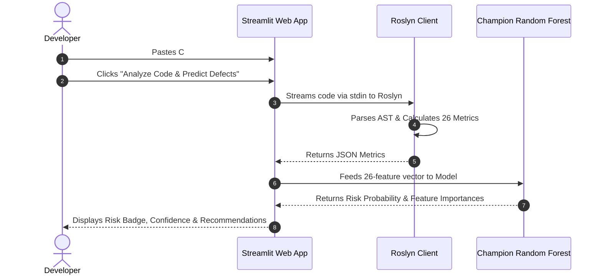

# 06 — Application Demonstration & Interactive Usage

---

## 1. Streamlit Interactive Workbench

The application provides an interactive web interface designed for software developers, QA leads, and software engineering researchers.

```text
==============================================================================
C# Defect Predictor — Interactive Navigation
==============================================================================
[1] Dashboard               -> Real-time repository, commit, and model metrics
[2] Repository Collection   -> Search & clone GitHub C# open-source projects
[3] Bug Analysis & SZZ      -> Interactive regex bug-fix & git blame tracing
[4] Dataset Management      -> Filter cohorts & export versioned CSV datasets
[5] Model Training          -> Train classifiers with hyperparameter controls
[6] Model Evaluation        -> Confusion matrices, ROC curves & threshold sweeps
[7] Real-World Prediction   -> Live method-level C# defect risk scoring
[8] Settings                -> Inspect paths, database diagnostics & thresholds
==============================================================================
```

---

## 2. Real-Time Defect Prediction Workflow (Tab 7)



---

## 3. Risk Categorization Tiers

The system categorizes defect risk into three intuitive operating tiers:

| Risk Tier | Probability Range | Visual Badge | Recommended Developer Action |
| :--- | :---: | :---: | :--- |
| **Low Risk** | $P < 0.35$ | Low Risk | Standard continuous integration tests suffice. |
| **Medium Risk** | $0.35 \le P \le 0.65$ | Medium Risk | Standard peer review recommended; verify edge case test coverage. |
| **High Risk** | $P > 0.65$ | High Risk | Senior developer review recommended; inspect high-complexity branches. |

---

## 4. Live Prediction Example

### Input C# Code Snippet
```csharp
public int ComplexProcessor(int[] data, int threshold, bool filterNegatives) {
    if (data == null) throw new ArgumentNullException(nameof(data));
    int sum = 0;
    for (int i = 0; i < data.Length; i++) {
        if (filterNegatives && data[i] < 0) continue;
        if (data[i] > threshold) {
            sum += data[i] * 2;
        } else {
            sum += data[i];
        }
    }
    return sum;
}
```

### System Diagnostic Output
- **Extracted Metrics:** `loc: 13`, `cyclomatic_complexity: 5`, `parameter_count: 3`, `max_nesting_depth: 3`, `statement_count: 8`
- **Model Output:** Defect Probability = **$0.3412$** (Low Risk)
- **Top Influential Factors:** `parameter_count` (3 parameters), `cyclomatic_complexity` (5 branches)

