# C# Defect Predictor: Machine Learning-Based Software Bug Detection

An academic-grade, fully local Machine Learning system for predicting software defect proneness in C# source code methods using **Multi-Model Supervised Learning (Random Forest Ensembles, Decision Trees, Logistic Regression, Dummy Baselines)** and static code metrics extracted via **Microsoft Roslyn**.

Developed for the Computational Intelligence in Software Engineering curriculum at Babeș-Bolyai University (Master in Applied Computational Intelligence).

---

## 🧭 Repository Structure & Main Project Areas

The repository is organized into six sequential, self-contained functional domains:

```text
CISE_Project2/
│
├── README.md                                  # Repository overview and quick start
├── app.py                                     # Root application launcher
├── pytest.ini                                 # Automated testing configuration
├── requirements.txt                           # Python dependencies
│
├── 1_Database/                                # Persistent database and datasets
│   ├── SQLite/                                # SQLite databases (bug_detection.db)
│   ├── Datasets/                              # Versioned CSV datasets (Original v1, Processed v2)
│   └── Schema/                                # Relational database & dataset schemas
│
├── 2_SourceCode/                              # Implementation & test source code
│   ├── Python/                                # Python application modules & Streamlit workbench
│   │   ├── application/pages/                 # Interactive Streamlit UI pages (8 tabs)
│   │   ├── core/                              # Settings, project root resolution, defaults
│   │   ├── database/                          # SQLite connection, schema, repository DB
│   │   ├── ml/                                # Training, cross-validation, predictor
│   │   ├── repositories/                      # GitHub API client, git manager, commit collector
│   │   ├── services/                          # Roslyn bridge, SZZ analyzer, dataset builder
│   │   ├── utils/                             # Logging & production source code classifier
│   │   ├── src/                               # Backward-compatibility facade layer
│   │   └── app.py                             # Core Streamlit application entrypoint
│   ├── RoslynAnalyzer/                        # .NET 9.0 C# AST static metric analyzer
│   ├── Tests/                                 # 16 automated test modules (121 tests)
│   └── Scripts/                               # Operational and maintenance scripts
│
├── 3_TestResults/                             # Empirical results & evaluation evidence
│   ├── AutomatedTests/                        # Automated pytest test execution reports
│   ├── CrossValidation/                      # 5-fold CV reports, results JSON, and CSVs
│   ├── HoldoutEvaluation/                     # Independent holdout (Newtonsoft.Json) results
│   ├── ModelEvaluation/                       # 11-model comparison benchmark metrics
│   └── AuditReports/                          # SZZ and dataset integrity audits
│
├── 4_AppBuild/                                # Distributable runtime packages
│   ├── Windows/                               # Windows 1-click launcher (run_app.bat)
│   ├── Assets/Models/                         # Frozen serialized ML model bundles
│   └── ReleaseNotes/                          # Release notes and changelog (v1.0.0)
│
├── 5_Documentation/                           # Technical and academic documentation
│   ├── 01_Architecture/                       # System architecture and data flows
│   ├── 02_Database/                           # Database design, schema, and provenance
│   ├── 03_SourceCode/                         # Source code guide and developer instructions
│   ├── 04_MachineLearning/                    # SZZ, Roslyn features, and ML methodology
│   ├── 05_Validation/                         # Empirical validation and academic limitations
│   ├── 06_UserGuide/                          # Step-by-step user manual & troubleshooting
│   ├── 07_AcademicReport/                     # Authoritative academic paper (FINAL_REPORT.md)
│   └── 08_Archive/                            # 20 historical reports and audit provenance
│
└── 6_Presentation/                            # University defense presentation material
    ├── 01_ProjectOverview.md                  # Project overview and motivation
    ├── 02_ProblemAndObjectives.md              # Problem definition and research questions
    ├── 03_SystemArchitecture.md               # Pipeline architecture and technology stack
    ├── 04_DatasetAndMethodology.md            # SZZ, production filtering, and 26 Roslyn metrics
    ├── 05_MachineLearningResults.md           # 11-model benchmark & reconciled accuracy
    ├── 06_ApplicationDemo.md                  # Interactive Streamlit UI and prediction workflow
    └── 07_ConclusionAndFutureWork.md          # Conclusions, limitations, and future research
```

---

## 🚀 Key Capabilities

- **Automated GitHub Discovery & Cloning**: Query public C# repositories via GitHub REST API, clone full histories, and track commit diffs incrementally.
- **Bug-Fix & SZZ Traceability**: Identify bug-fixing commits via commit message heuristics and issue/PR references; trace candidate Bug-Inducing Commits (BICs) using `git blame -w -M -C`.
- **Roslyn Static Code Metrics**: Cross-platform .NET 9.0 CLI calculating 26 structural, complexity, and OOP metrics using `Microsoft.CodeAnalysis.CSharp`. Isolates enclosing methods from nested lambdas/local functions and normalizes newlines across platforms.
- **Production-Only Code Classifier**: Enforces strict filtering rejecting test directories (`Tests/`, `Specs/`, `Testing/`), test projects (`.Tests`, `.Specs`), and test fixtures (`*Tests.cs`, `*Tester.cs`).
- **Zero-Leakage 5-Fold GroupKFold**: Enforces repository-level data partitioning (`GroupKFold` with $N_{\text{repos}}=5$, $K=5$), ensuring code from the same repository never leaks between training and validation sets.
- **Multi-Model Benchmarking**: Supervised classification benchmarked across Random Forest (5 architectures), Decision Tree (shallow & deep), Logistic Regression (standard & balanced), and DummyClassifier baselines.
- **Out-of-Fold Threshold Optimization & Calibration**: Tunes decision thresholds strictly on pooled out-of-fold cross-validation predictions; evaluates probability calibration via Brier score loss.
- **Strictly Quarantined Real-World Holdout**: Evaluates the frozen model on an untouched independent repository (`JamesNK/Newtonsoft.Json`, 159 methods), achieving **89.87% Recall** and **0.7845 F1-Score**.
- **Real-Time Method & File Bug Prediction**: Interactive Streamlit interface to paste C# snippets or upload complete `.cs` files, extract Roslyn metrics live, estimate defect risk scores, identify influential metrics, and export CSV reports.
- **Privacy-Preserving & Fully Local**: Operates 100% on the local workstation. No external LLMs, no paid APIs, no telemetry, and raw source code is never stored without explicit user consent.

---

## 🏗️ System Architecture

```mermaid
flowchart LR
    subgraph DataCollection[1. Data Collection]
        GH[GitHub REST API] --> Cloner[RepositoryManager]
        Cloner --> Commits[CommitCollector]
    end

    subgraph MiningSZZ[2. Mining & SZZ]
        Commits --> FixDetector[BugFixDetector]
        FixDetector --> SZZ[SZZAnalyzer]
        SZZ --> Guard[Production Source Guard]
        Guard --> Labeler[LabelManager]
    end

    subgraph Metrics[3. Roslyn Metrics]
        Labeler --> Roslyn[Microsoft.CodeAnalysis.CSharp CLI]
        Roslyn --> Builder[DatasetBuilder]
    end

    subgraph MLPipeline[4. Multi-Model 5-Fold GroupKFold]
        Builder --> Split[5-Fold GroupKFold by Repo]
        Split --> Trainer[ModelTrainer: RF, DT, LR, Dummy]
        Trainer --> Calibrator[Brier Score & Threshold Tuning]
    end

    subgraph Validation[5. Quarantined Holdout]
        Calibrator --> Holdout[Newtonsoft.Json Holdout Test]
    end

    subgraph GUI[6. Local Prediction]
        Trainer --> Predictor[BugPredictor]
        InputCode[Raw C# / .cs File] --> Predictor
        Predictor --> Streamlit[Streamlit Multi-Page UI]
    end
```



---

## 📋 Prerequisites

1. **Python**: Version 3.11 or higher (Python 3.11, 3.12, 3.13 supported).
2. **.NET SDK**: .NET 9.0 SDK or higher installed (`dotnet --version`).
3. **Git**: Git CLI installed and available in `PATH`.
4. **GitHub Token (Optional)**: Personal Access Token (PAT) for querying GitHub REST API above anonymous rate limits.

---

## 💻 Installation & Quick Execution

### Windows (PowerShell)

```powershell
# 1. Clone or navigate to the repository
cd CISE_Project2

# 2. Create and activate a Python virtual environment
python -m venv .venv
.\.venv\Scripts\Activate.ps1

# 3. Upgrade pip and install project dependencies
pip install --upgrade pip
pip install -r requirements.txt

# 4. Build the .NET 9 Roslyn Analyzer
dotnet build 2_SourceCode\RoslynAnalyzer\RoslynAnalyzer.csproj -c Release

# 5. Run the Streamlit Application
streamlit run app.py
```

*Tip (Windows 1-Click Launch):* Double-click `4_AppBuild\Windows\run_app.bat` to automatically activate the environment, build the analyzer if needed, and start Streamlit.

### macOS / Linux (Bash / Zsh)

```bash
# 1. Clone or navigate to the repository
cd CISE_Project2

# 2. Create and activate a Python virtual environment
python3 -m venv .venv
source .venv/bin/activate

# 3. Upgrade pip and install dependencies
pip install --upgrade pip
pip install -r requirements.txt

# 4. Build the .NET 9 Roslyn Analyzer
dotnet build 2_SourceCode/RoslynAnalyzer/RoslynAnalyzer.csproj -c Release

# 5. Run the Streamlit Application
streamlit run app.py
```

The application will launch in your browser at `http://localhost:8501`.

---

## 🧪 Running Automated Tests

Run the full automated test suite (121 passing tests):

```powershell
# From repository root
pytest
```

All 121 tests execute deterministically offline without external database or network dependencies.  
View execution details in [3_TestResults/AutomatedTests/TEST_EXECUTION_REPORT.md](3_TestResults/AutomatedTests/TEST_EXECUTION_REPORT.md).

---

## 📊 Empirical Datasets

The repository maintains persistent datasets in SQLite ([1_Database/SQLite/bug_detection.db](1_Database/SQLite/bug_detection.db)) and exported versioned CSV snapshots in [1_Database/Datasets/](1_Database/Datasets/):

1. **Dataset Snapshot #1 (`csharp_empirical_v1`, v1.0.0)** — [1_Database/Datasets/Original/](1_Database/Datasets/Original/):
   - **483 methods** (242 Buggy, 241 Clean).
   - Repositories: `Humanizer` (291), `CommandLineParser` (101), `MediatR` (91).
   - Baseline dataset used during exploratory development.
2. **Dataset Snapshot #2 (`csharp_empirical_v2`, v2.0.0)** — [1_Database/Datasets/Processed/](1_Database/Datasets/Processed/):
   - **578 methods** (279 Buggy, 299 Clean, 48.27% / 51.73% balance).
   - Repositories: `Humanizer` (291), `Serilog` (134), `MediatR` (91), `Polly` (34), `FluentValidation` (28).
   - Authoritative benchmark used for 5-Fold GroupKFold cross-validation.
3. **Independent Holdout Corpus (`Newtonsoft.Json`)**:
   - **159 methods** (79 Buggy, 80 Clean).
   - Strictly quarantined until model architecture and thresholds were frozen.

---

## 📚 Academic Documentation & Research References

Detailed technical and research material is organized in [5_Documentation/](5_Documentation/):

- 📄 **[5_Documentation/07_AcademicReport/FINAL_REPORT.md](5_Documentation/07_AcademicReport/FINAL_REPORT.md)** — **Authoritative Academic Research Report**: Complete 22-section academic paper covering problem formulation, SZZ mining, Roslyn static metrics, 5-fold repository-aware cross-validation, probability calibration, threshold tuning, quarantined holdout evaluation, threats to validity, and CI/CD recommendations.
- 🏛️ **[5_Documentation/01_Architecture/SYSTEM_ARCHITECTURE.md](5_Documentation/01_Architecture/SYSTEM_ARCHITECTURE.md)** — **System Architecture**: High-level component responsibilities, subprocess bridge, and data flows.
- 🗄️ **[5_Documentation/02_Database/DATABASE_ARCHITECTURE.md](5_Documentation/02_Database/DATABASE_ARCHITECTURE.md)** — **Database Architecture**: SQLite entity relationships, schema documentation, and data provenance.
- 💻 **[5_Documentation/03_SourceCode/SOURCE_CODE_GUIDE.md](5_Documentation/03_SourceCode/SOURCE_CODE_GUIDE.md)** — **Source Code Guide**: Python package layout, Roslyn AST visitor details, and developer guide.
- 🔬 **[5_Documentation/04_MachineLearning/PROJECT_METHODOLOGY.md](5_Documentation/04_MachineLearning/PROJECT_METHODOLOGY.md)** — **Methodology Reference**: Specification of repository discovery, commit mining, SZZ blame tracing, and 26 Roslyn metrics.
- 📊 **[5_Documentation/04_MachineLearning/EXPERIMENTAL_RESULTS.md](5_Documentation/04_MachineLearning/EXPERIMENTAL_RESULTS.md)** — **Consolidated Empirical Results**: Benchmark tables for all 11 model configurations, fold breakdowns, and threshold curves.
- ⚖️ **[5_Documentation/05_Validation/VALIDATION_AND_LIMITATIONS.md](5_Documentation/05_Validation/VALIDATION_AND_LIMITATIONS.md)** — **Verification, Validation & Limitations**: 121 passing tests, empirical validation, Bayes Base-Rate Fallacy derivations, and academic limitations.
- 📖 **[5_Documentation/06_UserGuide/USER_GUIDE.md](5_Documentation/06_UserGuide/USER_GUIDE.md)** — **User Guide**: Step-by-step UI walkthrough and troubleshooting.
- 📋 **[5_Documentation/07_AcademicReport/DEVELOPER_STUDY_TEMPLATE.md](5_Documentation/07_AcademicReport/DEVELOPER_STUDY_TEMPLATE.md)** — **Developer Study Protocol**: Formal 24-method double-blind review instrument.
- 🗃️ **[5_Documentation/08_Archive/](5_Documentation/08_Archive/)** — **Historical Archives**: Catalog of 20 historical audits, baseline reports, and superseded documents.

---

## 🎓 University Defense Presentation Material

A concise 7-part presentation sequence for academic examination is available in [6_Presentation/](6_Presentation/):

1. 📌 **[01_ProjectOverview.md](6_Presentation/01_ProjectOverview.md)**: Project overview, motivation, and core contributions.
2. 🎯 **[02_ProblemAndObjectives.md](6_Presentation/02_ProblemAndObjectives.md)**: Problem definition, research questions (RQ1–RQ4), and measurable objectives.
3. ⚙️ **[03_SystemArchitecture.md](6_Presentation/03_SystemArchitecture.md)**: End-to-end processing pipeline, tech stack, and subprocess bridge.
4. 🔬 **[04_DatasetAndMethodology.md](6_Presentation/04_DatasetAndMethodology.md)**: 7 mined repositories, SZZ algorithm, and 26 Roslyn static features.
5. 📈 **[05_MachineLearningResults.md](6_Presentation/05_MachineLearningResults.md)**: 11-classifier benchmark, accuracy reconciliation, and holdout results.
6. 🖥️ **[06_ApplicationDemo.md](6_Presentation/06_ApplicationDemo.md)**: 8-page Streamlit web app demonstration and real-time prediction flow.
7. 🔮 **[07_ConclusionAndFutureWork.md](6_Presentation/07_ConclusionAndFutureWork.md)**: Summary of findings, academic limitations (Bayes theorem), and future directions.

---

## 🧠 Summary of Final Experimental Results  

### Multi-Model 5-Fold GroupKFold Benchmark (Dataset #2, 578 Methods Across 5 Repositories)

Cross-validation was evaluated using strict repository-level grouping (`GroupKFold`, $N_{\text{repos}}=5$, $K=5$), ensuring zero intra-repository leakage between training and validation sets:

| Rank | Configuration ID | Algorithm Family | F1 (Mean ± Std) | Recall (Mean ± Std) | Precision (Mean ± Std) | Accuracy (Mean ± Std) | Brier Score |
| :---: | :--- | :--- | :---: | :---: | :---: | :---: | :---: | :---: |
| **1** | `rf_compact_regularized` | Random Forest | **$0.6859 \pm 0.0247$** | $0.7403 \pm 0.1557$ | $0.6824 \pm 0.1202$ | **$0.6734 \pm 0.0491$** | **$0.2144 \pm 0.0396$** |
| 2 | `rf_feature_constrained_log2` | Random Forest | $0.6385 \pm 0.0641$ | $0.6831 \pm 0.1706$ | $0.6384 \pm 0.1197$ | $0.6369 \pm 0.0673$ | $0.2209 \pm 0.0375$ |
| 3 | `rf_heavy_bagging_300` | Random Forest | $0.6262 \pm 0.0633$ | $0.6788 \pm 0.1738$ | $0.6117 \pm 0.0984$ | $0.6212 \pm 0.0617$ | $0.2265 \pm 0.0376$ |
| 4 | `rf_baseline_balanced` | Random Forest | $0.6108 \pm 0.1176$ | $0.6678 \pm 0.1982$ | $0.6046 \pm 0.1157$ | $0.6074 \pm 0.0827$ | $0.2249 \pm 0.0410$ |
| 5 | `dt_shallow_depth4` | Decision Tree | $0.5734 \pm 0.2172$ | $0.6166 \pm 0.2646$ | $0.5573 \pm 0.1884$ | $0.5721 \pm 0.1345$ | $0.2807 \pm 0.0699$ |
| 6 | `rf_deep_capacity` | Random Forest | $0.5577 \pm 0.0739$ | $0.5794 \pm 0.1737$ | $0.5811 \pm 0.1147$ | $0.5815 \pm 0.0647$ | $0.2429 \pm 0.0435$ |
| 7 | `lr_balanced_c1` | Logistic Regression | $0.4989 \pm 0.1252$ | $0.4538 \pm 0.1469$ | $0.5994 \pm 0.1557$ | $0.5709 \pm 0.0894$ | $0.2620 \pm 0.0368$ |
| 8 | `dummy_stratified` | Baseline (Prior) | $0.4919 \pm 0.0821$ | $0.4644 \pm 0.1328$ | $0.5259 \pm 0.0526$ | $0.4984 \pm 0.0592$ | $0.4726 \pm 0.0700$ |
| 9 | `lr_standard_c1` | Logistic Regression | $0.4890 \pm 0.1409$ | $0.4360 \pm 0.1651$ | $0.6095 \pm 0.1593$ | $0.5744 \pm 0.0877$ | $0.2643 \pm 0.0366$ |
| 10 | `dt_depth8` | Decision Tree | $0.4695 \pm 0.2194$ | $0.4907 \pm 0.2529$ | $0.4844 \pm 0.1983$ | $0.5050 \pm 0.1425$ | $0.3993 \pm 0.1017$ |
| 11 | `dummy_most_frequent` | Baseline (Majority) | $0.0000 \pm 0.0000$ | $0.0000 \pm 0.0000$ | $0.0000 \pm 0.0000$ | $0.5173 \pm 0.0210$ | $0.4885 \pm 0.0218$ |

### Reconciled Accuracy Metrics
- **5-Fold CV Mean Accuracy ($\tau = 0.50$):** **$0.6734 \pm 0.0491$** (unweighted mean across 5 validation folds).
- **Pooled Out-of-Fold Nominal Accuracy ($\tau = 0.50$):** **$67.13\%$** ($TN=183, FP=116, FN=74, TP=205$, $N=578$).
- **Pooled Out-of-Fold Tuned Accuracy ($\tau^* = 0.40$):** **$70.42\%$** ($TN=163, FP=136, FN=35, TP=244$, $N=578$).

### Independent Holdout Evaluation (`JamesNK/Newtonsoft.Json`, 159 Methods)
Evaluated blindly on an independent repository after model architecture and decision thresholds were frozen:
- **Nominal Threshold ($\tau = 0.50$):** Accuracy **74.21%**, Precision **69.79%**, Recall **84.81%**, F1 **0.7657**, ROC-AUC **0.8209**, Brier **0.1713** ($TN=51, FP=29, FN=12, TP=67$).
- **In-Training Tuned Threshold ($\tau^* = 0.40$):** Accuracy **75.47%**, Precision **69.61%**, Recall **89.87%** (71/79 defects caught), F1 **0.7845** ($TN=49, FP=31, FN=8, TP=71$).

---

## ⚠️ Documented Academic Limitations

1. **Base-Rate Fallacy in Production:** Evaluated on balanced ~1:1 corpora (~48%–50% defect prevalence). In industrial codebases where defects affect 2%–10% of methods, operational precision will decline (e.g. ~10.9% expected precision at 5% prevalence based on Bayes' theorem; see [5_Documentation/05_Validation/VALIDATION_AND_LIMITATIONS.md](5_Documentation/05_Validation/VALIDATION_AND_LIMITATIONS.md)).
2. **SZZ Label Approximations:** Defect labels are derived heuristically via Git blame and bug-fixing commit messages rather than certified ground truth.
3. **Open-World Assumption:** Candidate-clean methods sampled from stable HEAD are free of recorded bug-fixing traces in the mined commit window, but may contain undiscovered latent defects.
4. **Threshold Selection Coupling:** Decision threshold 0.40 was optimized on aggregated out-of-fold cross-validation predictions without nested CV, though its generalizability was confirmed on the independent holdout.
5. **Absence of External Human Feedback:** External human survey feedback was not collected; the evaluation protocol is published as a research instrument ([5_Documentation/07_AcademicReport/DEVELOPER_STUDY_TEMPLATE.md](5_Documentation/07_AcademicReport/DEVELOPER_STUDY_TEMPLATE.md)), and qualitative analyses were conducted via automated AST inspection.

---

## 🔒 Privacy & Local Processing

- **No Remote Telemetry**: All code analysis, parsing, training, and predictions occur 100% locally on your machine.
- **Source Code Privacy**: Raw source code is not persisted in prediction logs by default. Users may toggle history logging or clear stored predictions at any time in **Settings**.
- **No Paid External Dependencies**: Operates independently of commercial LLM APIs.
