# C# Defect Predictor: Machine Learning-Based Software Bug Detection

An academic-grade, fully local Machine Learning system for predicting software defect proneness in C# source code methods using **Multi-Model Supervised Learning (Random Forest Ensembles, Decision Trees, Logistic Regression, Dummy Baselines)** and static code metrics extracted via **Microsoft Roslyn**.

Developed for the Computational Intelligence in Software Engineering curriculum at Babeș-Bolyai University.

---

## 🚀 Key Capabilities

- **Automated GitHub Discovery & Cloning**: Query public C# repositories via GitHub REST API, clone full histories, and track commit diffs incrementally.
- **Bug-Fix & SZZ Traceability**: Identify bug-fixing commits via commit message heuristics and issue/PR references; trace candidate Bug-Inducing Commits (BICs) using `git blame -w -M -C`.
- **Roslyn Static Code Metrics**: Cross-platform .NET 9.0 CLI calculating 26 structural, complexity, and OOP metrics using `Microsoft.CodeAnalysis.CSharp`. Isolates enclosing methods from nested lambdas/local functions and normalizes newlines across platforms.
- **Production-Only Code Classifier**: Enforces strict filtering rejecting test directories (`Tests/`, `Specs/`, `Testing/`), test projects (`.Tests`, `.Specs`), and test fixtures (`*Tests.cs`, `*Tester.cs`).
- **Zero-Leakage 5-Fold GroupKFold**: Enforces repository-level data partitioning (`GroupKFold` with $N_{\text{repos}}=5$, $K=5$), ensuring code from the same repository never leaks between training and validation sets.
- **Multi-Model Benchmarking**: Supervised classification benchmarked across Random Forest (5 architectures), Decision Tree (shallow & deep), Logistic Regression (standard & balanced), and DummyClassifier baselines.
- **Out-of-Fold Threshold Optimization & Calibration**: Tunes decision thresholds strictly on pooled out-of-fold cross-validation predictions; evaluates probability calibration via Brier score loss.
- **Strictly Quarantined Real-World Holdout**: Evaluates the frozen model on an untouched independent repository (`JamesNK/Newtonsoft.Json`, 159 methods), achieving **89.87% Recall** and **0.7845 F1-Score**.
- **Real-Time Method & File Bug Prediction**: Interactive Streamlit interface to paste C# snippets or upload complete `.cs` files, extract Roslyn metrics live, estimate defect risk scores, identify influential metrics, and export CSV reports.
- **Privacy-Preserving & Fully Local**: Operates 100% on the local workstation. No external LLMs, no paid APIs, no telemetry, and raw source code is never stored without explicit user consent.

---

## 🏗️ System Architecture

```mermaid
flowchart LR
    subgraph DataCollection[1. Data Collection]
        GH[GitHub REST API] --> Cloner[RepositoryManager]
        Cloner --> Commits[CommitCollector]
    end

    subgraph MiningSZZ[2. Mining & SZZ]
        Commits --> FixDetector[BugFixDetector]
        FixDetector --> SZZ[SZZAnalyzer]
        SZZ --> Guard[Production Source Guard]
        Guard --> Labeler[LabelManager]
    end

    subgraph Metrics[3. Roslyn Metrics]
        Labeler --> Roslyn[Microsoft.CodeAnalysis.CSharp CLI]
        Roslyn --> Builder[DatasetBuilder]
    end

    subgraph MLPipeline[4. Multi-Model 5-Fold GroupKFold]
        Builder --> Split[5-Fold GroupKFold by Repo]
        Split --> Trainer[ModelTrainer: RF, DT, LR, Dummy]
        Trainer --> Calibrator[Brier Score & Threshold Tuning]
    end

    subgraph Validation[5. Quarantined Holdout]
        Calibrator --> Holdout[Newtonsoft.Json Holdout Test]
    end

    subgraph GUI[6. Local Prediction]
        Trainer --> Predictor[BugPredictor]
        InputCode[Raw C# / .cs File] --> Predictor
        Predictor --> Streamlit[Streamlit Multi-Page UI]
    end
```



---

## 📋 Prerequisites

1. **Python**: Version 3.11 or higher (Python 3.11, 3.12, 3.13 supported).
2. **.NET SDK**: .NET 9.0 SDK or higher installed (`dotnet --version`).
3. **Git**: Git CLI installed and available in `PATH`.
4. **GitHub Token (Optional)**: Personal Access Token (PAT) for querying GitHub REST API above anonymous rate limits.

---

## 💻 Installation & Setup

### Windows (PowerShell)

```powershell
# 1. Clone or navigate to the repository
cd CISE_Project2

# 2. Create and activate a Python virtual environment
python -m venv .venv
.\.venv\Scripts\Activate.ps1

# 3. Upgrade pip and install project dependencies
pip install --upgrade pip
pip install -r requirements.txt

# 4. Verify .NET SDK installation and build Roslyn Analyzer
dotnet --version
dotnet build roslyn_analyzer\RoslynAnalyzer.csproj -c Release

# 5. Run the Streamlit Application
streamlit run app.py
```

### macOS / Linux (Bash / Zsh)

```bash
# 1. Clone or navigate to the repository
cd CISE_Project2

# 2. Create and activate a Python virtual environment
python3 -m venv .venv
source .venv/bin/activate

# 3. Upgrade pip and install dependencies
pip install --upgrade pip
pip install -r requirements.txt

# 4. Verify .NET SDK installation and build Roslyn Analyzer
dotnet --version
dotnet build roslyn_analyzer/RoslynAnalyzer.csproj -c Release

# 5. Run the Streamlit Application
streamlit run app.py
```

The application will launch in your browser at `http://localhost:8501`.

---

## 🧪 Running the Test Suite

Run the full automated test suite (121 passing tests):

```powershell
# On Windows
.\.venv\Scripts\pytest.exe -v

# On macOS/Linux
pytest -v
```

All tests execute deterministically offline without network dependencies.

---

## 📊 Empirical Datasets

The repository maintains two versioned dataset snapshots stored in SQLite (`data/database/bug_detection.db`) and exported to `data/processed/`:

1. **Dataset Snapshot #1 (`csharp_empirical_v1`, v1.0.0)**:
   - **483 methods** (226 Buggy, 257 Clean).
   - Repositories: `Humanizer` (291), `MediatR` (91), `CommandLineParser` (101).
   - Historical baseline used during exploratory development.
2. **Dataset Snapshot #2 (`csharp_empirical_v2`, v2.0.0)**:
   - **578 methods** (279 Buggy, 299 Clean, 48.27% / 51.73% balance).
   - Repositories: `Humanizer` (291), `Serilog` (134), `MediatR` (91), `Polly` (34), `FluentValidation` (28).
   - Authoritative benchmark used for 5-Fold GroupKFold cross-validation.
3. **Independent Holdout Corpus (`Newtonsoft.Json`)**:
   - **159 methods** (79 Buggy, 80 Clean).
   - Strictly quarantined until model architecture and thresholds were frozen.

---

## 🧠 Final Experimental Findings

Detailed findings from the 5-fold cross-validation and independent holdout evaluation are documented in:
👉 **[docs/FINAL_REPORT.md](docs/FINAL_REPORT.md)**  
👉 **[docs/FINAL_EXPERIMENTAL_RESULTS.md](docs/FINAL_EXPERIMENTAL_RESULTS.md)**  
👉 **[docs/INDEPENDENT_VALIDATION_REPORT.md](docs/INDEPENDENT_VALIDATION_REPORT.md)**  
👉 **[docs/DEVELOPER_FEEDBACK_REPORT.md](docs/DEVELOPER_FEEDBACK_REPORT.md)**  

### Multi-Model 5-Fold GroupKFold Benchmark (Dataset #2, 578 Methods)

| Rank | Configuration ID | Algorithm Family | F1 (Mean ± Std) | Recall (Mean ± Std) | Precision (Mean ± Std) | Brier Score |
| :---: | :--- | :--- | :---: | :---: | :---: | :---: |
| **1** | `rf_compact_regularized` | Random Forest | **$0.6859 \pm 0.0247$** | $0.7403 \pm 0.1557$ | $0.6824 \pm 0.1202$ | **$0.2144 \pm 0.0396$** |
| 2 | `rf_feature_constrained_log2` | Random Forest | $0.6385 \pm 0.0641$ | $0.6831 \pm 0.1706$ | $0.6384 \pm 0.1197$ | $0.2209 \pm 0.0375$ |
| 3 | `rf_heavy_bagging_300` | Random Forest | $0.6262 \pm 0.0633$ | $0.6788 \pm 0.1738$ | $0.6117 \pm 0.0984$ | $0.2265 \pm 0.0376$ |
| 4 | `rf_baseline_balanced` | Random Forest | $0.6108 \pm 0.1176$ | $0.6678 \pm 0.1982$ | $0.6046 \pm 0.1157$ | $0.2249 \pm 0.0410$ |
| 5 | `dt_shallow_depth4` | Decision Tree | $0.5734 \pm 0.2172$ | $0.6166 \pm 0.2646$ | $0.5573 \pm 0.1884$ | $0.2807 \pm 0.0699$ |
| 6 | `rf_deep_capacity` | Random Forest | $0.5577 \pm 0.0739$ | $0.5794 \pm 0.1737$ | $0.5811 \pm 0.1147$ | $0.2429 \pm 0.0435$ |
| 7 | `lr_balanced_c1` | Logistic Regression | $0.4989 \pm 0.1252$ | $0.4538 \pm 0.1469$ | $0.5994 \pm 0.1557$ | $0.2620 \pm 0.0368$ |
| 8 | `dummy_stratified` | Baseline (Prior) | $0.4919 \pm 0.0821$ | $0.4644 \pm 0.1328$ | $0.5259 \pm 0.0526$ | $0.4726 \pm 0.0700$ |
| 9 | `lr_standard_c1` | Logistic Regression | $0.4890 \pm 0.1409$ | $0.4360 \pm 0.1651$ | $0.6095 \pm 0.1593$ | $0.2643 \pm 0.0366$ |
| 10 | `dt_depth8` | Decision Tree | $0.4695 \pm 0.2194$ | $0.4907 \pm 0.2529$ | $0.4844 \pm 0.1983$ | $0.3993 \pm 0.1017$ |
| 11 | `dummy_most_frequent` | Baseline (Majority) | $0.0000 \pm 0.0000$ | $0.0000 \pm 0.0000$ | $0.0000 \pm 0.0000$ | $0.4885 \pm 0.0218$ |

### Independent Holdout Evaluation (`JamesNK/Newtonsoft.Json`, 159 Methods)

- **Nominal Threshold ($\tau = 0.50$):**
  - **Accuracy:** 74.21% (118/159)
  - **Precision:** 69.79% (67/96)
  - **Recall:** **84.81%** (67/79 bugs caught)
  - **F1-Score:** **0.7657**
  - **ROC-AUC:** **0.8209** | **PR-AUC:** **0.7917** | **Brier Score:** **0.1713**
  - **Confusion Matrix:** $TN=51, FP=29, FN=12, TP=67$
- **In-Training Tuned Threshold ($\tau^* = 0.40$):**
  - **Accuracy:** **75.47%** (120/159)
  - **Precision:** 69.61% (71/102)
  - **Recall:** **89.87%** (71/79 bugs caught)
  - **F1-Score:** **0.7845**
  - **Confusion Matrix:** $TN=49, FP=31, FN=8, TP=71$

---

## 🖥️ Streamlit Multi-Page Interface Guide

| Page | Description |
| :--- | :--- |
| **📊 Dashboard** | High-level repository, commit, observation, model, and health statistics. |
| **📥 Repository Collection** | Search GitHub public repositories, clone full histories, and track commit diffs. |
| **🔍 Bug Analysis & SZZ** | Detect bug-fixing commits, trace bug-inducing commits (SZZ), and label methods. |
| **📁 Dataset Management** | Extract 26 Roslyn static code metrics, inspect distributions, and export versioned CSV snapshots. |
| **🧠 Model Training** | Train models across 4 algorithm families with repository-aware `GroupKFold` CV and compare with dummy baselines. |
| **📈 Model Evaluation** | Inspect holdout test metrics, confusion matrices, ROC/PR curves, and calibration scores. |
| **🎯 Real-World Bug Prediction** | Paste C# snippets or upload `.cs` files for real-time defect risk scoring, influential metric attribution, and validation benchmarks. |
| **⚙️ Settings** | Configure GitHub PAT, local storage paths, Roslyn project path, prediction thresholds, and privacy options. |

---

## 📊 Defect Risk Score Interpretation

- **0.00 – 0.39 (🟢 Low risk)**: Metrics are within standard clean method baselines.
- **0.40 – 0.69 (🟡 Medium risk)**: Moderate structural complexity or branching; review logic flow and verify test coverage.
- **0.70 – 1.00 (🔴 High risk)**: Severe structural complexity, high cyclomatic complexity, or deep nesting strongly matching historical defect patterns. Mandatory senior review recommended.

> [!IMPORTANT]
> **Defect Risk Caveat**: The risk score is an estimated metric propensity indicating structural complexity. It is **not** a formal proof that a method contains a bug, nor does a low-risk score guarantee code correctness (e.g. subtle semantic flaws in 1-line methods).

---

## 🔒 Privacy & Local Processing

- **No Remote Telemetry**: All code analysis, parsing, training, and predictions occur 100% locally on your machine.
- **Source Code Privacy**: Raw source code is not persisted in prediction logs by default. Users may toggle history logging or clear stored predictions at any time in **Settings**.
- **No Paid External Dependencies**: Operates independently of commercial LLM APIs.
