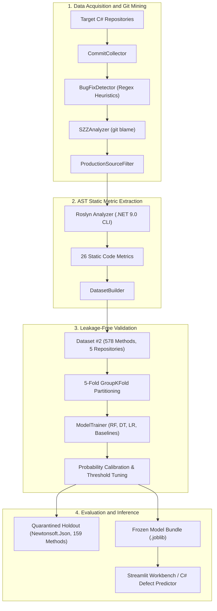

# C# Defect Predictor: Machine Learning-Based Software Defect Prediction

An academic machine learning system for predicting defect-prone C# source code methods using static code metrics extracted via Microsoft Roslyn and evaluated with repository-level cross-validation and an independent holdout repository.

Developed for the Computational Intelligence in Software Engineering curriculum at Babeș-Bolyai University (Master in Applied Computational Intelligence).

---

## 1. Problem Statement

Software defects introduce substantial maintenance costs and reliability risks during software evolution. Traditional quality assurance techniques such as manual code review and exhaustive unit testing are resource-intensive. Automated defect prediction aims to identify defect-prone software components prior to deployment, allowing engineering teams to prioritize verification efforts.

Predicting defects at the method level presents specific technical challenges:
- **Granularity and Isolation:** Method boundaries must be parsed accurately while isolating enclosing methods from nested lambdas, local functions, and anonymous delegates.
- **Data Leakage in Validation:** Standard random cross-validation partitions observations arbitrarily, causing code from the same repository to appear in both training and test sets and artificially inflating evaluation metrics.
- **Labeling Uncertainty:** Historical defect data mined from version control systems rely on heuristic bug-fix identification and blame tracking (SZZ), introducing heuristic approximations under the Open-World Assumption.
- **Operational Prevalence:** Defect distribution in real-world systems is sparse (typically 2% to 10%), leading to the Base-Rate Fallacy where high nominal accuracy yields low practical precision.

---

## 2. Main Objectives

1. **Automated Defect Mining:** Extract bug-fixing commits and identify candidate Bug-Inducing Commits (BICs) across open-source C# repositories using Git history and SZZ blame analysis.
2. **Static Metric Extraction:** Develop a Roslyn-based AST analyzer extracting 26 structural, complexity, and object-oriented metrics directly from C# source code.
3. **Leakage-Free Cross-Validation:** Evaluate multi-model supervised classifiers using strict repository-level 5-fold `GroupKFold` partitioning ($N_{\text{repos}}=5$, $K=5$).
4. **Probability Calibration and Threshold Tuning:** Analyze Brier score calibration and optimize decision thresholds on out-of-fold validation distributions.
5. **Independent Holdout Evaluation:** Verify generalization on a quarantined external repository (`Newtonsoft.Json`, 159 methods) untouched during model exploration and threshold selection.
6. **Local Desktop Workbench:** Provide an interactive Streamlit application for real-time method analysis, file scanning, and model inspection without external network dependencies.

---

## 3. System Capabilities

- **Repository Collection and Git Mining:** Query public C# repositories, clone version histories, and identify bug-fixing commits via standardized regex heuristics and issue/PR references.
- **SZZ-Based Defect Localization:** Map modified lines in bug-fixing commits back to candidate bug-introducing revisions using `git blame -w -M -C`.
- **Production-Source Filtering:** Restrict training observations to production code by excluding test projects, test files, benchmarks, and mock fixtures.
- **26 Roslyn Static Metrics:** Compute physical size, logical statements, McCabe cyclomatic complexity, maximum nesting depth, boolean/logical operators, control flow branches, and member accesses using Microsoft.CodeAnalysis.CSharp.
- **Multi-Model Benchmark:** Compare Random Forest (5 parameter configurations), Decision Trees (shallow and deep), Logistic Regression (standard and balanced), and DummyClassifier baselines.
- **Out-of-Fold Optimization:** Tune operational classification thresholds ($\tau^* = 0.40$) on pooled validation predictions to maximize defect recall while monitoring precision trade-offs.
- **Privacy and Local Execution:** All parsing, training, inference, and persistence run entirely on the local workstation. No telemetry, third-party cloud services, or external language model APIs are used.

---

## 4. Technology Stack

| Component | Technology | Version | Purpose |
| :--- | :--- | :--- | :--- |
| **Language Runtime** | Python | >= 3.11 (tested on 3.13) | Core application, data pipeline, and machine learning |
| **Compiler & AST** | Microsoft .NET SDK | 9.0 | Static code analysis and syntax tree traversal |
| **Roslyn Libraries** | `Microsoft.CodeAnalysis.CSharp` | 4.12.0 | C# syntax parsing, token inspection, and metric extraction |
| **Machine Learning** | `scikit-learn` | 1.6.1 | Estimators, GroupKFold validation, preprocessing, and metrics |
| **Data Processing** | `pandas`, `numpy` | 2.2.3 / 2.2.2 | Dataset transformations, feature matrices, and aggregation |
| **Serialization** | `joblib` | 1.4.2 | Model persistence and frozen estimator bundle loading |
| **Database** | SQLite3 | 3.x | Local relational storage for repositories, commits, and observations |
| **User Interface** | Streamlit, Plotly | 1.42.0 / 6.0.0 | Multi-page interactive desktop workbench and analytical plots |
| **Testing** | `pytest`, `pytest-mock` | 9.2.0 / 3.17.0 | Automated unit, integration, and regression testing |

---

## 5. High-Level Architecture

The repository is structured into six sequential functional domains:

```text
CISE_Project2/
├── README.md                                  # Project overview and entry point
├── app.py                                     # Root application entrypoint
├── pytest.ini                                 # Automated test configuration
├── requirements.txt                           # Frozen Python dependencies
│
├── 1_Database/                                # Relational database and dataset archives
│   ├── Datasets/                              # Versioned CSV snapshots (Original v1, Processed v2)
│   ├── Repositories/                          # Cloned open-source target repositories
│   ├── Schema/                                # Relational schema and dataset specifications
│   └── SQLite/                                # SQLite databases (bug_detection.db)
│
├── 2_SourceCode/                              # Implementation source code
│   ├── Python/                                # Python application modules
│   │   ├── application/pages/                 # Streamlit UI pages (8 analytical areas)
│   │   ├── core/                              # Settings, project root detection, unpickle aliases
│   │   ├── database/                          # SQLite connection and repository queries
│   │   ├── ml/                                # Preprocessing, training, cross-validation, predictor
│   │   ├── repositories/                      # GitHub API client, Git manager, commit collector
│   │   ├── services/                          # Roslyn bridge, SZZ analyzer, dataset builder
│   │   ├── utils/                             # Logging and production file classifier
│   │   └── app.py                             # Streamlit launcher and navigation
│   ├── RoslynAnalyzer/                        # .NET 9.0 C# AST static metric analyzer
│   ├── Scripts/                               # Operational, maintenance, and verification scripts
│   └── Tests/                                 # Automated regression test suite (121 tests)
│
├── 3_TestResults/                             # Empirical validation artifacts
│   ├── AuditReports/                          # Dataset integrity and SZZ reconciliation reports
│   ├── AutomatedTests/                        # Test execution logs and reports
│   ├── CrossValidation/                      # 5-fold cross-validation CSVs and JSON metrics
│   ├── HoldoutEvaluation/                     # Independent holdout evaluation results
│   └── ModelEvaluation/                       # Multi-model benchmark comparisons
│
├── 4_AppBuild/                                # Distribution packages and runtime assets
│   ├── Assets/Models/                         # Frozen serialized Random Forest model bundles
│   ├── ReleaseNotes/                          # Release documentation (v1.0.0)
│   └── Windows/                               # Windows execution launcher (run_app.bat)
│
├── 5_Documentation/                           # Technical specifications and academic reports
│   ├── 01_Architecture/                       # Component responsibilities and system data flow
│   ├── 02_Database/                           # Database schema design and entity relationships
│   ├── 03_SourceCode/                         # Source code guide and module organization
│   ├── 04_MachineLearning/                    # SZZ methodology and experimental results
│   ├── 05_Validation/                         # Empirical validation, Bayes analysis, limitations
│   ├── 06_UserGuide/                          # Operational user guide and troubleshooting
│   ├── 07_AcademicReport/                     # Formal academic research report and study protocol
│   └── 08_Archive/                            # Historical audit reports and baselines
│
└── 6_Presentation/                            # Academic defense presentation slides (7 decks)
    ├── 01_ProjectOverview.md                  # Project motivation and context
    ├── 02_ProblemAndObjectives.md              # Research questions and formal objectives
    ├── 03_SystemArchitecture.md               # Processing pipeline and technology stack
    ├── 04_DatasetAndMethodology.md            # SZZ mining, filtering, and 26 Roslyn metrics
    ├── 05_MachineLearningResults.md           # Model benchmark and accuracy reconciliation
    ├── 06_ApplicationDemo.md                  # Streamlit interface and prediction workflow
    └── 07_ConclusionAndFutureWork.md          # Findings, limitations, and future research
```

### Data and Processing Pipeline



---

## 6. Installation and Execution

### System Requirements

1. **Python**: Version 3.11 or higher.
2. **.NET SDK**: Microsoft .NET 9.0 SDK or higher (`dotnet --version`).
3. **Git**: Command-line Git installed and configured in system `PATH`.
4. **Hardware**: 8 GB RAM minimum; 16 GB recommended for repository mining.

### Setup Instructions

#### Windows (PowerShell)

```powershell
# 1. Navigate to the repository root
cd CISE_Project2

# 2. Create and activate a Python virtual environment
python -m venv .venv
.\.venv\Scripts\Activate.ps1

# 3. Upgrade package installer and install dependencies
python -m pip install --upgrade pip
pip install -r requirements.txt

# 4. Build the .NET 9.0 Roslyn Analyzer
dotnet build 2_SourceCode\RoslynAnalyzer\RoslynAnalyzer.csproj -c Release

# 5. Launch the Streamlit application
streamlit run app.py
```

*One-Click Execution on Windows:* Execute `4_AppBuild\Windows\run_app.bat` to automatically initialize the environment, verify the Roslyn build, and launch Streamlit.

#### Linux and macOS (Bash / Zsh)

```bash
# 1. Navigate to the repository root
cd CISE_Project2

# 2. Create and activate a Python virtual environment
python3 -m venv .venv
source .venv/bin/activate

# 3. Upgrade package installer and install dependencies
python -m pip install --upgrade pip
pip install -r requirements.txt

# 4. Build the .NET 9.0 Roslyn Analyzer
dotnet build 2_SourceCode/RoslynAnalyzer/RoslynAnalyzer.csproj -c Release

# 5. Launch the Streamlit application
streamlit run app.py
```

The application interface opens locally at `http://localhost:8501`.

---

## 7. Automated Testing and Verification

The test suite covers unit logic, database transactions, SZZ analysis, Roslyn metric parsing, and machine learning pipelines. All tests run offline without external network or live GitHub API dependencies.

```powershell
# Execute the full automated regression suite (121 tests)
pytest
```

To run targeted test modules:

```powershell
# Core model pipeline tests
pytest 2_SourceCode/Tests/test_ml_pipeline.py

# Roslyn static metric extraction tests
pytest 2_SourceCode/Tests/test_roslyn_metrics.py

# SZZ algorithm tests
pytest 2_SourceCode/Tests/test_szz_analyzer.py
```

Test execution evidence is recorded in [3_TestResults/AutomatedTests/TEST_EXECUTION_REPORT.md](3_TestResults/AutomatedTests/TEST_EXECUTION_REPORT.md).

---

## 8. Dataset Overview

The project manages two primary datasets and one quarantined independent holdout repository:

| Dataset Identifier | Observations | Positive Class (Defect-Prone) | Negative Class (Candidate-Clean) | Repositories Included | Primary Purpose |
| :--- | :---: | :---: | :---: | :--- | :--- |
| **Dataset #1 (`csharp_empirical_v1`)** | 483 | 242 (50.10%) | 241 (49.90%) | `Humanizer` (291), `CommandLineParser` (101), `MediatR` (91) | Exploratory feature selection and baseline modeling |
| **Dataset #2 (`csharp_empirical_v2`)** | 578 | 279 (48.27%) | 299 (51.73%) | `Humanizer` (291), `Serilog` (134), `MediatR` (91), `Polly` (34), `FluentValidation` (28) | Authoritative benchmark corpus for 5-fold GroupKFold cross-validation |
| **Independent Holdout** | 159 | 79 (49.69%) | 80 (50.31%) | `JamesNK/Newtonsoft.Json` (159) | Quarantined external validation of the frozen model |

### Labeling Methodology and Open-World Assumption

- **Defect-Prone Class (1):** Methods identified in candidate Bug-Inducing Commits via SZZ blame tracing from validated bug-fixing commits. Labels represent heuristic approximations rather than absolute ground truth.
- **Candidate-Clean Class (0):** Production methods sampled from the stable `HEAD` revision with no recorded bug-fixing modifications within the mined commit window. Under the Open-World Assumption of empirical software engineering, these methods are designated as *candidate-clean* because latent defects may remain unrecorded.

---

## 9. Main Experimental Results

### Multi-Model 5-Fold GroupKFold Cross-Validation Benchmark

Models were trained and evaluated on Dataset #2 (578 methods across 5 repositories) using strict repository-level grouping (`GroupKFold`, $K=5$). Metrics represent the mean and standard deviation across validation folds at the nominal decision threshold ($\tau = 0.50$):

| Rank | Model Configuration | Algorithm Family | F1-Score | Recall | Precision | Accuracy | Brier Score |
| :---: | :--- | :--- | :---: | :---: | :---: | :---: | :---: |
| **1** | `rf_compact_regularized` | Random Forest | **0.6859 ± 0.0247** | 0.7403 ± 0.1557 | 0.6824 ± 0.1202 | **0.6734 ± 0.0491** | **0.2144 ± 0.0396** |
| 2 | `rf_feature_constrained_log2` | Random Forest | 0.6385 ± 0.0641 | 0.6831 ± 0.1706 | 0.6384 ± 0.1197 | 0.6369 ± 0.0673 | 0.2209 ± 0.0375 |
| 3 | `rf_heavy_bagging_300` | Random Forest | 0.6262 ± 0.0633 | 0.6788 ± 0.1738 | 0.6117 ± 0.0984 | 0.6212 ± 0.0617 | 0.2265 ± 0.0376 |
| 4 | `rf_baseline_balanced` | Random Forest | 0.6108 ± 0.1176 | 0.6678 ± 0.1982 | 0.6046 ± 0.1157 | 0.6074 ± 0.0827 | 0.2249 ± 0.0410 |
| 5 | `dt_shallow_depth4` | Decision Tree | 0.5734 ± 0.2172 | 0.6166 ± 0.2646 | 0.5573 ± 0.1884 | 0.5721 ± 0.1345 | 0.2807 ± 0.0699 |
| 6 | `rf_deep_capacity` | Random Forest | 0.5577 ± 0.0739 | 0.5794 ± 0.1737 | 0.5811 ± 0.1147 | 0.5815 ± 0.0647 | 0.2429 ± 0.0435 |
| 7 | `lr_balanced_c1` | Logistic Regression | 0.4989 ± 0.1252 | 0.4538 ± 0.1469 | 0.5994 ± 0.1557 | 0.5709 ± 0.0894 | 0.2620 ± 0.0368 |
| 8 | `dummy_stratified` | Baseline (Prior) | 0.4919 ± 0.0821 | 0.4644 ± 0.1328 | 0.5259 ± 0.0526 | 0.4984 ± 0.0592 | 0.4726 ± 0.0700 |
| 9 | `lr_standard_c1` | Logistic Regression | 0.4890 ± 0.1409 | 0.4360 ± 0.1651 | 0.6095 ± 0.1593 | 0.5744 ± 0.0877 | 0.2643 ± 0.0366 |
| 10 | `dt_depth8` | Decision Tree | 0.4695 ± 0.2194 | 0.4907 ± 0.2529 | 0.4844 ± 0.1983 | 0.5050 ± 0.1425 | 0.3993 ± 0.1017 |
| 11 | `dummy_most_frequent` | Baseline (Majority) | 0.0000 ± 0.0000 | 0.0000 ± 0.0000 | 0.0000 ± 0.0000 | 0.5173 ± 0.0210 | 0.4885 ± 0.0218 |

### Reconciled Cross-Validation Accuracy Metrics

To prevent reporting ambiguities, evaluation distinguishes between unweighted fold means and pooled out-of-fold predictions:

| Metric Type | Decision Threshold | Value | Confusion Matrix Context |
| :--- | :---: | :---: | :--- |
| **5-Fold Fold Mean Accuracy** | $\tau = 0.50$ | 0.6734 ± 0.0491 | Arithmetic mean of accuracy across 5 validation folds |
| **Pooled Out-of-Fold Nominal Accuracy** | $\tau = 0.50$ | 67.13% | $TN=183, FP=116, FN=74, TP=205$ ($N=578$) |
| **Pooled Out-of-Fold Tuned Accuracy** | $\tau^* = 0.40$ | 70.42% | $TN=163, FP=136, FN=35, TP=244$ ($N=578$) |

### Independent Holdout Evaluation (`JamesNK/Newtonsoft.Json`, 159 Methods)

The selected Random Forest model (`rf_compact_regularized`) was evaluated on an external repository that was strictly quarantined during model exploration and hyperparameter selection:

| Threshold Setting | Accuracy | Precision | Recall | F1-Score | ROC-AUC | Brier Score | Confusion Matrix |
| :--- | :---: | :---: | :---: | :---: | :---: | :---: | :---: |
| **Nominal ($\tau = 0.50$)** | 74.21% | 69.79% | 84.81% | 0.7657 | 0.8209 | 0.1713 | $TN=51, FP=29, FN=12, TP=67$ |
| **Tuned ($\tau^* = 0.40$)** | 75.47% | 69.61% | 89.87% | 0.7845 | 0.8209 | 0.1713 | $TN=49, FP=31, FN=8, TP=71$ |

At the tuned threshold $\tau^* = 0.40$, the model captures 71 of 79 defect-prone methods (89.87% recall) with a 69.61% precision rate on the balanced holdout corpus.

### Documented Academic Limitations

1. **Base-Rate Fallacy in Production:** Real-world software defect prevalence typically ranges between 2% and 10%, compared to the balanced ~48% to 50% distribution in the experimental datasets. Under Bayes' theorem, an operational deployment with 5% prevalence would yield an expected precision of approximately 10.9% despite high nominal recall.
2. **Heuristic Labeling Approximations:** SZZ annotations rely on commit message heuristics and line blame histories, which may misattribute defects to formatting edits or refactorings.
3. **Absence of External Human Feedback:** The double-blind review framework ([DEVELOPER_STUDY_TEMPLATE.md](5_Documentation/07_AcademicReport/DEVELOPER_STUDY_TEMPLATE.md)) is published as a formal research instrument; no external human developer trials were conducted. Qualitative code analyses were performed via automated AST inspection.
4. **Threshold-Selection Coupling:** The operational threshold $\tau^* = 0.40$ was identified on aggregated out-of-fold cross-validation predictions without nested cross-validation, though its robustness was supported by independent holdout results.

---

## 10. Documentation Index

Comprehensive technical, experimental, and academic documentation is available in [5_Documentation/](5_Documentation/) and [6_Presentation/](6_Presentation/):

| Area | Document Path | Primary Responsibility |
| :--- | :--- | :--- |
| **Academic Paper** | [5_Documentation/07_AcademicReport/FINAL_REPORT.md](5_Documentation/07_AcademicReport/FINAL_REPORT.md) | Complete 22-section academic research paper with full methodology and statistical derivations |
| **System Architecture** | [5_Documentation/01_Architecture/SYSTEM_ARCHITECTURE.md](5_Documentation/01_Architecture/SYSTEM_ARCHITECTURE.md) | Component responsibilities, inter-process communication, and data flow specifications |
| **Database Architecture** | [5_Documentation/02_Database/DATABASE_ARCHITECTURE.md](5_Documentation/02_Database/DATABASE_ARCHITECTURE.md) | SQLite schema definitions, relational constraints, and provenance tracking |
| **Source Code Guide** | [5_Documentation/03_SourceCode/SOURCE_CODE_GUIDE.md](5_Documentation/03_SourceCode/SOURCE_CODE_GUIDE.md) | Python package organization, Roslyn AST visitor details, and coding conventions |
| **Methodology** | [5_Documentation/04_MachineLearning/PROJECT_METHODOLOGY.md](5_Documentation/04_MachineLearning/PROJECT_METHODOLOGY.md) | Detailed specification of repository mining, SZZ blame tracing, and 26 Roslyn metrics |
| **Empirical Results** | [5_Documentation/04_MachineLearning/EXPERIMENTAL_RESULTS.md](5_Documentation/04_MachineLearning/EXPERIMENTAL_RESULTS.md) | Detailed benchmark tables, fold-by-fold breakdowns, calibration curves, and feature importance |
| **Validation & Limits** | [5_Documentation/05_Validation/VALIDATION_AND_LIMITATIONS.md](5_Documentation/05_Validation/VALIDATION_AND_LIMITATIONS.md) | Verification tests, threats to validity, Bayes derivations, and operational limitations |
| **User Manual** | [5_Documentation/06_UserGuide/USER_GUIDE.md](5_Documentation/06_UserGuide/USER_GUIDE.md) | Step-by-step user instructions for all 8 application pages and troubleshooting |
| **Study Protocol** | [5_Documentation/07_AcademicReport/DEVELOPER_STUDY_TEMPLATE.md](5_Documentation/07_AcademicReport/DEVELOPER_STUDY_TEMPLATE.md) | 24-method double-blind review research instrument and protocol template |
| **Defense Slides** | [6_Presentation/](6_Presentation/) | 7 presentation decks prepared for academic defense and project examination |
