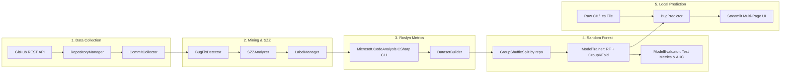

# C# Defect Predictor: Machine Learning-Based Software Bug Detection

An academic-grade, fully local Machine Learning system for predicting software defect proneness in C# source code methods using **Supervised Learning (Random Forest Classification)** and static code metrics extracted via **Microsoft Roslyn**.

Developed for the Computational Intelligence in Software Engineering curriculum.

---

## 🚀 Key Capabilities

- **Automated GitHub Discovery & Cloning**: Query public C# repositories via GitHub REST API, clone full histories, and track commit diffs incrementally.
- **Bug-Fix & SZZ Traceability**: Identify bug-fixing commits via commit message heuristics and issue/PR references; trace candidate Bug-Inducing Commits (BICs) using `git blame -w -M -C`.
- **Roslyn Static Code Metrics**: Cross-platform .NET 9.0 CLI calculating 24 structural, complexity, and OOP metrics using `Microsoft.CodeAnalysis.CSharp`. Isolates enclosing methods from nested lambdas/local functions and normalizes newlines across platforms.
- **Zero-Leakage ML Pipeline**: Enforces repository-aware data partitioning (`GroupShuffleSplit` on `repository_id`), ensuring code from the same repository never leaks between training and test sets.
- **Random Forest Modeling & Dual Importances**: Supervised classification evaluated with internal `GroupKFold` cross-validation, compared against `DummyClassifier` baselines, and analyzed via **MDI (Gini)** and **Permutation Feature Importance**.
- **Real-Time Method & File Bug Prediction**: Interactive Streamlit interface to paste C# snippets or upload complete `.cs` files, extract Roslyn metrics live, estimate defect risk scores, identify influential metrics, and export CSV reports.
- **Privacy-Preserving & Fully Local**: Operates 100% on the local workstation. No external LLMs, no paid APIs, no telemetry, and raw source code is never stored without explicit user consent.

---

## 🏗️ System Architecture



---

## 📋 Prerequisites

1. **Python**: Version 3.11 or higher (Python 3.11, 3.12, 3.13 supported).
2. **.NET SDK**: .NET 9.0 SDK or higher installed (`dotnet --version`).
3. **Git**: Git CLI installed and available in `PATH`.
4. **GitHub Token (Optional)**: Personal Access Token (PAT) for querying GitHub REST API above anonymous rate limits.

---

## 💻 Installation & Setup

### Windows (PowerShell)

```powershell
# 1. Clone or navigate to the repository
cd CISE_PROJECT_2

# 2. Create and activate a Python virtual environment
python -m venv .venv
.\.venv\Scripts\Activate.ps1

# 3. Upgrade pip and install project dependencies
pip install --upgrade pip
pip install -r requirements.txt

# 4. Verify .NET SDK installation and build Roslyn Analyzer
dotnet --version
dotnet build roslyn_analyzer\RoslynAnalyzer.csproj -c Release

# 5. Run the Streamlit Application
streamlit run app.py
```

### macOS / Linux (Bash / Zsh)

```bash
# 1. Clone or navigate to the repository
cd CISE_PROJECT_2

# 2. Create and activate a Python virtual environment
python3 -m venv .venv
source .venv/bin/activate

# 3. Upgrade pip and install dependencies
pip install --upgrade pip
pip install -r requirements.txt

# 4. Verify .NET SDK installation and build Roslyn Analyzer
dotnet --version
dotnet build roslyn_analyzer/RoslynAnalyzer.csproj -c Release

# 5. Run the Streamlit Application
streamlit run app.py
```

The application will launch in your browser at `http://localhost:8501`.

---

## 🧪 Running the Test Suite

Run all unit and integration tests across all pipeline phases:

```bash
# On Windows
.\.venv\Scripts\pytest.exe -v

# On macOS/Linux
pytest -v
```

All tests execute deterministically offline without network dependencies.

---

## 🖥️ Streamlit Multi-Page Interface Guide

| Page | Description |
| :--- | :--- |
| **📊 Dashboard** | High-level repository, commit, observation, model, and health statistics. |
| **📥 Repository Collection** | Search GitHub public repositories, clone full histories, and track commit diffs. |
| **🔍 Bug Analysis & SZZ** | Detect bug-fixing commits, trace bug-inducing commits (SZZ), and label methods. |
| **📁 Dataset Management** | Extract 24 Roslyn static code metrics, inspect distributions, and export versioned CSV snapshots. |
| **🧠 Model Training** | Train Random Forest models with repository-aware `GroupKFold` CV and compare with dummy baselines. |
| **📈 Model Evaluation** | Inspect holdout test metrics, confusion matrices, ROC/PR curves, and MDI vs Permutation feature importances. |
| **🎯 Real-World Bug Prediction** | Paste C# snippets or upload `.cs` files for real-time defect risk scoring, influential metric attribution, and validation benchmarks. |
| **⚙️ Settings** | Configure GitHub PAT, local storage paths, Roslyn project path, prediction thresholds, and privacy options. |

---

## 📊 Defect Risk Score Interpretation

- **0.00 – 0.30 (🟢 Low risk)**: Metrics are within standard clean method baselines.
- **0.31 – 0.60 (🟡 Medium risk)**: Moderate structural complexity or branching; review logic flow.
- **0.61 – 1.00 (🔴 High risk)**: Structural complexity, nesting, or branching strongly match historical defect patterns. Prioritize for focused code review and testing.

> [!IMPORTANT]
> **Defect Risk Caveat**: The risk score is an estimated metric propensity indicating structural complexity. It is **not** a formal proof that a method contains a bug, nor does a low-risk score guarantee code correctness.

---

## 🔒 Privacy & Local Processing

- **No Remote Telemetry**: All code analysis, parsing, training, and predictions occur 100% locally on your machine.
- **Source Code Privacy**: Raw source code is not persisted in prediction logs by default. Users may toggle history logging or clear stored predictions at any time in **Settings**.
- **No Paid External Dependencies**: Operates independently of commercial LLM APIs.

---

## 📑 Empirical Assessment & Academic Report

An empirical study across 3 real-world open-source repositories (`commandlineparser/commandline`, `LuckyPennySoftware/MediatR`, `Humanizr/Humanizer`) with 483 method observations and zero cross-repository data leakage is documented in:

👉 **[docs/FINAL_REPORT.md](docs/FINAL_REPORT.md)**

Key experimental findings:
- **Holdout Defect Recall**: **81.82%** (36/44 buggy methods identified in holdout repository `commandlineparser/commandline`).
- **Holdout F1-Score**: **0.6261** (vs baseline 0.0000).
- **Most Predictive Features**: `method_length`, `loc`, `object_creation_count`, `logical_loc`, and `parameter_count`.
- **Reproducible Pipeline**: `python scripts/run_empirical_experiment.py`.


