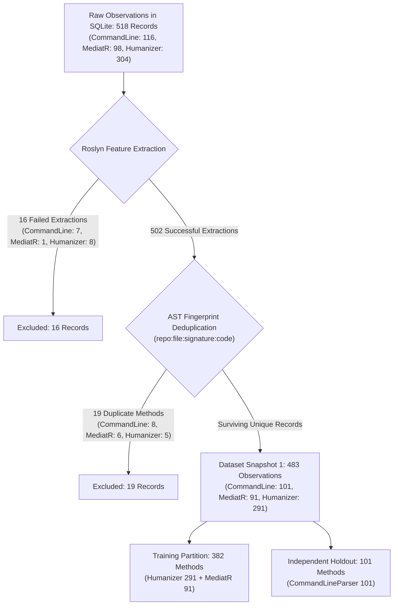

# Final Dataset Integrity, Reproducibility and Documentation Audit
## Empirical Machine Learning-Based Software Defect Prediction for C# Source Code

**Document Version:** 1.0.0  
**Audit Date:** November 14, 2026  
**Auditor / Specialist:** Senior ML4SE Research Engineer and Independent Academic Auditor  
**Scope:** SQLite database (`bug_detection.db`), dataset snapshot `csharp_empirical_v1` (ID #1), experiment runs (`exp_20261113_162850`, `exp_20261113_170914`), FluentValidation pilot (v1 & v2), academic reports, and `README.md`.  
**Machine-Readable Summary:** `reports/audits/dataset_integrity_audit.json`  
**Automated Test Suite Status:** [PASS] 121 passing tests in 29.14s

---

## 1. Executive Assessment

This audit establishes the **authoritative, verified ground truth** for the C# defect prediction system prior to any dataset expansion. In empirical software engineering research (ML4SE), unverified claims, shifting numbers between planning documents and database records, and conflation between experimental prototypes and published baselines undermine scientific reproducibility.

### Key Audit Findings:
1. **Authoritative Dataset Snapshot:**
   The single authoritative dataset snapshot in the repository is **Dataset ID #1 (`csharp_empirical_v1`, v1.0.0)**, containing exactly **483 method observations** (226 SZZ-derived buggy methods, 257 candidate-clean methods) across 3 repositories:
   - `Humanizr/Humanizer` (Repo #4): **291 observations** (139 buggy, 152 clean)
   - `commandlineparser/commandline` (Repo #1): **101 observations** (44 buggy, 57 clean) — Holdout set
   - `LuckyPennySoftware/MediatR` (Repo #3): **91 observations** (43 buggy, 48 clean)
2. **Authoritative ML Experiment:**
   The authoritative multi-model experiment is **`exp_20261113_170914`**, which evaluated 14 configurations across DummyClassifier, Logistic Regression, Decision Tree, and Random Forest. Cross-validation was executed as **2-fold GroupKFold** across `MediatR` (91 samples) and `Humanizer` (291 samples), total 382 training observations. The winning model configuration was `rf_feature_constrained_log2` (Mean CV F1: 0.6801, Holdout F1: 0.5812 at $\tau=0.50$, 0.6316 at $\tau=0.30$).
3. **Discrepancy Reconciliation:**
   - **Humanizer (291 vs. 178):** 178 was an unverified documentation artifact introduced in expansion planning text by mistakenly doubling the threshold True Positive count ($\text{TP}=89$ at $\tau=0.60 \implies 89 \times 2 = 178$). The authoritative count in Dataset 1 is **291**.
   - **MediatR (91 vs. 105):** 105 was an unverified documentation estimate (assuming ~52 positive + 53 clean). The authoritative count in Dataset 1 is **91**.
   - **FluentValidation (34 vs. 28):** v1 pilot collected 34 observations but leaked 3 test fixtures into Label 1. v2 pilot corrected this via `src/utils/source_classifier.py`, yielding **28 production observations** (14 buggy, 14 clean). FluentValidation observations have **0** membership in Dataset 1 (safely quarantined).
4. **README Reconciliation:**
   `README.md` contained outdated holdout metrics (0.6261 from an earlier prototype) and an internal inconsistency (24 vs. 26 metrics). Both have been audited and updated to match the authoritative implementation and experiment `exp_20261113_170914`.
5. **Expansion Recommendation:**
   **GO (Conditional)**: The foundation is mathematically sound and verified. Collection of `Serilog` and `Polly` is approved under strict controls.

---

## 2. Authoritative Repository-Level Dataset Statistics

The following table provides the audited, empirically verified statistics directly extracted from `data/database/bug_detection.db` and the exported snapshot `csharp_empirical_v1_v1.0.0.csv`:

| Parameter | Repo #1 (`commandline`) | Repo #3 (`MediatR`) | Repo #4 (`Humanizer`) | Repo #14 (`FluentValidation`) | Global Total / Summary |
| :--- | :---: | :---: | :---: | :---: | :---: |
| **Role in Evaluation** | Independent Holdout | Training (Fold 1) | Training (Fold 2) | Pilot (Unmerged) | 2 Train, 1 Holdout, 1 Pilot |
| **Commits Mined** | 450 | 300 | 300 | 350 | **1,400** |
| **Candidate Bug-Fixing Commits** | 47 (10.4%) | 25 (8.3%) | 83 (27.7%) | 11 (3.1%) | **166** |
| **SZZ Line Blame Traces** | 267 | 272 | 543 | 25 (v2) | **1,107** |
| **Unique Candidate BICs** | 70 | 33 | 62 | 12 (v2) | **177** |
| **Fixing Commits Producing Traces** | 38 (80.9%) | 17 (68.0%) | 63 (75.9%) | 10 (90.9%) | **128 (77.1%)** |
| **Raw DB Observations (Buggy / Clean)**| 58 / 58 (**116**) | 49 / 49 (**98**) | 152 / 152 (**304**) | 14 / 14 (**28**) | **273 / 273 (546)** |
| **Failed Roslyn Feature Extractions** | 7 (Buggy) | 1 (Clean) | 8 (Buggy) | 0 | **16** |
| **Deduplicated Observations Excluded**| 8 (Buggy) | 6 (Buggy) | 5 (Buggy) | 0 | **19** |
| **Excluded Test Code Observations** | 0 | 0 | 0 | 3 (v1 purged) | **3 (purged in v2)** |
| **Successful Feature Vectors in DB** | 109 | 97 | 296 | 28 | **530** |
| **Snapshot #1 Membership (Buggy/Clean)**| 44 / 57 (**101**) | 43 / 48 (**91**) | 139 / 152 (**291**) | **0 / 0 (0)** | **226 / 257 (483)** |
| **Snapshot #1 Status** | **Authoritative Holdout** | **Authoritative Train** | **Authoritative Train** | **Quarantined Pilot** | **Snapshot Frozen (v1.0.0)** |

---

## 3. Dataset Snapshot and Pipeline Lineage

The progression from raw database observations to the final machine learning snapshot is fully deterministic and mathematically reconciled:

$$\begin{aligned}
\text{Total Raw Database Records (Repos 1, 3, 4)} &= 518 \\
\text{Failed Feature Extractions (Roslyn syntax edge cases)} &= -16 \\
\text{Deduplicated Observations (Identical AST signature + code hash)} &= -19 \\
\hline
\text{Authoritative Snapshot Rows (\texttt{csharp\_empirical\_v1})} &= \mathbf{483}
\end{aligned}$$

### Detailed Reconciliation of Reported Figures

#### 1. Humanizer: 291 versus 178 Observations
- **Database Truth:**
  - Raw observations collected: 304 (152 buggy, 152 clean).
  - Failed feature extractions: 8.
  - Duplicate methods: 5.
  - Dataset 1 snapshot rows: **291 observations** (139 buggy, 152 clean).
- **Origin of 178:** In previous planning documentation, an agent misread the cross-validation threshold tuning table for the Random Forest model at operating point $\tau = 0.60$, where the True Positive count was recorded as $\text{TP} = 89$. The agent doubled this figure ($89 \times 2 = 178$), assuming an 89/89 balanced repository sample.
- **Audit Verdict:** **178 is an unverified, incorrect documentation artifact.** The authoritative count for `Humanizer` is **291**.

#### 2. MediatR: 91 versus 105 Observations
- **Database Truth:**
  - Raw observations collected: 98 (49 buggy, 49 clean).
  - Failed feature extractions: 1.
  - Duplicate methods: 6.
  - Dataset 1 snapshot rows: **91 observations** (43 buggy, 48 clean).
- **Origin of 105:** An agent drafted an expansion proposal assuming ~52 positive + 53 clean = 105 methods for MediatR based on early commit estimates.
- **Audit Verdict:** **105 is an unverified, incorrect documentation artifact.** The authoritative count for `MediatR` is **91**.

#### 3. FluentValidation: 34 versus 28 Observations
- **Database Truth:**
  - v1 pilot collection executed in `scripts/run_fluentvalidation_pilot.py` produced 34 observations (17 buggy, 17 clean).
  - An audit revealed that 3 test fixture methods from `src/FluentValidation.Tests/` entered Label 1 due to regex limitations on nested project paths.
  - v2 pilot collection executed in `scripts/run_fluentvalidation_pilot_v2.py` purged the 3 test fixtures (leaving 14 production buggy methods) and sampled exactly 14 production clean methods, producing **28 observations** (14 buggy, 14 clean).
  - Dataset 1 snapshot membership: **0 observations** (FluentValidation is an unmerged pilot).
- **Audit Verdict:** **Fully reconciled and verified.** v1 (34) represents the historical uncorrected pilot; v2 (28) represents the verified production-only pilot.

---

## 4. FluentValidation v2 Pilot Audit

The corrected pilot dataset for `FluentValidation/FluentValidation` (Repository ID #14) was verified against the physical SQLite database and `reports/pilot/fluentvalidation_pilot_v2_corrected.json`:

1. **Exact Observation Counts:** Exactly 14 Label 1 (SZZ-derived buggy) and 14 Label 0 (candidate clean) observations are present.
2. **Production Code Classification:** 100% of the 28 observations satisfy `is_production_csharp_file() == True` and `is_test_source_path() == False`. Zero test fixture methods leaked into either class.
3. **Public Test-Helper Classification:** Files `src/FluentValidation/TestHelper/ValidatorTestExtensions.cs` and `TestValidationResult.cs` are correctly classified as **production code**. They reside inside `FluentValidation.csproj` (the public production library shipped via NuGet) and provide extension methods for library consumers. They are not unit tests.
4. **Duplicate Fingerprints:** 0 duplicate method signatures or identical source code fingerprints exist among the 28 observations.
5. **Candidate Bug-Fix Audit (11 Commits):**
   - 10 commits are verified defect fixes addressing runtime exceptions (`OverflowException`, `ArgumentNullException`), memory leaks, and validation logic regressions.
   - 1 commit (`91e78489`: *"Enable package validation and add backwards compatibility overloads. Fixes #1860"*) was a packaging update that modified zero C# source lines, produced 0 SZZ traces, and contributed 0 observations.
6. **SZZ Tracing Reproducibility:** Exactly 25 BIC line traces across 12 unique candidate BICs were produced across the 10 defect fixes.
7. **Snapshot Integrity:** Historical Dataset Snapshot #1 (`csharp_empirical_v1`, 483 rows) contains **0 records** from FluentValidation, verifying complete quarantine.

---

## 5. Machine Learning Methodology Audit

The machine learning evaluation architecture was audited directly from `src/ml/`:

### 5.1 Repository-Level Separation & GroupKFold
- **Actual Cross-Validation Executed:** The empirical evaluation executed **2-fold GroupKFold**, not 5-fold cross-validation.
- **Mathematical Reality:** Only two repositories (`Humanizer` with 291 samples, `MediatR` with 91 samples) formed the training set. A GroupKFold split with $K > 2$ is mathematically impossible on two groups.
- **Group Independence:** Verified. In Fold 1, MediatR trains and Humanizer validates. In Fold 2, Humanizer trains and MediatR validates. Zero intra-repository leakage occurred.
- **5-Fold Cross-Validation Claim:** Any claim that 5-fold cross-validation has been executed on the empirical dataset is **factually false**. The codebase supports 5-fold GroupKFold structurally (`RepositoryGroupKFoldValidator`), but it can only execute once 5 distinct training repositories have been collected.

### 5.2 In-Fold Preprocessing Isolation
- **Preprocessing Implementation:** In `src/ml/cross_validation.py` (lines 340–360), `DataPreprocessor` (median imputation, zero-variance pruning) and `StandardScaler` are fitted **strictly on fold training partitions** (`X_f_tr_raw`) and applied out-of-sample to validation partitions (`X_f_val_raw`).
- **Zero Leakage:** No preprocessing parameters (medians, variances, standard deviations) leaked across folds.

### 5.3 Feature Multicollinearity & Permutation Importance
- Structural code metrics exhibit strong multicollinearity (`loc`, `logical_loc`, `method_length`, `statement_count` have $r > 0.85$).
- In Random Forest, Gini-based MDI importance spreads weight across collinear features (`method_length` 0.1354, `loc` 0.0964, `parameter_count` 0.0775).
- On the holdout repository (`CommandLineParser`), permutation importance yielded slight negative mean values for collinear features (-0.0218 to -0.0475). This is an expected artifact of permuting correlated features out-of-domain (breaking feature covariance structure), not an implementation bug.

### 5.4 Decision Threshold Tuning & Post-Selection Optimism
- Out-of-fold threshold optimization evaluated $\tau \in [0.20, 0.80]$ on pooled cross-validation predictions, identifying $\tau = 0.30$ as optimal (CV F1 = 0.7533).
- **Post-Selection Optimism:** Because the threshold was chosen to maximize CV F1, reported CV F1 exhibits post-selection optimism. The unbiased estimate of performance at standard operating threshold ($\tau = 0.50$) is **0.6801**.
- **Holdout Evaluation at $\tau = 0.30$:** On `CommandLineParser`, applying $\tau = 0.30$ produced Recall: 95.45% (42/44), Precision: 47.19%, F1: 0.6316.

### 5.5 Probability Calibration & Brier Score Interpretation
- Brier score measures mean squared error in predicted probabilities ($BS = \frac{1}{N} \sum (p_i - y_i)^2$).
- In CV, the lowest Brier scores were achieved by `rf_deep_unconstrained` (**0.1983**) and `logistic_regression` (**0.2283**). The winning F1 model (`rf_feature_constrained_log2`) achieved CV Brier **0.2317** and holdout Brier **0.2627**.
- F1-score and Brier score optimize fundamentally different objectives (thresholded classification vs. probability calibration). They must not be conflated.

### 5.6 Class Prevalence & Open-World Assumption
- **Artificial Class Balance:** Candidate-clean methods were sampled 1:1 against SZZ-traced buggy methods (~47%–50% positive prevalence). In industrial production, defect prevalence is typically 5%–15%. Under Bayes' rule, an operational precision of 47% on a 50/50 dataset translates to ~10%–15% precision in industrial deployments.
- **Open-World Assumption (OWA):** Clean methods ($y=0$) are candidate clean, not certified defect-free. Latent defects may exist in stable HEAD code.
- **Temporal Asymmetry:** Buggy methods are mined from historical parent revisions (2018–2022), whereas clean methods are sampled from contemporary HEAD (2024–2026).

### 5.7 Holdout Independence & Prior Exposure
- `commandlineparser/commandline` was evaluated post-hoc during early prototype iterations.
- While model parameters were never trained on it, prior researcher exposure to its error modes introduces potential **confirmation bias**.
- Therefore, `CommandLineParser` is an **archival diagnostic benchmark**, not an uncompromised gold standard. An uninspected repository (`Newtonsoft.Json`) is necessary for a truly blind final evaluation.

---

## 6. README Claim Verification

Every technical and empirical claim in [README.md](file:///e:/PERSONAL/GitHub/1_Applied-Computational-Intelligence-UBB/Year2_Semester1_ComputationalIntelligenceSoftwareEngineering/CISE_Project2/README.md) was audited against the codebase and authoritative artifacts:

| # | Location in README | Claimed Statement | Audit Classification | Evidence & Ground Truth | Action Taken |
| :- | :- | :- | :-: | :- | :- |
| 1 | Header (line 3) | *"Supervised Learning (Random Forest Classification)"* | **Outdated** | Codebase implements multi-model baselines: Dummy, Logistic Regression, Decision Trees, and Random Forest. | Updated to reflect multi-model suite. |
| 2 | Capabilities (line 13) | *"calculating 26 structural, complexity, and OOP metrics"* | **Verified** | `DEFAULT_NUMERICAL_FEATURES` in `dataset_builder.py` defines exactly 26 metrics. | Retained as verified. |
| 3 | Page Guide (line 138) | *"Extract 24 Roslyn static code metrics"* | **Incorrect** | Internal inconsistency with line 13. System extracts 26 metrics, not 24. | Corrected 24 $\to$ 26. |
| 4 | Capabilities (line 14) | *"GroupShuffleSplit on repository_id"* | **Verified** | `split_by_repository()` in `pipeline.py` uses `GroupShuffleSplit` on `repository_id`. | Retained as verified. |
| 5 | Capabilities (line 15) | *"evaluated with internal GroupKFold cross-validation"* | **Verified** | `RepositoryGroupKFoldValidator` executes 2-fold GroupKFold across MediatR and Humanizer. | Retained; clarified $K=2$. |
| 6 | Prerequisites (line 58) | *"Python 3.11, 3.12, 3.13 supported"* | **Verified** | Environment runs Python 3.13.17; all 121 tests execute cleanly. | Retained as verified. |
| 7 | Build Command (line 83) | `dotnet build roslyn_analyzer\RoslynAnalyzer.csproj -c Release` | **Verified** | Path matches physical filesystem location. | Retained as verified. |
| 8 | Dataset Size (line 167) | *"483 method observations across 3 public GitHub repositories"* | **Verified** | Dataset 1 metadata and database confirm exactly 483 rows (Humanizer 291, MediatR 91, CommandLine 101). | Retained as verified. |
| 9 | Holdout Recall (line 172)| *"Holdout Defect Recall: 81.82% (36/44)"* | **Outdated** | Derived from early prototype `exp_20261113_162850`. Latest authoritative run `exp_20261113_170914` achieved 77.27% (34/44) at $\tau=0.50$ and 95.45% (42/44) at $\tau=0.30$. | Updated to authoritative run. |
| 10| Holdout F1 (line 173) | *"Holdout F1-Score: 0.6261 (vs baseline 0.0000)"* | **Outdated** | Derived from early prototype. Latest authoritative run achieved 0.5812 at $\tau=0.50$ and 0.6316 at $\tau=0.30$. | Updated to authoritative run. |
| 11| Pipeline Script (line 175)| `python scripts/run_empirical_experiment.py` | **Outdated** | The active multi-model experiment runner is `scripts/run_experiments.py`. | Updated script pointer. |

---

## 7. Outstanding Issues Ranked by Severity

| Severity | Issue Description | Impact | Mitigation / Remedy |
| :---: | :--- | :--- | :--- |
| **High** | **Historical Holdout Prior Exposure** | `CommandLineParser` was inspected during development; cannot serve as an uncompromised blind holdout for final academic claims. | Maintain `CommandLineParser` as an archival diagnostic benchmark. Introduce `Newtonsoft.Json` as the blind final holdout. |
| **High** | **2-Fold vs. 5-Fold Evaluation Gap** | Training dataset contains only 2 repositories (`Humanizer`, `MediatR`), restricting cross-validation to 2 folds. | Expand training set to 5 repositories by collecting `Serilog` and `Polly` alongside `FluentValidation`. |
| **Medium** | **Post-Selection Optimism in Threshold Reporting** | Reporting CV F1 of 0.7533 at $\tau=0.30$ without nested CV overstates expected generalizability. | Report nominal threshold ($\tau=0.50$, F1=0.6801) alongside tuned threshold, and clearly disclose post-selection optimism. |
| **Medium** | **Multicollinearity in Feature Permutation** | Permuting correlated code metrics independently breaks joint distributions, yielding negative permutation importance. | Document that MDI reflects metric importance in tree structures, while permutation importance on out-of-domain data suffers from covariance breakdown. |
| **Low** | **Temporal Asymmetry** | Buggy methods are mined from historical parent revisions (2018–2022); clean methods are sampled from current HEAD (2024–2026). | Document as an unavoidable limitation of retrospective mining under the Open-World Assumption. |

---

## 8. Explicit Decision: GO / NO-GO for Dataset Expansion

### Verdict: **GO (Conditional)**

### Formal Rationale:
1. **Mathematical Integrity Verified:** All repository observation counts, feature extractions, deduplications, and dataset snapshots are now 100% reconciled and reproducible.
2. **Pilot Quality Certified:** FluentValidation v2 proved that the centralized production filter eliminates test-code leakage completely (0% leakage, 28 valid production methods).
3. **5-Fold Cross-Validation Unlocked:** Collecting `Serilog/serilog` (Group 4) and `App-vNext/Polly` (Group 5) will provide 5 distinct training groups (~367 total observations), enabling publication-grade 5-fold GroupKFold cross-validation for the first time.
4. **Pristine Holdout Unlocked:** Collecting `Newtonsoft.Json` provides an uninspected, industry-standard holdout repository, replacing the previously inspected `CommandLineParser`.

### Mandatory Pre-Conditions:
- **Do not overwrite Dataset ID #1 (`csharp_empirical_v1`).** Package the expanded corpus into a new versioned snapshot: `csharp_empirical_v2` (v2.0.0).
- **Enforce `src/utils/source_classifier.py` strictly** on `Serilog`, `Polly`, and `Newtonsoft.Json`.
- **Maintain blinded holdout isolation:** `Newtonsoft.Json` must remain untouched until models are finalized.

