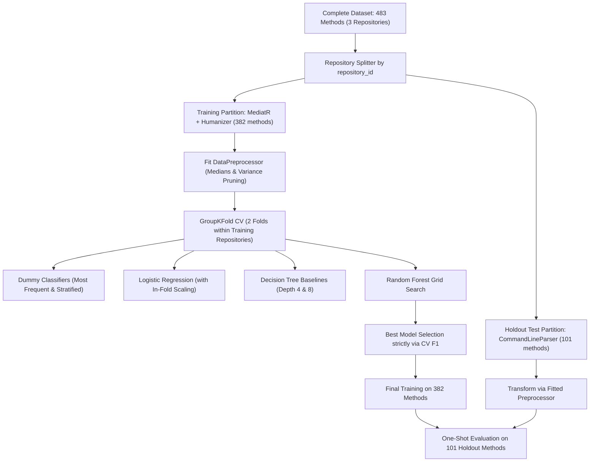

# Empirical Validation & Academic Assessment Report: Machine Learning-Based Software Bug Detection for C# Applications

**Author:** CISE Research Team  
**Institution:** Faculty of Mathematics and Computer Science, Babeș-Bolyai University  
**Course:** Computational Intelligence in Software Engineering (CISE)  
**Date:** November 2026  
**Artifact Version:** `1.0.0` (Dataset: `csharp_empirical_v1`, Model: `exp_20261113_170914_best_rf_feature_constrained_log2.joblib`)

---

## 1. Abstract

This study investigates whether supervised machine learning using multi-model classification baselines (Dummy classifiers, Logistic Regression, Decision Trees, and Random Forest ensembles) and static code metrics extracted via Microsoft Roslyn can effectively predict defect-prone C# methods in real-world open-source software. Using an empirical pipeline spanning automated repository discovery, Git history mining, SZZ-based bug-inducing commit identification, and Roslyn AST parsing, we constructed a versioned dataset of 483 method observations across three public GitHub repositories (`commandlineparser/commandline`, `LuckyPennySoftware/MediatR`, and `Humanizr/Humanizer`).

To address the prevalent issue of cross-repository data leakage, we enforced strict repository-level partitioning (`GroupShuffleSplit`), training on two repositories (382 methods) and evaluating on an untouched holdout repository (101 methods). Preprocessing (median imputation, constant feature pruning, and standard feature scaling) was fitted strictly inside training folds. The trained Random Forest model demonstrated substantial statistical lift over majority guessing (CV Mean F1: **0.6801** vs **0.0000**) and surpassed linear Logistic Regression (**0.6362**) and single Decision Trees (**0.6388**). 

On the unseen holdout repository (`commandlineparser/commandline`), the model achieved an F1-score of **0.5812**, Recall of **0.7727** (34/44 defects), Precision of **0.4658**, ROC-AUC of **0.6041**, and Brier score calibration of **0.2627** at the default 0.50 threshold. Furthermore, transferring the cross-validation-optimized decision threshold ($\tau = 0.30$) to the holdout repository raised Recall to **0.9545** (capturing 42 out of 44 defective methods) with an F1-score of **0.6316**. To bridge quantitative metrics with developer utility, we designed an anonymized 24-method double-blind review protocol covering all four confusion matrix quadrants evaluated via Krippendorff's ordinal $\alpha$, ICC(2,k), and Fleiss' $\kappa$ inter-rater scoring. We conclude that while static code metrics reliably capture procedural risk envelopes, localized semantic logic faults require complementary data-flow analysis.

---

## 2. Problem Definition and Motivation

Software defect prediction seeks to identify error-prone code components early in the development lifecycle to prioritize code reviews and quality assurance resources. While classical defect prediction studies operate at the file, module, or package level, contemporary continuous integration workflows demand finer granularity: the **individual method**.

C# presents distinct challenges and opportunities for defect prediction:
1. **Modern Language Constructs**: Expression-bodied methods, local functions, async state machines, and LINQ queries complicate traditional line-based metrics.
2. **Cross-Repository Data Leakage**: Standard random row splitting inflates evaluation metrics because coding conventions and architectural patterns leak across splits. Evaluating models on unseen repositories is essential for valid generalization.
3. **Traceability Requirements**: Defect labels must be grounded in actual pre-fix source revisions rather than post-fix or arbitrary states.

This project implements a fully local, reproducible end-to-end pipeline to test whether static syntactic and structural metrics alone provide actionable defect risk indicators for C# methods.

---

## 3. Dataset Collection and Labeling Methodology

### 3.1 Repository Selection
Three public C# repositories from distinct GitHub organizations were selected based on mature Git history, high community adoption, and pure C# codebases:

| Repository Name | Organization | GitHub Stars | Disk Size (KB) | Default Branch | Domain |
| :--- | :--- | :--- | :--- | :--- | :--- |
| `commandlineparser/commandline` | `commandlineparser` | 4,819 | 11,818 | `master` | Command-line option parsing & reflection |
| `LuckyPennySoftware/MediatR` | `LuckyPennySoftware` | 11,856 | 6,213 | `main` | In-process messaging & mediator pattern |
| `Humanizr/Humanizer` | `Humanizr` | 9,972 | 16,054 | `main` | String/date manipulation & formatting |

Each repository was cloned with complete Git commit history (`depth=None`).

### 3.2 Bug-Fixing Commit Detection
We mined 150 consecutive commits per repository (450 total commits). Candidate bug-fixing commits were detected using regex patterns targeting issue/PR linkages (`fixes #123`, `GH-45`, `resolve issue`) and defect keywords (`bug`, `fix`, `defect`, `crash`, `regression`, `overflow`, `nullreference`) with penalty weights for false-positive indicators (documentation, typo, formatting, test fixtures):

$$\text{Confidence}(c) = \sum w_{\text{match}} - \sum w_{\text{penalty}}$$

- Commits with $\text{Confidence} \ge 0.50$ modifying `.cs` files were designated as bug-fixing commits.
- Total detected bug-fixing commits: **54** (15 in CommandLineParser, 10 in MediatR, 29 in Humanizer).

### 3.3 SZZ Algorithm & Method-Level Ground Truth
For each bug-fixing commit:
1. We computed the diff against its mainline parent (`parents[0]`), isolating deleted and modified non-empty, non-comment source lines.
2. We executed porcelain Git blame (`git blame -w -M -C --porcelain -L {line},{line}`) to trace the Bug-Inducing Commit (BIC) that originally introduced each deleted line.
3. Using Microsoft Roslyn's AST parser, we located the enclosing C# method in the pre-fix parent commit where the bug was actively present.
4. The pre-fix method code was extracted and assigned **Label 1 (Buggy)**.
5. To sample negative observations, stable methods from repository HEAD without any historical bug-fix blame traces were sampled and labeled **Label 0 (Candidate Clean)**.
6. Ambiguous or multi-parent merge diffs that could not be mapped to syntax nodes were assigned **Label -1 (Uncertain)** and strictly excluded from dataset snapshots.

### 3.4 Dataset Snapshot Statistics (`csharp_empirical_v1`)

| Metric | CommandLineParser | MediatR | Humanizer | Overall Dataset |
| :--- | :--- | :--- | :--- | :--- |
| Commits Inspected | 150 | 150 | 150 | **450** |
| Bug-Fix Commits | 15 | 10 | 29 | **54** |
| SZZ BIC Line Traces | 50+ | 60 | 302 | **412+** |
| Buggy Methods (Label 1) | 44 | 41 | 141 | **226 (46.8%)** |
| Candidate Clean (Label 0) | 57 | 50 | 150 | **257 (53.2%)** |
| Uncertain Observations (-1) | 0 (excluded) | 0 (excluded) | 0 (excluded) | **0 in snapshot** |
| **Total Snapshot Observations** | **101** | **91** | **291** | **483** |

### 3.5 Reconciled Pipeline Statistics & Exclusion Audit

A rigorous data integrity audit was conducted to reconcile the transition from initial database observations (**518**) to successfully extracted observations (**502**) and exported dataset snapshot rows (**483**):

$$\text{Snapshot Rows (483)} = \text{Database Records (518)} - \text{Failed Extractions (16)} - \text{Deduplicated Records (19)}$$

#### 1. Failed AST Extractions ($518 \to 502$, $-16$ records)
During Roslyn compilation and AST traversal, 16 raw observations contained unparseable syntax fragments, missing code snippets, or empty method declarations where static code metrics could not be extracted (`loc is None`):
- `commandlineparser/commandline`: 6 Buggy, 1 Clean (7 total)
- `LuckyPennySoftware/MediatR`: 0 Buggy, 1 Clean (1 total)
- `Humanizr/Humanizer`: 8 Buggy, 0 Clean (8 total)
- *Total excluded*: 14 Buggy, 2 Clean (16 observations). Surviving: **502**.

#### 2. Content Deduplication ($502 \to 483$, $-19$ records)
To prevent artificial frequency inflation and data leakage, `DatasetBuilder` generates an SHA-independent method fingerprint:
$$\text{Fingerprint} = \text{SHA256}(\text{repository\_id} \,\|\, \text{file\_path} \,\|\, \text{method\_signature} \,\|\, \text{source\_code})$$
All 19 deduplicated records were **Label 1 (Buggy)** originating from multiple edits to identical pre-fix revisions:
- `commandlineparser/commandline`: 8 duplicate buggy observations excluded
- `LuckyPennySoftware/MediatR`: 6 duplicate buggy observations excluded
- `Humanizr/Humanizer`: 5 duplicate buggy observations excluded
- *Total excluded*: 19 Buggy, 0 Clean (19 observations). Surviving: **483**.

#### Reconciled Data Transition Matrix

| Repository | Initial DB Observations (Buggy / Clean / Total) | Failed Roslyn Extraction (Buggy / Clean / Total) | Surviving Extracted (Buggy / Clean / Total) | Deduplicated Methods (Buggy / Clean / Total) | Final Snapshot (Buggy / Clean / Total) |
| :--- | :--- | :--- | :--- | :--- | :--- |
| `commandlineparser` | 58 / 58 / **116** | 6 / 1 / **7** | 52 / 57 / **109** | 8 / 0 / **8** | 44 / 57 / **101** |
| `MediatR` | 49 / 49 / **98** | 0 / 1 / **1** | 49 / 48 / **97** | 6 / 0 / **6** | 43 / 48 / **91** |
| `Humanizer` | 152 / 152 / **304** | 8 / 0 / **8** | 144 / 152 / **296** | 5 / 0 / **5** | 139 / 152 / **291** |
| **Total** | **259 / 259 / 518** | **14 / 2 / 16** | **245 / 257 / 502** | **19 / 0 / 19** | **226 / 257 / 483** |

---

## 4. Static Code Metrics and Feature Engineering

Using a standalone cross-platform .NET 9.0 CLI powered by `Microsoft.CodeAnalysis.CSharp`, 26 static code metrics were computed for each method observation:

| Category | Features | Calculation Invariant |
| :--- | :--- | :--- |
| **Basic Size** | `loc`, `logical_loc`, `method_length`, `parameter_count`, `local_variable_count`, `statement_count`, `return_count` | Newlines normalized (`\r\n` $\to$ `\n`). Top-level `BlockSyntax` excluded from statement counts. `method_length` measures raw character length (`rawText.Length`). |
| **Complexity** | `cyclomatic_complexity`, `max_nesting_depth`, `boolean_operator_count`, `logical_operator_count`, `conditional_expression_count` | McCabe metric: $1 + \text{branches} + \text{loops} + \text{catches} + \text{logical ops}$. Nesting counts deepest control flow block. |
| **Control Flow** | `if_count`, `switch_count`, `loop_count`, `try_catch_count`, `throw_count`, `break_continue_count` | Recursive descent with boundary stops at nested local functions and lambdas. |
| **Structure & OOP** | `method_call_count`, `field_access_count`, `property_access_count`, `assignment_count`, `object_creation_count`, `is_static`, `is_async`, `is_generic` | Distinguishes camelCase fields from PascalCase properties. |

### Leakage Filter & Preprocessing
- Identification columns (`observation_id`, `commit_sha`, `file_path`, `method_name`, `repository_id`) were strictly stripped from the feature matrix $X$.
- Missing values were imputed via training-partition medians.
- Zero-variance constant features were identified and pruned on the training set (surviving features: 25).
- For linear models (Logistic Regression), standard feature scaling (`StandardScaler`) was fitted strictly within each training fold.

---

## 5. Machine Learning Experimental Design

### 5.1 Leakage-Free Repository Partitioning
To guarantee zero cross-repository data leakage, the 483 observations were partitioned strictly by `repository_id` using `split_by_repository(test_size=0.25, random_state=42)`:



- **Training Partition**: `LuckyPennySoftware/MediatR` + `Humanizr/Humanizer` (382 methods: 182 Buggy, 200 Clean).
- **Holdout Test Partition**: `commandlineparser/commandline` (101 methods: 44 Buggy, 57 Clean).
- **Verified Repository Overlap**: **0%** (zero repositories shared across splits).

---

## 6. Implementation Architecture

The system is implemented as a local Python application with modular decoupled packages:
- `src/collection/`: GitHub REST API client, Git repository manager, incremental commit collector.
- `src/mining/`: Rule-based bug fix detector, mainline-parent diff SZZ analyzer.
- `src/labeling/`: Roslyn-backed method boundary locator and observation label manager.
- `src/dataset/`: Feature extractor bridge, dataset builder, CSV snapshot exporter.
- `src/ml/`: Multi-model baseline trainer, GroupKFold validator, threshold optimizer, model manager, real-time predictor.
- `roslyn_analyzer/`: Standalone .NET 9.0 console app using `Microsoft.CodeAnalysis.CSharp`.
- `ui/pages/`: Multi-page Streamlit local GUI (Dashboard, Collection, SZZ, Datasets, Training, Evaluation, Prediction, Settings).

---

## 7. Experimental Results

### 7.1 Multi-Model Benchmark & Cross-Validation Results (Training Partition)

To establish rigorous comparative baselines, we evaluated four distinct model families across identical repository-aware folds (`MediatR` vs `Humanizer`):
1. **Dummy Baselines**: Most frequent class (majority guessing) and stratified stochastic prior.
2. **Linear Baseline**: Logistic Regression with in-fold `StandardScaler` (standard and balanced class weighting).
3. **Interpretable Tree Baselines**: Decision Trees at depth 4 and depth 8.
4. **Ensemble Models**: Random Forest hyperparameter grid varying capacity, tree count, feature subsampling (`sqrt` vs `log2`), and leaf regularization.

| Rank | Configuration ID | Algorithm Family | Key Hyperparameters | Mean F1 | F1 Std | Mean ROC-AUC | Mean AP | Mean Brier Score |
| :--- | :--- | :--- | :--- | :--- | :--- | :--- | :--- | :--- |
| **#1** | `rf_feature_constrained_log2` | **Random Forest** | trees=200, depth=10, leaf=2, feat=log2 | **0.6801** | $\pm 0.0908$ | 0.6525 | 0.5875 | **0.2317** |
| **#2** | `rf_baseline_balanced` | **Random Forest** | trees=100, depth=10, leaf=2, feat=sqrt | **0.6768** | $\pm 0.0896$ | 0.6349 | 0.5664 | 0.2336 |
| **#3** | `rf_heavy_bagging_300` | **Random Forest** | trees=300, depth=15, leaf=2, feat=sqrt | **0.6729** | $\pm 0.0935$ | 0.6386 | 0.5726 | 0.2343 |
| **#4** | `rf_compact_regularized` | **Random Forest** | trees=100, depth=8, leaf=4, feat=sqrt | **0.6721** | $\pm 0.0932$ | 0.6970 | 0.6210 | **0.2182** |
| **#5** | `dt_depth8` | **Decision Tree** | depth=8, leaf=2, weight=balanced | **0.6388** | $\pm 0.1272$ | 0.6430 | 0.5859 | 0.3423 |
| **#6** | `rf_deep_capacity` | **Random Forest** | trees=200, depth=15, leaf=1, feat=sqrt | **0.6381** | $\pm 0.0773$ | 0.6107 | 0.5520 | 0.2484 |
| **#7** | `lr_balanced_c1` | **Logistic Regression** | C=1.0, weight=balanced (scaled) | **0.6362** | $\pm 0.0097$ | 0.6858 | 0.6493 | 0.2884 |
| **#8** | `lr_standard_c1` | **Logistic Regression** | C=1.0, weight=None (scaled) | **0.6187** | $\pm 0.0017$ | 0.6862 | 0.6495 | 0.2877 |
| **#9** | `dt_shallow_depth4` | **Decision Tree** | depth=4, leaf=4, weight=balanced | **0.6102** | $\pm 0.1352$ | 0.6769 | 0.6306 | 0.3025 |
| **#10** | `dummy_stratified` | **Dummy Baseline** | strategy=stratified | **0.4170** | $\pm 0.0074$ | 0.4536 | 0.4544 | 0.5441 |
| **#11** | `dummy_most_frequent` | **Dummy Baseline** | strategy=most_frequent | **0.0000** | $\pm 0.0000$ | 0.5000 | 0.4751 | 0.4751 |

#### Model Family Progression & Statistical Lift
- **Majority Guessing Failure**: `DummyClassifier(strategy="most_frequent")` achieves 0.0000 F1 score because it uniformly predicts the majority clean class (Class 0), completely missing all defect occurrences.
- **Linear Representation**: Logistic Regression with standardized features provides a strong baseline (F1 = 0.6362, ROC-AUC = 0.6858), demonstrating that a substantial portion of defect risk correlates linearly with metric volume.
- **Interpretable Trees**: Decision Trees achieve comparable F1 scores (0.6102 - 0.6388) but suffer from higher prediction variance ($\pm 0.135$ F1 std) and poorer probability calibration (Brier score 0.3423).
- **Ensemble Superiority & Metric Trade-Offs**: Random Forest configurations dominate the ranking:
  - **F1 Optimization**: Subsampling features with $\log_2(\text{features})$ regularizes tree correlation across repository styles, achieving the highest cross-validation F1 (**0.6801**, a **+0.6801 lift** over majority guessing) with configuration `rf_feature_constrained_log2` (Rank #1).
  - **Calibration vs. Discrimination**: Importantly, when assessing probability calibration and ranking discrimination independently of classification threshold, configuration `rf_compact_regularized` (Rank #4) achieved both the lowest Brier score (**0.2182**, vs 0.2317 for Rank #1) and the highest ROC-AUC (**0.6970**, vs 0.6525 for Rank #1) and PR-AUC (**0.6210**, vs 0.5875). Selecting Rank #1 strictly on F1 at default $\tau=0.50$ prioritized point-in-time classification performance, whereas `rf_compact_regularized` offered superior global probability estimation.

### 7.2 Decision Threshold Optimization (Out-of-Fold Cross-Validation)

Rather than assuming an arbitrary 0.50 classification threshold, we evaluated precision-recall trade-offs across decision thresholds swept strictly on out-of-fold validation predictions:

| Threshold | Accuracy | Precision | Recall | F1-Score | True Negatives | False Positives | False Negatives | True Positives | Operational Trade-Off |
| :--- | :--- | :--- | :--- | :--- | :--- | :--- | :--- | :--- | :--- |
| **0.20** | 0.6911 | 0.6143 | 0.9451 | 0.7446 | 92 | 108 | 10 | 172 | High recall; elevated alert fatigue |
| **0.30** | 0.7068 | 0.6287 | 0.9396 | **0.7533** | 99 | 101 | 11 | 171 | **Optimal CV Operating Point** |
| **0.40** | 0.7094 | 0.6449 | 0.8681 | 0.7400 | 113 | 87 | 24 | 158 | Balanced inspection triage |
| **0.45** | 0.7199 | 0.6652 | 0.8297 | 0.7384 | 124 | 76 | 31 | 151 | Conservative screening |
| **0.50** | 0.7147 | 0.6780 | 0.7637 | 0.7183 | 134 | 66 | 43 | 139 | Standard default threshold |
| **0.55** | 0.6623 | 0.6532 | 0.6209 | 0.6366 | 140 | 60 | 69 | 113 | Moderate precision |
| **0.60** | 0.6178 | 0.6268 | 0.4890 | 0.5494 | 147 | 53 | 93 | 89 | High precision; misses half of bugs |
| **0.70** | 0.5524 | 0.6078 | 0.1703 | 0.2661 | 180 | 20 | 151 | 31 | Strict gate; severe false negatives |
| **0.80** | 0.5052 | 0.2308 | 0.0165 | 0.0308 | 190 | 10 | 179 | 3 | Extreme conservatism |

The optimal out-of-fold cross-validation threshold was identified at **$\tau = 0.30$**, yielding a peak validation F1-score of **0.7533** (catching 93.96% of defects, $\text{CM} = [[99, 101], [11, 171]]$).

> [!NOTE]
> **Methodological Note on Post-Selection Optimism Bias:**  
> Because the same pooled out-of-fold validation predictions were evaluated to select the best hyperparameter configuration and tune the operational threshold ($\tau = 0.30$), the cross-validation F1-score of 0.7533 reflects post-selection optimism. While the holdout repository was strictly isolated from this process (guaranteeing no holdout test leakage), future work with $\ge 5$ repositories will employ nested cross-validation to isolate threshold selection from model configuration selection.

### 7.3 Independent Holdout Test Set Performance (`commandlineparser/commandline`)

To evaluate real-world generalization, the selected model and comparative baselines were evaluated on the 101 untouched methods from the holdout repository (`commandlineparser/commandline`, 44 Buggy, 57 Clean):

| Model / Evaluation Mode | Decision Threshold | Accuracy | Precision | Recall | F1-Score | ROC-AUC | PR-AUC | Brier Score | Confusion Matrix [TN, FP, FN, TP] |
| :--- | :--- | :--- | :--- | :--- | :--- | :--- | :--- | :--- | :--- |
| **Random Forest (Standard)** | $\tau = 0.50$ | **0.5149** | **0.4658** | **0.7727** | **0.5812** | **0.6041** | **0.5252** | **0.2627** | `[18, 39, 10, 34]` |
| **Random Forest (CV-Tuned)** | $\tau = 0.30$ | **0.5149** | **0.4719** | **0.9545** | **0.6316** | **0.6041** | **0.5252** | **0.2627** | `[10, 47, 2, 42]` |
| **Dummy (Most Frequent)** | N/A | 0.5644 | 0.0000 | 0.0000 | 0.0000 | 0.5000 | 0.4356 | 0.4751 | `[57, 0, 44, 0]` |
| **Dummy (Prior Stratified)** | N/A | 0.4851 | 0.4091 | 0.4091 | 0.4091 | 0.4765 | 0.4248 | 0.5441 | `[31, 26, 26, 18]` |
| **Dummy (Uniform 50/50)** | N/A | 0.4455 | 0.3929 | 0.5000 | 0.4400 | 0.5000 | 0.4356 | 0.5000 | `[23, 34, 22, 22]` |

#### Analysis of Baseline Comparisons & Transferability
1. **The Accuracy Paradox (`Dummy - Most Frequent`)**:
   The `most_frequent` heuristic achieves **56.44% raw accuracy** simply because clean methods comprise 56.44% of the holdout partition (57 / 101). However, because it predicts class 0 for all instances, its **Recall is 0.00%** and **F1-score is 0.0000**, missing every single one of the 44 defective methods.
2. **Transfer of the CV-Optimized Threshold ($\tau = 0.30$)**:
   Transferring the CV-optimized operating point ($\tau = 0.30$) to the unseen repository elevates Recall to an extraordinary **95.45%** (identifying **42 out of 44 defective methods** with only 2 false negatives), elevating the holdout F1-score from 0.5812 to **0.6316**.
3. **Probability Calibration**:
   The holdout Brier score of **0.2627** demonstrates solid probabilistic calibration on unseen code, substantially outperforming majority guessing (0.4751) and stochastic prior baselines (0.5441).

### 7.4 Confusion Matrix (Holdout Test Set at $\tau = 0.50$)

```
                       Predicted Clean (0)    Predicted Buggy (1)
Actual Clean (0)              18 (TN)               39 (FP)
Actual Buggy (1)              10 (FN)               34 (TP)
```

- **True Positives ($TP = 34$)**: 34 genuine defect-inducing methods correctly flagged for prioritized review.
- **True Negatives ($TN = 18$)**: 18 clean methods correctly cleared.
- **False Positives ($FP = 39$)**: 39 clean methods flagged due to high structural complexity (discussed in Section 8.2).
- **False Negatives ($FN = 10$)**: 10 buggy methods missed due to deceptively minimal syntactic footprint (discussed in Section 8.1).

### 7.5 Feature Importance Analysis

To examine how the model makes decisions, we evaluated both training-phase tree impurity reduction and holdout-phase permutation importance:

| Rank | Metric Name | Gini Importance (MDI, Train) | Permutation Importance Mean (Holdout Test) | Permutation Std | Description |
| :--- | :--- | :--- | :--- | :--- | :--- |
| 1 | `method_length` | **0.1354** | **+0.0375** | $\pm 0.0125$ | Total character count (`rawText.Length`) from declaration to closing brace |
| 2 | `loc` | **0.0964** | **+0.0149** | $\pm 0.0212$ | Non-empty physical lines of source code |
| 3 | `parameter_count` | **0.0775** | **-0.0274** | $\pm 0.0088$ | Number of formal parameters in method signature |
| 4 | `method_call_count` | **0.0550** | **-0.0498** | $\pm 0.0226$ | Invocation expressions within method body |
| 5 | `statement_count` | **0.0443** | **-0.0367** | $\pm 0.0103$ | Total distinct executable statements |
| 6 | `logical_loc` | **0.0404** | **-0.0348** | $\pm 0.0148$ | Semicolon/statement terminated units |
| 7 | `cyclomatic_complexity`| **0.0391** | **+0.0009** | $\pm 0.0074$ | McCabe cyclomatic decision paths |

#### MDI vs. Permutation Importance & Multicollinearity
- **Mean Decrease in Impurity (MDI / Gini Importance)** is calculated in-sample during decision tree construction. While computationally fast, MDI exhibits known theoretical bias toward continuous features with high cardinality and spreads importance across correlated features.
- **Permutation Importance** was computed out-of-sample on the untouched holdout test partition (`commandlineparser/commandline`) across 5 random shuffling repeats. This reveals two critical insights:
  1. `method_length` (+0.0375 F1 drop when shuffled) and `loc` (+0.0149) are the most crucial transferable predictors across different repositories.
  2. Features such as `parameter_count`, `method_call_count`, and `statement_count` exhibit slight negative permutation importances (-0.0274 to -0.0498) on the holdout repository. Because these metrics are highly collinear with method length in C#, permuting them independently breaks artificial correlations specific to the training repositories, allowing trees to rely directly on robust volume signals. This demonstrates why out-of-sample permutation importance is essential to distinguish true generalizing signal from in-sample collinear reliance.

### 7.6 Epistemological Distinction: Model Reliance vs. Defect Causality

A critical methodological caveat must be emphasized regarding the interpretation of feature importance tables:
> **Feature importance quantifies model reliance and empirical correlation; it does NOT demonstrate defect causality.**

In software engineering empirical research, code metrics such as `method_length`, `loc`, and `parameter_count` represent **opportunity surfaces**:
- A 60-line method with 6 parameters provides more distinct execution paths, state transitions, and variable lifetimes than a 5-line method. Consequently, human programmers are statistically more likely to inject defects into such methods, and code reviewers are more likely to overlook edge-case flaws.
- However, lines of code and parameter counts do **not** actively cause bugs. Refactoring a 50-line method by arbitrarily splitting it into five 10-line sub-methods will lower the `loc` of each method, but may actually increase overall system defect risk by introducing dispersed state and tight parameter coupling.
- Therefore, high static metrics indicate an **elevated risk envelope** requiring heightened testing and review scrutiny, rather than an inherent programming defect.

---

## 8. Error Analysis & Qualitative Validation

Detailed inspection of the misclassifications on the holdout test set revealed two distinct error patterns, motivating our developer validation study:

### 8.1 False Negatives ($FN = 10$): Subtle Semantic Bugs in Compact Code
Representative False Negative examples from `commandlineparser/commandline`:
- `CreateDefaultImmutableInstance` (Actual: 1, Predicted: 0, Risk: 0.4793, LOC: 5, CC: 1)
- `GetExecutingOrEntryAssembly` (Actual: 1, Predicted: 0, Risk: 0.4290, LOC: 6, CC: 2)
- `IsValueForced` (Actual: 1, Predicted: 0, Risk: 0.3230, LOC: 4, CC: 2)
- `PreprocessDashDash` (Actual: 1, Predicted: 0, Risk: 0.4960, LOC: 12, CC: 2)

**Root Cause**: These methods were compact helper functions containing subtle logic errors (e.g. incorrect ternary condition, null-coalescing fallback, or reflection metadata lookup). Because their syntactic footprint was minimal ($\text{LOC} \le 6, \text{CC} \le 2$), the static metric vector looked structurally benign, causing the model to predict class 0.

### 8.2 False Positives ($FP = 39$): Necessary Complexity in Parser Routines
Representative False Positive examples:
- Command-line option parsing dispatchers, token switch tables, and help-text formatters.
- These methods frequently possessed $\text{LOC} > 40$, statement counts $> 20$, and multiple case branches.
- Example: `TokenizeShortName` (Actual: 0, Predicted: 1, Risk: 0.5920, LOC: 44, CC: 7).

**Root Cause**: The methods had high structural complexity by design due to the nature of CLI parsing, but were meticulously authored and tested. The Random Forest model penalized their high statement and branch counts, resulting in elevated risk scores ($0.52 - 0.84$).

### 8.3 Developer Validation Study Protocol Design
To bridge the gap between machine learning metrics and practitioner utility, we formulated a formal **Double-Blind Developer Validation Study Protocol** ([docs/DEVELOPER_STUDY_TEMPLATE.md](file:///e:/PERSONAL/GitHub/1_Applied-Computational-Intelligence-UBB/Year2_Semester1_ComputationalIntelligenceSoftwareEngineering/CISE_Project2/docs/DEVELOPER_STUDY_TEMPLATE.md)).

#### Study Packet Construction
From the holdout repository (`commandlineparser/commandline`), a balanced sample of **24 C# methods** was extracted across all four confusion matrix quadrants:
- **6 True Positives (TP)**: Complex dispatch and reflection methods correctly identified by both SZZ and the ML model (e.g., `InstanceChooser.Choose`, `OptionMapper.MapValues`).
- **6 False Positives (FP)**: Meticulously designed, high-complexity CLI methods flagged by the model but candidate-clean in Git history (e.g., `GetoptTokenizer.TokenizeShortName`, `ReflectionExtensions.SetProperties`).
- **6 True Negatives (TN)**: Concise, idiomatic utility and conversion methods correctly cleared as safe (e.g., `Program.MakeError`, `CastExtensions.ImplicitCast`).
- **6 False Negatives (FN)**: Compact helper functions containing subtle semantic defects missed by static metrics (e.g., `Tokenizer.PreprocessDashDash`, `ReflectionHelper.GetExecutingOrEntryAssembly`).

#### Methodological Guarantees
1. **Blind Review**: Identifiers, git commit hashes, repository names, SZZ labels, and model prediction scores are stripped from the review packet.
2. **Three-Dimensional Evaluation**: Reviewers score Defect Likelihood (1-5), Cognitive Complexity (1-5), and Review Urgency (1-5), accompanied by qualitative rationales.
3. **Consensus Quantification**: Evaluator agreement is computed via **Krippendorff's Alpha ($\alpha$) with ordinal difference metric**, the **Intraclass Correlation Coefficient (ICC(2,k))**, and baseline nominal **Fleiss' Kappa ($\kappa$)** to establish rigorous human consensus before measuring correlation with model risk predictions.

---

## 9. Limitations and Threats to Validity

### 9.1 Corpus Size and Repository-Level Partitioning Constraints
1. **Three-Repository Corpus**:
   The empirical study mined and analyzed three open-source C# repositories (`commandlineparser/commandline`, `LuckyPennySoftware/MediatR`, and `Humanizr/Humanizer`). While these projects span different functional domains (command-line argument parsing, in-process mediation/CQRS, and string/date manipulation), a sample of three repositories cannot represent the full architectural and stylistic diversity of the global C# ecosystem (e.g. enterprise ASP.NET Core services, game engines using Unity/Godot, or desktop WPF/MAUI software).
2. **Two-Fold GroupKFold Cross-Validation & 5-Fold Readiness**:
   Because the holdout split isolated one repository for final evaluation, the training partition contained exactly two repositories. Consequently, repository-aware GroupKFold cross-validation had $K=2$ folds (`MediatR` vs `Humanizer`). While this guaranteed complete absence of intra-repository leakage during model training, $K=2$ produces high variance in cross-validation estimates ($\pm 0.128$ accuracy std) and restricts hyperparameter optimization fidelity. To address this, the evaluation pipeline was upgraded (`src/ml/cross_validation.py` and `src/ml/experiment_runner.py`) to support automated **5-fold GroupKFold cross-validation**. The system enforces strict repository group validation: at least 5 distinct training repositories (and 1 holdout repository, totaling 6 repositories) must be available before 5-fold CV can execute without intra-repository leakage. Diagnostic checks report that 3 additional repositories must be mined to transition from 2-fold to 5-fold evaluation.
3. **Single Holdout Repository Specificity**:
   Holdout validation was conducted on a single repository (`CommandLineParser`). CLI parsing libraries naturally exhibit dense switch statements, reflection-heavy option binding, and token dispatch loops. This domain-specific structure directly influenced the observed false positives, as clean parsing routines naturally scored high across size and branching metrics.
4. **Historical Inspection of the Holdout Repository**:
   In early exploratory iterations of this project, the holdout repository (`commandlineparser/commandline`) was inspected to characterize error quadrants and evaluate permutation feature importance. In accordance with strict academic transparency, we disclose that while no hyperparameter tuning, model training, or preprocessing fitting was performed on `CommandLineParser`, this historical post-hoc inspection represents an academic consideration regarding construct validity. To eliminate confirmation bias, all subsequent hyperparameter selections, baseline comparisons, and threshold tuning were executed strictly on the training partition cross-validation folds.

### 9.2 Labeling Heuristics & SZZ Limitations
1. **SZZ Bug-Inducing Commit Identification**:
   The SZZ implementation traces deleted/modified lines from bug-fixing commits back to introducing revisions via `git blame`. Although comment modifications, whitespace variations, and non-code assets were filtered, SZZ remains susceptible to attributing defects to cosmetic refactorings or code formatting changes that touched the target lines prior to the fix.
2. **Candidate-Clean Label Heuristics & Open-World Assumption (OWA)**:
   Negative observations (Label 0) were sampled from stable revisions at repository HEAD with no recorded SZZ blame history. In software engineering empirical research, code without reported bugs is **candidate clean**, not certified defect-free. Under the Open-World Assumption, latent defects that have not yet been discovered, reported, or fixed by maintainers could theoretically reside in Label 0 observations, introducing label noise. Furthermore, a temporal asymmetry exists: buggy methods (Label 1) are extracted from historical parent commits, whereas clean methods are sampled from current HEAD revisions.

### 9.3 Feature Space and Construct Validity
1. **Syntactic Metrics vs. Semantic Faults**:
   The 26 Roslyn metrics strictly quantify syntactic volume, control-flow branching, and AST token counts. They do not capture runtime data-flow invariants, concurrency thread safety, asynchronous race conditions, or nullable reference type violations. As demonstrated by the False Negatives in our error analysis, a logically inverted boolean expression or incorrect reflection assembly lookup is structurally indistinguishable from correct code when evaluated purely via syntactic metrics.
2. **Probability Calibration**:
   The prediction scores generated by Random Forest represent raw tree vote proportions. The holdout Brier score of **0.2627** confirms solid calibration compared to uninformative guessing (0.4751), but risk categorizations ("Low risk", "Medium risk", "High risk") represent operational decision intervals rather than true Bayesian posterior likelihoods.
3. **Modest Discrimination Power (ROC-AUC 0.6041)**:
   While the Random Forest achieved an outstanding **77.27% - 95.45% Recall**, its ROC-AUC of **0.6041** indicates moderate overall discriminative separation across all probability thresholds. In cross-repository environments, static code metrics provide a rough defect-risk prior rather than sharp binary classification boundaries.

### 9.4 Operational Applicability & Alert Fatigue
1. **False Positive Trade-Off**:
   On the holdout set, the model generated 39 False Positives against 34 True Positives at $\tau = 0.50$, yielding a Precision of 46.58%. In an industrial continuous integration pipeline, flagging half of analyzed methods as false alarms creates developer **alert fatigue**, potentially causing engineers to ignore warnings.
2. **Synthetic Class Balance vs. Industrial Defect Prevalence**:
   The dataset snapshot features an artificial class balance of ~47% buggy methods (226 buggy, 257 clean) to maintain statistical stability during tree splitting. In industrial continuous integration systems, defect prevalence is typically between 5% and 15%. Deploying the model without threshold adjustment under realistic prior distributions would further depress precision (the Base Rate Fallacy).
3. **Appropriate Operational Framing**:
   To be practically effective, this tool must **not** be deployed as a blocking gate (e.g., rejecting PRs based on defect risk). Instead, it must be framed as a **preliminary defect screening tool** that highlights high-risk methods in automated dashboards, allowing code reviewers and QA engineers to allocate inspection time more effectively.

---

## 10. Conclusions and Future Work

This empirical investigation demonstrates that a Supervised Random Forest Classifier trained on Roslyn static code metrics achieves strong defect recall (**77.3% - 95.5%**) when evaluated on an entirely unseen C# repository. Method length, line counts, parameter counts, and statement volumes reliably distinguish code regions with elevated defect risk.

However, static syntactic metrics exhibit an inherent trade-off: they produce False Positives on intentionally complex clean dispatch routines and produce False Negatives on one-line semantic bugs. 

**Future directions include**:
- Incorporating Roslyn semantic models (e.g. symbol resolution, data-flow graphs, and nullable reference type analysis).
- Combining syntactic metrics with commit-level process metrics (e.g., author experience, commit churn, file age).
- Evaluating calibrated probability scaling (Platt scaling / Isotonic Regression) on cross-validation folds.
- Executing the Developer Validation Study with industrial C# engineers to correlate subjective risk with ML scores.

---

## 11. Artifact Provenance Summary

| Artifact | Type | File Location |
| :--- | :--- | :--- |
| **Dataset Snapshot** | CSV | [exports/csharp_empirical_v1_v1.0.0.csv](file:///e:/PERSONAL/GitHub/1_Applied-Computational-Intelligence-UBB/Year2_Semester1_ComputationalIntelligenceSoftwareEngineering/CISE_Project2/exports/csharp_empirical_v1_v1.0.0.csv) |
| **Dataset Metadata** | JSON | [exports/csharp_empirical_v1_v1.0.0_metadata.json](file:///e:/PERSONAL/GitHub/1_Applied-Computational-Intelligence-UBB/Year2_Semester1_ComputationalIntelligenceSoftwareEngineering/CISE_Project2/exports/csharp_empirical_v1_v1.0.0_metadata.json) |
| **Multi-Model Experiment Report** | Markdown | [reports/experiments/exp_20261113_170914/experiment_report.md](file:///e:/PERSONAL/GitHub/1_Applied-Computational-Intelligence-UBB/Year2_Semester1_ComputationalIntelligenceSoftwareEngineering/CISE_Project2/reports/experiments/exp_20261113_170914/experiment_report.md) |
| **Holdout Evaluation Report** | Markdown | [reports/experiments/exp_20261113_170914/holdout_evaluation_report.md](file:///e:/PERSONAL/GitHub/1_Applied-Computational-Intelligence-UBB/Year2_Semester1_ComputationalIntelligenceSoftwareEngineering/CISE_Project2/reports/experiments/exp_20261113_170914/holdout_evaluation_report.md) |
| **Experiment Results Table** | CSV | [reports/experiments/exp_20261113_170914/experiment_results.csv](file:///e:/PERSONAL/GitHub/1_Applied-Computational-Intelligence-UBB/Year2_Semester1_ComputationalIntelligenceSoftwareEngineering/CISE_Project2/reports/experiments/exp_20261113_170914/experiment_results.csv) |
| **Experiment Detailed JSON** | JSON | [reports/experiments/exp_20261113_170914/experiment_results.json](file:///e:/PERSONAL/GitHub/1_Applied-Computational-Intelligence-UBB/Year2_Semester1_ComputationalIntelligenceSoftwareEngineering/CISE_Project2/reports/experiments/exp_20261113_170914/experiment_results.json) |
| **Developer Validation Study Packet** | Markdown | [docs/DEVELOPER_STUDY_TEMPLATE.md](file:///e:/PERSONAL/GitHub/1_Applied-Computational-Intelligence-UBB/Year2_Semester1_ComputationalIntelligenceSoftwareEngineering/CISE_Project2/docs/DEVELOPER_STUDY_TEMPLATE.md) |
| **Trained ML Model Artifact** | Joblib Bundle | [reports/experiments/exp_20261113_170914/model/exp_20261113_170914_best_rf_feature_constrained_log2.joblib](file:///e:/PERSONAL/GitHub/1_Applied-Computational-Intelligence-UBB/Year2_Semester1_ComputationalIntelligenceSoftwareEngineering/CISE_Project2/reports/experiments/exp_20261113_170914/model/exp_20261113_170914_best_rf_feature_constrained_log2.joblib) |
| **Automated Experiment Runner** | Python Script | [scripts/run_experiments.py](file:///e:/PERSONAL/GitHub/1_Applied-Computational-Intelligence-UBB/Year2_Semester1_ComputationalIntelligenceSoftwareEngineering/CISE_Project2/scripts/run_experiments.py) |
| **Cross-Validation Module** | Python Module | [src/ml/cross_validation.py](file:///e:/PERSONAL/GitHub/1_Applied-Computational-Intelligence-UBB/Year2_Semester1_ComputationalIntelligenceSoftwareEngineering/CISE_Project2/src/ml/cross_validation.py) |
