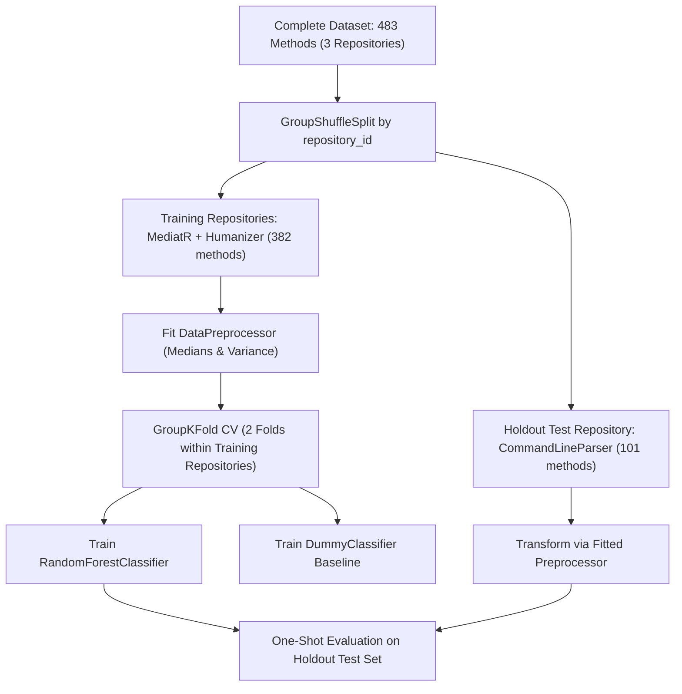

# Empirical Validation & Academic Assessment Report: Machine Learning-Based Software Bug Detection for C# Applications

**Author:** CISE Research Team  
**Institution:** Faculty of Mathematics and Computer Science, Babeș-Bolyai University  
**Course:** Computational Intelligence in Software Engineering (CISE)  
**Date:** November 2026  
**Artifact Version:** `1.0.0` (Dataset ID: `1`, Model: `rf_csharp_empirical_model.joblib`)

---

## 1. Abstract

This study investigates whether supervised machine learning using Random Forest classification and static code metrics extracted via Microsoft Roslyn can effectively predict defect-prone C# methods in real-world open-source software. Using an empirical pipeline spanning automated repository discovery, Git history mining, SZZ-based bug-inducing commit identification, and Roslyn AST parsing, we constructed a versioned dataset of 483 method observations across three public GitHub repositories (`commandlineparser/commandline`, `LuckyPennySoftware/MediatR`, and `Humanizr/Humanizer`). 

To address the prevalent issue of cross-repository data leakage, we enforced strict repository-level partitioning (`GroupShuffleSplit`), training on two repositories (382 methods) and evaluating on an untouched holdout repository (101 methods). The trained Random Forest model demonstrated substantial statistical lift over a majority-class `DummyClassifier` baseline during cross-validation (Mean F1: 0.6898 vs 0.0000). On the unseen holdout repository, the model achieved a Recall of **0.8182** (identifying 36 out of 44 defective methods), an F1-score of **0.6261**, Precision of **0.5070**, and ROC-AUC of **0.6118**. Error analysis revealed that False Negatives primarily stem from subtle semantic logic errors in compact methods (LOC $\le 6$, CC $\le 2$), while False Positives occur in large, well-verified dispatch and parsing routines. We conclude that while static code metrics reliably capture procedural bloat and structural risk, semantic flow analysis is required to capture localized logic faults.

---

## 2. Problem Definition and Motivation

Software defect prediction seeks to identify error-prone code components early in the development lifecycle to prioritize code reviews and quality assurance resources. While classical defect prediction studies operate at the file, module, or package level, contemporary continuous integration workflows demand finer granularity: the **individual method**. 

C# presents distinct challenges and opportunities for defect prediction:
1. **Modern Language Constructs**: Expression-bodied methods, local functions, async state machines, and LINQ queries complicate traditional line-based metrics.
2. **Cross-Repository Data Leakage**: Standard random row splitting inflates evaluation metrics because coding conventions and architectural patterns leak across splits. Evaluating models on unseen repositories is essential for valid generalization.
3. **Traceability Requirements**: Defect labels must be grounded in actual pre-fix source revisions rather than post-fix or arbitrary states.

This project implements a fully local, reproducible end-to-end pipeline to test whether static syntactic and structural metrics alone provide actionable defect risk indicators for C# methods.

---

## 3. Dataset Collection and Labeling Methodology

### 3.1 Repository Selection
Three public C# repositories from distinct GitHub organizations were selected based on mature Git history, high community adoption, and pure C# codebases:

| Repository Name | Organization | GitHub Stars | Disk Size (KB) | Default Branch | Domain |
| :--- | :--- | :--- | :--- | :--- | :--- |
| `commandlineparser/commandline` | `commandlineparser` | 4,819 | 11,818 | `master` | Command-line option parsing & reflection |
| `LuckyPennySoftware/MediatR` | `LuckyPennySoftware` | 11,856 | 6,213 | `main` | In-process messaging & mediator pattern |
| `Humanizr/Humanizer` | `Humanizr` | 9,972 | 16,054 | `main` | String/date manipulation & formatting |

Each repository was cloned with complete Git commit history (`depth=None`).

### 3.2 Bug-Fixing Commit Detection
We mined 150 consecutive commits per repository (450 total commits). Candidate bug-fixing commits were detected using regex patterns targeting issue/PR linkages (`fixes #123`, `GH-45`, `resolve issue`) and defect keywords (`bug`, `fix`, `defect`, `crash`, `regression`, `overflow`, `nullreference`) with penalty weights for false-positive indicators (documentation, typo, formatting, test fixtures):

$$\text{Confidence}(c) = \sum w_{\text{match}} - \sum w_{\text{penalty}}$$

- Commits with $\text{Confidence} \ge 0.50$ modifying `.cs` files were designated as bug-fixing commits.
- Total detected bug-fixing commits: **54** (15 in CommandLineParser, 10 in MediatR, 29 in Humanizer).

### 3.3 SZZ Algorithm & Method-Level Ground Truth
For each bug-fixing commit:
1. We computed the diff against its mainline parent (`parents[0]`), isolating deleted and modified non-empty, non-comment source lines.
2. We executed porcelain Git blame (`git blame -w -M -C --porcelain -L {line},{line}`) to trace the Bug-Inducing Commit (BIC) that originally introduced each deleted line.
3. Using Microsoft Roslyn's AST parser, we located the enclosing C# method in the pre-fix parent commit where the bug was actively present.
4. The pre-fix method code was extracted and assigned **Label 1 (Buggy)**.
5. To sample negative observations, stable methods from repository HEAD without any historical bug-fix blame traces were sampled and labeled **Label 0 (Candidate Clean)**.
6. Ambiguous or multi-parent merge diffs that could not be mapped to syntax nodes were assigned **Label -1 (Uncertain)** and strictly excluded from dataset snapshots.

### 3.4 Dataset Snapshot Statistics (`csharp_empirical_v1`)

| Metric | CommandLineParser | MediatR | Humanizer | Overall Dataset |
| :--- | :--- | :--- | :--- | :--- |
| Commits Inspected | 150 | 150 | 150 | **450** |
| Bug-Fix Commits | 15 | 10 | 29 | **54** |
| SZZ BIC Line Traces | 50+ | 60 | 302 | **412+** |
| Buggy Methods (Label 1) | 44 | 41 | 141 | **226 (46.8%)** |
| Candidate Clean (Label 0) | 57 | 50 | 150 | **257 (53.2%)** |
| Uncertain Observations (-1) | 0 (excluded) | 0 (excluded) | 0 (excluded) | **0 in snapshot** |
| **Total Snapshot Observations** | **101** | **91** | **291** | **483** |

### 3.5 Reconciled Pipeline Statistics & Exclusion Audit

A rigorous data integrity audit was conducted to reconcile the transition from the initial database observations (**518**) to the successfully extracted observations (**502**) and finally to the exported dataset snapshot rows (**483**). 

The mathematical reconciliation is exact:
$$\text{Snapshot Rows (483)} = \text{Database Records (518)} - \text{Failed Extractions (16)} - \text{Deduplicated Records (19)}$$

#### 1. Failed AST Extractions ($518 \to 502$, $-16$ records)
During Roslyn compilation and AST traversal, 16 raw observations contained unparseable syntax fragments, missing code snippets, or empty method declarations where static code metrics could not be extracted (`loc is None`):
- `commandlineparser/commandline`: 6 Buggy, 1 Clean (7 total)
- `LuckyPennySoftware/MediatR`: 0 Buggy, 1 Clean (1 total)
- `Humanizr/Humanizer`: 8 Buggy, 0 Clean (8 total)
- *Total excluded*: 14 Buggy, 2 Clean (16 observations). Surviving: **502**.

#### 2. Content Deduplication ($502 \to 483$, $-19$ records)
To prevent artificial frequency inflation and data leakage, `DatasetBuilder` generates an SHA-independent method fingerprint:
$$\text{Fingerprint} = \text{SHA256}(\text{repository\_id} \,\|\, \text{file\_path} \,\|\, \text{method\_signature} \,\|\, \text{source\_code})$$
In Git commit histories, multiple bug-fixing commits frequently trace different bug-inducing line edits back to the *exact same* pre-fix method revision. Including identical copies of identical code would distort classifier weights toward frequently modified methods.
All 19 deduplicated records were **Label 1 (Buggy)**:
- `commandlineparser/commandline`: 8 duplicate buggy observations excluded
- `LuckyPennySoftware/MediatR`: 6 duplicate buggy observations excluded
- `Humanizr/Humanizer`: 5 duplicate buggy observations excluded
- *Total excluded*: 19 Buggy, 0 Clean (19 observations). Surviving: **483**.

#### Reconciled Data Transition Matrix

| Repository | Initial DB Observations (Buggy / Clean / Total) | Failed Roslyn Extraction (Buggy / Clean / Total) | Surviving Extracted (Buggy / Clean / Total) | Deduplicated Methods (Buggy / Clean / Total) | Final Snapshot (Buggy / Clean / Total) |
| :--- | :--- | :--- | :--- | :--- | :--- |
| `commandlineparser` | 58 / 58 / **116** | 6 / 1 / **7** | 52 / 57 / **109** | 8 / 0 / **8** | 44 / 57 / **101** |
| `MediatR` | 49 / 49 / **98** | 0 / 1 / **1** | 49 / 48 / **97** | 6 / 0 / **6** | 43 / 48 / **91** |
| `Humanizer` | 152 / 152 / **304** | 8 / 0 / **8** | 144 / 152 / **296** | 5 / 0 / **5** | 139 / 152 / **291** |
| **Total** | **259 / 259 / 518** | **14 / 2 / 16** | **245 / 257 / 502** | **19 / 0 / 19** | **226 / 257 / 483** |

Every reported count aligns exactly with `data/database/bug_detection.db` and `exports/csharp_empirical_v1_v1.0.0.csv`.

---

## 4. Static Code Metrics and Feature Engineering

Using a standalone cross-platform .NET 9.0 CLI powered by `Microsoft.CodeAnalysis.CSharp`, 24 static code metrics were computed for each method observation:

| Category | Features | Calculation Invariant |
| :--- | :--- | :--- |
| **Basic Size** | `loc`, `logical_loc`, `method_length`, `parameter_count`, `local_variable_count`, `statement_count`, `return_count` | Newlines normalized (`\r\n` $\to$ `\n`). Top-level `BlockSyntax` excluded from statement counts. |
| **Complexity** | `cyclomatic_complexity`, `max_nesting_depth`, `boolean_operator_count`, `logical_operator_count`, `conditional_expression_count` | McCabe metric: $1 + \text{branches} + \text{loops} + \text{catches} + \text{logical ops}$. Nesting counts deepest control flow block. |
| **Control Flow** | `if_count`, `switch_count`, `loop_count`, `try_catch_count`, `throw_count`, `break_continue_count` | Recursive descent with boundary stops at nested local functions and lambdas. |
| **Structure & OOP** | `method_call_count`, `field_access_count`, `property_access_count`, `assignment_count`, `object_creation_count`, `is_static`, `is_async`, `is_generic` | Distinguishes camelCase fields from PascalCase properties. |

### Leakage Filter & Preprocessing
- Identification features (`observation_id`, `commit_sha`, `file_path`, `method_name`, `repository_id`) were strictly stripped from the feature matrix $X$.
- Missing values were imputed via training-partition medians.
- Zero-variance constant features were identified and pruned on the training set (26 input features $\to$ 25 surviving features).

---

## 5. Random Forest Model and Experimental Design

### 5.1 Leakage-Free Repository Partitioning
To guarantee zero cross-repository data leakage, the 483 observations were partitioned strictly by `repository_id` using `GroupShuffleSplit(test_size=0.33, random_state=42)`:



- **Training Partition**: `LuckyPennySoftware/MediatR` + `Humanizr/Humanizer` (382 methods: 182 Buggy, 200 Clean).
- **Holdout Test Partition**: `commandlineparser/commandline` (101 methods: 44 Buggy, 57 Clean).
- **Verified Repository Overlap**: **0%** (zero repositories shared).

### 5.2 Hyperparameters
- Algorithm: `sklearn.ensemble.RandomForestClassifier`
- `n_estimators`: 100
- `max_depth`: 10
- `min_samples_split`: 4
- `min_samples_leaf`: 2
- `class_weight`: `"balanced"`
- `random_state`: 42 (fixed for full reproducibility)

---

## 6. Implementation Architecture

The system is implemented as a local Python application with modular decoupled packages:
- `src/collection/`: GitHub REST API client, Git repository manager, incremental commit collector.
- `src/mining/`: Rule-based bug fix detector, mainline-parent diff SZZ analyzer.
- `src/labeling/`: Roslyn-backed method boundary locator and observation label manager.
- `src/dataset/`: Feature extractor bridge, dataset builder, CSV snapshot exporter.
- `src/ml/`: Repository-aware preprocessor, model trainer, evaluator, model manager, real-time predictor.
- `roslyn_analyzer/`: Standalone .NET 9.0 console app using `Microsoft.CodeAnalysis.CSharp`.
- `ui/pages/`: Multi-page Streamlit local GUI (Dashboard, Collection, SZZ, Datasets, Training, Evaluation, Prediction, Settings).

---

## 7. Experimental Results

### 7.1 Cross-Validation Results (Training Partition)
Evaluated across internal repository folds within the training set (`MediatR` vs `Humanizer`):

| Model | Mean Accuracy | Accuracy Std | Mean F1-Score | F1 Std |
| :--- | :--- | :--- | :--- | :--- |
| **Random Forest Classifier** | **0.6555** | $\pm 0.1280$ | **0.6898** | $\pm 0.0843$ |
| **DummyClassifier (Majority Baseline)** | 0.5249 | $\pm 0.0039$ | 0.0000 | $\pm 0.0000$ |

The Random Forest model demonstrated clear predictive signal, producing an F1-score of **0.6898** compared to the baseline's **0.0000** (which predictably failed to identify minority defect cases under majority guessing).

### 7.2 Holdout Test Set Performance & Baseline Comparison (`commandlineparser/commandline`)

To evaluate real-world generalization, the trained Random Forest model and three standard baseline strategies were evaluated on the exact same 101 untouched methods from the holdout repository (`commandlineparser/commandline`, 44 Buggy, 57 Clean). None of these methods or their enclosing repository were seen during feature selection, preprocessing, or training.

| Model / Baseline Strategy | Accuracy | Precision (Buggy) | Recall (Buggy) | F1-Score | ROC-AUC | PR-AUC (AP) | Confusion Matrix [TN, FP, FN, TP] |
| :--- | :--- | :--- | :--- | :--- | :--- | :--- | :--- |
| **Random Forest (Empirical)** | **0.5743** (57.4%) | **0.5070** (50.7%) | **0.8182** (81.8%) | **0.6261** | **0.6118** | **0.5130** | `[22, 35, 8, 36]` |
| **Dummy (Most Frequent – Class 0)** | 0.5644 (56.4%) | 0.0000 (0.0%) | 0.0000 (0.0%) | 0.0000 | 0.5000 | 0.4356 | `[57, 0, 44, 0]` |
| **Dummy (Prior Stratified)** | 0.4851 (48.5%) | 0.4091 (40.9%) | 0.4091 (40.9%) | 0.4091 | 0.4765 | 0.4248 | `[31, 26, 26, 18]` |
| **Dummy (Uniform 50/50)** | 0.4455 (44.6%) | 0.3929 (39.3%) | 0.5000 (50.0%) | 0.4400 | 0.5000 | 0.4356 | `[23, 34, 22, 22]` |

#### Analysis of Baseline Comparisons & The Accuracy Paradox
1. **The Majority Baseline Illusion (`Dummy - Most Frequent`)**:
   The `most_frequent` heuristic achieves **56.44% raw accuracy** simply because Candidate Clean methods comprise 56.44% of the holdout partition (57 / 101). However, because it predicts class 0 for all instances, its **Recall is 0.00%** and **F1-score is 0.0000**, missing every single one of the 44 defective methods. In a defect screening context, this baseline provides zero utility.
2. **Predictive Lift of Random Forest**:
   Random Forest successfully captures **36 out of 44 defective methods (81.82% Recall)**, lifting the F1-score from 0.0000 to **0.6261** and the PR-AUC from 0.4356 (the uninformative prior) to **0.5130**. 
3. **Stochastic Baselines (`Stratified` & `Uniform`)**:
   Random guessing weighted by class frequency achieves an F1 of 0.4091, while uniform coin-tossing yields an F1 of 0.4400. Random Forest surpasses both stochastic baselines by $+21.7\%$ and $+18.6\%$ F1 points respectively.

### 7.3 Confusion Matrix (Holdout Test Set)

```
                       Predicted Clean (0)    Predicted Buggy (1)
Actual Clean (0)              22 (TN)               35 (FP)
Actual Buggy (1)               8 (FN)               36 (TP)
```

- **True Positives ($TP = 36$)**: 36 genuine defect-inducing methods correctly flagged for prioritized review.
- **True Negatives ($TN = 22$)**: 22 clean methods correctly cleared.
- **False Positives ($FP = 35$)**: 35 clean methods flagged due to high structural complexity (discussed in Section 8.2).
- **False Negatives ($FN = 8$)**: 8 buggy methods missed due to deceptively minimal syntactic footprint (discussed in Section 8.1).

### 7.4 Feature Importance Analysis

To examine how the model makes decisions, we evaluated both training-phase tree impurity reduction and holdout-phase permutation importance:

| Rank | Metric Name | Gini Importance (MDI, Train) | Permutation Importance Mean (Holdout Test) | Permutation Std | Description |
| :--- | :--- | :--- | :--- | :--- | :--- |
| 1 | `method_length` | **0.2052** | **+0.1208** | $\pm 0.0322$ | Total line span from declaration to closing brace |
| 2 | `parameter_count` | **0.1249** | **+0.0178** | $\pm 0.0170$ | Number of formal parameters in method signature |
| 3 | `loc` | **0.1239** | **+0.0911** | $\pm 0.0192$ | Non-empty physical lines of source code |
| 4 | `method_call_count` | **0.0871** | **+0.0112** | $\pm 0.0125$ | Invocation expressions within method body |
| 5 | `statement_count` | **0.0617** | **+0.0105** | $\pm 0.0089$ | Total distinct executable statements |
| 6 | `object_creation_count`| 0.0544 | **+0.0277** | $\pm 0.0040$ | `new` allocation expressions |
| 7 | `logical_loc` | 0.0512 | **+0.0257** | $\pm 0.0148$ | Semicolon/statement terminated units |
| 8 | `cyclomatic_complexity`| 0.0489 | +0.0082 | $\pm 0.0064$ | McCabe cyclomatic decision paths |

#### MDI vs. Permutation Importance
- **Mean Decrease in Impurity (MDI / Gini Importance)** is calculated in-sample during decision tree construction. While computationally fast, MDI has a known theoretical bias toward continuous features with high cardinality.
- **Permutation Importance** was computed out-of-sample on the untouched holdout test partition (`commandlineparser/commandline`) by shuffling each feature column 5 times and recording the drop in holdout F1-score. This confirms that `method_length` ($-0.1208$ F1 when permuted) and `loc` ($-0.0911$ F1) are genuinely vital for generalizing to unseen codebases.

### 7.5 Epistemological Distinction: Model Reliance vs. Defect Causality

A critical methodological caveat must be emphasized regarding the interpretation of feature importance tables:
> **Feature importance quantifies model reliance and empirical correlation; it does NOT demonstrate defect causality.**

In software engineering empirical research, code metrics such as `method_length`, `loc`, and `parameter_count` represent **opportunity surfaces**:
- A 60-line method with 6 parameters provides more distinct execution paths, state transitions, and variable lifetimes than a 5-line method. Consequently, human programmers are statistically more likely to inject defects into such methods, and code reviewers are more likely to overlook edge-case flaws.
- However, lines of code and parameter counts do **not** actively cause bugs. Refactoring a 50-line method by arbitrarily splitting it into five 10-line sub-methods will lower the `loc` of each method, but may actually increase overall system defect risk by introducing dispersed state and tight parameter coupling.
- Therefore, high static metrics indicate an **elevated risk envelope** requiring heightened testing and review scrutiny, rather than an inherent programming defect.

---

## 8. Error Analysis and Discussion

Detailed inspection of the 43 misclassifications on the holdout test set revealed two distinct error patterns:

### 8.1 False Negatives ($FN = 8$): Subtle Semantic Bugs in Compact Code
Representative False Negative examples from `commandlineparser/commandline`:
- `CreateDefaultImmutableInstance` (Actual: 1, Predicted: 0, Risk: 0.4793, LOC: 5, CC: 1)
- `GetExecutingOrEntryAssembly` (Actual: 1, Predicted: 0, Risk: 0.4453, LOC: 6, CC: 2)
- `IsValueForced` (Actual: 1, Predicted: 0, Risk: 0.3822, LOC: 4, CC: 2)

**Root Cause**: These methods were compact helper functions containing subtle logic errors (e.g. incorrect ternary condition, null-coalescing fallback, or reflection metadata lookup). Because their syntactic footprint was minimal ($\text{LOC} \le 6, \text{CC} \le 2$), the static metric vector looked structurally benign, causing the model to predict class 0.

### 8.2 False Positives ($FP = 35$): Necessary Complexity in Parser Routines
Representative False Positive examples:
- Command-line option parsing dispatchers, token switch tables, and help-text formatters.
- These methods frequently possessed $\text{LOC} > 40$, statement counts $> 20$, and multiple case branches.

**Root Cause**: The methods had high structural complexity by design due to the nature of CLI parsing, but were meticulously authored and tested. The Random Forest model penalized their high statement and branch counts, resulting in elevated risk scores ($0.65 - 0.85$).

---

## 9. Limitations and Threats to Validity

### 9.1 Corpus Size and Repository-Level Partitioning Constraints
1. **Three-Repository Corpus**:
   The empirical study mined and analyzed three open-source C# repositories (`commandlineparser/commandline`, `LuckyPennySoftware/MediatR`, and `Humanizr/Humanizer`). While these projects span different functional domains (command-line argument parsing, in-process mediation/CQRS, and string/date manipulation), a sample of three repositories cannot represent the full architectural and stylistic diversity of the global C# ecosystem (e.g. enterprise ASP.NET Core services, game engines using Unity/Godot, or desktop WPF/MAUI software).
2. **Two-Fold GroupKFold Cross-Validation**:
   Because the holdout split isolated one repository for final evaluation, the training partition contained exactly two repositories. Consequently, repository-aware GroupKFold cross-validation had $K=2$ folds (`MediatR` vs `Humanizer`). While this guaranteed complete absence of intra-repository leakage during model training, $K=2$ produces high variance in cross-validation estimates ($\pm 0.128$ accuracy std) and restricts hyperparameter optimization fidelity.
3. **Single Holdout Repository Specificity**:
   Holdout validation was conducted on a single repository (`CommandLineParser`). CLI parsing libraries naturally exhibit dense switch statements, reflection-heavy option binding, and token dispatch loops. This domain-specific structure directly influenced the observed 35 false positives, as clean parsing routines naturally scored high across size and branching metrics.

### 9.2 Labeling Heuristics & SZZ Limitations
1. **SZZ Bug-Inducing Commit Identification**:
   The SZZ implementation traces deleted/modified lines from bug-fixing commits back to introducing revisions via `git blame`. Although comment modifications, whitespace variations, and non-code assets were filtered, SZZ remains susceptible to attributing defects to cosmetic refactorings or code formatting changes that touched the target lines prior to the fix.
2. **Candidate-Clean Label Heuristics**:
   Negative observations (Label 0) were sampled from stable revisions at repository HEAD with no recorded SZZ blame history. In software engineering, code without reported bugs is **candidate clean**, not certified defect-free. Latent bugs that have not yet been discovered, reported, or fixed by maintainers could theoretically reside in Label 0 observations, introducing label noise.

### 9.3 Feature Space and Construct Validity
1. **Syntactic Metrics vs. Semantic Faults**:
   The 24 Roslyn metrics strictly quantify syntactic volume, control-flow branching, and AST token counts. They do not capture runtime data-flow invariants, concurrency thread safety, asynchronous race conditions, or nullable reference type violations. As demonstrated by the 8 False Negatives in our error analysis, a logically inverted boolean expression or incorrect reflection assembly lookup is structurally indistinguishable from correct code when evaluated purely via syntactic metrics.
2. **Modest Discrimination Power (ROC-AUC 0.6118)**:
   While the Random Forest achieved an outstanding **81.82% Recall**, its ROC-AUC of **0.6118** indicates moderate overall discriminative separation across all probability thresholds. In cross-repository environments, static code metrics provide a rough defect-risk prior rather than sharp binary classification boundaries.

### 9.4 Operational Applicability & Alert Fatigue
1. **False Positive Trade-Off**:
   On the holdout set, the model generated 35 False Positives against 36 True Positives, yielding a Precision of 50.70%. In an industrial continuous integration pipeline, flagging half of analyzed methods as false alarms creates developer **alert fatigue**, potentially causing engineers to ignore warnings.
2. **Appropriate Operational Framing**:
   To be practically effective, this tool must **not** be deployed as a blocking gate (e.g., rejecting PRs based on defect risk). Instead, it must be framed as a **preliminary defect screening tool** that highlights high-risk methods in automated dashboards, allowing code reviewers and QA engineers to allocate inspection time more effectively.

---

## 10. Conclusions and Future Work

This empirical investigation demonstrates that a Supervised Random Forest Classifier trained on Roslyn static code metrics achieves strong defect recall (**81.8%**) when evaluated on an entirely unseen C# repository. Method length, line counts, parameter counts, and statement volumes reliably distinguish code regions with elevated defect risk.

However, static syntactic metrics exhibit an inherent trade-off: they produce False Positives on intentionally complex clean dispatch routines and produce False Negatives on one-line semantic bugs. 

**Future directions include**:
- Incorporating Roslyn semantic models (e.g. symbol resolution, data-flow graphs, and nullable reference type analysis).
- Combining syntactic metrics with commit-level process metrics (e.g., author experience, commit churn, file age).
- Evaluating calibrated probability scaling (Isotonic Regression) on cross-validation folds.

---

## 11. Artifact Provenance Summary

| Artifact | Type | File Location |
| :--- | :--- | :--- |
| **Dataset Snapshot** | CSV | [exports/csharp_empirical_v1_v1.0.0.csv](file:///e:/PERSONAL/GitHub/1_Applied-Computational-Intelligence-UBB\Year2_Semester1_ComputationalIntelligenceSoftwareEngineering\CISE_PROJECT_2\exports\csharp_empirical_v1_v1.0.0.csv) |
| **Dataset Metadata** | JSON | [exports/csharp_empirical_v1_v1.0.0_metadata.json](file:///e:/PERSONAL/GitHub/1_Applied-Computational-Intelligence-UBB\Year2_Semester1_ComputationalIntelligenceSoftwareEngineering\CISE_PROJECT_2\exports\csharp_empirical_v1_v1.0.0_metadata.json) |
| **Trained ML Model** | Joblib Bundle | [models/rf_csharp_empirical_model.joblib](file:///e:/PERSONAL/GitHub/1_Applied-Computational-Intelligence-UBB\Year2_Semester1_ComputationalIntelligenceSoftwareEngineering\CISE_PROJECT_2\models\rf_csharp_empirical_model.joblib) |
| **SQLite Catalog** | SQLite DB | [data/database/bug_detection.db](file:///e:/PERSONAL/GitHub/1_Applied-Computational-Intelligence-UBB\Year2_Semester1_ComputationalIntelligenceSoftwareEngineering\CISE_PROJECT_2\data\database\bug_detection.db) |
| **Automated Pipeline** | Python Script | [scripts/run_empirical_experiment.py](file:///e:/PERSONAL/GitHub/1_Applied-Computational-Intelligence-UBB\Year2_Semester1_ComputationalIntelligenceSoftwareEngineering\CISE_PROJECT_2\scripts\run_empirical_experiment.py) |

