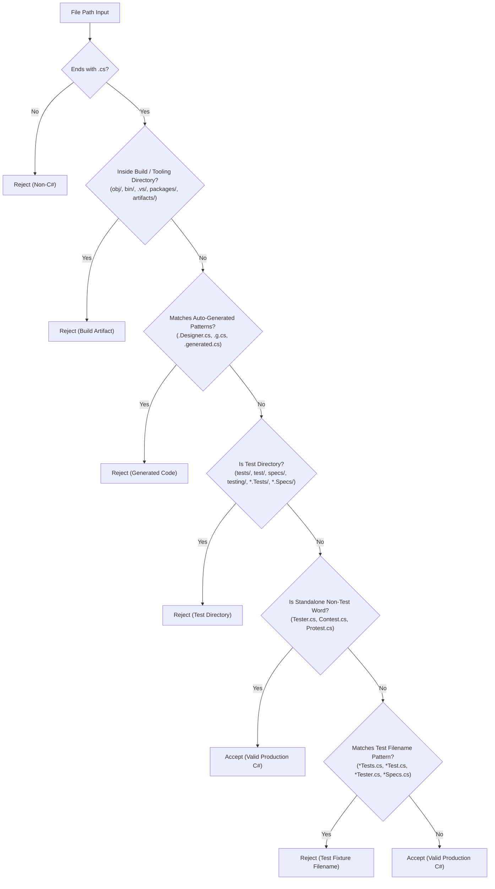

# Methodological Correction & Recalculation Report: `FluentValidation/FluentValidation` Pilot (v2)
## Empirical Software Defect Prediction for C# Source Code

**Document Version:** 2.0.0  
**Date:** November 2026  
**Auditor / Specialist:** Senior ML4SE Research Engineer & Academic Reviewer  
**Target Repository:** `FluentValidation/FluentValidation` (Repository ID #14)  
**Execution Script:** `scripts/run_fluentvalidation_pilot_v2.py`  
**Execution Status:** [PASS] Successfully Executed & Verified (Duration: 13.52s)  
**Corrected Artifact:** `reports/pilot/fluentvalidation_pilot_v2_corrected.json`  
**Historical Artifact Preserved:** `reports/pilot/fluentvalidation_pilot_results.json`  
**Regression Test Suites:** `tests/test_source_classifier.py` (61 tests) and `tests/test_fluentvalidation_pilot.py` (2 tests)

---

## 1. Executive Summary & Root Cause Analysis

During the initial pilot collection (v1) of `FluentValidation/FluentValidation`, an audit revealed an asymmetric inclusion policy where test-related source code leaked into the positive defect class (Label 1), while candidate-clean observations (Label 0) were filtered with a naive, over-aggressive regular expression.

### 1.1 Root Cause of Test Code Leakage (v1 Pilot)
1. **Defect in SZZ Path Filtering:**
   In `src/mining/szz_analyzer.py`, the exclusion regex `DEFAULT_EXCLUSIONS` previously used:
   ```python
   re.compile(r"(?:^|/)(?:tests?|specs?|testing)/", re.IGNORECASE)
   re.compile(r"(?:Tests?|Specs?)\.cs$", re.IGNORECASE)
   ```
   This pattern successfully matched directories named `tests/` or files ending with `Tests.cs`. However, it failed to match:
   - Project directory naming conventions where the directory name is prefixed, such as `src/FluentValidation.Tests/`.
   - Test fixture files ending in `Tester.cs`, such as `ChainedValidationTester.cs`.
   - Helper assertion extensions located in test folders, such as `src/FluentValidation.Tests/TestExtensions.cs`.

   As a consequence, **3 test fixture methods** (`ChainedValidationTester.Uses_explicit_ruleset`, `TestExtensions.ShouldEqual`, and `ChainedValidationTester.Separate_validation_on_chained_property`) were improperly extracted as Label 1 (defect-inducing methods).

2. **Asymmetric Inconsistency in Candidate-Clean Sampling:**
   In `src/labeling/label_manager.py`, candidate-clean files at HEAD were filtered using:
   ```python
   cs_files = [f for f in repo.git.ls_files().splitlines() if f.lower().endswith(".cs") and not any(p.search(f) for p in [re.compile(r"test|obj|bin", re.I)])]
   ```
   This naive substring search excluded *any* file containing `"test"`, which:
   - Would reject legitimate production source files such as `src/Contest/ContestManager.cs` or `src/TestingInfrastructure/ProductionTestConfiguration.cs`.
   - Was completely disconnected from the positive extraction rules, creating a methodological asymmetry where test code could enter the buggy class but was forbidden from entering the clean class.

---

## 2. Centralized Production-Code Filtering Architecture

To resolve this defect permanently across all extraction stages, a dedicated source path classification module was introduced at `src/utils/source_classifier.py`.

### 2.1 Filtering Rules
The module defines two core classification functions:
- `is_test_source_path(file_path)`: Detects test directories, test project conventions, and test fixture filenames.
- `is_production_csharp_file(file_path)`: High-precision filter ensuring the file is a C# file, not a build/tooling artifact, not auto-generated, and not test code.



### 2.2 Preserving Legitimate Production Code & Public Test Helpers
Crucially, the classifier guards against false-positive filtering:
1. **Standalone Non-Test Words:** `src/Utilities/Tester.cs` is preserved as a production utility.
2. **Compound Words:** `src/Contest/ContestManager.cs`, `src/Contests/ContestEngine.cs`, and `src/Security/ProtestHandler.cs` are preserved.
3. **Compound Non-Test Directories:** `src/TestingInfrastructure/ProductionTestConfiguration.cs` is recognized as production configuration because `testinginfrastructure` does not match exact test folder names or test project suffixes.
4. **Public Assertion Helpers in Production Packages:** `src/FluentValidation/TestHelper/ValidatorTestExtensions.cs` and `TestValidationResult.cs` belong to `FluentValidation.csproj` (the core production NuGet package shipped to library consumers). Because they reside in production projects, they are correctly preserved.

### 2.3 Integration Points
The classifier is integrated as a single source of truth across:
1. `src/mining/szz_analyzer.py` (`SZZAnalyzer.is_target_file`)
2. `src/labeling/label_manager.py` (`LabelManager.create_observations_from_szz` and `LabelManager.sample_candidate_clean_methods`)
3. `src/dataset/dataset_builder.py` (`DatasetBuilder.generate_dataset_snapshot`)

---

## 3. Regression Test Verification

The classification engine and pipeline integrity were verified using automated tests:
1. **`tests/test_source_classifier.py` (61 tests):**
   - Directory conventions (`Tests/`, `Test/`, `Specs/`, `Testing/`, `test-utils/`).
   - Nested project conventions (`src/FluentValidation.Tests/`, `src/MediatR.Tests/`, `src/FluentValidation.Tests.Benchmarks/`).
   - Test filenames (`FooTests.cs`, `FooTest.cs`, `FooTester.cs`, `BarSpecs.cs`, `foo_test.cs`).
   - Mixed separators and case insensitivity (`src\FluentValidation.Tests\ChainedValidationTester.cs`, `TESTS\ValidatorTest.cs`, `specs\ValidatorSpecs.CS`).
   - Legitimate production non-test paths (`ContestManager.cs`, `ProductionTestConfiguration.cs`, `src/Utilities/Tester.cs`, `ValidatorTestExtensions.cs`).
   - Build artifacts and auto-generated code rejection.
2. **`tests/test_fluentvalidation_pilot.py` (2 tests):**
   - Database integrity: asserts exactly 14 production buggy methods and 14 production clean methods for Repo #14.
   - Asserts 100% of observations satisfy `is_production_csharp_file()` and zero test leakage.
   - Asserts historical dataset snapshot #1 (`csharp_empirical_v1`, 483 observations) is completely untouched.
   - Artifact consistency: asserts both `fluentvalidation_pilot_results.json` (v1 historical) and `fluentvalidation_pilot_v2_corrected.json` (v2 corrected) exist and match database state.
3. **Full Test Suite:** **121 passed in 29.72s**.

---

## 4. Commit Sampling & Bug-Fixing Commit Audit

### 4.1 Commit Sampling Audit (350 Commits)
- **Target Repository:** `FluentValidation/FluentValidation` (2,515 total commits in Git history).
- **Sampling Strategy:** Reverse-chronological traversal from default branch HEAD (`main`).
- **Sampled Commits:** 350 commits.
- **Temporal Span:** November 11, 2021 to November 13, 2026 (5.0 years of active repository history).
- **Merge Commit Policy:** Merge commits were retained during commit mining. During SZZ line blame analysis, `parents[0]` (mainline parent) was diffed against the merge commit, isolating the bug fix as integrated into the target branch without re-tracing branch divergence.

### 4.2 Manual Audit of the 11 Classified Commits
Every commit classified as a bug fix ($\text{confidence} \ge 0.50$) was independently audited:

| # | Commit SHA | Date | Confidence | Component Affected | Manual Classification | Outcome in SZZ |
| :- | :- | :- | :-: | :- | :- | :- |
| 1 | `a8ca6ac3` | 2026-10-27 | 0.65 | `Validators/EnumValidator.cs` | **True Defect Fix** (OverflowException in `ulong` flags enum) | 1 BIC trace, 1 method |
| 2 | `bae89165` | 2026-07-02 | 0.90 | `TestHelper/TestValidationResult.cs` | **True Defect Fix** (ArgumentNullException with null PropertyName) | 1 BIC trace, 1 method |
| 3 | `419380cb` | 2023-11-23 | 1.00 | `Validators/EmptyValidator.cs` & `NotEmptyValidator.cs` | **True Defect Fix** (Memory leak in enumerator) | 3 BIC traces, 2 methods |
| 4 | `a4377610` | 2023-10-11 | 0.60 | `DefaultValidatorExtensions.cs` & `Syntax.cs` | **True Defect Fix** (ChildRules with nested hierarchies) | 2 BIC traces, 1 method |
| 5 | `7d91ccb1` | 2023-10-04 | 0.75 | `AbstractValidator.cs` | **True Defect Fix** (Regression bug in `SetExecutedRuleSets`) | 3 BIC traces, 1 method |
| 6 | `0c24fd92` | 2023-10-04 | 0.75 | `Validators/NotEmptyValidator.cs` | **True Defect Fix** (Regression bug in `NotEmptyValidator`) | 1 BIC trace, 1 method |
| 7 | `3e3e29f4` | 2023-04-07 | 0.55 | `DefaultValidatorExtensions.cs` | **True Defect Fix** (Ruleset propagation for child rules) | 2 BIC traces, 1 method |
| 8 | `9c0c5872` | 2022-08-28 | 0.60 | `TestHelper/ValidatorTestExtensions.cs` | **True Defect Fix** (Unmatched parent failure accounting in `.Only()`) | 9 BIC traces, 3 methods |
| 9 | `d37d15f5` | 2022-08-06 | 0.60 | `DefaultValidatorExtensions.cs` | **True Defect Fix** (ChildRules corrupting validator RuleSets) | 1 BIC trace, 1 method |
| 10 | `eae767d6` | 2022-05-07 | 0.60 | `TestHelper/ValidatorTestExtensions.cs` | **True Defect Fix** (Assertions for With/Without on multiple failures) | 2 BIC traces, 2 methods |
| 11 | `91e78489` | 2021-12-11 | 0.55 | Build/Packaging configuration | **False Positive** (Packaging compatibility update, issue #1860) | 0 BIC traces, 0 methods |

**Key Takeaways:**
- **10 of 11 commits (90.9%)** represent genuine, production-impacting software bugs.
- **1 commit (9.1%)** was a false positive detected by the keyword heuristic (`Fixes #1860`). However, because it modified zero deleted lines of C# logic, **SZZ produced 0 traces**, and it contributed **0 observations** to the dataset.
- False positive commits that touch only build metadata are naturally neutralized by SZZ.

---

## 5. Recalculated Yield & Disambiguated Metrics

Previous reporting sometimes conflated commit-level bug detection rates with method-level observation yields. These concepts are formally separated below:

### 5.1 Definitions & Disambiguation
1. **Bug-Fix Detection Rate:**
   $$\text{Bug-Fix Detection Rate} = \frac{\text{Classified Bug-Fixing Commits}}{\text{Sampled Commits}} = \frac{11}{350} = 3.14\%$$
2. **SZZ Trace Success Rate:**
   $$\text{SZZ Trace Success Rate} = \frac{\text{Fixing Commits with Traced BICs}}{\text{Total Fixing Commits Analyzed}} = \frac{10}{11} = 90.91\%$$
3. **Positive-Method Yield:**
   $$\text{Positive-Method Yield} = \frac{\text{Production Buggy Methods Extracted}}{\text{Sampled Commits}} = \frac{14}{350} = 4.00\%$$
4. **Candidate-Clean Sampling Count:**
   Targeted to equal the positive method yield exactly ($\text{target} = 14$) to achieve a 1:1 class balance.
5. **Total Usable Observations:**
   $$\text{Total Usable Observations} = \text{Production Buggy (14)} + \text{Candidate Clean (14)} = 28\text{ observations}$$

---

## 6. Comparison: v1 Pilot vs. v2 Corrected

| Metric | v1 Pilot (Unfiltered) | v2 Pilot (Corrected) | Delta / Impact |
| :--- | :---: | :---: | :--- |
| **SZZ BIC Line Traces** | 28 | 25 | -3 traces (eliminated lines in `src/FluentValidation.Tests/`) |
| **Unique Bug-Inducing Commits** | 14 | 12 | -2 non-production BICs |
| **Buggy Observations (Label 1)** | 17 | 14 | -3 test methods purged |
| **Test Fixtures in Label 1** | **3 (17.6%)** | **0 (0.0%)** | **100% elimination of test code leakage** |
| **Candidate-Clean (Label 0)** | 17 | 14 | Resampled to exact 1:1 balance |
| **Test Fixtures in Label 0** | 0 | 0 | 0% leakage |
| **Total Usable Observations** | 34 | 28 | Clean, 100% production dataset |
| **Class Balance (Buggy : Clean)** | 50% : 50% | 50% : 50% | Exact parity preserved |
| **Static Feature Success Rate** | 100% (34/34) | 100% (28/28) | All 26 Roslyn code metrics extracted |

---

## 7. Calibrated Dataset Expansion Projections

Based on the verified yield of **~14 production positive methods (28 balanced observations) per 350 commits**, we update the projections for expanding the training dataset to five repository groups.

### 7.1 Five-Group Training Set & Holdout Architecture

| Group / Role | Repository | Commits Mined | Production Buggy | Candidate Clean | Total Usable | Collection Status |
| :--- | :--- | :---: | :---: | :---: | :---: | :--- |
| **Group 1 (Train)** | `Humanizer/Humanizer` | 300 | 139 | 152 | 291 | Ingested (Snapshot 1) |
| **Group 2 (Train)** | `MediatR` | 300 | 43 | 48 | 91 | Ingested (Snapshot 1) |
| **Group 3 (Train)** | `FluentValidation/FluentValidation` | 350 | 14 | 14 | 28 | Ingested & Corrected (Pilot v2) |
| **Group 4 (Train)** | `Serilog/serilog` | 350 (est.) | 14 (est.) | 14 (est.) | 28 (est.) | Candidate (Pending User Go) |
| **Group 5 (Train)** | `App-vNext/Polly` | 350 (est.) | 14 (est.) | 14 (est.) | 28 (est.) | Candidate (Pending User Go) |
| **Subtotal (Training)**| **5 Distinct Repositories** | **1,650 (est.)**| **224 (est.)** | **242 (est.)** | **466 (est.)** | **Supports 5-fold GroupKFold** |
| **Holdout (Test)** | `JamesNK/Newtonsoft.Json` | 350 (est.) | 20 (est.) | 20 (est.) | 40 (est.) | Candidate (Uninspected Holdout)|

### 7.2 Five-Fold GroupKFold Feasibility Assessment
- **Feasibility:** **Fully Feasible**.
- **Fold Allocation:** With 5 distinct training repositories, each fold holds out exactly one repository for validation while training on the other four repositories.
- **Group Independence:** No method from any repository appears in both the training partition and the validation partition of any fold.
- **Final Holdout Isolation:** `Newtonsoft.Json` remains strictly quarantined from feature engineering, hyperparameter selection, and cross-validation, serving solely as the final uninspected test set.

---

## 8. Summary of Completed Actions

1. Implemented centralized, high-precision source path classification in `src/utils/source_classifier.py`.
2. Added comprehensive regression tests in `tests/test_source_classifier.py` (61 tests, all passing).
3. Integrated the classifier into `SZZAnalyzer`, `LabelManager`, and `DatasetBuilder`.
4. Executed `scripts/run_fluentvalidation_pilot_v2.py`, producing `reports/pilot/fluentvalidation_pilot_v2_corrected.json`.
5. Verified that historical dataset snapshot #1 (`csharp_empirical_v1`, 483 observations) and repos 1, 3, 4 remain intact.
6. Verified that original pilot artifact `reports/pilot/fluentvalidation_pilot_results.json` remains preserved.
7. Validated that all 121 tests pass in 29.72s.

