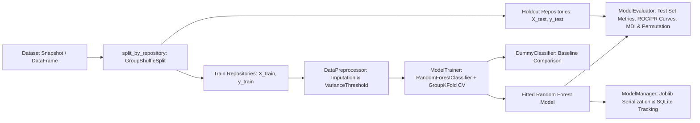

# Machine Learning Model Specification: Random Forest Classification

## 1. Algorithm Selection: Random Forest Classifier

Random Forest Classification is chosen as the supervised learning algorithm for predicting method defect proneness based on static code metrics for several key reasons:

- **Non-Linear Decision Boundaries**: Software defect thresholds are non-linear. For example, high cyclomatic complexity ($\ge 10$) interacts non-linearly with nesting depth ($\ge 4$) and method length to elevate bug probability, which single linear classifiers cannot capture without polynomial expansions.
- **Invariance to Monotonic Scaling**: Decision trees split on individual metric thresholds; therefore, Random Forest is naturally robust to extreme outliers and varying scale differences between features (e.g., `loc` up to 500 vs `conditional_expression_count` of 1).
- **Reduced Variance via Bagging**: By averaging predictions across hundreds of de-correlated decision trees trained on bootstrap samples with random feature subsets ($\sqrt{p}$ features per split), Random Forest mitigates the high variance associated with individual decision trees.
- **Interpretability & Feature Rankings**: Provides Mean Decrease in Impurity (Gini Importance) and enables permutation importance analysis on held-out test data, identifying which structural patterns most strongly correlate with bugs.

---

## 2. Model Architecture & Pipeline Components

The machine learning engine (`src/ml/`) is structured into four decoupled, testable components:

### 2.1 Preprocessing (`src/ml/preprocessing.py`)
- **Imputation**: Missing values (from syntax edge-cases or zero-metric occurrences) are imputed using median values computed strictly on the training partition to avoid data leakage.
- **Variance Thresholding**: Identifies and strips zero-variance (constant) features across observations.
- **Repository-Aware Partitioning**: `split_by_repository()` uses scikit-learn's `GroupShuffleSplit` on `repository_id` ensuring zero repository overlap between train and test sets.

### 2.2 Model Training (`src/ml/trainer.py`)
- **Ensemble Training**: Trains `sklearn.ensemble.RandomForestClassifier` with deterministic random seeds.
- **GroupKFold Cross-Validation**: Evaluates cross-validation performance across repository folds strictly within the training set.
- **Dummy Baseline Comparison**: Evaluates `DummyClassifier(strategy="most_frequent")` under identical cross-validation folds to demonstrate statistical lift above naïve majority guessing.

### 2.3 Evaluation & Interpretability (`src/ml/evaluator.py`)
- **Holdout Test Metrics**: Accuracy, Precision, Recall, F1-Score, ROC-AUC, and Average Precision (PR-AUC).
- **Confusion Matrix**: Generates $2 \times 2$ heatmap of true positives, false positives, true negatives, and false negatives.
- **Discrimination Curves**: Computes ROC and Precision-Recall curve figures using Plotly.
- **MDI (Gini) Importance**: Measures cumulative impurity decrease across all forest nodes.
- **Permutation Importance**: Shuffles each feature individually on the held-out test set over 5 repetitions to measure generalization drop, free from high-cardinality Gini bias.

### 2.4 Model Persistence & Provenance (`src/ml/model_manager.py`)
- **Single-Bundle Serialization**: Serializes the fitted `RandomForestClassifier`, the fitted `DataPreprocessor`, feature column names, training hyperparameters, evaluation metrics, and repository split provenance into a single compressed `.joblib` file.
- **SQLite Catalog**: Synchronizes model metadata into the `models` database table for auditing, tracking, and UI listing.

---

## 3. Hyperparameter Configuration

| Hyperparameter | Default | Range Explored | Description |
| :--- | :--- | :--- | :--- |
| `n_estimators` | 100 | [10, 300] | Number of decision trees in the ensemble |
| `max_depth` | 15 | [5, 30, None] | Maximum tree depth; None allows unlimited expansion |
| `min_samples_split` | 5 | [2, 20] | Minimum samples required to split an internal node |
| `min_samples_leaf` | 2 | [1, 10] | Minimum samples required at any terminal leaf node |
| `class_weight` | `balanced` | [`balanced`, `None`] | Inversely weights classes by frequency to combat bug rarity |
| `max_features` | `sqrt` | [`sqrt`, `log2`, None] | Number of features considered at each decision split |
| `random_state` | 42 | fixed | Ensures deterministic execution and reproducible training |

---

## 4. Feature Importance Methodology: MDI vs Permutation

1. **Mean Decrease in Impurity (MDI / Gini Importance)**:
   $$\text{MDI}(f) = \frac{1}{N_{\text{trees}}} \sum_{T} \sum_{t \in T, v(t) = f} p(t) \Delta i(t)$$
   Computed rapidly during tree construction. However, MDI is known to possess a slight bias toward numerical features with high variance.
2. **Permutation Feature Importance**:
   Evaluates each metric on the unseen test repository split:
   $$I(f) = s_{\text{baseline}} - s_{\text{permuted}(f)}$$
   Permutes feature $f$ across held-out observations and measures the drop in F1-score over 5 random repetitions. Features that cause large performance drops are confirmed to be truly predictive of defect proneness across distinct codebases.

---

## 5. Real-Time Inference, Risk Scoring & Explainability (Phase 6)

### 5.1 Inference Workflow
1. **Source Ingestion**: The input C# code (either single method snippet or complete `.cs` file) is passed to `RoslynClient`. If a bare method snippet lacks class wrapping, Roslyn wraps it inside a dummy container to construct a valid AST.
2. **Method Extraction**: Roslyn locates method declarations, isolates nested local functions/lambdas, and computes the 24 static code metrics.
3. **Preprocessing Alignment**: Extracted metrics are mapped into a single-row DataFrame matching the model's fitted `DataPreprocessor` input schema. Missing metrics are imputed using training medians; dropped constant features are filtered out.
4. **Ensemble Scoring**: The processed feature vector is passed to `model.predict_proba()`. The estimated risk score is extracted as the predicted probability for class 1 (buggy):
   $$\text{RiskScore}(m) = P(\text{Label} = 1 \mid \vec{x}_m)$$

### 5.2 Risk Categorization & Presentation Thresholds
Predictions are categorized using presentation thresholds to guide manual code inspection:

| Risk Score Range | Presentation Category | Visual Badge | Guidance |
| :--- | :--- | :--- | :--- |
| **0.00 – 0.30** | **Low risk** | 🟢 Low risk | Metrics are within typical clean method envelopes. Code does not exhibit high structural warning signs. |
| **0.31 – 0.60** | **Medium risk** | 🟡 Medium risk | Moderate structural complexity or multiple decision branches present; review logic flow. |
| **0.61 – 1.00** | **High risk** | 🔴 High risk | Structural complexity, deep nesting, or high branching strongly align with historical defect-inducing patterns. Prioritize for focused code review and unit testing. |

> [!WARNING]
> **Scientific Caveats on Risk Scores**:
> - The risk score represents the Random Forest model's estimated propensity based on static syntactic metrics; it is **not** a mathematically calibrated Bayesian probability.
> - A high-risk score does **not** prove the existence of a bug (e.g., highly complex dispatch tables may be thoroughly tested and clean).
> - A low-risk score does **not** guarantee correctness (e.g., simple one-line semantic bugs or missing null checks may occur in structurally minimal methods).

### 5.3 Explainability Framework
Explainability is provided across three complementary tiers:
1. **Extracted Metrics Matrix**: Complete transparent display of all 24 measured Roslyn metrics.
2. **Global Feature Importance**: Top MDI (Gini) and Permutation importance rankings derived during training, highlighting which metrics general software defect models prioritize.
3. **Local Influential Metrics**: Specific structural metrics of the inspected method that exceed alert thresholds (e.g., cyclomatic complexity $\ge 10$, nesting depth $\ge 4$, statement count $\ge 25$), paired with software engineering explanations.
4. **Boundary Distinction**: Global feature importances explain forest-level splits across all repositories; individual predictions result from tree voting over all metric branches simultaneously. Global importance is never presented as direct local causality.
