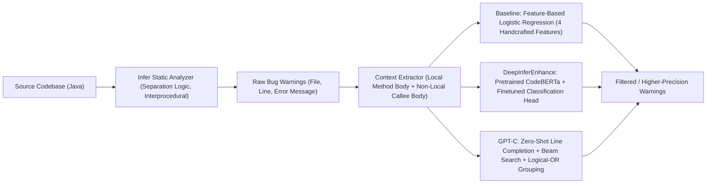
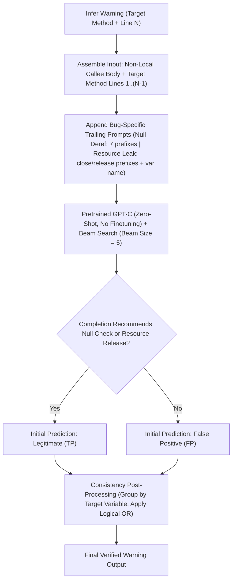

# Research Summary: Learning to Reduce False Positives in Analytic Bug Detectors

## 1. Bibliographic Information

* **Title:** Learning to Reduce False Positives in Analytic Bug Detectors
* **Authors:** Anant Kharkar, Roshanak Zilouchian Moghaddam, Matthew Jin, Xiaoyu Liu, Xin Shi, Colin Clement, and Neel Sundaresan
* **Affiliation:** Microsoft, Redmond, Washington, USA
* **Publication:** Proceedings of the 2022 IEEE/ACM 44th International Conference on Software Engineering (ICSE '22), May 21–29, 2022, Pittsburgh, PA, USA (ACM, New York, NY, USA, pp. 1307–1316)
* **Year:** 2022
* **DOI:** `https://doi.org/10.1145/3510003.3510153`
* **ACM ISBN:** `978-1-4503-9221-1/22/05`

---

## 2. Executive Overview

Modern software projects rely on **static analysis tools**—automated programs that inspect source code for defects without executing it—to catch bugs and security vulnerabilities early. However, these tools routinely generate many **false positives** (warnings raised on code that is actually correct), which wastes developer time and discourages consistent tool adoption.

Rather than replacing rule-based analyzers with end-to-end machine learning (ML) bug detectors, this paper proposes a **hybrid paradigm**: using pretrained **Transformer** neural networks (deep learning models that process sequential data using attention mechanisms) as a post-processing verification layer on top of **Infer**, a production static analyzer. The authors compare a handcrafted feature-based classifier, a supervised finetuned encoder model (**DeepInferEnhance**), and a **zero-shot** generative code-completion model (**GPT-C**, used without task-specific retraining). Experiments on Java repositories demonstrate that augmenting Infer with GPT-C improves relative precision by **17.47%** (from 72.7% to 85.4%) on **null dereference** warnings and **5.56%** (from 57.4% to 60.6%) on **resource leak** warnings, while DeepInferEnhance achieves **+15.13%** precision improvement with superior **recall** (88.3% vs. 83.7%).

---

## 3. Problem Statement and Research Objectives

### Problem Statement
* **Precision–Recall Trade-Off:** Building rule-based static analyzers requires balancing **precision** (the fraction of reported warnings that are genuine bugs) against **recall** or coverage (the fraction of all real bugs the tool detects). Most analyzers prioritize coverage, yielding high false positive rates.
* **Developer Abandonment:** Manually triaging false warnings consumes scarce developer time during short bug-fixing sessions, making high false positive rates a primary barrier to industrial adoption.
* **Concept Drift:** As software patterns and bug types evolve over time (known as **concept drift**), maintaining and updating static analysis rules manually becomes costly.
* **Shortcomings of Standalone ML Bug Detectors:** Prior ML models trained to detect bugs directly from code also exhibit low real-world precision, often require designing separate models for each vulnerability class, and are computationally prohibitive to run over every line of a large codebase.

### Research Objectives
1. **Augment Rather Than Replace:** Leverage machine learning—specifically large pretrained Transformer models—to filter false positives from an existing analytic static analyzer (Infer), combining formal static localization with data-driven recognition of coding conventions.
2. **Compare Modeling Paradigms:** Benchmark handcrafted feature engineering against supervised transfer learning (**DeepInferEnhance**) and zero-shot generative prompting (**GPT-C**) on real-world production warnings.
3. **Eliminate Labeling Bottlenecks:** Evaluate whether a self-supervised generative code-completion model can verify static warnings in a zero-shot setting without expensive manual warning labels.
4. **Assess Generalizability:** Test whether the zero-shot neural verification strategy transfers across distinct defect categories—from **null dereferences** to **resource leaks**—by modifying only the prompt design.

---

## 4. Background Knowledge vs. Direct Paper Contributions

To support academic synthesis and literature review, the table below separates established domain background referenced in the paper from the authors' original contributions.

| Dimension | Established Background / Prior Work | Direct Contributions of This Paper |
| :--- | :--- | :--- |
| **Rule-Based Static Analysis** | Tools such as Coverity, SonarQube, FindBugs, ITS4, and Infer detect bugs analytically; Infer uses **separation logic** for scalable, annotation-free **interprocedural analysis**. | Selects Infer as the analytic backbone and demonstrates how coding idioms (e.g., iterating over a map's `keySet()` before calling `get()`) trigger systematic false positives that language models can recognize. |
| **False Positive Reduction** | Prior work used syntactic model-checking to prune infeasible paths (Goanna), warning partitioning by modified variables/modification points, or two-stage error ranking from manual labels (EFindBugs, ALETHEIA). | Introduces Transformer-based neural models operating directly on raw source code (no syntax trees or control flow graphs) to automatically refine static analyzer warnings. |
| **ML-Based Bug Detection** | End-to-end ML models (e.g., VulDeePecker RNNs, neural memory networks, Bugram n-grams, DeepBugs) detect bugs directly in C/C++, Java, or JavaScript, but suffer from low real-world precision and per-bug modeling overhead. | Proposes a cost-effective **hybrid ML-augmented static analysis** workflow where Infer localizes candidate bugs and Transformers verify warning legitimacy. |
| **Code Transformers** | Encoder models (BERT, RoBERTa, CodeBERT, CodeBERTa on CodeSearchNet) learn bidirectional code representations; decoder models (GPT-2, GPT-3, GPT-C / IntelliCode Compose) predict next code tokens. | (1) Pretrains a custom **CodeBERTa** model on 2M Java and C# functions and finetunes a sequence classification head (**DeepInferEnhance**). (2) Invents a **zero-shot fuzzy fix-signal** method using **GPT-C** code completions plus consistency post-processing to validate warnings without labeled training data. |
| **Empirical Evaluation & Data** | Prior developer studies established that false positives reduce static tool adoption and that developers triage warnings under time constraints. | Curates and manually labels two real-world Java Infer warning datasets across 7 repositories (**539 null dereferences**, **108 resource leaks**) with local and interprocedural non-local code context, and conducts thorough quantitative and error-pattern analyses. |

---

## 5. Theoretical Background

### Analytic Static Analysis and Infer
* **Static Analysis:** Automated code inspection performed at compile or build time without running the program.
* **Intraprocedural vs. Interprocedural Analysis:** Most simple analyzers are *intraprocedural* (inspecting one function in isolation). **Infer** is *interprocedural*—it tracks program state across multiple nested method calls across Java, C++, and C# (via Infer#).
* **Separation Logic:** A formal mathematical logic for reasoning about computer memory manipulations. Infer applies separation logic to derive method summaries consisting of **pre-conditions** (what must hold before a method runs) and **post-conditions** (how the method modifies memory), composing logical predicates across the entire call stack.
* **Why Infer Was Chosen:**
  1. Interprocedural reasoning spans multiple methods.
  2. Fully automated without requiring developer code annotations.
  3. Scales to multi-million-line production codebases via incremental change analysis.

### Target Bug Categories
* **Null Dereference:** Occurs when a program tries to access a field or invoke a method on a pointer/reference that can be `null` (pointing to no object), causing a runtime crash.
* **Resource Leak:** Occurs when a program acquires a system resource (such as a file or I/O stream) and fails to release or close it along all execution paths (for example, when an exception skips a `close()` call).

### Transformer Architectures for Source Code
* **Transformers:** Deep neural networks built around **multi-headed self-attention** (a mechanism that weighs relationships between all tokens in a sequence) that learn statistical patterns from massive unlabeled code corpora such as GitHub.
* **Auto-Generative (Encoder) Models:** Bidirectional models (e.g., BERT, RoBERTa, CodeBERTa) trained via **Masked Language Modeling (MLM)**—hiding random tokens and predicting them from surrounding left and right context—to produce rich sequence representations suited for **transfer learning** (reusing pretrained weights on a smaller labeled downstream task).
* **Auto-Regressive (Decoder) Models:** Unidirectional generative models (e.g., GPT-2, GPT-3, GPT-C) trained to predict the next token sequentially, enabling line-by-line code completion.

---

## 6. Proposed Methodology, Architectures, and Algorithms

### Hybrid System Architecture
All evaluated methods function strictly as **downstream filters** on Infer's output. They inspect the raw source code context of each reported warning and classify it as either a **True Positive (valid)** or **False Positive (invalid)**; by design, they never emit new warnings outside Infer's original set.

### Context Representation (Capturing Interprocedural Information)
For every Infer warning, the data extraction pipeline captures six elements:
1. **Label:** Manual developer verdict (valid true positive vs. invalid false positive).
2. **Location:** File path and line number where the warning occurs.
3. **Warning Code Snippet:** The line of code flagged by Infer.
4. **Error Message:** The diagnostic text emitted by Infer.
5. **Local Context:** All lines from the start of the surrounding **target method** up to the warning line. (For both Transformer models, input includes the target method up to, *but excluding*, the warning line itself.)
6. **Non-Local Context:** Source code bodies of methods invoked in the local context that affect the target pointer (e.g., the callee method returning a potentially null object). Although null values can traverse deep call chains, retrieving the **immediate callee** proved sufficient in most cases.

---

### Approach 1: Feature-Based Baseline (Logistic Regression)
* **Algorithm:** A **logistic regression** binary classifier (a standard linear statistical model predicting class probabilities) trained on manually engineered features.
* **Handcrafted Features (4):**
  1. *Explicit `return null;` in non-local context:* Signals that the called method can genuinely return `null` (supports True Positive).
  2. *Presence of an external null-check method:* Checks for library calls like `Objects.requireNonNull()` that Infer cannot model internally (signals False Positive).
  3. *Class field dereference:* Indicates whether the flagged variable is a class field, whose state Infer frequently tracks inaccurately (signals False Positive).
  4. *Implicit wrapper-to-primitive cast (unboxing):* Detects lines where a Java wrapper object (e.g., `Double` returned by `HashMap.get()`) is implicitly cast to a primitive type (`double`), a frequent source of real null dereferences (supports True Positive).
* **Validation Procedure:** Evaluated with **5-fold cross-validation** (splitting data into 5 parts, training on 4, testing on 1 across 5 rounds). Because warning counts varied dramatically across repositories, splitting folds strictly by repository would starve some folds of training data; to partially prevent leakage, all warnings from the same source file were placed in the same fold.

---

### Approach 2: DeepInferEnhance (Supervised Encoder Transformer)
* **Base Architecture:** Lightweight **CodeBERTa** (based on RoBERTa), consisting of a **6-layer Transformer encoder** and a **2-layer sequence classification head**, totaling **83 million parameters**.
* **Custom Pretraining:** Standard CodeBERTa was pretrained on **CodeSearchNet** (2 million functions across Go, Java, JavaScript, PHP, Python, and Ruby), which omits C#. Because Infer targets both Java and C#, the authors pretrained an identical CodeBERTa model from scratch using **Masked Language Modeling (MLM)** on **2 million Java and C# functions** collected from GitHub.
* **Transfer Learning & Finetuning:** All 6 encoder layers were **frozen** (weights fixed), and only the 2-layer binary classification head was finetuned on labeled Infer warning contexts (strings of target method local context up to the warning line) to predict valid vs. invalid warnings.
* **Input Requirement:** Operates purely on raw source code tokens without abstract syntax trees (ASTs) or control flow graphs (CFGs).

---

### Approach 3: GPT-C (Zero-Shot Generative Verification)
* **Base Architecture:** **GPT-C**, a multilingual auto-regressive decoder-only Transformer based on **GPT-2** (originally built for the IntelliCode Compose code-completion service). Pretrained on **10 programming languages** (C#, Python, C++, Java, JavaScript, TypeScript, Go, PHP, Ruby, and C) to complete partially written lines of code inside method bodies.
* **Core Algorithmic Intuition (Fuzzy Fix-Signal):** Many null dereferences can be guarded by inserting a null check before the dereference, and many resource leaks can be resolved by explicitly releasing the resource. If GPT-C—operating **zero-shot** with no additional training—recommends inserting a null check or resource release immediately before the warning line, that recommendation acts as a "fuzzy" statistical signal that the warning is legitimate. Syntactic validity of generated code is not enforced.
* **Input Formulation:**
  1. *Prepend* the non-local context (callee method body) whenever available.
  2. *Include* the local context (target method body from start up to, but not including, the warning line).
  3. *Append* an incomplete trailing line (**prompt**) tailored to the bug type.
* **Prompting and Decoding Strategy:**
  * **Null Dereferences:** Uses **7 distinct null-check prefix prompts** (e.g., `if `, `Debug.Assert`). Runs **beam search** (a decoding algorithm that tracks the top-$k$ most probable token sequences) with **beam size = 5**, yielding $7 \times 5 = \mathbf{35}$ **completion recommendations per warning**. If any completion generates a null check before the warning line, the warning is flagged as valid.
  * **Resource Leaks:** Adapts only the prompts—uses the first three characters of `close()` and `release()`, plus the variable name of the leaked resource when assigned to a variable.
* **Post-Processing and Edge-Case Heuristics:**
  * **Consistency Grouping (Logical OR):** Because GPT-C is sensitive to tiny variations in input sequences, similar warnings referring to the same target variable within a project can receive inconsistent predictions. Warnings sharing the same target variable are grouped and combined via a **logical OR**—all warnings in the group are marked legitimate if GPT-C marks *any* single warning in the group as legitimate.
  * **Chained Method Calls Fallback:** When a warning fires inside a chained call (e.g., `foo.bar().baz()`), the intermediate object has no variable name to prompt on; in these cases, the system defaults to trusting Infer and retains the warning as legitimate.

---

## 7. Datasets and Experimental Setup

### Datasets
Warnings were collected by running vanilla Infer across **7 Java repositories** spanning open-source and proprietary domains: back-end services (**Ambry**, **Azure SDK**, **Nacos**), build plugins (**Azure Maven Plugins**), browser automation (**Playwright**), and two proprietary Microsoft codebases (**Project A**, **Project B**). Experienced developers manually investigated and labeled every warning.

#### Table 1: Null Dereference Dataset (Vanilla Infer Baseline)

| Repository | Lines of Code (LOC) | Total Warnings | True Positives (TP) | False Positives (FP) | Vanilla Infer Precision |
| :--- | ---: | ---: | ---: | ---: | ---: |
| Project A (Proprietary) | 35,527 | 57 | 47 | 10 | 82.4% |
| Project B (Proprietary) | 66,346 | 33 | 30 | 3 | 90.9% |
| Ambry | 138,947 | 25 | 17 | 8 | 68.0% |
| Azure SDK | 3,555,286 | 343 | 272 | 71 | 79.3% |
| Playwright | 21,094 | 18 | 3 | 15 | 16.7% |
| Nacos | 62,443 | 37 | 13 | 24 | 35.1% |
| Azure Maven Plugins | 23,995 | 26 | 10 | 16 | 38.5% |
| **Total** | **3,903,638** | **539** | **392** | **147** | **72.7%** |

*Observation:* Repository-level vanilla Infer precision varied dramatically from **16.7%** (Playwright) to **90.9%** (Project B), demonstrating how severely false positives can degrade developer experience on specific codebases.

#### Table 2: Resource Leak Dataset (Vanilla Infer Baseline)
*(Note: Infer reported zero resource leak warnings in Ambry, leaving 6 repositories.)*

| Repository | Lines of Code (LOC) | Total Warnings | True Positives (TP) | False Positives (FP) | Vanilla Infer Precision |
| :--- | ---: | ---: | ---: | ---: | ---: |
| Project A (Proprietary) | 35,527 | 6 | 2 | 4 | 33.3% |
| Project B (Proprietary) | 66,346 | 49 | 33 | 16 | 67.3% |
| Azure SDK | 3,555,286 | 33 | 16 | 17 | 48.5% |
| Playwright | 21,094 | 2 | 2 | 0 | 100.0% |
| Nacos | 62,443 | 7 | 2 | 5 | 28.6% |
| Azure Maven Plugins | 23,995 | 11 | 7 | 4 | 63.6% |
| **Total** | **3,764,691** | **108** | **62** | **46** | **57.4%** |

### Evaluation Metrics
* **Precision:** $\text{Precision} = \frac{\text{TP}}{\text{TP} + \text{FP}}$ (proportion of retained warnings that are genuinely valid).
* **Relative Precision Improvement ($\Delta\text{Precision}$):** Primary evaluation metric measuring percentage gain over vanilla Infer:
  $$\Delta\text{Precision} = \frac{\text{Precision}_{\text{model}} - \text{Precision}_{\text{Infer}}}{\text{Precision}_{\text{Infer}}} \times 100\%$$
* **Recall (Relative to Infer's True Positives):** Proportion of vanilla Infer's true positive warnings preserved after ML filtering. Vanilla Infer has **100% baseline recall** by construction, as no new warnings are generated.

---

## 8. Experimental Results and Quantitative Analysis

### Experiment 1: Comparing Feature-Based and Neural Models (Null Dereferences)

| Approach | Paradigm | Requires Labeled Data? | Precision | $\Delta$ Precision (Relative) | Recall (vs. Infer TPs) |
| :--- | :--- | :---: | ---: | ---: | ---: |
| **Vanilla Infer (Baseline)** | Rule-based static analysis | No | 72.7% | — | 100.0% |
| **Feature-Based** | Handcrafted features + Logistic Regression | Yes (5-fold CV) | 78.7% | +8.26% | 65.1% |
| **DeepInferEnhance** | Pretrained CodeBERTa + Finetuned Classifier | Yes (5-fold CV) | 83.7% | +15.13% | **88.3%** |
| **GPT-C** | Zero-shot generative completion + Logical-OR grouping | **No** | **85.4%** | **+17.47%** | 83.7% |

#### Key Findings from Experiment 1
* **Inadequacy of Handcrafted Features:** Logistic regression on manual features raises precision by +8.26% (to 78.7%) but drops recall sharply to **65.1%**, confirming that rigid manual rules cannot capture the complexity of real-world code patterns.
* **Strength of Supervised Transfer Learning (DeepInferEnhance):** Despite finetuning on only a few hundred examples, DeepInferEnhance substantially outperforms feature engineering, lifting precision by **+15.13%** (to 83.7%) while preserving **88.3%** of Infer's true bugs. Qualitatively, it learned nuanced idioms directly from code—such as identifying false positives where `null` is explicitly passed to a method that safely handles null inputs.
* **Superior Precision Without Labels (GPT-C):** GPT-C achieves the highest precision (**85.4%**, a **+17.47%** relative gain) with zero finetuning data, at a modest recall trade-off (**83.7%**) relative to DeepInferEnhance.
* **Deployment Trade-Off:** GPT-C is optimal when maximizing precision or operating without labeled data; DeepInferEnhance is preferable for teams that prioritize higher bug coverage alongside precision and can afford manual labeling.

---

### Experiment 2: Generalizability to a Second Bug Type (Resource Leaks)
Because the 108 resource leak warnings were too few to meaningfully finetune DeepInferEnhance, only the zero-shot **GPT-C** model was evaluated (by modifying only the prompt templates).

| Approach | Precision | $\Delta$ Precision (Relative) | Recall (vs. Infer TPs) |
| :--- | ---: | ---: | ---: |
| **Vanilla Infer (Baseline)** | 57.4% | — | 100.0% |
| **GPT-C (Zero-Shot)** | **60.6%** | **+5.56%** | 64.5% |

#### Key Findings from Experiment 2
* **Cross-Bug Generalizability:** Simply changing line-completion prompts transferred GPT-C to resource leaks without retraining, yielding a **+5.56%** relative precision gain (from 57.4% to 60.6%).
* **Naming-Dependent Recall Drop:** GPT-C missed over a third of true resource leaks (64.5% recall). Analysis revealed that GPT-C reliably recognized conventional resource types containing explicit keywords like `File` or `Stream`, but struggled when leaked resource types had opaque domain-specific names (e.g., `EntityNotFoundHttpResponse`, `ChangeFeedProcessorBuilderImpl`) that do not obviously signal disposable resources.

---

## 9. Error Analysis and Failure Modes

Qualitative inspection of GPT-C's misclassifications uncovered four primary failure patterns:

1. **Insufficient or Unavailable Non-Local Context:**
   * *Interface methods:* Concrete implementations of interface calls cannot be statically resolved until runtime, preventing non-local context extraction.
   * *Simple getter methods:* When a callee is a one-line getter returning a class field (e.g., `getHandlerMethod()` returning `@Nullable private InvocableHandlerMethod handlerMethod`), the getter body alone lacks the class fields and constructors needed to infer whether the field can be `null`.
2. **Missing Explicit Reference to the Target Object:**
   * When a nullable reference is returned directly by a method call without being assigned to a local variable (such as in chained calls like `foo.bar().baz()`), the object never appears before the warning line in GPT-C's input, making null-check completion unlikely.
3. **Excessive Input Sensitivity:**
   * Minor contextual differences between structurally similar warnings in the same codebase caused GPT-C to predict valid on some instances and invalid on others (partially mitigated via target-variable grouping and logical-OR aggregation).
4. **Non-Descriptive Resource Identifiers (Resource Leaks):**
   * Because zero-shot completion relies heavily on lexical semantics learned during pretraining, custom classes lacking words like `File` or `Stream` rarely trigger `close()` or `release()` completions.

---

## 10. Significance for Machine Learning-Based Static Bug Detection

* **Hybrid Localization + Neural Verification ("Best of Both Worlds"):** Static analyzers excel at scalable interprocedural tracking and formal memory reasoning but lack awareness of developer idioms; large language models excel at recognizing coding conventions and defensive patterns but are too noisy and computationally expensive to scan entire codebases line by line. Combining them harnesses each paradigm's strengths while bounding inference cost strictly to localized warnings.
* **Zero-Shot Prompting as a Scalable Paradigm:** Treating pretrained generative code-completion models as *fuzzy fix detectors* bypasses the chronic scarcity of labeled static-analysis datasets and generalizes across languages, tools, and bug types (e.g., prompting for bounds checks to verify C/C++ buffer overflows).
* **Filtering vs. Re-Ranking for Developer Workflows:** Because developers address static warnings under tight time constraints, boosting precision improves trust and adoption. In high-assurance settings where recall cannot be sacrificed, model confidence signals can **re-rank** all warnings—surfacing likely true positives first without hiding any detections.
* **Solving the Labeling Cold-Start Problem:** Scaling supervised ML bug datasets requires project owners to review warnings, yet developers refuse to engage with noisy tools (the **cold-start problem**). Zero-shot precision boosts make warnings actionable enough to earn developer feedback, enabling iterative collection of larger labeled datasets.

---

## 11. Advantages, Limitations, and Threats to Validity

### Advantages
* **Analyzer- and Language-Agnostic Design:** Requires only raw source code (no ASTs, CFGs, or custom compiler plugins) and applies conceptually to any static analyzer.
* **No Labeled Data Needed for GPT-C:** Zero-shot verification eliminates the expensive manual triage bottleneck and adapts to new defect classes via prompt adjustments alone.
* **Computable at Scale:** Running expensive Transformer inference only on Infer-flagged lines avoids the prohibitive cost of full-codebase neural scanning.
* **Handles Coding Idioms Naturally:** Captures real-world conventions (such as `map.keySet()` iteration or external null-check utilities) without manually encoding brittle heuristic rules.

### Limitations and Threats to Validity
* **Small Dataset Size:** Only 539 null dereference warnings and 108 resource leak warnings were labeled due to high manual triage effort. This limited DeepInferEnhance's training capacity, prevented evaluating DeepInferEnhance on resource leaks, and prevented strict cross-repository cross-validation splits (file-level grouping was used instead).
* **Bounded Recall:** Because models only filter Infer's outputs, they can never discover bugs missed by Infer and inevitably drop some legitimate warnings (recall of 83.7%–88.3% on null dereferences; 64.5% on resource leaks).
* **Limited Scope of Empirical Evidence:** Experiments evaluated only one static analyzer (**Infer**), one programming language (**Java**), and two bug categories (**null dereference** and **resource leak**).
* **Single-Method Pretraining Scope of GPT-C:** GPT-C was pretrained strictly on single method bodies, limiting its capacity to exploit broader class-level state (constructors, fields, imports, inheritance).
* **Restricted Data Availability:** Code from proprietary projects (Project A and Project B) cannot be publicly released; open-source warning data release was deferred pending coordination with project maintainers to safely resolve reported issues.

---

## 12. Conclusions and Future Work

### Conclusions
Rule-based static analyzers cannot independently resolve the precision–recall tension without losing coverage or incurring high maintenance costs. Augmenting Infer with Transformer models provides an effective, cost-efficient remedy: zero-shot **GPT-C** improves relative precision by **17.47%** (~17.5%) on null dereferences and **5.56%** (~6%) on resource leaks, while supervised **DeepInferEnhance** improves null dereference precision by **15.13%** with **88.3%** recall. These findings validate ML-augmented static analysis as a practical path toward higher-precision, developer-friendly bug detection.

### Future Research Directions
1. **Broader Generalization Studies:** Extend evaluation to additional programming languages (starting with **C#**), additional static analyzers, and further defect classes (such as C/C++ buffer overflows via bounds-checking prompts).
2. **Extended-Context Code Transformers:** Train next-generation code-completion models on richer repository-level context—including **imports, constructors, class fields, and superclasses**—to resolve getter/field ambiguity and improve zero-shot verification accuracy.
3. **Automated Bug Repair:** Couple generative Transformers like GPT-C with static analyzers not only to verify warnings, but also to synthesize and suggest automated code fixes.
4. **Alternative Localization Pipelines & Dataset Scaling:** Combine Transformers with lightweight bug localization techniques (e.g., file-level defect prediction) and leverage improved precision to engage project owners, overcoming the cold-start problem to build larger public benchmarks.