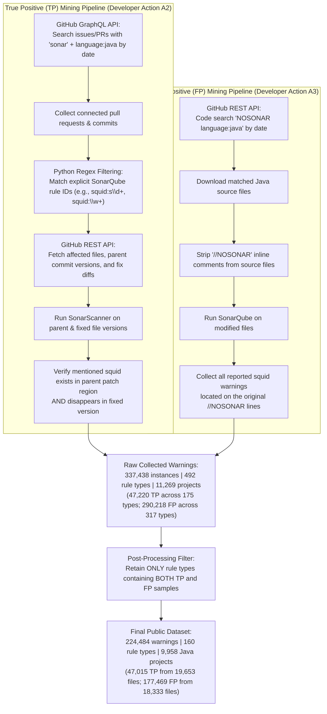
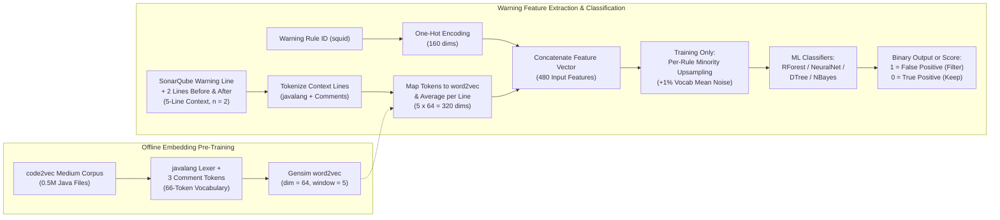

# Research Paper Summary: Static Code Analysis Alarms Filtering Reloaded

## 1. Bibliographic Information

| Field | Details |
| :--- | :--- |
| **Title** | Static Code Analysis Alarms Filtering Reloaded: A New Real-World Dataset and Its ML-Based Utilization |
| **Authors** | Péter Hegedűs and Rudolf Ferenc |
| **Affiliation** | Software Engineering Department, University of Szeged, 6720 Szeged, Hungary |
| **Publication Venue** | *IEEE Access* (Multidisciplinary Rapid Review Open Access Journal), Vol. 10, pp. 55090–55101 |
| **Year** | 2022 (Received: April 12, 2022; Accepted: May 10, 2022; Published: May 23, 2022) |
| **Paper DOI** | `10.1109/ACCESS.2022.3176865` |
| **Dataset / Replication DOI** | `https://doi.org/10.5281/zenodo.5885653` |
| **Index Terms** | Static code analysis, filtering false positives, real-world dataset, code embedding, machine learning |

---

## 2. Executive Summary

Static Code Analysis (SCA)—automated inspection of source code without executing the program—is widely integrated into Continuous Integration and Continuous Deployment (CI/CD) pipelines to catch bugs, vulnerabilities, performance flaws, and design issues. Despite low execution cost, SCA tools generate high rates of **false positive (FP) warnings** (non-actionable alerts), which cause alert fatigue and lead developers to abandon the tools.

This paper addresses two core bottlenecks in Machine Learning-Based Static Bug Detection: the scarcity of large, open, real-world labeled warning datasets and the reliance on narrow, computationally expensive filtering pipelines. The authors mine **224,484 real-world SonarQube warnings** (47,015 true positives and 177,469 false positives) across **160 distinct rule types** from **9,958 open-source Java repositories** on GitHub. Using a lightweight Natural Language Processing (NLP) pipeline based on tokenized local code context (5 lines centered on the warning) and `word2vec` embeddings, they train and evaluate four machine learning classifiers. The best overall model (**Random Forest**) achieves **91.0% accuracy**, **81.3% F1-score**, **87.4% precision**, and **95.3% AUC**, while a **Neural Network** achieves the highest false-alarm recall (**77.8%**).

---

## 3. Problem Statement & Research Objectives

### Problem Statement (General Domain Context)
* **Excessive False Alarms:** Prior empirical studies show that 30%–60% of warnings reported by SCA tools are false positives. These non-actionable reports bury critical real defects at the "bottom of the pile" and cause developers to ignore or disable static analyzers.
* **Root Causes of SCA False Positives:**
  * Shallow or imperfect static analysis used to keep runtime fast.
  * Conservative over-approximation in rule detection strategies.
  * **Context sensitivity:** Identical code patterns can be genuine bugs in one context and intentional, safe designs in another.
  * Inherent static analysis limits when resolving polymorphism, reflection, and pointer aliasing.
* **Limitations of Existing Post-Processing Research:**
  1. **Narrow Rule Coverage:** Prior filters typically address only 1–10 specific warning types (e.g., a handful of security or memory rules).
  2. **Synthetic or Small-Scale Evaluation:** Most prior studies evaluate models on synthetic benchmarks (such as OWASP Benchmark or Juliet) or small, manually labeled datasets (a few hundred samples), which do not reflect real-world false positive distributions.
  3. **Closed Proprietary Data:** Larger real-world evaluations in prior work rely on closed company-specific datasets, preventing replication and benchmarking.

### Research Objectives (Paper-Specific Goals)
1. **Construct an Open, Large-Scale Real-World Dataset:** Mine historical Java repositories on GitHub to collect hundreds of thousands of developer-validated true positive and false positive SonarQube warnings across a broad spectrum of rules.
2. **Design a Lightweight, Context-Aware Feature Representation:** Represent the local source code surrounding a warning using automated NLP embeddings (`word2vec`), eliminating manual feature engineering and costly program analysis (such as symbolic execution or backward slicing).
3. **Evaluate ML-Based Warning Classification at Scale:** Train, tune, and compare multiple machine learning classifiers to assess the practical feasibility of automated false positive filtering across 160 SonarQube rules.

---

## 4. Theoretical Background vs. Direct Contributions

To separate established field knowledge from the authors' original work, the table below contrasts prior literature with the direct contributions of this paper.

| Dimension | General Background / Prior Literature | Direct Contributions of This Paper |
| :--- | :--- | :--- |
| **Statistical & History-Based Ranking** | Z-ranking (Kremenek & Engler) on 3 C checker rules; history-based category prioritization (Kim & Ernst) on FindBugs, JLint, and PMD across 3 projects (showing ~90% of warnings go unfixed). | Operates at the **individual warning instance level** rather than rule-category level, distinguishing valid vs. false instances of the *same* rule using local code context. |
| **Feature-Engineered ML & Interactive Filters** | Adaptive ranking and 51 hand-crafted code/history/churn metrics on FAULTBENCH (Heckman & Williams, 88%–97% accuracy); Google logistic regression on 1,652 FindBugs warnings (Ruthruff et al., 85% accuracy); 10 alert features on 1,147 alerts (Yuksel & Sozer); interactive JavaScript filtering (Aletheia). | Fully automated pipeline with **zero manual feature engineering**; avoids outdated small benchmarks (e.g., Java 1.5 FAULTBENCH) and proprietary industrial corpora. |
| **Code-Context Deep Learning** | Koc et al. used bytecode of method bodies / backward slices with Bayesian & LSTM classifiers on FindSecBugs (OWASP synthetic: 2,371 samples, 89.5% accuracy; real-world: 400 samples across 14 apps, 6 security rules). Lee et al. used CNN + `word2vec` on ~10K proprietary C/C++ alarms across 6 checkers (79.72% precision). | Introduces a **fixed 5-line local token window** (2 lines before/after) instead of full method bodies, slicing, or Program Dependence Graphs (PDGs); scales evaluation to **160 SonarQube rules** and **224,484 public real-world samples**. |
| **Formal Verification Methods** | Symbolic execution, SMT solvers (Kim et al., Arzt et al.), and deductive verification (Nguyen et al.) for narrow rule classes (e.g., buffer overflows, SEI CERT C). | Provides a **computationally inexpensive** ML alternative suited for direct CI/CD integration without heavyweight semantic analysis. |
| **Benchmark Availability** | Synthetic suites (OWASP, Juliet) or small/closed real-world sets (hundreds to ~10K samples). | Releases the **largest public real-world SCA warning dataset** (224,484 labeled warnings from 9,958 GitHub Java projects, 1–3 orders of magnitude larger than prior real-world sets). |

---

## 5. Dataset Construction Methodology

### 5.1 Exploiting Explicit Developer Actions in SonarQube
SonarQube is an open-source static analysis platform that checks code for bugs, vulnerabilities, and code smells using rule identifiers prefixed with `squid:` (e.g., `squid:S1643` for string concatenation with `+` inside a loop). When SonarQube raises a warning, developers take one of three actions:

* **Action A1 (Do Nothing):** The warning remains untouched. *Excluded from the dataset* because it is ambiguous—the warning could be a false positive or simply undiscovered/unreviewed.
* **Action A2 (Explicit Fix):** The developer modifies the code so the SonarQube warning disappears (e.g., replacing `+` concatenation with `StringBuilder`). Treated as a verified **True Positive (TP)** (`class = 0`).
* **Action A3 (Explicit Ignore):** The developer adds a `//NOSONAR` inline comment on the offending line to suppress the alert. Treated as a verified **False Positive (FP)** (`class = 1`).

**Context-Sensitivity Motivating Example (`squid:S2447`):** For the rule *"Null should not be returned from a 'Boolean' method"*, one mined repository explicitly suppressed `return null;` inside an `else` branch with `//NOSONAR, null is used for further comparison` (FP), whereas another repository patched `return null;` to `return Boolean.FALSE;` in an `@Override` method (TP). This confirms that disabling rules globally hides genuine defects and that local code structure is essential for classification.

### 5.2 Dual GitHub Data Mining Pipeline
The authors mined open-source Java repositories on GitHub dating back to **2010** (when SonarQube history first appeared) without project selection filters. Because GitHub's GraphQL API does not support code search, two separate mining workflows were implemented, partitioned by date intervals to handle API rate and volume limits.

### 5.3 Dataset Statistics & Rule Distribution
* **Total Raw Instances:** 337,438 warnings across 492 SonarQube rules and 11,269 projects.
* **Final Filtered Dataset:** **224,484** warnings across **160** rules and **9,958** projects:
  * **True Positives (Fixed, Label `0`):** 47,015 samples (20.9%) from 19,653 Java files.
  * **False Positives (Ignored, Label `1`):** 177,469 samples (79.1%) from 18,333 Java files (more than 3× as many FPs as TPs).
* **Top 10 Most Frequent Warning Types (from Paper Figure 3):**

| Rank | SonarQube Rule ID | Total Samples | Dominant Class Distribution |
| :---: | :--- | :---: | :--- |
| 1 | `squid:S2208` | 60,909 | Overwhelmingly FP (~99%+) |
| 2 | `squid:S00115` | 27,048 | Predominantly FP (~96% FP) |
| 3 | `squid:S00100` | 16,015 | Overwhelmingly FP (~99% FP) |
| 4 | `squid:S1166` | 13,388 | Predominantly FP (~98% FP) |
| 5 | `squid:S2293` | 11,987 | Predominantly TP (~97% TP) |
| 6 | `squid:UIC` | 9,763 | Predominantly FP (~98% FP) |
| 7 | `squid:S00116` | 9,080 | Predominantly FP (~95% FP) |
| 8 | `squid:S1214` | 6,683 | Overwhelmingly FP (~99%+) |
| 9 | `squid:S106` | 4,907 | Majority FP (~85% FP / ~15% TP) |
| 10 | `squid:S1213` | 4,163 | Majority TP (~20% FP / ~80% TP) |

---

## 6. Proposed ML Architecture & Filtering Methodology

### 6.1 End-to-End Pipeline Architecture

### 6.2 NLP-Based Code Context Representation
1. **Context Window Extraction:** Extract the line flagged by SonarQube together with $n$ preceding lines and $n$ succeeding lines (total context = $2n + 1$ lines).
2. **Lexical Tokenization:** Parse each line using the open-source `javalang` Java lexer into abstract token categories (keywords like `package`, `for`; modifiers like `public`; types like `int`, `long`; separators; identifiers). Three custom tokens were added to represent single-line comments, multiline comments, and Javadoc comments, yielding a compact vocabulary of **66 unique tokens**. High-frequency tokens (`Separator` and `Identifier`) were deliberately retained after experiments confirmed they improved accuracy.
3. **Word2Vec Source Code Embedding:** Using `Gensim`, a `word2vec` model (an unsupervised neural method that maps tokens into dense numeric vectors capturing contextual similarity) was trained on the public `code2vec` medium dataset (**0.5 million Java files**).
   * Grid search explored vector sizes `{32, 64, 128, 200}` and window sizes `{2, 5, 8, 10}`.
   * **Optimal embedding parameters:** Vector size $w_{\text{size}} = 64$, window size $= 5$.
4. **Feature Vector Formulation:**
   * Each line in the context is represented by the arithmetic mean of the `word2vec` vectors of its tokens.
   * The rule identifier is one-hot encoded across all **160** warning types.
   * Total record dimensionality (including the target class column):
     $$\text{Record Size} = 160 + (2n + 1) \times w_{\text{size}} + 1$$
   * With optimal $n = 2$ (5 lines total) and $w_{\text{size}} = 64$, the input feature vector has **$160 + (5 \times 64) = 480$ dimensions**.
5. **Context Window Size Trade-Off ($n = 1$ vs. $n = 2$ vs. $n = 3$):**
   * $n = 2$ (5 lines) substantially outperformed $n = 1$ (3 lines).
   * $n = 3$ (7 lines) achieved nearly identical aggregate metrics on `NeuralNet` (F1: 0.810 vs. 0.803; Accuracy: 0.901 vs. 0.902), **but increased misclassifications of true positives as false positives by ~20% on average**. Because suppressing real bugs is the most harmful error, $n = 2$ was selected.

### 6.3 Class Imbalance Handling (Per-Rule Synthetic Upsampling)
Because false positives outnumber true positives by more than 3:1 globally—and individual rules exhibit extreme class skew—the authors applied **rule-level upsampling** strictly during the training phase:
* Within each of the 160 SonarQube warning types, minority-class instances were randomly selected and duplicated until TP and FP counts were balanced for that specific rule.
* To create synthetic variation rather than exact duplicates, noise equal to **1% of the vocabulary mean vector** (the average of all 66 token `word2vec` vectors) was added to each sampled minority vector.

### 6.4 ML Algorithms & Hyperparameter Optimization
Four supervised classifiers were evaluated (a Support Vector Machine, SVM, was also trialed but excluded due to slow training speed and lack of performance advantage). Hyperparameters were tuned automatically via **HyperOpt**, using Bayesian Optimization with **Sequential Model-Based Global Optimization (SMBO)**.

| Algorithm | Framework | Optimal Hyperparameter Configuration |
| :--- | :--- | :--- |
| **Decision Tree (`DTree`)** | `scikit-learn` | Criterion: Gini; max depth: 250; min samples leaf: 1; min samples split: 10; splitter: best |
| **Random Forest (`RForest`)** | `scikit-learn` | Criterion: Entropy; max depth: 100; max features: 480; min samples leaf: 1; min samples split: 10; estimators: 250 |
| **Naive Bayes (`NBayes`)** | `scikit-learn` | Default (no hyperparameters required) |
| **Neural Network (`NeuralNet`)** | `TensorFlow` | Input dim: 480; 3 hidden dense layers (800 neurons each, ReLU); 2 dropout layers (rate 0.2); Sigmoid output; Binary cross-entropy loss; Adam optimizer (LR = 0.0001); 100 epochs; batch size 512 |

---

## 7. Experimental Design & Evaluation Metrics

* **Validation Scheme:** **10-fold cross-validation** with an **80% / 10% / 10%** split for training, hyperparameter optimization, and testing.
* **Stratification:** Stratified sampling was performed **per `squid` warning type**, guaranteeing that all 160 rule types appear across folds with their original internal TP/FP class proportions preserved.
* **Labeling Convention (Critical for Interpreting Metrics):**
  * **Positive class (`1`)** = False Positive SonarQube warning (*false alarm* to be filtered out).
  * **Negative class (`0`)** = True Positive SonarQube warning (*actionable bug/issue* to be preserved).
* **Evaluation Metrics:**
  * **Accuracy:** Overall proportion of correctly classified warnings.
  * **Precision (for class `1`):** Fraction of warnings predicted as false alarms that are genuinely false alarms. High precision is critical to minimize accidentally hiding real bugs.
  * **Recall (for class `1`):** Fraction of all actual false alarms successfully caught and filtered out. High recall directly measures developer workload reduction.
  * **F1-Score:** Harmonic mean of precision and recall.
  * **Matthews Correlation Coefficient (MCC):** Balanced correlation measure between observed and predicted binary classifications, robust to class imbalance.
  * **ROC Curve & AUC (Area Under the Curve):** Threshold-independent measure of discrimination between true alarms and false alarms across 10 folds.

---

## 8. Experimental Results & Key Findings

### 8.1 Overall Classifier Performance (10-Fold Cross-Validation Average)

| Algorithm | Accuracy | F1-Score | Precision | Recall | MCC | Mean AUC (± SD) |
| :--- | :---: | :---: | :---: | :---: | :---: | :---: |
| **Decision Tree (`DTree`)** | 0.872 | 0.750 | 0.755 | 0.745 | 0.664 | 0.861 ± 0.005 |
| **Random Forest (`RForest`)** | **0.910** | **0.813** | **0.874** | 0.760 | **0.757** | **0.953 ± 0.003** |
| **Naive Bayes (`NBayes`)** | 0.870 | 0.727 | 0.789 | 0.675 | 0.646 | 0.896 ± 0.007 |
| **Neural Network (`NeuralNet`)** | 0.902 | 0.803 | 0.831 | **0.778** | 0.739 | 0.926 ± 0.005 |

* **Best Overall Model:** `RForest` dominates in accuracy (91.0%), F1-score (81.3%), precision (87.4%), MCC (0.757), and AUC (0.953). Over 87% of alarms it flags for removal are true false alarms, and it catches 76.0% of all false alarms.
* **Highest False-Alarm Removal:** `NeuralNet` achieves the highest recall (**77.8%**) while maintaining competitive accuracy (90.2%) and AUC (0.926), and natively outputs continuous confidence scores in `[0, 1]`.

### 8.2 Error Asymmetry & Confusion Matrix Analysis (`RForest`)

| Actual \ Predicted | Predicted: False Alarm (`1`) | Predicted: True Alarm (`0`) |
| :--- | :---: | :---: |
| **Actual: False Alarm (`1`)** | **846** (TP of filter) | **88** (FN of filter — harmless inconvenience) |
| **Actual: True Alarm (`0`)** | **270** (FP of filter — dangerous bug loss) | **3,118** (TN of filter) |

* **Low Risk of Hiding Real Bugs:** Only **~8%** of actual true SonarQube warnings (`270 / (270 + 3,118)`) are mistakenly filtered out as false alarms, preserving the vast majority of actionable defects.
* **Ranking Alternative:** Rather than hard binary filtering (threshold 0.5), continuous prediction scores can be used to **rank warnings**, ensuring zero true warnings are ever discarded while focusing developer attention on high-probability bugs first.

### 8.3 Per-Rule Performance Heterogeneity
* Performance varies substantially across the 160 individual SonarQube rules:
  * **Per-type Accuracy Range:** **0%** (e.g., `squid:S1210`, `squid:S00114`, `squid:S3864`) to **100%** (e.g., `squid:S1067`, `squid:S2225`, `squid:S4201`, `squid:S1215`).
  * **Macro-Averages across all 160 types:** Accuracy **82.1%**, Precision **70.54%**, Recall **55.34%**, F1-Score **70.73%**.
* Manual inspection of a small random sample of errors indicated that failures predominantly occur on warning types with **very few training/test instances** (spanning severities from minor to blocker).

### 8.4 Confidence Calibration & Token Sensitivity Analysis (`NeuralNet`)
* **Prediction Score Histograms (Threshold = 0.5):**
  * **True Positive Warnings (`0`):** Overwhelmingly concentrated in `[0.0, 0.1]`, showing high confidence in retaining real bugs.
  * **False Positive Warnings (`1`):** Majority score `> 0.8`, though a noticeable subset scores near `0.0` (high-confidence misses of false alarms—practically tolerable since they do not suppress real bugs).
* **Token Ablation Case Study (`squid:S2259` — Null Pointer Dereference):** On a true positive warning where a nullable `Base64.OutputStream` (`bos`) is dereferenced inside `finally { try { bos.close(); } catch (Exception e) {} }`:
  * **Original tokenized snippet:** Prediction score = **0.03** (confident class `0`, true alarm).
  * **Removing `SingleLineComment` tokens:** Score rises to **0.24** (still class `0`, reduced confidence).
  * **Removing `Keyword_finally` token:** Score jumps to **0.54** (uncertain and misclassified as class `1`, false alarm).
  * *Takeaway:* The classifier actively learns discriminative structural token patterns from the surrounding lines rather than relying solely on the rule ID.

---

## 9. Relevance to Machine Learning-Based Static Bug Detection

This study offers several foundational insights for research and engineering in ML-based static bug detection:

1. **Closing the Real-World Data Gap:** Prior ML bug-filtering studies risked overfitting to artificial patterns in synthetic suites (OWASP, Juliet). By leveraging explicit version-control signals (verified fix commits + `//NOSONAR` suppressions), this paper establishes a scalable, reproducible mining methodology for ground-truth supervision across nearly 10,000 production codebases.
2. **Instance-Level Context over Global Rule Tuning:** Static bug detectors cannot solve alert fatigue by turning off noisy rules globally. Local lexical context (just 5 lines) carries enough structural signal to separate actionable from unactionable alarms of the exact same rule.
3. **Efficiency vs. Semantic Depth Trade-Off:** Replacing heavyweight static representations (backward program slices, PDGs, bytecode extraction, or SMT/symbolic execution) with shallow `javalang` tokenization + pre-trained `word2vec` embeddings achieves >90% accuracy and 0.953 AUC with minimal inference latency—making real-time CI/CD deployment practical.
4. **Error-Asymmetry-Aware Model Design:** In static bug detection, **false negatives of the SCA tool (bugs hidden by the ML filter)** are far costlier than surviving false alarms. The paper demonstrates how context window sizing ($n=2$ vs. $n=3$), precision-focused evaluation, and score-based ranking directly govern this safety trade-off.
5. **Handling Long-Tail Rule Imbalance:** Multi-rule static bug detectors suffer from both global and per-rule skew. Per-rule stratified splitting and per-rule noise-injected upsampling are essential to prevent dominant rules (like `squid:S2208`) from drowning out rarer defect patterns.

---

## 10. Advantages, Limitations (Threats to Validity), and Future Work

### Key Advantages
* **Unprecedented Scale & Openness:** 224,484 real-world labeled warnings across 160 rules and 9,958 projects, publicly archived on Zenodo for full replication.
* **Lightweight & CI/CD-Ready:** Requires only a 5-line local snippet, a fast lexer, and pre-trained 64-dim embeddings—no compilation, bytecode, slicing, or symbolic execution needed at inference time.
* **No Manual Feature Engineering:** Token-level `word2vec` embeddings automatically capture local structural patterns.
* **Strong Precision–Recall Balance:** Filters out 76.0%–77.8% of false alarms while misclassifying only ~8% of true warnings, with natural extensibility to lossless warning ranking.

### Limitations & Threats to Validity
* **Noisy `//NOSONAR` Semantics:** Developers may insert `//NOSONAR` temporarily as a quick workaround, or code generators may insert it in bulk for irrelevant generated files. (The authors note this remains valid if the goal is framed as filtering *"unactionable"* warnings rather than strictly false alarms.)
* **Omission of Unresolved Warnings (Action A1):** Ignoring untouched warnings reduces label noise but excludes silently ignored false alarms from the training distribution.
* **Single Embedding Technique:** Only `word2vec` over flat lexical tokens was explored; richer representations (e.g., Abstract Syntax Trees, `code2vec` path embeddings, or pre-trained code Transformers) were not benchmarked.
* **Local Context Boundary:** A 5-line window cannot capture inter-procedural or long-range dataflow dependencies required by certain complex bug rules.
* **Non-Chronological Data Splitting:** Stratified random 10-fold CV ignores commit timestamps (potentially training on newer code and testing on older code), though the authors argue local warning contexts lack chronological inter-project dependence.
* **Single Tool & Language Scope:** Evaluated strictly on **SonarQube** and **Java**; cross-tool generalization (e.g., to SpotBugs, where rules like `EI_EXPOSE_REP` mirror SonarQube's `squid:S2384`) is hypothesized but not empirically tested.
* **Informal Failure Analysis:** Root causes of 0%-accuracy and low-sample warning types were only informally inspected.

### Future Work Directions
* **Systematic Error Analysis:** Formally investigate why specific warning types fail (especially low-frequency rules) and design few-shot or transfer-learning strategies for rare bug categories.
* **CI/CD Ranking Integration:** Deploy and evaluate the models as continuous-score warning rankers inside real-world CI/CD pipelines to measure developer productivity gains with zero missed bugs.
* **Cross-Tool & Cross-Language Generalization:** Extend the mining and filtering framework to other languages (e.g., C/C++, Python, JavaScript) and analyzers (e.g., SpotBugs, PMD).
* **Advanced Code Representations:** Benchmark modern contextual code embeddings and graph/AST-based deep learning architectures on the published 224K-sample benchmark.

---

## 11. Conclusions

Hegedűs and Ferenc advance ML-based static bug detection primarily by overcoming its biggest empirical barrier: the lack of large, open, real-world ground-truth data. By systematically mining verified fix commits and `//NOSONAR` suppressions across 9,958 GitHub Java repositories, they release a 224,484-warning benchmark spanning 160 SonarQube rules. Furthermore, they demonstrate that a simple, computationally lightweight pipeline—combining a 5-line tokenized code window, `word2vec` embeddings, per-rule synthetic upsampling, and standard ML classifiers—accurately distinguishes actionable from non-actionable static alarms (up to **91.0% accuracy**, **81.3% F1-score**, **95.3% AUC**, removing **76%–77.8%** of false alarms at an **~8%** true-warning loss rate). Beyond strong predictive performance, the public dataset provides a realistic, large-scale foundation for benchmarking next-generation false-alarm filtering and prioritization techniques.