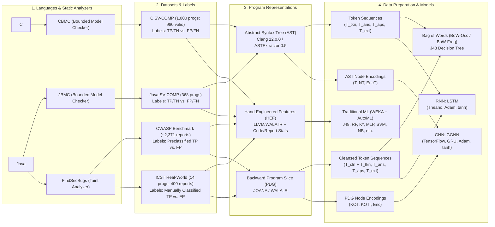
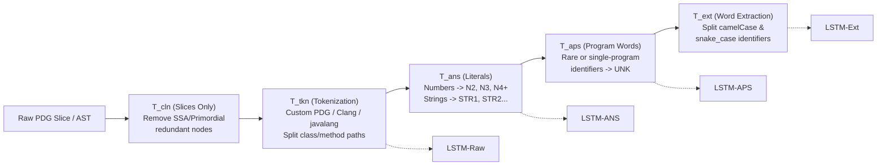

# Research Summary: An Empirical Assessment of Machine Learning Approaches for Triaging Reports of Static Analysis Tools

## 1. Bibliographic Information

* **Title:** An empirical assessment of machine learning approaches for triaging reports of static analysis tools
* **Authors:** Sai Yerramreddy¹, Austin Mordahl² *(equal contribution)*, Ugur Koc¹, Shiyi Wei², Jeffrey S. Foster³, Marine Carpuat¹, Adam A. Porter¹
* **Affiliations:**
  * ¹ Department of Computer Science, University of Maryland, College Park, MD, USA
  * ² Department of Computer Science, University of Texas at Dallas, Richardson, TX, USA
  * ³ Department of Computer Science, Tufts University, Medford, MA, USA
* **Publication:** *Empirical Software Engineering*, Vol. 28, Article 28, pp. 1–44
* **Year:** 2023 *(Accepted: 31 October 2022; Published online: 10 January 2023)*
* **Publisher:** Springer Science+Business Media, LLC, part of Springer Nature
* **DOI:** `https://doi.org/10.1007/s10664-022-10253-z`
* **Replication Package:** `https://bitbucket.org/SaiArrow/emse-replication-package/`
* **Lineage:** Journal extension of Koc et al. (ICST 2019), expanding from a single Java taint analyzer to three static analyzers across two languages (Java and C), adding Abstract Syntax Tree (AST) representations, incorporating True/False Negative verification classifications, and adding 1,368 new benchmark data points.

---

## 2. Problem Statement & Research Objectives

### Problem Statement
**Static analysis (SA)** tools—automated programs that inspect source code or bytecode without executing it—can uncover critical correctness, security, and performance bugs. However, their practical adoption is severely impeded by high rates of erroneous outputs:
* **False Positives (FPs):** Non-errors incorrectly flagged as bugs, forcing developers to waste substantial time manually inspecting invalid warnings.
* **False Negatives (FNs):** Genuine bugs missed by the analyzer.

In practice, developers often view the cost of manually triaging hundreds or thousands of false alarms as far higher than the risk of missing real bugs. While machine learning (ML) has been proposed to filter SA reports, prior research left three major gaps:
1. **Lack of systematic cross-paradigm evaluation:** Little empirical evidence comparing traditional ML models against deep neural architectures (recurrent and graph neural networks) to clarify accuracy, variance, and efficiency tradeoffs.
2. **Under-explored data preparation and program representations:** Unclear how code transformations and graph node encodings affect performance across different real-world deployment scenarios.
3. **Over-reliance on synthetic benchmarks:** Prior deep learning evaluations relied heavily on artificial benchmarks rather than real-world software, and rarely tested cross-project generalization.

### Research Objectives & Questions
The paper conducts a large-scale comparative empirical study (training **2,350 models**) across three static analyzers, two programming languages, four datasets, and two realistic usage scenarios to answer four Research Questions (RQs):
* **RQ1 (Overall Performance Comparison):** Which family of ML approaches performs best overall in classifying correct versus incorrect static analysis results?
* **RQ2 (Effect of Data Preparation):** How do code transformations and graph node representations impact classification performance?
* **RQ3 (Variability Analysis):** How consistent (low-variance) are the models across data splits and random seeds, and how strongly do they overfit?
* **RQ4 (Further Interpretation):** How do different ML families differ in the signals they learn, and do their correct predictions overlap or complement one another?

---

## 3. Background vs. Direct Contributions

To support academic synthesis, the table below separates established domain background from the paper's direct contributions.

| Dimension | General Background / Prior Work | Direct Contributions of This Paper |
| :--- | :--- | :--- |
| **Static Analysis Triage with Traditional ML** | Prior studies used **Hand-Engineered Features (HEF)**—such as rule names, severity, and trace length—with classical classifiers (e.g., Bayesian models, decision trees, random forests) to filter warnings. | Benchmarks 9 classical WEKA classifiers on HEF and introduces **Bag of Words (BoW)** representations directly over code slices/ASTs for SA report classification, demonstrating where traditional models succeed and fail relative to neural networks. |
| **Deep Learning for Code & SA Filtering** | Prior work (e.g., Koc et al., 2017) tested **Long Short-Term Memory (LSTM)** networks on synthetic OWASP benchmarks; **Gated Graph Neural Networks (GGNNs)** were used for general program verification but rarely for SA triage. | Conducts the first broad multi-language, multi-tool empirical comparison of HEF, BoW, LSTM, and GGNN across both **taint analysis** (FindSecBugs) and **bounded model checking** (CBMC, JBMC), including both FP and FN error classes. |
| **Program Representations & Preprocessing** | Backward program slicing over **Program Dependence Graphs (PDGs)** was used when line-specific alarms existed; basic tokenization and identifier cleanup existed in limited forms. | Introduces **Abstract Syntax Tree (AST)** representations for tools lacking line-level slicing criteria (CBMC/JBMC), formalizes cumulative token transformations ($T_{cln}, T_{tkn}, T_{ans}, T_{aps}, T_{ext}$), and designs novel GGNN node encodings (`KOT`, `KOTI`, `Enc` for PDGs; `T`, `NT`, `EncT` for ASTs). |
| **Benchmarks & Deployment Scenarios** | Most evaluations used synthetic corpora (e.g., OWASP) and random train/test splits, ignoring generalization to unseen codebases. | Combines a manually labeled real-world Java dataset (**ICST**, 14 projects, 400 reports) with **1,368 new SV-COMP data points** (CBMC/JBMC) and explicitly evaluates **two practical deployment scenarios**: within-project evolution (random split) vs. cross-project deployment (program-wise split). |

---

## 4. Theoretical Background & Static Analysis Tools Studied

### Static Analysis Paradigms Evaluated
1. **Taint Analysis (`FindSecBugs` v1.4.6 — Java):**
   * *Concept:* Tracks whether untrusted external inputs (**sources**, e.g., HTTP request parameters) flow into security-sensitive operations (**sinks**, e.g., SQL query execution or `Runtime.exec()`) without sanitization.
   * *Scope:* Configured to detect SQL, command, CRLF, and LDAP injections, cross-site scripting (XSS), and path traversal (XPATH). Emits HTML/XML alarms containing vulnerability type, priority, source/sink locations, witness paths, and exact line numbers.
   * *Failure Modes Observed:* (1) Over-approximation yielding unrealizable control/data flows (dominant in synthetic OWASP); (2) failure to recognize sanitization/safety checks along a path; (3) misclassifying a safe source as tainted (the latter two dominate real-world ICST false positives).

2. **Bounded Model Checking (`CBMC` for C; `JBMC` for Java):**
   * *Concept:* Models a program as a finite state machine and encodes safety properties (e.g., memory safety, termination, buffer bounds) in temporal logic. For an integer bound $k$, the tool builds a propositional formula satisfiable if and only if a property-violating execution trace (counterexample) of length $\le k$ exists, solving it via SAT/SMT solvers.
   * *Output:* Classifies an entire program as **Safe** or **Unsafe**, often without pointing to a single faulty line number (e.g., non-termination bugs).
   * *Configuration Strategy:* Default settings favor soundness and frequently time out rather than emit incorrect answers. To obtain balanced datasets of correct and incorrect results reflecting noisy real-world triage needs, the authors selected specific command-line configurations from three-way covering arrays (from SATune, Koc et al., 2021)—using MathSAT for CBMC and Yices for JBMC—with depth/unwind bounds of 100.

### Classification Formulation
Report triaging is framed as **binary classification**, learning a function $y = f_{\theta}(x)$ where:
* $y = 0$: **Correct SA result** (True Positive [TP] for FindSecBugs; True Positive or True Negative [TP/TN] for CBMC/JBMC).
* $y = 1$: **Incorrect SA result** (False Positive [FP] for FindSecBugs; False Positive or False Negative [FP/FN] for CBMC/JBMC).

---

## 5. Proposed Approach, Architecture & Algorithms

### End-to-End Study Pipeline

### Program Representations
1. **Program Dependence Graph (PDG) Backward Slices (FindSecBugs):**
   * *Definition:* A **PDG** is a directed graph whose nodes represent program statements/expressions and whose edges capture data dependencies (`DD`) and control-flow dependencies (`CF`). A **backward slice** extracts all statements that can influence execution at the reported vulnerability line.
   * *Extraction:* Computed using **JOANA** (built on WALA intermediate representation [IR]). User-invokable entry points (APIs, `main`, tests) are identified via backward call hierarchies; slices trace from the reported sink line back to entry points.
2. **Abstract Syntax Trees (ASTs) (CBMC & JBMC):**
   * *Definition:* An **AST** is a tree representing the hierarchical syntactic structure of source code.
   * *Rationale:* Because model checkers often report whole-program properties without a faulty line number, backward slicing is infeasible. Full-program ASTs are extracted via **Clang v12.0.0** (C) and **ASTExtractor v0.5** (Java), preserving graph edges, `Node_Type`, and raw `Node_Content`.
3. **Hand-Engineered Feature Vectors (HEF):**
   * *Common Code Features:* Number of path conditions and function calls.
   * *FindSecBugs Features (adapted from Tripp et al., 2014):* 9 retained features (source/sink identifiers, source/sink line numbers, total results, witness path steps, analysis time, rule name, severity; dropping web-only URL/external-object features) plus 2 newly added features (**analyzer confidence** and **number of classes referenced in the error trace**).
   * *CBMC/JBMC Features (adapted from Koc et al., 2021):* Static instruction frequency counts (**46 LLVM IR** instructions for C; **23 WALA IR** instructions for Java) plus structural construct counts (**13 constructs** for C including loops, ifs, pointers, loads, stores, and composite features; **9 constructs** for Java).

### Machine Learning Families & Data Preparation Routines

#### 1. Traditional Models (`HEF-*` and `BoW-*`)
* **HEF Classifiers:** 9 algorithms in WEKA tuned via AutoML: Naïve Bayes, Bayesian Network, Decision Tree (`J48`), Random Forest, Multi-Layer Perceptron (`MLP`), $K^*$, `OneR`, `ZeroR`, and Support Vector Machine (`SVM`).
* **Bag of Words (`BoW-Occ`, `BoW-Freq`):** Treats tokens extracted from PDG slices or ASTs as an unordered multiset. `BoW-Occ` creates a binary presence/absence vector; `BoW-Freq` creates an integer token-count vector. Evaluated using `J48` (the top-performing HEF classifier overall) with AutoML tuning.

#### 2. Recurrent Neural Networks (`LSTM`)
* **Architecture:** Long Short-Term Memory (LSTM) network—a gated RNN capable of capturing long-range sequential dependencies—adapted from Carrier & Cho (2018) in Python 2.7/Theano. Processes token sequences $x_0, \dots, x_n$ into hidden states $h_t = \text{RNN}(x_t, h_{t-1})$ and feeds the mean hidden vector into a logistic regression classifier. Uses **Adam** optimizer (replacing ADADELTA) and `tanh` activation.
* **Cumulative Code Transformation Pipeline:**

  * **$T_{cln}$ (Data Cleansing — PDG slices only):** Removes uninformative Static Single Assignment (SSA) bookkeeping nodes (`formal_in/out`, `actual_in/out`), synthetic phrases (`many2many`, `UNIQ`, `init`, `immutable`, `fake`, `-exception`), and `Primordial` (library/non-source) classes. Not needed for ASTs.
  * **$T_{tkn}$ (Tokenization):** Strips bytecode artifacts (e.g., leading `L` in Java types) and splits package/method paths by `.` or `/`.
  * **$T_{ans}$ (Abstracting Numbers & Strings):** Normalizes numeric literals by digit length (`N2`, `N3`, `N4+`, preserving negative/scientific categories) and maps string literals to indexed placeholders (`STR1`, `STR2`, ...).
  * **$T_{aps}$ (Abstracting Program-Specific Identifiers):** Replaces infrequent or single-program identifiers with `UNK` while retaining common programming tokens (`i`, `j`, `counter`).
  * **$T_{ext}$ (Identifier Splitting):** Splits `camelCase` and `snake_case` names into constituent English words (e.g., `getFilePath` $\to$ `get`, `File`, `Path`) to reduce vocabulary sparsity and improve cross-project generalization.

#### 3. Graph Neural Networks (`GGNN`)
* **Architecture:** Gated Graph Neural Network (GGNN) extended from Microsoft Research (2019) in Python 3/TensorFlow. Iteratively updates each node representation $h_i^{(t)}$ by aggregating neighbor states $h_{\text{NBR}(n_i)}^{(t-1)}$ over typed edges using **Gated Recurrent Units (GRUs)** with `tanh` activation and Adam optimizer, outputting binary classifications.
* **Node Encoding Variants:**

| Representation Family | PDG Variant (OWASP, ICST) | AST Variant (CBMC, JBMC) | Encoded Node Information |
| :--- | :--- | :--- | :--- |
| **Enumerated Fields Only** | `GGNN-KOT` | `GGNN-T` | PDG: Kind, Operation, Type. AST: Ordinal-encoded `Node_Type`. |
| **Enumerated + Content Abstraction** | `GGNN-KOTI` | `GGNN-NT` | PDG: KOT + 1 abstracted Value item (e.g., method identifier or `object`). AST: `Node_Type` + first $N$ label-encoded tokens from `Node_Content` (preprocessed with ANS/APS/EXT, padded with `-1`; $N \in \{5, 8, 16\}$ for CBMC, $N \in \{1, 2, 5\}$ for JBMC). |
| **Enumerated + Full Word Embeddings** | `GGNN-Enc` | `GGNN-EncT` | Concatenates enumerated field embeddings with `word2vec` embeddings (pre-trained, dim 12) over all tokens in node content (mean vector for PDG `Value`; sum vector for AST `Node_Content`). |

---

## 6. Datasets & Experimental Setup

### Datasets Summary

| Dataset | Language | Analyzer | Origin | Size / Class Distribution | Label Semantics | Application Scenario |
| :--- | :--- | :--- | :--- | :--- | :--- | :--- |
| **OWASP** | Java | FindSecBugs | Synthetic (OWASP Benchmark v1.1) | 2,371 SQLi reports in text (Table 1: **1,124 T / 1,193 F**) | Bug Reports (TP vs. FP) | Scenario 1 (Random Split) |
| **ICST** | Java | FindSecBugs | Real-world (14 open-source projects, 6K–916K LoC) | **400** manually labeled reports (**194 TP / 206 FP**) | Bug Reports (TP vs. FP) | Scenario 1 (`ICST-Rand`) & Scenario 2 (`ICST-PW`) |
| **CBMC** | C | CBMC | Synthetic/Aggregated (SV-COMP sample) | 1,000 sampled progs (517 unsafe / 483 safe ground truth; **523 correct / 457 incorrect**, 20 timeouts discarded) | Verification Results (TP/TN vs. FP/FN) | Scenario 2 (Mutually Exclusive Programs) |
| **JBMC** | Java | JBMC | Synthetic/Aggregated (All SV-COMP Java) | **368** programs (**164 correct / 204 incorrect**, 0 timeouts) | Verification Results (TP/TN vs. FP/FN) | Scenario 2 (Mutually Exclusive Programs) |

* **ICST Real-World Corpus Details:** Includes Apollo-0.9.1 (916K LoC), Jetty-9.4.8 (651K), Jackrabbit-2.15.7 (417K), HSQLDB-2.4.0 (367K), Joda-Time-2.9.9 (277K), H2-DB-1.4.196 (236K), BioJava-4.2.8 (184K), MyBatis-3.4.5 (134K), Giraph-1.1.0 (120K), JPF-8.0 (119K), Susi.AI (65K), OkHttp-3.10.0 (61K), FreeCS-1.2 (27K), and UPM-1.14 (6K). Ground truth was established by manually tracing backward call trees in Eclipse (depth-first search) to confirm unsanitized tainted flows, with a 5% sample validated across co-authors.

### Application Scenarios & Protocol
* **Scenario 1 (Continuous Analysis of Evolving Software):** Random splits (`OWASP`, `ICST-Rand`) where training and test sets contain reports from the same codebases, allowing models to leverage project-specific APIs and identifiers.
* **Scenario 2 (Deployment on Unseen Programs):** Program-wise splits (`ICST-PW`, `CBMC`, `JBMC`) where training and test programs are strictly mutually exclusive, testing true cross-project generalization.
* **Cross-Validation & Reproducibility:** 5-fold cross-validation $\times$ 5 random seeds (`1234, 3252, 5827, 7421, 9876`) = **25 runs per model/dataset** (**2,350 models total**: 1,350 across OWASP/ICST-Rand/ICST-PW with 18 variants; 1,000 across CBMC/JBMC with 20 variants; 23 unique model configurations).
* **Hyperparameters:**
  * *Stopping Criteria:* 5-hour training timeout; early stopping patience = 100 (GGNN) / 20 (LSTM) on OWASP & ICST; 150 (GGNN) / 100 (LSTM) on CBMC; 100 (GGNN) / 50 (LSTM) on JBMC.
  * *LSTM Embeddings & Batch Size:* Tuned via 15-epoch preliminary trials $\to$ dim **8**, batch **8** (FindSecBugs); dim **16**, batch **12** (CBMC/JBMC).
  * *GGNN Embeddings:* `word2vec` dim **12** (`GGNN-Enc`); scalar label encoding dim **1** per token (`GGNN-NT`).
* **Evaluation Metrics:**
  * **Effectiveness:** Accuracy, Precision, and Recall on test splits, aggregated using **Median** and **Semi-Interquartile Range (SIQR)** across 25 runs (non-parametric due to unknown underlying distributions).
  * **Efficiency:** Training time and epochs to convergence (test-time inference is negligible at ~1 second after model loading).

---

## 7. Experimental Results & Key Findings

### RQ1: Overall Performance Comparison (Median Test Metrics & SIQR over 25 Runs)

| Dataset (Scenario) | Top Model(s) | Test Accuracy (SIQR) | Precision (SIQR) | Recall (SIQR) | Best BoW Accuracy | Best HEF Accuracy | Key Comparison |
| :--- | :--- | :---: | :---: | :---: | :---: | :---: | :--- |
| **OWASP** (Scen. 1) | `LSTM-Raw` / `LSTM-ANS` / `LSTM-Ext` | **100.00%** (0.00) / **99.37%** (0.42) / **99.16%** (1.16) | 100.00% / 98.74% / 99.57% | 100.00% / 99.15% / 98.94% | 97.47% (`BoW-Occ`) | 79.96% (`HEF-J48`) | Neural models & BoW far exceed HEF (<80%). `GGNN-Enc` reaches 94.00% vs. 78.00% for `GGNN-KOT`. |
| **ICST-Rand** (Scen. 1) | `LSTM-Raw` / `LSTM-Ext` | **89.33%** (2.19) / **89.04%** (1.90) | 86.49% / 85.29% | 90.62% / 90.62% | 87.14% (`BoW-Freq`) | 84.00% (`HEF-K*`, `HEF-RF`) | LSTM leads (~89%); BoW competitive (~87%); GGNN (`KOTI` 84.21%) & HEF (~81–84%) trail modestly. |
| **ICST-PW** (Scen. 2) | `LSTM-Ext` / `LSTM-APS` | **80.00%** (4.00) / **78.48%** (3.33) | 76.19% / 76.47% | 78.57% / 70.27% | 51.32% (`BoW-Occ`) | 73.08% (`HEF-MLP`) | **Largest gap:** BoW collapses to near-random (~51%) and HEF drops to 63–73%. Neural models generalize best (`GGNN-Enc` 74.67%, `LSTM-Ext` 80.00%). |
| **CBMC** (Scen. 2) | `GGNN-NT-16` / `LSTM-ANS` | **83.40%** (0.75) / **81.37%** (0.74) | 80.20% / 79.74% | 86.60% / 83.00% | 79.20% (`BoW-Occ/Freq`) | 79.60% (`HEF-RF`) | `GGNN-NT-16` outperforms all models on C ASTs, followed by all LSTM variants (~81.1–81.4%). `GGNN-T` (75.80%) & `GGNN-EncT` (76.20%) underperform HEF/BoW. |
| **JBMC** (Scen. 2) | `GGNN-NT-5` / `GGNN-NT-2` / `LSTM-APS` | **80.15%** (3.30) / **79.50%** (3.23) / **78.50%** (2.39) | 77.60% / 77.50% / 77.97% | 82.10% / 81.50% / 78.60% | 74.70% (`BoW-Freq`) | 74.00% (`HEF-J48`) | `GGNN-NT` leads on Java ASTs, with LSTMs close behind (77.4–78.5%) and clear margin over HEF/BoW (~73–75%). |

*Note: On OWASP, the paper's text highlights `LSTM-Ext`'s 99.57% figure (its median precision in Table 5, alongside 99.16% accuracy) as a major leap over Koc et al. (2017)'s prior state-of-the-art accuracies of 85% (slices) and 90% (CFGs).*

* **Architecture-to-Representation Affinity:**
  * **LSTMs outperform GGNNs on PDG program slices** (FindSecBugs: OWASP, ICST-Rand, ICST-PW).
  * **GGNNs (`GGNN-NT`) outperform LSTMs on full-program ASTs** (CBMC and JBMC).
* **Efficiency vs. Accuracy Tradeoff:**
  * `HEF` and `BoW` train in **under 1 minute** across all datasets.
  * Neural models require **minutes to hours** (e.g., OWASP: 11–54 min; ICST: ~194–304 min, frequently hitting the 5-hour timeout; JBMC: GGNN 12–25 min vs. LSTM 171–287 min; CBMC: GGNN 834–974 min vs. LSTM 7,273–8,045 min as reported in Table 6). Because training is offline and inference takes ~1 second, this overhead is often acceptable when higher accuracy is needed.

### RQ2: Effect of Data Preparation & Vocabulary Compression

| Dataset | Vocabulary Size: `LSTM-Raw` $\to$ `LSTM-Ext` | Mean Sample Length: `Raw` $\to$ `Ext` | Impact of Preparation on LSTM | Impact of Node Encoding on GGNN |
| :--- | :---: | :---: | :--- | :--- |
| **OWASP** | 333 $\to$ 251 (-24.6%) | 224 $\to$ 277 | `LSTM-Raw` hits 100% by exploiting leak-like synthetic names (`safe`, `tainted`); `LSTM-Ext` retains >99% without program-specific tokens. | **`+16.0%` accuracy jump:** `GGNN-KOT` (78.00%) $\to$ `GGNN-Enc` (94.00%), showing lexical content carries strong signal on OWASP. |
| **ICST** | 13,237 $\to$ 4,730 (-64.3%) | 18,524 $\to$ 23,031 | **Scenario 1 (`Rand`):** `LSTM-Raw` slightly best (89.33% vs. 89.04%). **Scenario 2 (`PW`):** **`+5.33%` gain** from `LSTM-Raw` (74.67%) to `LSTM-Ext` (80.00%). | Minor differences across `KOT`, `KOTI`, and `Enc` (~82–84% Rand; ~72–75% PW). Large PDGs (avg 1,880 nodes / 6,411 edges; max 16,479 nodes / 146,444 edges) and embedding averaging dilute `Enc`. |
| **CBMC** | 13,503 $\to$ 3,404 (-74.8%) | 10,134 $\to$ 10,637 | Small positive gain (<1.5%; `LSTM-ANS`/`APS` ~81.4% vs. `Raw` 81.1%). | **`+7.6%` gain:** `GGNN-T` (75.80%) $\to$ `GGNN-NT-16` (83.40%; text cites 83.80%). `GGNN-EncT` (76.20%) adds little over `GGNN-T`. |
| **JBMC** | 942 $\to$ 381 (-59.6%) | 533 $\to$ 539 | Small positive gain (~1.1%; `LSTM-APS` 78.50% vs. `Raw` 77.44%). | **`+6.4%` gain:** `GGNN-T` (73.75%) $\to$ `GGNN-NT-5` (80.15%). Direct token encoding (`NT`) beats summed `word2vec` (`EncT`, 73.95%). |

* **Key Takeaway on BoW:** `BoW-Occ` (presence) and `BoW-Freq` (frequency) perform nearly identically (largest gap: 85.53% vs. 87.14% on `ICST-Rand`).
* **Scenario-Dependent Preprocessing:** Retaining raw identifiers benefits within-project continuous analysis (Scenario 1), whereas aggressive abstraction and identifier splitting (`LSTM-APS`, `LSTM-Ext`) are critical for cross-project generalization (Scenario 2).

### RQ3: Variability & Overfitting Analysis
* **Low Variance Benchmarks:** OWASP and CBMC exhibit low SIQR across almost all models (mostly <1.5% accuracy SIQR).
* **High Variance Benchmarks:** `ICST-PW` shows the highest variability (recall SIQRs reaching ~30% for some HEF/LSTM/GGNN models), driven by small dataset size (400 samples) and cross-program heterogeneity. However, the top two LSTM models (`LSTM-Ext`, `LSTM-APS`) maintain accuracy SIQR $\le 4\%$ because training directly optimizes loss aligned with accuracy.
* **Stabilizing Effect of Preprocessing:** Applying progressive code transformations (`ANS` $\to$ `APS` $\to$ `Ext`) consistently **reduces metric variance** for LSTMs on both `ICST-PW` and `JBMC`.
* **Overfitting Patterns:** Significant train-vs-test accuracy gaps appear on `ICST-Rand` and especially `ICST-PW` (e.g., `BoW-Freq` 97.60% train vs. 51.25% test; `HEF-RF` 99.70% train vs. 63.44% test). Across `ICST-Rand`, `CBMC`, and `JBMC`, traditional models (`HEF`, `BoW`) show larger train-test generalization gaps than neural networks, indicating weaker structural generalization.

### RQ4: Model Complementarity & Qualitative Interpretability
Analyzing intersections of correct predictions among four representative models (`HEF-J48`, `BoW-Freq`, `LSTM-Ext`, and `GGNN-KOT`/`GGNN-NT`) via Venn diagrams reveals:
* **Substantial Disagreement:** Reports unanimously classified correctly by all four models account for 294.0/474 (OWASP), 43.0/74 (ICST-Rand; 41% missed by $\ge 1$ model), 19.8/80 (ICST-PW), 80.0/168 (CBMC; 52.1% missed by $\ge 1$ model), and 30.2/74 (JBMC).
* **No Subsumption:** **No single ML model strictly subsumes another.** Even lower-accuracy models (`HEF-J48` and `BoW-Freq`) uniquely classify reports that both `LSTM-Ext` and `GGNN` miss—strongly motivating **ensemble / late-fusion classifiers**.
* **Why Sequential & Graph Models Win (Case Studies):**
  * *OWASP `switch` False Positive:* A tainted query string is conditionally assigned in a `switch` statement where the constant character `'B'` guarantees a safe string `"bob"` reaches `executeUpdate(sql)`. `HEF-J48` lacks control-flow/logic features, and `BoW-Freq` loses token ordering; only `LSTM-Ext` captures the sequential flow (`charAt(1)` $\to$ `switch` $\to$ `PHI`) and classifies it correctly.
  * *JBMC Division-by-Zero False Negative:* JBMC misses an `ArithmeticException` in `int j = 10 / denom;` where `denom` is a nondeterministic integer. `HEF` summary instruction counts lack expression context, whereas `LSTM-Ext` retains the sequential division pattern (`N2 / VAR1`) and `GGNN-2T` captures the variable-operator edge relationship in the AST.

---

## 8. Relevance to Machine Learning-Based Static Bug Detection

This paper provides foundational empirical evidence for designing and deploying **ML-based static bug detection and alarm triaging systems**:
1. **Code Semantics Outperform Report Metadata:** Learning directly from program representations (PDG slices or ASTs) captures control-flow, data-flow, and contextual bug/sanitization patterns that hand-engineered report metadata and summary counts fundamentally miss.
2. **Representation Must Match Analyzer Output Granularity:**
   * When a static bug detector emits **localized warnings** (e.g., taint sinks or line-specific vulnerability reports), **backward PDG slicing** compresses large real-world repositories (up to ~1M LoC) into relevant code contexts well-suited for sequential models (LSTMs).
   * When an analyzer emits **program-level verdicts** without a fault location (e.g., model checkers verifying termination or global assertions), **ASTs with explicit token-level node features (`GGNN-NT`)** are effective alternatives.
3. **Generalization Requires Lexical Abstraction:** Models trained on raw code easily memorize benchmark-specific or project-specific identifiers (a form of shortcut learning). Abstracting literals (`T_ans`), masking rare project identifiers (`T_aps`), and splitting compound names (`T_ext`) are essential for deploying bug classifiers onto new codebases.
4. **Beyond False Positive Filtering (Handling False Negatives):** By classifying verifier outcomes across TP/TN vs. FP/FN, the study proves ML triage models can identify **both** false alarms and missed bugs (false negatives) in configurable verification workflows.
5. **Practical Productivity vs. Soundness Tradeoff:** ML triaging is inherently **unsound** (it can mistakenly suppress genuine bugs). On the real-world ICST dataset (400 balanced reports, 89.33% max accuracy), filtering warnings with the ML model cuts manual developer triage effort roughly in **half**, at the cost of missing ~21 real bugs (~43 total misclassifications split roughly evenly between FPs and FNs). Thus, ML filtering is well-suited for maximizing bug-fixing throughput under finite developer time, but inappropriate for safety-critical domains requiring zero missed defects.

---

## 9. Advantages, Limitations & Threats to Validity

### Advantages of the Studied Approaches & Methodology
* **Broad Empirical Generalizability:** Evaluates 2 languages (Java, C), 3 real-world tools spanning 2 distinct SA paradigms (taint analysis and bounded model checking), and both synthetic and real-world software.
* **Leakage Mitigation:** Explicitly avoids known data-leakage features (e.g., warning context and defect likelihood) and removes identifier giveaways via abstraction transformations.
* **Rigorous Statistical Validation:** Uses 25-run cross-validation (5 folds $\times$ 5 seeds) and non-parametric statistics (median and SIQR) to quantify stability and overfitting.
* **Actionable Deployment Insights:** Differentiates within-project evolution from cross-project deployment, exposing severe real-world failure modes (such as BoW's collapse on `ICST-PW`).

### Limitations & Threats to Validity
* **Internal Validity:**
  * *No Direct PDG vs. AST Comparison on Identical Data:* PDG slices were evaluated only on FindSecBugs and ASTs only on CBMC/JBMC, preventing a controlled apples-to-apples comparison between the two representations on the same dataset.
  * *Cumulative Transformation Confounding:* Code transformations ($T_{cln} \to T_{ext}$) were applied cumulatively rather than via full ablation, leaving interaction effects between individual steps unisolated.
* **External Validity:**
  * *Dataset Size & Synthetic Dominance:* Three of four datasets (OWASP, CBMC, JBMC) are synthetic/benchmark collections. The sole real-world dataset (ICST) contains only **400 reports**, which is relatively small for deep neural networks and led to observable overfitting.
  * *Non-Default Verifier Configurations:* CBMC and JBMC were run under covering-array configurations engineered to produce balanced correct/incorrect distributions rather than default settings (which frequently fail to terminate). These configurations may not match typical user setups.
  * *Limited SA Scope:* Does not evaluate other static analysis families (e.g., abstract interpretation, typestate analysis, style/bug-pattern linters without taint/model checking).
  * *Hardware Asymmetry:* FindSecBugs experiments ran on a 12-core VM while CBMC/JBMC ran on a 32-core server, affecting raw training-time comparability (though models are trained offline).
* **Technical Limitations of Models:**
  * Neural models incur high offline training costs and low human interpretability compared to decision trees/HEF.
  * `GGNN-Enc` / `GGNN-EncT` struggled with information dilution when averaging or summing `word2vec` token embeddings over complex statements or large PDGs.

---

## 10. Conclusions & Future Work

### Conclusions
1. **Deep Learning Beats Traditional Models:** Neural networks learning directly from source code representations consistently outperform hand-engineered features and Bag of Words across languages, tools, and deployment scenarios, achieving peak accuracies of **80%–99%+** depending on the benchmark.
2. **No Universal Neural Architecture:** **LSTMs** excel on backward program slices (FindSecBugs), whereas **GGNNs with explicit token-encoded AST nodes (`GGNN-NT`)** perform best on full-program ASTs (CBMC/JBMC).
3. **Data Preparation Is Critical:** Thoughtful preprocessing improves accuracy by **up to 5.33% for LSTMs** (on cross-project real-world data) and **up to 16% for GGNNs** (on OWASP; +6.4% to +7.6% on JBMC/CBMC), while reducing prediction variance.
4. **Cross-Project Triage Is Harder but Achievable:** Generalizing to unseen programs (Scenario 2) causes Bag of Words to fail and increases overfitting, yet neural models paired with lexical abstraction (`LSTM-Ext`, `GGNN-NT`) retain strong accuracy (~80–83%).
5. **Complementarity Exists Across Paradigms:** Because neural models do not strictly subsume traditional classifiers, distinct model families capture complementary defect signals.

### Future Work
* **Ensemble / Late-Fusion Classifiers:** Combine traditional models (HEF/BoW) with neural networks (LSTM/GGNN) via voting or ensemble schemes to exploit their complementary error profiles.
* **Richer Code Embeddings:** Investigate advanced pre-trained code representations and alternative embedding strategies for GGNN nodes and RNN inputs (moving beyond basic `word2vec` averaging/summation).
* **Configuration-Aware Learning:** Integrate static analyzer configuration spaces directly into the ML pipeline so models can jointly reason over source code and tool configuration parameters.
* **Deeper Program Representation Research:** Systematically study why sequential representations outperform graph representations on slices while graphs outperform sequences on ASTs.