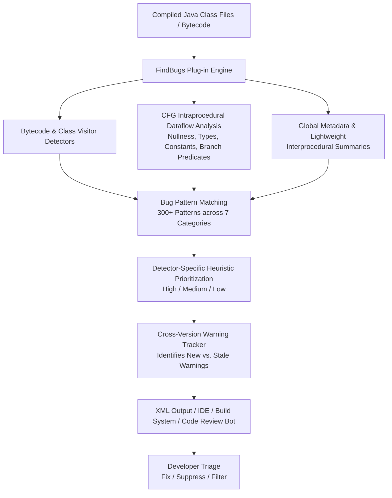
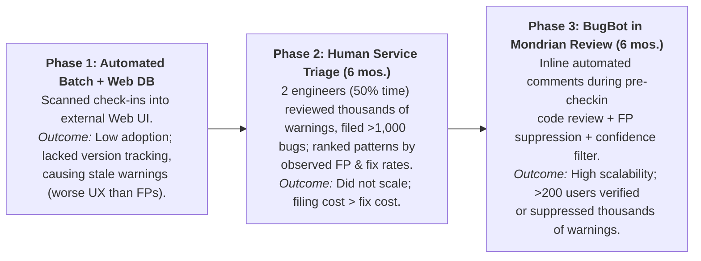

# Research Paper Summary: Using Static Analysis to Find Bugs

## 1. Bibliographic Information

| Field | Details |
| :--- | :--- |
| **Title** | Using Static Analysis to Find Bugs |
| **Authors** | Nathaniel Ayewah (University of Maryland), William Pugh (University of Maryland), David Hovemeyer (York College of Pennsylvania), J. David Morgenthaler (Google), John Penix (Google) |
| **Publication** | *IEEE Software* (Published by the IEEE Computer Society) |
| **Publication Date** | September/October 2008 |
| **Pages** | 22–29 |
| **ISSN / Print Identifier** | 0740-7459/08/$25.00 © 2008 IEEE |
| **DOI** | Not specified in the provided source document |

---

## 2. Executive Overview

This paper examines how **static analysis**—the automated inspection of software without executing it or supplying runtime inputs—can effectively uncover real-world programming defects in production Java systems using lightweight techniques. Centering on **FindBugs**, an open-source static-analysis tool for Java with more than 500,000 downloads at the time of publication, the authors demonstrate that relatively simple analyses over compiled Java **bytecode** (the intermediate instructions executed by the Java Virtual Machine) can identify high-value bugs even in mature codebases written by experienced engineers. Beyond technical design, the paper presents empirical evaluations on Sun's Java Development Kit (JDK 1.6.0), a two-year industrial deployment case study at Google, and a user survey of 252 practitioners, showing that workflow integration, warning prioritization, and human factors are as decisive for adoption as algorithmic sophistication.

---

## 3. Problem Statement & Research Objectives

### Problem Statement
Production software routinely contains coding mistakes that reduce reliability or cause runtime failures. Although sophisticated commercial static-analysis tools and proprietary systems exist, they are often expensive, require manual code **annotations** (metadata added to code to specify intended properties), rely on computationally heavy analyses, or overwhelm developers with **false positives** (warnings that do not correspond to real defects). Furthermore, software engineering teams lack established empirical guidelines for integrating static analysis into everyday workflows, often leading to inconsistent ad hoc usage and abandonment.

### Research Objectives
1. **Evaluate lightweight defect detection:** Determine which categories of real-world defects in Java can be detected accurately and cheaply using simple static-analysis techniques.
2. **Document tool design and defect patterns:** Explain the architecture, analysis algorithms, prioritization mechanisms, and real-world bug patterns implemented in FindBugs.
3. **Assess industrial and production effectiveness:** Measure the practical impact and defect yield of FindBugs on large-scale production codebases (Sun's JDK 1.6.0 and Google's internal Java codebase).
4. **Understand human and organizational factors:** Investigate how developers interact with static-analysis warnings, configure filters, suppress non-bugs, and establish organizational review policies.

---

## 4. Background vs. Direct Contributions

To maintain analytical clarity for academic reporting, the table below separates established domain background referenced in the paper from the authors' direct contributions.

| Dimension | General Background & Prior Context | Direct Contributions of This Paper |
| :--- | :--- | :--- |
| **Static Analysis Landscape** | Historical origins in `lint` for C; security-driven research (buffer overflows, format strings, SQL injection, cross-site scripting); commercial tools, proprietary analyzers (Microsoft's PREfix), and pattern-language tools (PMD, Metal). | Articulation of the FindBugs "low-hanging fruit" philosophy: prioritizing simple, fast, low-false-positive detectors built directly from observed real-world bugs rather than formal soundness or completeness. |
| **Program Analysis Theory** | Path-feasibility checking (determining if a specific sequence of conditional branches can execute) is undecidable in general; deeper tools like Reasoning rely on path-sensitive analysis or theorem proving. | Practical architecture combining bytecode visitors, conditional-aware intraprocedural dataflow analysis, global subtype/field data, lightweight interprocedural summaries, and cross-version warning tracking. |
| **Empirical Codebase Evaluation** | Prior evaluations of static tools focus primarily on soundness, completeness, speed, and memory consumption. | Synthesis of empirical defect evaluations on Sun's JDK 1.6.0 (build 13 examples, 53 cross-build warning removals, and manual triage of 379 release warnings in build 105) plus a rapid-prototyping case on Eclipse 3.3M6. |
| **Industrial Workflow Integration** | Ad hoc adoption is widespread, with few documented operational best practices for large engineering organizations. | Longitudinal two-year, three-phase case study at Google culminating in **BugBot** (inline static-analysis comments inside the **Mondrian** code-review system) and empirical pattern ranking by false-positive and fix rates. |
| **Human Factors & Governance** | Tool vendors hold untested assumptions about how teams prioritize, suppress, and govern warnings; JSR 305 aims to standardize nullness annotations across vendors. | Quantitative and qualitative findings from a FindBugs user survey (N = 252) and interviews detailing review habits, out-of-the-box usage, suppression methods, and organizational policies. |

---

## 5. Proposed Approach, Architecture & Algorithms

### Core Design Philosophy
Unlike security-assurance tools that attempt to prove the absence of an entire defect class, FindBugs is **unsound and incomplete by design**. It targets **low-hanging fruit**: defects that are cheap to detect, easy to understand (typically within a few lines of code), and likely to be fixed by developers. New detectors follow a **bug-driven development methodology**—starting with real bugs observed in student code, production repositories, or developer forums, and crafting the simplest effective detector (often within hours). For example, after seeing a bug online involving casting a signed `int` to an unsigned `char` and comparing it to `-1` (which is always false in Java), the team built a detector in under an hour and found **11 identical errors in Eclipse 3.3M6**.

### Architecture & Analysis Techniques
FindBugs uses a Java **plug-in architecture** rather than a domain-specific pattern language (such as PMD or Metal). Each plug-in detector is written in Java, inspects compiled class files/bytecode, and can emit multiple bug patterns (over **300 patterns** in total).

1. **Bytecode & Class Visitor Analysis:**
   - Uses the **visitor pattern** (a software design pattern that traverses elements of a data structure to apply operations) over class files and method bytecodes.
   - Inspects types, constant values, flags, operand stack values, and local variables to catch localized mistakes (e.g., infinite recursion, ignored return values, impossible bit shifts).
2. **Intraprocedural Dataflow Analysis over Control-Flow Graphs (CFGs):**
   - A **control-flow graph** models all possible execution paths inside a single method, and **intraprocedural dataflow analysis** tracks how variable properties change along those paths within one method.
   - Tracks **nullness** (whether a reference may be `null`), **type information**, and **constant values**.
   - Incorporates branch predicates from `instanceof` checks and `null` tests.
   - **Null-pointer strategy:** Instead of attempting undecidable path-feasibility proofs across separate branches, FindBugs flags branches or statements that are **guaranteed** to trigger a `NullPointerException` if executed.
3. **Global Information & Lightweight Interprocedural Summaries:**
   - Avoids expensive **interprocedural context-sensitive analysis** (analyzing call chains across methods while distinguishing different call sites).
   - Leverages global whole-application metadata (e.g., subtype hierarchies and field accesses) and targeted **interprocedural summaries** (e.g., identifying method parameters that are unconditionally dereferenced).
4. **Categorization & Heuristic Prioritization:**
   - Groups warnings into seven categories: *Correctness*, *Bad practice*, *Performance*, *Multithreaded correctness*, *Malicious code vulnerability*, *Dodgy*, and *Internationalization*.
   - Assigns **High**, **Medium**, or **Low** priority via detector-specific heuristics (low-priority warnings are suppressed by default). Priorities are not strictly calibrated for comparison across distinct bug patterns.
5. **Cross-Version Warning Tracking:**
   - Implements two matching mechanisms that align warnings across different software revisions even when line numbers and surrounding code change, allowing teams to isolate newly introduced issues and preserve audit histories.
6. **Tooling & Output Integration:**
   - Runs via CLI, Ant, Maven, Eclipse, NetBeans, or a standalone Swing GUI, and exports structured **XML** for downstream filtering, transformation, or database ingestion.

### Representative Defect Patterns & Explicit Non-Goals

| Category / Scope | Concrete Examples & Mechanics |
| :--- | :--- |
| **Infinite Recursive Loops** | A method unconditionally calls itself (e.g., `public String foundType() { return this.foundType(); }`, caused by unintended parentheses on a getter), causing a stack overflow. |
| **Ignored Return Values / Unthrown Exceptions** | Calling immutable object methods without assignment (e.g., `s.toLowerCase();` instead of `s = s.toLowerCase();`) or instantiating an exception without throwing it (`new SAXException(...);`). |
| **Null-Pointer Dereferences** | Misusing short-circuit Boolean operators (`name != null \|\| name.length > 0` evaluates `name.length` precisely when `name` is `null`), or checking a variable for `null` then unconditionally dereferencing it (`if (g != null) paintScrollBars(g, colors); g.dispose();`). |
| **Type & Equality Errors** | Checked casts guaranteed to throw `ClassCastException`; calling `equals()` on unrelated types (e.g., `StringBuffer` vs. `String`, or `String` vs. `java.util.Enumeration` in JDK's `PartialCompositeContext.allEmpty()`). |
| **Obscure Language / API Bugs** | Testing equality against `Double.NaN` (always false); shifting a 32-bit `int` by a constant > 31; casting `int` to unsigned `char` and comparing to `-1`. |
| **Explicit Non-Goals (Not Detected)** | Path-sensitive multi-branch null dereferences requiring theorem proving (e.g., Reasoning's report on Apache Tomcat 4.1.24) and array-index-out-of-bounds checks requiring relational variable tracking (`i < a.length`). |

---

## 6. Datasets, Experiments, Evaluation Metrics & Results

### Evaluation Metrics Used
- **Cross-build resolution attribution:** Proportion of vanished warnings explained by targeted bug fixes vs. incomplete workarounds vs. unrelated refactorings.
- **Manual functional-impact classification:** Categorizing release warnings into *bad analysis*, *unreachable/low impact*, *functional impact*, and *substantial functional impact*.
- **Empirical pattern ranking metrics (Google):** Observed **false-positive rate** and observed **developer fix rate** per bug pattern.
- **Workflow adoption & survey metrics:** Number of bugs filed/fixed, active reviewer interactions, and percentage distributions of review habits, formal policies, and suppression strategies.

### Experiment 1: Production Evaluation on Sun's JDK 1.6.0 & Eclipse 3.3M6
- **JDK 1.6 Build 13 (Infinite Recursion):** Detected **5** infinite recursive loops.
- **Cross-Build Warning Removals (53 medium/high-priority correctness warnings removed while the containing class persisted):**
  - **37 (69.8%):** Removed by a small, targeted code change narrowly addressing the warning.
  - **5 (9.4%):** Disappeared due to code changes that did not fully fix the underlying defect.
  - **11 (20.8%):** Disappeared as a side effect of larger refactorings or substantial modifications.
- **Manual Classification of All 379 Medium/High-Priority Correctness Warnings in JDK 1.6.0 Build 105 (Official Release):**

| Classification Category | Count | Share of Total (N = 379) | Interpretation |
| :--- | :---: | :---: | :--- |
| **Bad Analysis (Tool Error)** | 5 | 1.3% | FindBugs misunderstood code semantics (e.g., missed field mutation via method call). |
| **Unreachable / Little or No Functional Impact** | 160 | 42.2% | Dead code or harmless inconsistencies unlikely to affect execution. |
| **Functional Impact** | 176 | 46.4% | Likely causes unintended runtime behavior. |
| **Substantial Functional Impact** | 38 | 10.0% | Method clearly behaves substantially at odds with its intended specification. |
| **Total Evaluated** | **379** | **100.0%** | **56.5% (214/379)** judged to have functional or substantial functional impact. |

- **Eclipse 3.3M6:** A newly written detector for `int`-to-`char` comparison with `-1` (built in <1 hour) identified **11** real errors.

### Experiment 2: Longitudinal Industrial Case Study at Google (2 Years)
Overall, Google integrated FindBugs into its testing and code-review infrastructure and **fixed more than 1,000 issues** in its internal Java codebase, including **more than 70 infinite recursive loops**. Deployment evolved through three phases:

- **Key Operational Finding:** **Stale warnings** (warnings from already-fixed or outdated file versions) degrade developer trust and user experience even more severely than false positives. Embedding warnings directly into mandatory peer code review (**Mondrian**) with confidence filtering and suppression enabled scalable adoption.

### Experiment 3: FindBugs User Survey & Interviews (N = 252)

**Warning Review Behavior (Table 1 — Users Reviewing at Least High-Priority Warnings, N = 252):**

| Bug Category | Percentage of Users Reviewing |
| :--- | :---: |
| Bad practice | 96% |
| Performance | 96% |
| Correctness | 95% |
| Multithreaded correctness | 93% |
| Malicious code vulnerability | 86% |
| Dodgy | 86% |
| Internationalization | 57% |

- **Out-of-the-Box Usage:** **55%** of respondents run FindBugs with default settings without filtering any bug patterns. Many unexpectedly review lower-priority warnings in categories aligned with their project context.

**Organizational Policies (Table 2):**

| Policy / Practice | Percentage of Users |
| :--- | :---: |
| FindBugs warnings are **not** inserted into a separate bug-tracking database | 83% |
| No policy on how soon each FindBugs issue must be human-reviewed | 81% |
| Running FindBugs is **not** required by process or management | 76% |
| Developers only occasionally run FindBugs manually | 60% |
| No policy on how to handle warnings designated "Not a Bug" | 55% |

*(Note: The original printed Table 2 also contains a final row labeled "Internationalization — 57%", which appears to be a typesetting repetition from Table 1.)*

**Suppression Mechanisms for "Not a Bug" Warnings (Table 3):**

| Suppression Mechanism | Percentage of Users |
| :--- | :---: |
| No policy | 55% |
| Filter out using FindBugs XML filters | 25% |
| Suppress in source using `@SuppressWarnings` | 17% |
| Close in a bug tracker or database | 5% |

*(Note: Percentages sum to 102% in the original table due to rounding or multiple responses.)*

- **Review Ownership:** Most organizations delegate warning triage to a single individual (frequently the code author). Only **11%** use team review, and **14%** allow independent reviewer decisions solely for trivial cases.

---

## 7. Relevance to Machine Learning-Based Static Bug Detection

### Machine Learning Techniques in This Paper
This paper **does not use machine learning (ML) algorithms**. Its detection engine relies strictly on deterministic static-analysis rules (bytecode visitors, CFG dataflow analysis, global metadata, and hand-crafted heuristics), while Google's ranking scheme uses descriptive empirical statistics (historical false-positive rates and developer fix rates).

### Foundational Implications for ML-Based Static Bug Detection
Despite being pre-ML, the paper directly identifies the exact bottlenecks and empirical signals that motivate modern ML-based static bug detection and actionable warning identification (AWI):

1. **Empirical Warning Prioritization as a Precursor to Supervised Alert Ranking:**
   - FindBugs' hand-crafted priorities are not comparable across patterns, and static severity/confidence scores fail to capture organization-specific **risk**.
   - Google's Phase 2/3 shift toward ranking patterns by **observed false-positive rate** and **observed fix rate** establishes the core target variables used by supervised ML classifiers to rank static-analysis warnings as actionable vs. non-actionable.
2. **Context-Specific Risk Modeling & User Clustering:**
   - The authors explicitly highlight the absence of a "context-specific oracle" (e.g., Web vs. desktop apps, active development vs. pre-release, mature legacy code vs. newly written code) and call for research to **cluster users into contexts** to select relevant detectors—directly motivating unsupervised clustering, transfer learning, and project-adaptive ML filtering.
3. **Human-in-the-Loop Feedback Signals for Training Data:**
   - Google's **BugBot** inside Mondrian generates continuous, fine-grained developer annotations (*verified/fixed*, *suppressed false positive*, *confidence-threshold filtered*) within normal code review. This workflow demonstrates how to harvest high-volume, real-world training labels for online and active learning without disrupting developers.
4. **Label Noise, Subjectivity, and Ground-Truth Hazards:**
   - The JDK 1.6.0 manual audit demonstrates that distinguishing true bugs from harmless dead code (42.2% unreachable/low-impact) is subjective, localized code correctness does not always match end-user impact, and single-reviewer triage (dominant in industry) introduces inter-rater disagreement. ML models trained on historical warning-fix or suppression logs must account for **label noise** and **reviewer bias**.
5. **Addressing Rule-Based Blind Spots with Learned Models:**
   - Static rules miss external compensating controls (e.g., custom input validation or white-listing that neutralizes SQL injection or XSS warnings) and require manual engineering for every new pattern. ML models operating on source/bytecode representations, control/dataflow graphs, and repository context can learn project-specific idioms, filter contextually mitigated warnings, and generalize beyond rigid pattern templates.
6. **Importance of Temporal & Version Features:**
   - The finding that **stale warnings** harm adoption more than false positives underscores that ML static bug detectors must incorporate **version-tracking and code-churn features** (e.g., warning age, newly introduced vs. legacy code) rather than relying solely on static code features.

---

## 8. Key Findings, Advantages, Limitations & Future Work

### Key Findings
- **Simple analyses catch real production bugs:** Trivial bytecode and intraprocedural dataflow checks uncover significant defects (e.g., infinite recursion, null dereferences, broken `equals()` calls) even in flagship software like Sun's JDK and Google's codebase.
- **Workflow integration determines impact:** Moving static analysis from an external dashboard into mandatory peer code review dramatically increases developer engagement and defect remediation.
- **Stale warnings are toxic to trust:** Failing to track warnings across code versions causes greater UX degradation than false positives.
- **Formal adoption lags behind tool availability:** Most teams use static analysis sporadically without formal review deadlines, bug-tracker policies, or suppression standards, risking rushed suppression rather than real fixes near release dates.
- **Developer priorities are risk- and context-driven:** Users care about operational risk rather than abstract severity, and are far less willing to modify stable legacy code than newly written code.

### Advantages of the FindBugs Approach
- **Low false-positive rate on targeted bugs:** Only 1.3% (5/379) of JDK 1.6.0 build 105 correctness warnings resulted from flawed tool analysis.
- **Fast, agile detector authoring:** Writing Java plug-ins directly from observed defects enables hour-scale turnaround from bug discovery to broad deployment.
- **Scalable execution:** Avoiding interprocedural context-sensitive analysis and theorem proving keeps analysis lightweight enough for IDEs, build servers, and large repositories.
- **Developer-centric features:** Cross-version warning tracking, XML filtering, and confidence-based suppression directly support continuous engineering workflows.

### Limitations
- **Incomplete coverage by design:** Misses path-sensitive multi-branch defects, array-bounds violations, and defects requiring deep interprocedural reasoning.
- **Uncalibrated cross-pattern priorities:** Priority heuristics are detector-specific and cannot be compared uniformly across different bug patterns.
- **Lack of semantic/environmental awareness:** Cannot recognize external defensive controls (e.g., custom Web input validation) or automatically adapt to project domain and lifecycle stage.
- **Unproven comparative cost-effectiveness:** While believed to outperform alternative uses of developer time (such as extra manual review or test writing), formal economic measurement had not yet been conducted.
- **Workflow gaps at Google:** Phase 3 did not yet automatically execute FindBugs on every pre-checkin intermediate revision during active review.
- **Potential tool conflicts:** Source-level code tuning and tool-specific annotations can conflict across competing static analyzers.

### Future Work Identified by the Authors
1. **Pre-checkin continuous execution:** Automatically run FindBugs on every development revision while it is under review and prior to source-control check-in.
2. **Context clustering & presets:** Research methods to cluster users by application context and provide tailored preset detector configurations.
3. **In-situ observational studies:** Observe developers directly in their work environments to capture nuanced tool interactions beyond surveys.
4. **Effort & inter-rater studies:** Empirically measure review time, fix effort, false-positive rates for high-value detectors, and whether different reviewers classify the same warnings consistently.
5. **Standardization & automated suppression:** Advance **JSR 305** to standardize defect-detection annotations across Java tools and automate insertion of source-level suppression annotations based on reviewer actions.
6. **Cost-effectiveness & best-practice validation:** Measure and establish formal, validated organizational processes that maximize the return on developer time spent using static analysis.

---

## 9. Conclusions

The paper demonstrates that lightweight static analysis—anchored in real-world defect patterns, bytecode inspection, and intraprocedural dataflow analysis—delivers substantial practical defect detection in large production Java systems without requiring full formal verification. However, technical accuracy alone is insufficient for real-world impact. Through empirical evidence from Sun's JDK, Google's three-phase deployment, and a 252-user survey, the authors conclude that effective static bug detection depends equally on **seamless workflow integration** (particularly within code review), **accurate cross-version tracking**, **empirical ranking and suppression mechanisms**, and **organizational best practices** that ensure developer time spent reviewing warnings yields higher value than competing quality-assurance activities.