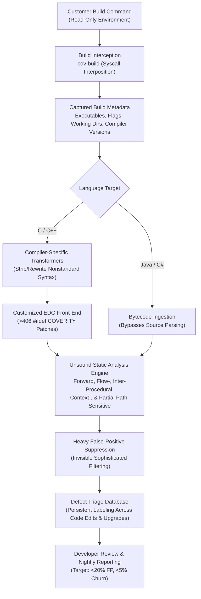
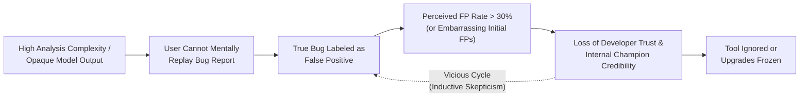

# Research Paper Summary: A Few Billion Lines of Code Later — Using Static Analysis to Find Bugs in the Real World

---

## 1. Bibliographic Information

| Field | Details |
| :--- | :--- |
| **Title** | A Few Billion Lines of Code Later: Using Static Analysis to Find Bugs in the Real World |
| **Authors** | Al Bessey, Ken Block, Ben Chelf, Andy Chou, Bryan Fulton, Seth Hallem, Charles Henri-Gros, Asya Kamsky, Scott McPeak, and Dawson Engler |
| **Affiliations** | Coverity, Inc. (San Francisco, CA); Dawson Engler also with Department of Computer Science and Electrical Engineering, Stanford University (Stanford, CA) |
| **Publication** | *Communications of the ACM* (Contributed Articles) |
| **Year / Issue** | February 2010, Vol. 53, No. 2, pp. 66–75 |
| **DOI** | `10.1145/1646353.1646374` |
| **Paper Type** | Industrial Experience Report / Systems Retrospective |

---

## 2. Executive Summary

This paper documents eight years of engineering, operational, and socio-technical lessons learned while commercializing a Stanford academic static analysis research prototype into **Coverity Static Analysis** (beginning in 2002). **Static analysis** is the automated inspection of program source code or compiled code to detect defects without executing the program. By December 2009, Coverity had licensed its tool to approximately 700 customers covering over one billion lines of code (LOC) and had analyzed several billion LOC in total.

The authors demonstrate that transitioning static bug detection from a research lab to industrial deployment fails primarily due to unexpected engineering and human barriers rather than core analysis algorithms alone. Key challenges include capturing source code from opaque build systems without modifying them, parsing wildly divergent compiler dialects ("the C language does not exist"), suppressing false alarms below strict trust thresholds, capping report instability (**churn**) across releases, and ensuring bug reports are simple enough for skeptical developers to understand and accept.

---

## 3. Direct Contributions vs. General Background

To support accurate academic synthesis, the table below separates pre-existing background knowledge from the paper's original contributions.

| Category | Content in Paper |
| :--- | :--- |
| **General Background Information** | • **Core static analysis premise:** Programming rules (such as releasing acquired locks) map directly to source code patterns and can be checked statically. • **Prior research foundations:** The commercial product evolved from earlier Stanford academic work on system-specific compiler extensions and static checkers (2000–2002), alongside contemporaneous tools such as Microsoft's **PREfix**, **ESP**, **SLAM/SPIN**, **ESC/Java**, flow-sensitive type qualifiers, and dynamic memory checker **Purify**. • **Unsoundness paradigm:** Adopting an **unsound** approach (finding real bugs without mathematically proving the absence of all bugs), originally popularized by PREfix and once controversial circa 2000, had become the *de facto* standard for practical tools by 2010. • **Standard front-end infrastructure:** The Edison Design Group (**EDG**) C/C++ front-end (developed since 1989) serves as the industry standard for commercial C/C++ parsing. |
| **Paper's Direct Contributions** | • **Formulation of empirical laws of real-world bug finding:** *No Check = No Bug*, *You can't check code you don't see*, and *You can't check code you can't parse*. • **Industrial architectural solutions:** Build interception via system-call interposition (`cov-build`), compiler-specific source transformers paired with EDG front-end patches, and persistent defect-triage tracking. • **Quantitative empirical evidence from commercial scale:** Throughput requirements (≥1,400 LOC/min), false-positive thresholds (<20% target; >30% failure point), release churn limits (<5%), EDG patch counts (>406 `#ifdef COVERITY` modifications), and transformer code sizes across 18 compilers. • **Socio-technical taxonomy of tool adoption:** Identification of the two commercialization dynamics (Gaussian heavy tails and user–builder fission), five real-world customer upgrade models, organizational incentive conflicts (managerial bug-trend graphs), and the asymmetry between visible bug-finding complexity and invisible false-positive suppression. |

---

## 4. Problem Statement & Research Objectives

### Problem Statement
Academic static analysis tools often achieve impressive bug counts on a small number of familiar codebases (such as the Linux kernel) when operated by their own creators. However, these research prototypes routinely fail when deployed across hundreds of unfamiliar commercial codebases operated by thousands of everyday developers. The authors identify two underlying dynamics driving this gap:

1. **Scale and Heavy-Tail Diversity ("Many Check Many"):** Summing many independent variables—such as code idioms, compiler dialect deviations, custom build systems, and developer skill levels—produces a **Gaussian distribution** (bell curve). As the number of codebases and users grows, extreme edge cases in the tails of this distribution occur frequently and break assumptions tuned in a lab.
2. **User–Builder Fission:** In a research lab, the tool builder is also the tool user, sharing the same expertise and goals. In industry, users have limited knowledge of the tool, little incentive to debug it, and often operate under conflicting organizational incentives—leading them to label any confusing report as a false alarm.

### Research Objectives
- Document the real-world technical, operational, and human obstacles encountered while building and commercializing an industrial static bug-finding tool.
- Extract actionable engineering principles, performance thresholds, and design trade-offs that form a "least common denominator" for any non-trivial static analysis tool operating at scale.
- Challenge common academic myths—specifically that parsing is a solved problem and that deeper, more sophisticated program analysis is always beneficial.

---

## 5. Theoretical Background & Core Terminology

The paper grounds its engineering discussion in established static program analysis concepts:

- **Flow-Sensitive Analysis:** Tracks how program state changes along execution paths in statement order (e.g., verifying `unlock()` occurs after `lock()`).
- **Inter-Procedural Analysis:** Follows execution across function call boundaries rather than analyzing each function in isolation.
- **Context-Sensitive Analysis:** Preserves information specific to each call site (distinguishing different places where the same function is called) to avoid mixing unrelated states.
- **Path-Sensitive Analysis:** Tracks branch conditions to detect **infeasible paths** (execution sequences that cannot logically happen at runtime), reducing false alarms.
- **Soundness vs. Unsoundness:** A **sound** tool guarantees it will never miss a bug of a given class (zero false negatives), typically at the cost of many false alarms and poor scalability. An **unsound** tool sacrifices completeness to maximize true bug discovery while minimizing false alarms, intentionally skipping problematic constructs (such as inline assembly or complex files).
- **False Positive (FP):** An error reported by the tool that is not an actual defect in the code.
- **False Negative (FN):** A real bug in the code that the tool fails to report.
- **Churn:** Instability in the set of reported defects across runs or tool upgrades, where previously reported bugs disappear or new bugs appear even on unchanged code.
- **Empirical Law of Unchecked Systems:** Running any reasonable static checker over a large, previously unchecked codebase will reliably find serious bugs, because humans inevitably violate repeated programming rules without an automated safety net.

---

## 6. Proposed Approach, Architecture & Methodologies

Coverity's commercial architecture is designed to operate in two demanding environments: **pre-sale on-site trials** (analyzing an unseen 1–30 million LOC codebase and presenting accurate, explainable bugs within hours to two days) and **post-sale nightly builds** (completing full analysis within 12–24 hours).

### High-Level System Architecture

### Core Methodological Components

#### 1. Build Interception ("You Can't Check Code You Don't See")
- **Constraint:** Customers enforce a strict read-only policy ("No, you can't touch that") forbidding modifications to makefiles, compiler paths, or build configurations.
- **Failed Initial Approach (2002):** Running `make`, logging its text output, rewriting compiler calls (e.g., `gcc`) to invoke the analyzer, and replaying the build. This failed on alternative build systems (e.g., ClearCase/`ClearMake`) and caused a catastrophic failure when a misparsed directory path passed an empty string to `cd`, causing a root-privileged build script to run `rm -rf *` from the filesystem root and wipe a customer's Linux installation.
- **Production Approach (System-Call Interposition):** Wrapping the native build via `cov-build <build command>` to intercept every operating system call spawned during compilation. This captures exact compiler binaries, flags, directories, and versions, enabling automatic per-file language dialect switching.
- **Platform Workarounds:**
  - *GUI-only builds* lacked a command prompt for `cov-build`.
  - *Windows interposition* required running the compiler inside a debugger, which triggered a hidden use-after-free bug in Visual Studio C++.NET 2003 (caused by debug `malloc` poisoning freed memory during Microsoft `#using` directives). Coverity's workaround overwrote the compiler's internal "in debugger" memory flag with `0` immediately upon process startup.

#### 2. Parsing & Compiler Dialect Normalization ("You Can't Check Code You Can't Parse")
- **Core Insight:** Language standards do not match real-world code; developers write whatever character strings their compiler accepts and treat successful compilation as proof of validity. A single illegal construct in a widely included header file causes cascading parse errors across an entire codebase.
- **Front-End Pipeline:**
  1. License the commercial **EDG C/C++ front-end** for broad compiler and version-specific bug compatibility.
  2. Write **compiler-specific transformers** that strip or rewrite nonstandard extensions into parseable C/C++.
  3. Directly modify EDG source code as a last resort (exceeding **406 `#ifdef COVERITY`** patches by early 2009).
- **Managed Languages:** For **Java** and **C#**, Coverity bypassed source-dialect fragility by analyzing compiled **bytecode** (intermediate machine-independent instructions) instead of source files.

#### 3. Static Analysis Algorithms & Engineering Constraints
- **Checker Design:** Checkers target both generic defects (memory corruption, use-after-free, buffer overflows, dead code, data races) and interface/system-specific rules (e.g., function ordering such as `lock()`/`unlock()`). Checkers avoid manual user annotations or formal specifications to minimize setup friction.
- **Traversal Strategy:** Forward **flow-sensitive**, **inter-procedural**, **context-sensitive**, and partially **path-sensitive** analysis.
- **Strict Determinism & Churn Control:** To keep release-to-release defect churn below **5%**, **randomization is strictly prohibited** ("verboten"), and **timeouts** are heavily discouraged (used only as a last resort), ruling out many heuristic shortcuts for exponential state-space problems.
- **Asymmetric Analysis Complexity:**
  - *False-positive suppression* (which silently removes reports) grew far more sophisticated than the academic prototype because users never have to understand how an alert was suppressed.
  - *Bug detection* (which generates visible reports) was intentionally constrained to favor simple, clear, probable defects. Complex analyses whose reports users could not mentally replay (such as concurrency/data-race checkers for many years) were dropped or delayed.

#### 4. Defect Persistence & Triage Database
- Error reports are stored in a centralized database where engineers label findings as true bugs or false positives.
- Coverity invested substantial engineering effort into **label persistence**: automatically reapplying historical triage classifications to recurring defects across subsequent runs, even after source-code edits shift line numbers or checker upgrades alter analysis behavior.

---

## 7. Machine Learning Techniques & Relevance to ML-Based Static Bug Detection

### Use of Machine Learning in This Paper
**This paper does not use any machine learning (ML) techniques.** Coverity Static Analysis is a strictly deterministic, symbolic, rule-based static analysis engine combined with manually engineered compiler transformers and explicit heuristic filters. No statistical classifiers, neural networks, feature embeddings, or training datasets are used in the system described.

### Direct Relevance & Implications for ML-Based Static Bug Detection
Despite predating modern deep-learning bug detectors, this paper defines the **core operational, evaluation, and socio-technical constraints** that ML-based static bug detection systems must satisfy to succeed in industrial deployment:

| Coverity Empirical Finding (2010) | Direct Challenge & Design Implication for ML-Based Static Bug Detection |
| :--- | :--- |
| **Zero-Modification Ingestion & Parsing Fragility** | ML models operating on raw source tokens or lightweight syntax trees may partially bypass the EDG/dialect bottleneck ("you can't parse"), offering a major advantage over rigid compiler front-ends—provided they still capture cross-file and build-configuration semantics without breaking read-only build rules. |
| **Gaussian Heavy Tails Across Codebases** | Models trained on a small set of open-source repositories (e.g., Linux or GitHub benchmarks) face severe **out-of-distribution (OOD)** shifts when deployed across proprietary dialects, legacy embedded code, and custom idioms. |
| **Strict Determinism & <5% Churn Cap** | Stochastic training, model weight updates, or non-deterministic inference directly violate industrial churn expectations. ML detectors must manage version stability so retraining does not cause sudden bug spikes (which managers penalize) or drop previously known bugs. |
| **Explainability & Mental Replay** | Developers dismiss incomprehensible warnings as false positives. Black-box ML predictions (e.g., a raw bug probability score without a minimal, verifiable execution trace) risk triggering the distrust cycle even when technically accurate. |
| **Asymmetric Complexity (Suppression vs. Detection)** | Rather than replacing symbolic analyzers outright, ML is well-suited for **invisible false-positive suppression, warning ranking, and triage prioritization**, where internal complexity does not burden the developer with explaining *why* a report was suppressed. |
| **False-Positive Tolerance (<20% Overall; First *N* ≈ 3 Reports)** | Standard academic ML metrics (e.g., F1-score, AUROC) are insufficient. Industrial adoption depends heavily on **Precision@K** (especially top-3 initial warnings), avoiding "embarrassing/punchline" false positives, and maintaining overall FP rates well below 20–30%. |
| **Data Privacy & No Customer Code Access** | Companies routinely refuse to share proprietary source code even under NDA. This restricts centralized supervised training, fine-tuning, and error diagnosis on real industrial failure cases, motivating on-premise adaptation or privacy-preserving learning. |
| **Persistent Triage & Baselining (>1,000 Bugs)** | Industrial teams rely on historical triage labels and bug baselines. ML detectors should integrate human-in-the-loop triage feedback while ensuring stable defect fingerprinting across code edits. |

### Socio-Technical Trust Loop (Applicable to Both Symbolic & ML Bug Detectors)

---

## 8. Datasets, Evaluated Systems & Empirical Scope

Because this paper is an industrial retrospective rather than a controlled benchmark experiment, it does not evaluate on a fixed public dataset. Instead, its findings derive from large-scale commercial deployment:

- **Commercial Deployment Scale (as of December 2009):** ~700 licensed enterprise customers owning >1 billion LOC combined; several billion LOC analyzed since 2002.
- **Target Codebase Sizes:** Routine pre-sale trials on multi-million LOC systems (up to **20–30 MLOC**); nightly builds commonly handling **10+ MLOC**.
- **Domain Diversity:** Operating systems (e.g., **Linux** during early academic work), windowing systems (**X Window System**), networking equipment, embedded systems (automotive, consumer appliances), safety-critical legacy software using decades-old compilers, and classified systems.
- **Languages Covered:** Primarily **C** and **C++** (source-level via EDG + transformers), plus **Java** and **C#** (bytecode-level).
- **Compiler Corpus Measured:** 18 widely used commercial and open-source compilers quantified by transformer implementation size.

---

## 9. Experiments, Quantitative Results & Evaluation Metrics

### Operational Metrics & Empirical Thresholds

| Metric / Parameter | Reported Value / Threshold | Operational Significance |
| :--- | :--- | :--- |
| **Commercial Scale (Dec 2009)** | ~700 customers; >1B LOC licensed; several billion LOC analyzed | Demonstrates longitudinal, cross-industry empirical breadth since 2002. |
| **Nightly Build Time Budget** | ≤12 hours standard; ≤24 hours max (for 10+ MLOC) | Hard operational deadline for integration into nightly CI/build pipelines. |
| **Minimum Analysis Throughput** | ≥1,400 LOC / minute | Lower bound required to meet nightly build SLAs on large codebases. |
| **Trial Codebase Scale** | Millions of LOC (up to 20–30 MLOC) | Must go from zero prior exposure to actionable reports in hours to ~2 days. |
| **False Positive Rate (Failure)** | >30% | Consistently causes developers to abandon the tool and triggers distrust cycles. |
| **False Positive Rate (Target)** | <20% for "stable" checkers | Practical industrial benchmark; tool design prioritizes lower FPs over higher recall. |
| **Initial Report Sensitivity** | First $N \approx 3$ reports | Early false positives disproportionately trigger immediate rejection ("This tool sucks"). |
| **Release Churn Cap** | <5% per release | Limits defect-set drift across upgrades; forces strict determinism. |
| **Direct EDG Front-End Patches** | >406 `#ifdef COVERITY` locations (early 2009) | Quantifies the extreme inadequacy of standard parsers on real-world C/C++. |
| **EDG Bug Reports** | Largest single source of EDG bug reports (within 3 years) | Reflects breadth of real-world compiler edge cases encountered. |
| **Fix vs. Baseline Heuristic** | <1,000 bugs → fix; >1,000 bugs → baseline | Organizations leave legacy defects untouched to avoid regressions, fixing only new bugs. |
| **Upgrade Backlash Case Study** | Company X: v2.4 (~2,400 bugs) → fixed ~1,200 → v3.6 (3,600 bugs) | Illustrates why finding *more* bugs during upgrades angers managers tracking downward trendlines. |
| **Silent False Negative Case** | >9 months of ignored array references (early research tool) | Demonstrates how subtle analyzer bugs silently suppress findings without raising alarms. |
| **Viral Adoption Anecdote** | 110 employees laid off → 4 new customer sales | Larger trial meetings spread tool familiarity across companies when engineers change jobs. |

### Compiler Dialect Divergence: Transformer Code Size (18 Common Compilers)

Each line of transformer code was typically written only after encountering a real customer failure that could not be worked around easily.

| Compiler / Transformer | Lines of Code (LOC) | Compiler / Transformer | Lines of Code (LOC) |
| :--- | :---: | :--- | :---: |
| **QNX** | 160 | **bcc.cpp** | 629 |
| **HP-UX** | 280 | **diab.cpp** | 673 |
| **picc.cpp** | 285 | **xlc.cpp** | 756 |
| **sun.java.cpp** | 294 | **ARM** | 912 |
| **cosmic.cpp** | 334 | **GNU** | 914 |
| **st.cpp** | 384 | **Microsoft** | 1,294 |
| **intel.cpp** | 421 | **keil.cpp** | 1,425 |
| **sun.cpp** | 457 | **Metrowerks** | 1,665 |
| **iccmsa.cpp** | 603 | **cw.cpp** | 1,848 |

*Range:* **160 LOC** (QNX) to **1,848 LOC** (cw.cpp), illustrating substantial dialect divergence even for mainstream compilers like GNU (914 LOC) and Microsoft (1,294 LOC).

### Notable Qualitative & Code-Level Findings

1. **Illegal Real-World Header Constructs:** Compilers accepted nonstandard code embedded in universal headers—including duplicate parameter names (`void foo(int a, int a);`), nonsensical typedefs (`typedef char int;`), custom hex literals (`0xdead_beef`), zero-size labels (`void x;`), memory-section placement (`unsigned x @ "text";`), raw machine-code hex arrays as function bodies, arbitrary unparseable text before Microsoft precompiled headers, and incompatible inline assembly syntaxes (`asm ...` vs. `#pragma asm`).
2. **Developer Misconceptions Creating False "False Positives":** Developers rejected genuine defects due to flawed mental models of C—claiming a loop `for(i=1; i<0; i++)` executes at least once, asserting `memset(a, 0, 12)` safely clears adjacent stack variables `int a[2], b;`, insisting `free(foo); foo->bar;` is safe without an intervening `malloc`, and arguing ANSI C permits writing one element past an array bound (`unsigned p[4]; p[4] = 1;`).
3. **High-Impact "Foolish" Bugs:** A simple, quickly written checker discovered a critical privilege-escalation bug in the **X Window System**: `if(getuid() != 0 && geteuid == 0)`—missing parentheses compared the function address of `geteuid` to `0` (always false), allowing any local user to obtain root access.

---

## 10. Key Findings, Advantages & Limitations

### Key Empirical Findings
- **The Three Laws of Bug Finding:** (1) *No Check = No Bug* (coverage bounds defect counts linearly: 10× more code yields ~10× more bugs); (2) *You can't check code you don't see*; (3) *You can't check code you can't parse*.
- **Five Real-World Tool Upgrade Models:** Because improved detection spikes bug counts (ruining downward managerial graphs), organizations independently adopt five behaviors: (1) *Never upgrade*, (2) *Never before a release* (ironically common in release-gating teams), (3) *Never before a meeting*, (4) *Upgrade then roll back*, and (5) *Upgrade only high-priority checkers* (e.g., use-after-free, memory corruption, and selectively locking or code contradictions).
- **Non-Superset Tool Comparison:** No static analyzer's bug set is reliably a strict superset of another's—even when Tool A is substantially stronger than Tool B—complicating head-to-head evaluations.
- **False Negatives Become Visible in Specific Scenarios:** While missed bugs are normally invisible, they break trust when customers seed test bugs, test against a recent catastrophic outage bug, compare rival tools, or notice previously reported defects vanish after an upgrade.
- **Technology Alone Cannot Eliminate False Positives:** Because misunderstood true bugs are reclassified as false positives by users, false-positive management is fundamentally both a technical and a communication/UX problem.

### Advantages of Coverity's Approach
- **Zero-Modification Integration:** System-call interposition (`cov-build`) works seamlessly across arbitrary build systems without altering customer scripts or build environments.
- **High Scalability & Practicality:** Unsound, annotation-free analysis achieves ≥1,400 LOC/min, enabling nightly checks of 10–30 MLOC codebases.
- **Real-World Resilience:** Combining EDG with compiler-specific transformers and bytecode ingestion handles legacy, embedded, and vendor-specific dialects that defeat academic front-ends.
- **Developer-Centric Design:** Prioritizing <20% false positives, <5% churn, persistent triage labeling, and easy-to-explain defects enables sustained industrial adoption.

### Limitations & Caveats
- **Author-Acknowledged Caveats:**
  - *Single Data Point:* Lessons come from one company and one product; Coverity's specific engineering workarounds are presented for concreteness rather than as proven optimal solutions.
  - *Small Organizational Scale:* At publication (2010), Coverity was still small relative to mature enterprise software vendors.
- **Technical & Methodological Limitations:**
  - *Unsoundness Trade-off:* Skipping complex constructs and suppressing uncertain warnings guarantees missed defects (false negatives).
  - *Dropped High-Value Analyses:* Practical explainability constraints forced Coverity to abandon or delay advanced checkers (such as concurrency/data-race detection) that worked in the research prototype.
  - *Perpetual Maintenance Burden:* Supporting divergent compilers requires a permanent team of top engineers ("they're never done") and even purchasing obsolete compilers on eBay.
  - *No Formal Controlled Evaluation:* As an experience report, the paper provides operational thresholds and case studies rather than formal precision/recall benchmarks, per-checker statistical evaluations, or reproducible datasets (largely due to strict customer NDA restrictions).

---

## 11. Conclusions & Open Directions

### Conclusions
Despite detailing numerous engineering, cultural, and business hurdles, the authors close with two strongly positive conclusions:

1. **Cultural Acceptance of Static Analysis:** Between 2002 and 2010, industry attitudes underwent a "seismic shift." Network effects from widespread adoption replaced earlier skepticism ("Lint? Yuck.") with broad developer recognition of static bug finding's value.
2. **Enduring Empirical Law of Bug Finding:** If an effective static analysis tool can locate the code, compile/parse enough of it, and run on a sufficiently large system, it will **always** uncover serious software defects.

### Implied Future Work & Open Research Directions
*(Note: The paper does not include a formal "Future Work" section; the directions below follow directly from unresolved problems identified by the authors.)*

- **Automated Explanation Generation:** Developing clearer, human-verifiable diagnostic explanations so sophisticated analyses (e.g., concurrency, deep path-sensitive reasoning) can be deployed without triggering user confusion and false-positive mislabeling.
- **Low-Churn Analysis Evolution:** Designing algorithmic techniques that improve bug detection accuracy while strictly bounding report churn (<5%) without sacrificing scalability or relying on randomization/timeouts.
- **Resilient Parsing & Build-Agnostic Ingestion:** Reducing the perpetual engineering overhead of tracking compiler dialects, precompiled headers, GUI-driven builds, and legacy toolchains.
- **Privacy-Preserving Diagnostics:** Creating methods to diagnose parser failures, performance bottlenecks, and subtle false-negative bugs when customer source code cannot leave restricted or classified environments.