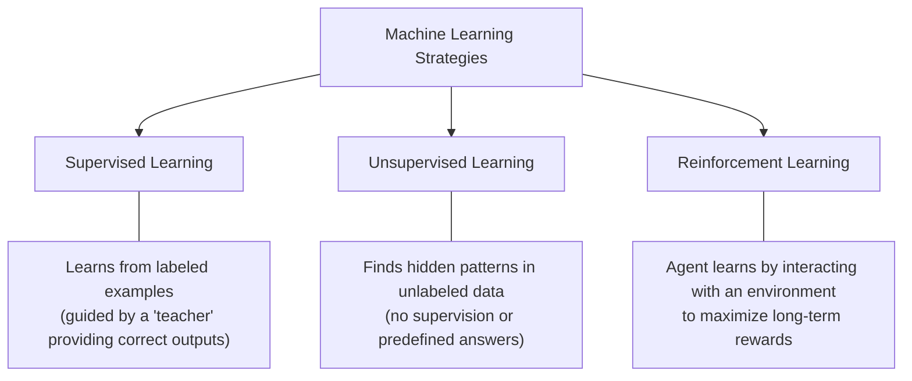
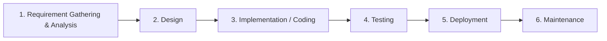

# Course 1 - Computational Intelligence in Software Engineering

## 1.1 Course Overview & Administration

### 1.1.1 Core Definitions
* **Computational Intelligence (CI):** A branch of artificial intelligence that uses nature-inspired computing methods (like machine learning and search algorithms) to solve complex problems where traditional math or logic is too slow or strict.
* **Software Engineering (SE):** The systematic, disciplined, and measurable approach to building, running, and maintaining software programs.
* **Search-Based Software Engineering (SBSE):** A field that reformulates software engineering tasks into search problems. Instead of writing exact rules to solve a problem, SBSE searches through many possible options to find a good solution.

### 1.1.2 Course Objectives & Competencies
* **Objectives:** Introduce SBSE, demonstrate why CI is needed for SE problems, and show how key SE tasks are solved using CI.
* **Professional Competencies:** Understand CI concepts/models, grasp SBSE principles, and conduct beginner-level original research in SBSE.
* **Transversal Competencies:** Apply CI to SE problems, complete lab and research reports responsibly, follow rigorous work rules, and respect ethical/scientific principles.

### 1.1.3 Course Topics
1. Search-Based Software Engineering (SBSE)
2. Machine Learning in Software Engineering
3. Program Comprehension (understanding how existing code works)
4. Refactoring (improving code structure without changing its behavior)
5. Defect Detection and Prediction (finding and forecasting software bugs)
6. Software Testing
7. Software Visualization
8. Effort Prediction and Cost Estimation
9. Software Reuse
10. Design Patterns Identification (finding standard reusable solutions in code)
11. Research Reports Presentation

### 1.1.4 Grading & Assessment Structure

| Component | Weight | Details & Deadlines | Retake Session Rules |
| :--- | :--- | :--- | :--- |
| **Class Attendance** | 10% | Weekly participation (Course: 2h/week, Lab: 1h/week). | Cannot be improved. |
| **Theoretical Research Report** | 30% | Written paper (~4 pages), oral presentation, and 1-page outline. Topic: ML/SBSE in SE. **Title due: Week 7**. **Presentations: Weeks 10–12**. | Can be improved up to a **maximum grade of 8** (written only; no oral presentation allowed). |
| **Laboratory Projects** | 30% | **Lab 1 (30% of Lab grade):** Due **Week 4**. **Lab 2 (70% of Lab grade):** Due **Week 8**. | Cannot be improved. |
| **Final Exam** | 30% | Written paper during the regular exam session. | Can be improved. |

$$\text{Final Grade} = 0.10(\text{Attendance}) + 0.30(\text{Report}) + 0.30(0.30 \cdot \text{Lab}_1 + 0.70 \cdot \text{Lab}_2) + 0.30(\text{Exam})$$

---

## 1.2 Lab & Research Requirements

### 1.2.1 Theoretical Research Report Structure
A 4-page paper analyzing recent research on applying machine learning or search techniques to software development:
* **Suggestive Title:** Must clearly match the content.
* **Abstract:** Summary of the paper (~10 lines).
* **Introduction:** Explains the main purpose of the paper.
* **Context Section:** Connects the specific topic to the broader field of SE/CI.
* **Main Sections:** Core theoretical considerations, plus **advantages and disadvantages** of the chosen approach (must include personal opinions).
* **Concluding Remarks & Further Work:** Summary of findings and future directions.
* **Bibliography:** 5 to 10 complete, properly formatted references. Every listed item must be cited directly in the text.

### 1.2.2 Lab Project 1 (Due Week 4)
* **Part A (ML Framework):** Install an open-source Machine Learning (ML) framework (e.g., TensorFlow, PyTorch, Scikit-learn). Pick an existing public dataset (e.g., Kaggle, UCI Repository) or collect your own. Implement one ML technique:
  * Decision tree learning, Association rule learning, Artificial neural networks, Self-organizing maps, Clustering, Reinforcement learning, Bayesian networks, Support vector machines, or Genetic algorithms.
* **Part B (Rule-Based Baseline):** Solve the exact same problem in any programming language using simple branching logic (`if` or `case` statements).
  * **Constraint:** You may use **no more than $n$ `if` or `case` statements**, where $n$ is the number of **attributes** (features or data columns) in the dataset.
  * **Goal:** Match or beat the performance of the ML model from Part A.
* **Evaluation:** Compare both parts using standard evaluation metrics:
  * **Accuracy:** The percentage of total predictions the model got right.
  * **Precision:** Out of all items the model predicted as positive, how many were actually positive.
  * **Recall:** Out of all actual positive items in the data, how many the model successfully found.

### 1.2.3 Lab Project 2 (Due Week 8)
Apply a machine learning technique to automate, support, or enhance a real-world SE task (e.g., code review, bug detection, feature prediction, test case generation).

1. **Data Collection:** Gather representative training data from dev logs, user feedback, or system metrics.
2. **ML Approach:** Select supervised, unsupervised, or reinforcement learning based on the data and task.
3. **Implementation:** Preprocess data (clean and format it), train the model, and evaluate it. Document all choices.
4. **Validation:** Test the model on real-world examples, in a live development environment, or with real users to gather feedback.
5. **Reporting:** Document the problem overview, data collection method, ML implementation details, validation results/user feedback, and future improvements.

---

## 1.3 Software Engineering Research Papers (Mary Shaw's Framework)

A good research paper explains **what** was accomplished, **how** it was done, and **why** the reader should care. To get published, the result must be an interesting, sound, and significant contribution to SE knowledge.

### 1.3.1 Core Questions Every Paper Must Answer

1. **What, precisely, was your contribution?**
* What question did you answer? Why should the reader care? What larger question does this address?

2. **What is your new result?**
* What new, reusable knowledge did you contribute? What prior work do you build on or replace? How is your result different and better than previous work? What, in detail, is the result?

3. **Why should the reader believe your result?**
* What standard should be used to judge your claim? What concrete evidence proves your result meets that claim?

### 1.3.2 Types of SE Research Questions & ICSE Acceptance Rates

SE researchers study how to create/modify software (code, design, docs) and how to predict/estimate system properties (like speed or reliability). Based on submissions to **ICSE** (International Conference on Software Engineering):

| Type of Question | Core Meaning / Examples | Submitted | Accepted | Acceptance Ratio (Acc/Sub) |
| --- | --- | --- | --- | --- |
| **Method or means of development** | How can we build, modify, or automate $X$? What is a better way to build $X$? *(Most common submission)* | 142 (48%) | 18 (42%) | **13%** |
| **Method for analysis or evaluation** | How can we test the quality/correctness of $X$? How do we choose between $X$ and $Y$? *(Highest acceptance rate)* | 95 (32%) | 19 (44%) | **20%** |
| **Design, evaluation, or analysis of a particular instance** | How good is system $Y$? What is property $X$ of artifact $Y$? How does $X$ compare to $Y$? What is the current state/practice of $X$? | 43 (14%) | 5 (12%) | **12%** |
| **Generalization or characterization** | Given $X$, what will $Y$ necessarily be? What exactly does $X$ mean? What is a good formal/empirical model for $X$? | 18 (6%) | 1 (2%) | **6%** |
| **Feasibility study or exploration** | Does $X$ even exist? Is it possible to accomplish $X$ at all? | 0 (0%) | 0 (0%) | **0%** |
| **TOTAL** | — | **298 (100%)** | **43 (100%)** | **14%** |

### 1.3.3 Types of SE Research Results

| Type of Result | Definition & Examples |
| --- | --- |
| **Procedure or technique** | A practical, step-by-step method (not just general advice) to perform a task like design, coding, maintenance, or measurement. *(Most common result in ICSE papers).* |
| **Qualitative or descriptive model** | A non-mathematical structure or classification (taxonomy) for a problem area; includes architectural styles, design patterns, checklists, and informal generalizations. |
| **Empirical model** | A predictive model built from observed, real-world data (quantitative models have higher acceptance success than qualitative ones). |
| **Analytic model** | A strict mathematical or structural model that allows formal proof or automatic processing. |
| **Tool or notation** | A working software tool that implements a technique, or a formal language with strict rules (semantics/calculus) for computing or reasoning. *(Often presented alongside a procedure/technique).* |
| **Specific solution, prototype, answer, or judgment** | A concrete design, working prototype, or full system showing SE principles in action; or the outcome of a specific evaluation/comparison. |
| **Report** | Interesting observations or rules of thumb that are not systematic or general enough to be considered a full descriptive model. |

---

## 1.4 Search-Based Software Engineering (SBSE)

### 1.4.1 Core Principles (Harman & Jones, 2001)

* **Concept:** Turning SE tasks into search problems so they can be solved using computational intelligence.
* **Metaheuristic Search Techniques:** High-level problem-independent strategies that guide a search process to find near-optimal solutions efficiently. Key examples include:
* **Genetic Algorithms:** Search methods inspired by biological evolution (selection, crossover, mutation).
* **Simulated Annealing:** A probabilistic technique that searches for a global optimum by allowing occasional uphill moves (worse solutions) early on to escape local traps.
* **Tabu Search:** A local search method that keeps a memory list of recently visited ("tabu") solutions to avoid cycling back to them.

* **Why SBSE Works Well for SE:** Software engineering problems often have competing or inconsistent constraints (e.g., wanting maximum software testing coverage with minimum time and cost). Exact, perfect solutions are often theoretically impossible or too slow to compute. Search techniques balance these trade-offs to find **acceptable, practical solutions**.
* **Key SBSE Application Areas:** Testing, module clustering (grouping related code files), cost estimation, requirements analysis, systems integration, software maintenance, legacy system evolution, object-oriented transformation, and behavioral adaptation of systems.

---

## 1.5 Machine Learning (ML) Fundamentals

* **Machine Learning (ML):** A branch of AI focused on building computer systems that learn from **training data** (past examples) to improve their performance through experience and capture domain knowledge.

### 1.5.1 The Three Basic ML Strategies

### 1.5.2 Key Machine Learning Techniques

| Technique | Category / Nature | How It Works & Primary Use |
| --- | --- | --- |
| **Decision Tree Learning** | Supervised (Predictive Model) | Uses a tree-like flowchart where each branch represents a test on an item's observation (attribute) and each leaf node represents a conclusion about its target value. *Example: Predicting if a code file has a bug based on whether file size > 500 lines.* |
| **Association Rule Learning** | Unsupervised (Pattern Discovery) | Discovers interesting relationships or co-occurrences between variables in large databases. *Example: Finding that whenever File A is modified, File B is also modified 80% of the time.* |
| **Artificial Neural Networks (ANN)** | Supervised / Unsupervised (Non-linear Statistical Model) | Inspired by biological brains. Uses interconnected groups of artificial neurons (**connectionist approach**) to model complex, non-linear relationships between inputs and outputs, find patterns, or capture probability distributions. |
| **Support Vector Machines (SVM)** | Supervised (Classification & Regression) | Given training examples labeled as belonging to one of two categories, an SVM builds a boundary model that predicts which category a new, unseen example falls into. |
| **Clustering** | Unsupervised Classification | Groups a set of observations into subsets (**clusters**) so items in the same cluster are highly similar (**internal compactness**) and items in different clusters are very different (**separation**). Uses similarity metrics, estimated density, or graph connectivity. |
| **Reinforcement Learning** | Interaction-Based Learning | An **agent** takes actions in an **environment** to maximize a cumulative **long-term reward**. It learns a **policy** (a rule mapping world states to best actions). Unlike supervised learning, it is never shown correct input/output pairs, and sub-optimal actions are not explicitly corrected. |

---

## 1.6 Software Engineering Lifecycle, Activities & Data

### 1.6.1 Software Development Life Cycle (SDLC) & Methodologies

The standard sequence of stages to build and maintain software:

* **Common Development Methodologies:** Waterfall (strict linear phases), Prototyping, Iterative and Incremental Development, Feature Driven Development (FDD), Spiral Development (risk-driven iterations), Rapid Application Development (RAD), Extreme Programming (XP), and Agile Methodology.

### 1.6.2 Software Engineering Subdisciplines

* **Requirements Engineering:** Gathering (elicitation), analyzing, writing down (specification), and checking (validation) what the software must do.
* **Software Design:** Defining the system's overall structure (architecture), components, and interfaces.
* **Software Construction:** Building working software through coding, verification, unit testing (testing individual functions), integration testing (testing combined parts), and debugging.
* **Software Testing:** Running technical investigations to give stakeholders information about software quality.
* **Software Maintenance:** All activities needed to provide cost-effective support and updates after release.
* **Software Configuration Management:** Tracking and controlling changes to software files over time to maintain system integrity and **traceability** (linking requirements to code).
* **Software Engineering Management:** Planning, coordinating, measuring, monitoring, controlling, and reporting to keep development systematic and quantified.
* **Software Engineering Process:** Defining, measuring, managing, and improving the software development lifecycle itself.
* **Software Engineering Tools and Methods:** Computer-Aided Software Engineering (CASE) tools and structured methods that assist developers and make success more likely.
* **Software Quality Management:** Ensuring the software's characteristics fulfill its stated requirements.

### 1.6.3 Specific Activities Across SE Phases

| Phase | Key Activities |
| --- | --- |
| **Requirements Analysis** | Cost and time estimation, **traceability** (tracking how requirements connect to design and code). |
| **Design** | Breaking the system down (decomposition) into subsystems, components, classes, and **state machines** (models showing system states and transitions). |
| **Coding** | Implementing new features, repairing bugs, **refactoring** (cleaning up code structure), using a **source code repository** (version control like Git), and **continuous integration** (automatically building and testing code changes). |
| **Testing** | Creating test cases and unit tests, integration testing, and system testing (testing the complete, integrated software). |
| **Deployment** | Configuration management and application monitoring (watching system health in production). |
| **Maintenance** | **Program comprehension**, refactoring to improve overall design, fixing bugs/creating test cases, **concept location** (finding where a specific feature is implemented in the code), and **software visualization**. |

### 1.6.4 SE Data Sources for Machine Learning & CI

Any **artifact** (byproduct created during software development) can be used as input data for CI and ML algorithms.

| Data Category | Existing Artifacts Available to Use | Data We Can Produce or Collect |
| --- | --- | --- |
| **Design & Code** | • **Design Documents:** UML diagrams (class, sequence, use case), functional, architectural, and UI documents.
 • **Source Code:** Instructions, methods, classes, comments, modules, package structure, test cases, file metadata (size, creation/modification timestamps). | • **Software Metrics:** Quantitative measurements at the method, class, or package level (e.g., lines of code, complexity). |
| **Version Control & Config** | • **Source Code Repository:** Commit messages, commit timestamps, author/team member info, location, list of modified/moved/removed files. • **Configuration/Deployment:** Config files, build scripts (e.g., Ant, Maven). | — |
| **Execution & Runtime** | — | • **Runtime Data:** Stack traces (active function calls during a crash), code coverage (percentage of code executed by tests), memory usage, error conditions. |
| **Project Management** | • **Management Data:** Tasks, task dependencies, staff allocation, estimated vs. actual time spent. | • **Management Metrics:** Project velocity (rate at which a team completes work). |
| **Users** | — | • **User Data:** User surveys, user behavior logs (clicks, selections, navigation paths). |

