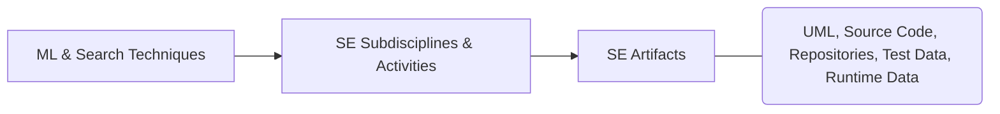
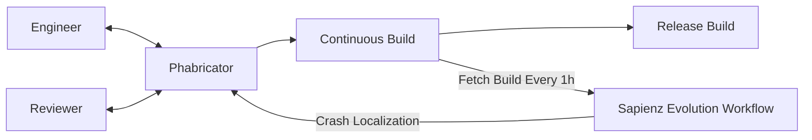
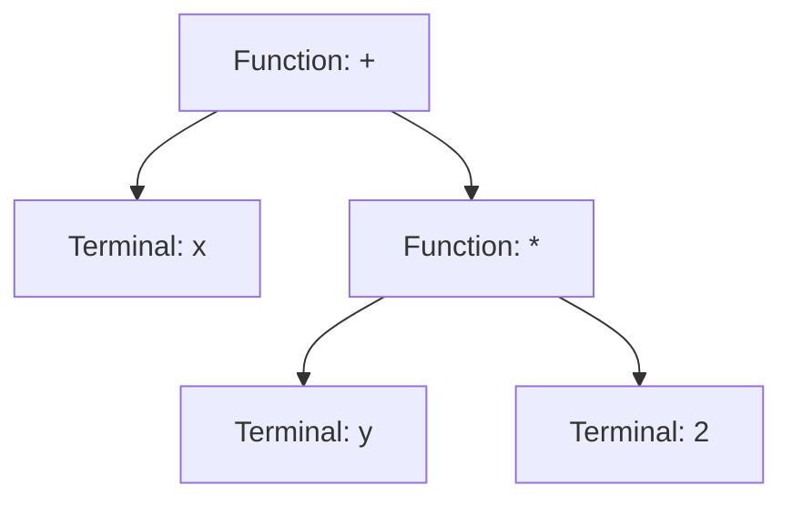

# CISE Course 2: Machine Learning & Search-Based Software Engineering

---

## 2.1 Core Concepts & Overview

**Machine Learning in Software Engineering (ML in SE)** applies machine learning algorithms (computer programs that learn patterns from data) to solve software engineering problems. 

### Dual Role of ML in SE
1. **Building SE Tools:** Automating and assisting software development and maintenance tasks (e.g., predicting bugs, estimating project costs);
2. **Enhancing Software Products:** Embedding ML directly into software products so they become **adaptive** (able to change behavior based on environment) and **self-configuring** (able to adjust settings automatically).

**Search-Based Software Engineering (SBSE)** is the practice of reformulating software engineering problems as **search problems** (finding the best solution from a massive set of possibilities using optimization algorithms).

---

## 2.2 Machine Learning Approaches Mapped to SE Tasks

### Definitions of Major Learning Types

* **Concept Learning (CL):** Inferring a general category definition from positive and negative examples;
* **Decision Trees (DT):** Tree-like models that make decisions by splitting data based on feature values;
* **Artificial Neural Networks (ANN):** Computing systems inspired by biological brains that learn complex patterns from data;
* **Bayesian Belief Networks (BBN):** Probabilistic graphical models representing cause-and-effect relationships between variables;
* **Reinforcement Learning (RL):** Learning how to act in an environment by receiving rewards or penalties;
* **Genetic Algorithms (GA) & Genetic Programming (GP):** Search methods inspired by natural evolution (selection, crossover, mutation) to evolve solutions or complete computer programs;
* **Instance-Based Learning (IBL) / Case-Based Reasoning (CBR):** Solving new problems by comparing them directly to stored past examples (cases);
* **Inductive Logic Programming (ILP):** Learning logical rules from examples and background knowledge;
* **Analytical Learning (AL) / Explanation-Based Learning (EBL):** Using prior domain theories and logical deduction to generalize from very few (or single) training examples;
* **Support Vector Machines (SVM):** Algorithms that classify data by finding the best boundary (hyperplane) separating different classes;
* **Association Rules (AR):** Discovering interesting relationships or co-occurrences between variables in large datasets;
* **Clustering (CU):** Grouping similar objects together without predefined labels (unsupervised learning).

### Mapping of SE Activities to ML Techniques

| Software Engineering Activity | Applicable ML Techniques |
| --- | --- |
| **Requirement Engineering** | AL, BBN, CL, DT, ILP |
| **Rapid Prototyping** | GP |
| **Component Reuse** | IBL (CBR) |
| **Cost / Effort Prediction** | IBL (CBR), DT, BBN, ANN |
| **Defect Prediction** | BBN, AR, Supervised Learning |
| **Design Defect Detection** | AR |
| **Test Oracle Generation** | AL (EBL) |
| **Test Data Adequacy** | CL |
| **Validation** | AL (EBL) |
| **Restructuring / Refactoring** | CU |
| **Design Patterns** | CU |
| **Data Structures** | ANN, SVM |
| **Reverse Engineering** | CL |

---

## 2.3 Trends, Benchmarks & Real-World Tools in SBSE

### Research & Publication Trends

* **Publication Growth:** SBSE publications have grown rapidly since 1976. **Search-Based Software Testing (SBST)** cumulative publications follow a 4th-degree polynomial growth trend:

$$
y = 0.0013x^4 - 0.061x^3 + 1.0008x^2 - 5.8636x + 10.443
$$

* **Topic Distribution:** Testing is the dominant topic in SBSE, though its relative share stabilized around **50%–54%** as non-testing areas grew:
* **Testing:** 54%
* **Maintenance:** 11%
* **Design:** 10%
* **Management:** 10%
* **Verification:** 4% | **General:** 4% | **Others:** 4% | **Requirements:** 3%

* **Non-Functional Properties Tested:**
* *1996–2007:* Dominated by Execution Time (43%), Usability (20%), Security (20%), Safety (11%), and Quality of Service / QoS (6%).
* *1996–2014:* Broadened significantly to include Execution Time (25%), Security (15%), Usability (12%), Robustness (12%), Efficiency (10%), Safety (9%), Scalability (6%), QoS (5%), Flexibility (4%), Energy Consumption (1%), and Availability (1%).

### Search-Based Optimization (SBO) Techniques by Usage

**Evolutionary Algorithms (EAs)** are by far the most widely used technique in SBSE literature, followed by **Simulated Annealing (SA)** and **Hill Climbing (HC)**.

| Category / Acronym | Full Technique Name |
| --- | --- |
| **EAs** | **Evolutionary Algorithms** (Umbrella category comprising GA, GP, ES, PSO, EDA, SS) |
| **GA** | Genetic Algorithms (Most popular EA) |
| **GP** | Genetic Programming |
| **ES** | Evolutionary Strategies |
| **PSO** | Particle Swarm Optimization |
| **EDA** | Estimation of Distribution Algorithms |
| **SS** | Scatter Search Algorithm |
| **SA** | Simulated Annealing |
| **HC** | Hill Climbing |
| **ACO** | Ant Colony Optimization |
| **GS** | Greedy Search |
| **IP** | Integer Programming |
| **TS** | Tabu Search |
| **AIS** | Artificial Immune Systems |
| **MA** | Memetic Algorithms |
| **SQP** | Sequential Quadratic Programming |

### Open-Source SBSE Challenge Projects

Standard real-world systems used to test, analyze, and apply SBSE techniques:

* **LibreOffice:** Large productivity suite (C++ and others), 8 MLOC (Million Lines of Code), 3 levels of regression testing;
* **SQLite:** Widely used database engine deployed as a single C source file, 338 KLOC (Thousand Lines of Code), 3 separate test suites;
* **Guava:** Google's core Java collections/utilities library, >252 KLOC, thorough performance tests;
* **Flask:** Minimalist Python web framework, 9 KLOC, full test suite.

### Major Tools, Frameworks & Benchmarks

#### 2.3.1 EvoSuite

An automated tool for Java that generates whole test suites with assertions. It uses a hybrid evolutionary search approach to optimize entire test suites simultaneously toward satisfying a coverage criterion.

#### 2.3.2 Defects4J

A database and extensible framework of real, reproducible bugs from open-source Java projects used for controlled software testing research.

| Identifier | Project Name | Number of Bugs (Total = 395) |
| --- | --- | --- |
| **Chart** | JFreeChart | 26 |
| **Closure** | Closure Compiler | 133 |
| **Lang** | Apache commons-lang | 65 |
| **Math** | Apache commons-math | 106 |
| **Mockito** | Mockito | 38 |
| **Time** | Joda-Time | 27 |

**Five Mandatory Properties of Every Defects4J Bug:**

1. **Tracked:** Reported in the project's issue tracker and referenced in the fixing commit message.
2. **Atomic:** Fixed in a single commit.
3. **Minimized:** Maintainers manually removed irrelevant changes (e.g., refactorings or new features).
4. **Source-Code Only:** Fixed by modifying source code (not configuration, documentation, or test files).
5. **Reproducible Triggering Test:** Accompanied by a deterministic test that fails before the fix and passes after the fix (independent of test execution order).

#### 2.3.3 Sapienz (at Facebook)

A multi-objective search-based Android testing system deployed in production at Facebook.

* **Goal:** Automatically explore and optimize test sequences to **minimize test length** while simultaneously **maximizing code coverage and fault revelation** (crashes).
* **Workflow:** Runs every 1 hour in a recurring loop: fetches the Continuous Build, evolves test cases, localizes crashes, reports them back to developers/reviewers via Phabricator, and monitors fixes prior to the Release Build.

---

## 2.4 Reformulating SE Problems as ML / Search Problems

### 2.4.1 Component Reuse (Instance-Based Learning / CBR)

**Goal:** Retrieve reusable software components from a repository to match a new task.

1. **Representation:** Represent repository components as points in an $n$-dimensional Euclidean space (or cases in a case base).
2. **Attribute Splitting:** Divide component information into:
* **Indexed attributes:** Used directly to search and retrieve components.
* **Unindexed attributes:** Used to provide background context.

3. **Querying:** Express desired component requirements as constraints on indexed attributes.
4. **Similarity Measurement:** Find nearest neighbors using standard Euclidean distance, distance-weighted measures, or symbolic measures.
5. **Retrieval Methods:** Use **K-Nearest Neighbor (KNN)**, **Inductive Retrieval**, or **Locally Weighted Regression (LWR)**.
6. **Component Adaptation:** Modify the retrieved component for the current task using:
* **Structural Adaptation:** Apply adaptation rules directly to the retrieved component.
* **Derivational Adaptation:** Reuse the rules that generated the original component to build a new solution.

---

### 2.4.2 Rapid Prototyping / Program Generation (Genetic Programming)

**Goal:** Automatically generate a working prototype program to understand and validate software requirements.

* **Tree Representation:** A computer program is represented as a tree where **internal nodes** are functions (e.g., `+`, `-`, `if`) and **leaf nodes (terminals)** are inputs/constants (e.g., `x`, `y`, `5`).

**7-Step GP Rapid Prototyping Framework:**

1. **Define Primitives:** Specify the set of functions (internal nodes) and terminals (leaf nodes).
2. **Define Fitness Function:** Create a scoring formula to evaluate how well a generated program works using test data (inputs and expected outputs).
3. **Initialize Population:** Randomly generate an initial group of program trees.
4. **Selection Strategy:** Choose which top-performing programs survive into the next generation.
5. **Genetic Operations:** Define how and how often **crossover** (swapping tree branches between two programs) and **mutation** (randomly altering a node/branch) occur.
6. **Termination Criteria:** Set the stopping condition (e.g., target fitness reached or maximum generations elapsed).
7. **Translation:** Convert the best evolved tree into the target programming language.

---

### 4.3 Requirement Engineering

#### Functional Requirement Learning (Supervised Learning)

* **Functional Requirement:** Describes a specific system service or function (how the system reacts to inputs).
* **Non-Functional Requirement:** A constraint placed on the system (e.g., speed, security).

**Formalization:**

1. Let $X$ be the input domain and $C$ be the output co-domain of a target system function $f$.
2. Define the empirical training dataset $D$:

$$
D = \{ \langle x_i, c_k \rangle \mid x_i \in X \text{ and } c_k \in C \}
$$

3. Learn the target function $f$ using supervised learning (AL, BBN, CL, DT, ILP) such that for any pair in $D$:

$$
f(x_i) = c_k
$$

#### Scenario-Based Requirement Engineering (Inductive Learning)

* **Goal:** Infer formal system goal specifications inductively from stakeholder interaction scenarios.
* **Mechanism:** Takes **positive scenarios** (examples of desired behavior) and **negative scenarios** (counterexamples of forbidden behavior) as inputs and generates formal goal specifications expressed as **temporal rules** (rules governing system behavior over time).

---

### 4.4 Reverse Engineering (Program Comprehension)

**Goal:** Recover the design or functional specification of a **legacy system** (an old, critical system that must be maintained despite poor structure and missing/outdated documentation) from its executable code.

**Formalization:**

1. Given executable program $p$, input dataset $X$, and output set $C$, construct the training dataset $D$ by running $p$ on inputs $x_i$:

$$
D = \{ \langle x_i, p(x_i) \rangle \mid x_i \in X \text{ and } p(x_i) \in C \}
$$

2. Use supervised learning (e.g., Concept Learning) to learn a human-understandable specification function $f$ such that:

$$
\forall x_i \in X, \quad f(x_i) = p(x_i)
$$

---

### 4.5 Software Validation (Analytical / Explanation-Based Learning)

**Goal:** Check whether an executable software implementation matches its formal specification.

**Formalization:**

1. Let executable implementation $p$ map inputs to outputs: $p: X \rightarrow C$.
2. Define the test execution dataset $D$:

$$
D = \{ \langle x_i, p(x_i) \rangle \mid x_i \in X \}
$$

3. Represent the system specification as the **domain theory** $B$.
4. **Validation Condition:** Implementation $p$ is valid if and only if for every pair in $D$, the specification $B$ and input $x_i$ logically imply the program's output $p(x_i)$:

$$
\forall \langle x_i, p(x_i) \rangle \in D, \quad (B \land x_i) \implies p(x_i)
$$

5. Carry out the logical verification using **Explanation-Based Learning (EBL)**.

---

### 4.6 Software Defect Prediction

**Goal:** Predict delivered software quality and required maintenance effort before deployment.

#### Approach 1: Bayesian Belief Networks (BBN)

Unifies multiple software lifecycle perspectives (size, complexity, testing metrics, process quality) into a single probabilistic cause-and-effect graph.

* **Lifecycle Stages Modeled:** Specification $\rightarrow$ Design $\rightarrow$ Implementation $\rightarrow$ Testing.
* **Key Lifecycle Variables:** `Problem-Complexity`, `Design-Effort`, `Design-Size`, `Defects-Introduced`, `Testing-Effort`, `Defects-Detected`, `Defects-Density-At-Testing`, `Residual-Defect-Count`, `Residual-Defect-Density`.
* **Mechanism:** Computes the probability distribution of unknown variables (e.g., probability that `Defects-Detected` is *"very low"*, *"low"*, *"medium"*, *"high"*, or *"very high"*) given observed metrics.

**3-Step BBN Construction Process:**

1. **Identify Variables:** Categorize variables into three types:
* **Hypothesis variables:** Unobservable or too costly to measure directly; the target values to predict.
* **Information variables:** Observable metrics and measurements collected during development.
* **Mediating variables:** Helper variables introduced to represent conditional independence and simplify probability calculations.

2. **Define Causal Relationships:** Connect variables with directed edges that reflect real-world cause-and-effect across the software lifecycle.
3. **Acquire Probability Distributions:** Assign conditional probabilities to each variable.

#### Approach 2: General Supervised Learning

1. **Collect Data:** Gather software metrics and resource allocation measurements for past modules/classes as input features.
2. **Train Model:** Train a classifier on historical modules labeled as *defective* or *non-defective*.
3. **Predict:** Use the trained model to predict the defect rate of new, unseen software systems.

---

### 4.7 Project Effort / Cost Estimation

**Goal:** Predict the development time and cost required for a new software project.

#### Instance-Based Learning (CBR) Workflow

1. **Define Features:** Characterize projects using attributes (e.g., number of interfaces, functional requirement size, tools/methods used).
2. **Build Case Base:** Store data from completed historical projects as instances.
3. **Define Distance Metric:** Measure similarity using Euclidean distance in $n$-dimensional space ($n =$ number of features). Apply **feature weighting** to combat the **curse of dimensionality** (where too many irrelevant features distort distance calculations).
4. **Retrieve & Predict:** For a new project, use **K-Nearest Neighbor (KNN)** or **Locally Weighted Regression (LWR)** to retrieve similar past projects and compute the effort estimate.

#### Decision Trees (DT) & Artificial Neural Networks (ANN)

* Competitive with traditional parametric estimation models like **COCOMO** and **Function Points**.
* **Key Advantages:** They are **adaptable** (adjust easily to new project data) and **nonparametric** (do not assume a fixed mathematical equation beforehand).

---

### 4.8 Software Restructuring, Refactoring & Transformation (Clustering)

**Goal:** Improve internal software structure and identify high-level architectural patterns without changing external behavior.

**Methodology:**

1. **Model as Objects:** Represent code entities (classes, modules, methods/functions, packages) as objects.
2. **Extract Features:** Describe each object using software metrics (e.g., coupling, cohesion, lines of code).
3. **Define Distance:** Use Euclidean distance or a **custom domain-specific distance metric** between objects.
4. **Cluster:** Run a clustering algorithm to partition objects into cohesive groups.
5. **Apply Results:** Use the resulting partition to:
* Identify a cleaner system architecture/structure.
* Derive automated refactoring transformations.
* Discover components, concepts, or **design patterns** in the source code.

---

## 2.5 Evaluation Criteria for Search-Based Software Engineering

To justify and validate any SBSE approach, researchers and engineers evaluate it against six core criteria:

| Evaluation Criterion | Core Requirement / Justification |
| --- | --- |
| **1. Baseline Validity** | Must find better solutions (or require less computational effort) than **Random Search**. If it fails, a different search algorithm or representation is needed. |
| **2. Discovery of Known Solutions** | When no general exact algorithm exists, the metaheuristic search must prove it can rediscover or match known individual high-quality solutions. |
| **3. Discovery of Desirable Solutions** | Must gather empirical data demonstrating the practical quality and usefulness of the newly generated solutions. |
| **4. Efficiency vs. Quality** | Metaheuristic search requires repeated trials and is often slower than analytical methods. It is justified when **solution quality overrides execution speed**. |
| **5. Validation Against Analytical Techniques** | Even when non-search analytical methods exist, SBSE remains valuable if existing analytical methods:  • Work on only a **subset of the problem space**.  • Produce **inconsistent solutions** (SBSE acts as a "second guess" / sanity check).  • Yield **sub-optimal solutions** (SBSE refines or improves upon them). |
| **6. Psychological Considerations** | • Provides an intuitive, aesthetic application of optimization.  • Enables **(semi-)automatization** of tedious SE tasks.  • Helps engineers **better understand** the problem space and trade-offs. |
