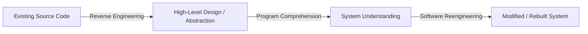
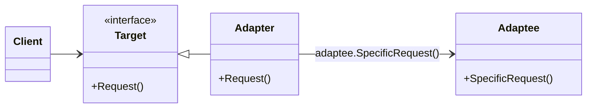
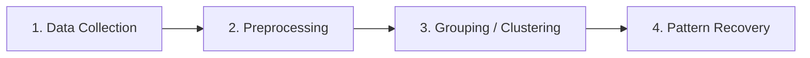
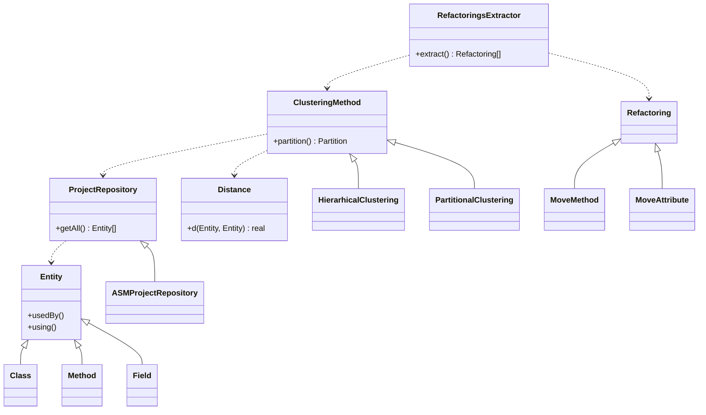

# CISE Course 3&4: Program Comprehension & Search-Based Software Engineering

---

## 3.1 Program Comprehension in Software Engineering

### Core Concepts & Definitions
* **Maintenance and Evolution**: Stages in the software lifecycle that account for approximately **66% of the total cost** of software development.
* **Program Comprehension** (also called *program understanding* or *source code comprehension*): The subfield of software engineering focused on how software engineers understand existing high-level source code. It studies the cognitive and technical processes required to facilitate reuse, inspection, maintenance, migration, and extension.
* **Reverse Engineering**: Analyzing a software system to create representations of it at a higher level of abstraction (going backward through the development cycle to recover design).
* **Software Reengineering**: Inspecting and modifying a software system to rebuild and reimplement it in a new form (e.g., adding functionality or fixing errors) after it has been reverse-engineered.



### Key Research Directions in Program Comprehension
* **Automatic Documentation Generation**: Creating natural language summaries of code. Traditional tools only describe *what* a method does; modern context-aware approaches analyze how methods are invoked to explain *why* a method exists and its role in the system.
* **Measuring Programming Experience**: Experience is a major confounding factor in comprehension experiments. Self-estimation has been validated through factor analysis as a reliable metric for controlling this variable.
* **Common Empirical Research Topics**:
  * Identifier and variable naming conventions (e.g., single-letter variables vs. meaningful names).
  * Bug and fault localization (using Information Retrieval, Deep Learning, and execution traces).
  * Code clone detection (in source code, binary code, and system tests).
  * API changes, developer information-seeking behavior, and IDE interactions.

### Search-Based Software Engineering (SBSE) for Comprehension
SBSE applies metaheuristics and machine learning to automate and optimize comprehension tasks:
1. **Concept Location**: Identifying specific sections of code that implement high-level domain concepts.
2. **Design Pattern Identification**: Detecting structural/behavioral patterns and hidden dependencies.
3. **Optimizing Source Code**: Applying code transformations, pretty printing (improving readability), and software visualization.
4. **Optimizing Designs**: Modularization (decomposing systems into components/packages), migrating procedural code to object-oriented structures, introducing design patterns, identifying refactorings, and aspect mining (Aspect-Oriented Programming).

### Tool Architecture Comparison
| Stage | General Program Comprehension Tool | SBSE Program Comprehension Tool |
| :--- | :--- | :--- |
| **1. Input** | Extract data (source code, stack/memory traces, UML) | Extract data (source code, stack/memory traces, UML) |
| **2. Processing** | Store, handle, and transform extracted data | Store and handle extracted data |
| **3. Analysis** | *N/A (Direct transformation)* | **Apply machine learning / search techniques** |
| **4. Output** | Visualize / generate results | Visualize / generate results |

---

## 3.2 Clustering Fundamentals

### Core Principles
* **Clustering (Unsupervised Classification)**: A data mining activity that partitions a set of objects into distinct, non-empty groups (**clusters**) based on relevant attributes.
* **Vector-Space Model**: Each object is represented as a $k$-dimensional vector based on $k$ measured attributes.
* **Distance and Similarity**:
  * **Distance ($d(O_i, O_j)$)**: Measures the **dissimilarity** between two objects using a metric or semi-metric function (e.g., Euclidean, Manhattan, Minkowski, or Hamming distance).
  * **Similarity**: Inversely proportional to distance:
    $$\text{Similarity}(O_i, O_j) = \frac{1}{\text{distance}(O_i, O_j)}$$
* **Quality Criteria**: A high-quality clustering method produces:
  * **High intra-cluster similarity** (objects within the same cluster are very similar).
  * **Low inter-cluster similarity** (objects in different clusters are very distinct).

### Taxonomy of Clustering Methods
* **Partitioning Algorithms**: Divide data into $k$ partitions and evaluate them by a criterion function (e.g., *K-Means*, *K-Medoids*).
* **Hierarchical Algorithms**: Create a tree-like decomposition of data, either bottom-up (*agglomerative*) or top-down (*divisive*).
* **Density-Based Methods**: Group objects based on connectivity and local density functions.
* **Grid-Based Methods**: Quantize the object space into a finite number of cells that form a multi-level granularity grid structure.
* **Model-Based Methods**: Hypothesize a mathematical model for each cluster and find the best fit of the data to the models.

---

## 3.3 Clustering Algorithms & Implementations

### Partitioning Methods: K-Means vs. K-Medoids (PAM)
Both algorithms partition $n$ objects into $k$ clusters ($k \le n$) iteratively and heuristically to minimize a squared-error criterion (works best with isolated, compact clusters).

| Feature | K-Means (MacQueen '67) | K-Medoids / PAM (Kaufman & Rousseeuw '87) |
| :--- | :--- | :--- |
| **Cluster Center** | **Centroid**: The calculated mean (average value) of all attribute vectors in the cluster. | **Medoid**: An actual, representative object existing within the cluster. |
| **Data Requirement** | Requires numerical coordinates to compute averages. | Only requires a distance metric between any two objects. |
| **Optimization** | Minimizes intra-cluster distance to the centroid. | Minimizes the sum of distances (cost) to the medoid by testing non-medoid replacements. |
| **Disadvantages** | 1. Sensitive to initial centroids (no guarantee of global optimum).<br>2. $k$ must be specified in advance. | Higher computational cost per iteration due to pairwise replacement checks. |

#### K-Means Algorithm Workflow
1. Select $k$ objects randomly as initial centroids.
2. Assign each object to the cluster with the closest centroid.
3. Recalculate each cluster's centroid as the mean vector of its assigned objects.
4. Repeat Steps 2–3 until the change in centroids is less than a threshold $\epsilon$.

#### K-Means Implementation
```java
import java.util.List;
/**
 * Implements the K-Means clustering algorithm to partition a set of objects.
 */
public class KMeansClusterer<ObjType ObjectWithFeature extends> {
    private DistanceMetric dist;
    /**
     * Constructs a KMeansClusterer with a specified distance metric.
     *
     * @param dist The metric used to calculate distance between objects and centroids.
     */
    public KMeansClusterer(DistanceMetric dist) {
        this.dist = dist;
    }
    /**
     * Partitions a list of objects into a specified number of clusters using K-Means.
     * Iteratively assigns objects to the closest centroid and updates centroids until convergence.
     *
     * @param objects    The list of objects to be clustered.
     * @param nrClusters The target number of clusters (k).
     * @param list       A listener to record intermediate partitioning states.
     * @return           The final converged partition of objects.
     */
    public Partition<ObjType> partition(List<ObjType> objects, int nrClusters, ClusteringListener<ObjType> list) {
        double epsilon = 0.001;
        List<? extends ObjectWithFeature> centroidsOld = KMedoids.pickRandomSeeds(nrClusters, objects);
        Partition<ObjType> part;
        double centroidDist;
        do {
            part = KMedoids.computePartition(centroidsOld, objects, dist);
            if (list != null) {
                list.intermediatePartition(part);
            }
            List<Centroid> centroidsNew = computeCentroids(part);
            centroidDist = computeDistance(centroidsOld, centroidsNew);
            centroidsOld = centroidsNew;
        } while (centroidDist > epsilon);
        return part;
    }
    /**
     * Computes the new centroids by averaging the feature attributes of objects in each cluster.
     *
     * @param part The current partition of objects.
     * @return     A list of newly computed centroids.
     */
    private List<Centroid> computeCentroids(Partition<ObjType> part) {
        // Implementation computes mean attribute values per cluster
        return part.calculateClusterMeans();
    }
    /**
     * Calculates the total shift distance between the previous centroids and the updated centroids.
     *
     * @param oldCentroids The centroids from the previous iteration.
     * @param newCentroids The newly calculated centroids.
     * @return             The numeric distance representing centroid movement.
     */
    private double computeDistance(List<? extends ObjectWithFeature> oldCentroids, List<Centroid> newCentroids) {
        return dist.calculateSetDistance(oldCentroids, newCentroids);
    }
}
```

#### K-Medoids (PAM) Implementation
```java
import java.util.ArrayList;
import java.util.List;
/**
 * Implements the Partitioning Around Medoids (PAM / K-Medoids) clustering algorithm.
 */
public class KMedoidsClusterer<T> {
    private DistanceMetric<T> dist;
    /**
     * Constructs a KMedoidsClusterer with a given distance metric.
     *
     * @param dist The distance metric used to evaluate dissimilarity between objects.
     */
    public KMedoidsClusterer(DistanceMetric<T> dist) {
        this.dist = dist;
    }
    /**
     * Partitions a list of objects into k clusters by iteratively swapping medoids with
     * non-medoids to minimize the total distance cost.
     *
     * @param objects    The dataset of objects to partition.
     * @param nrClusters The desired number of clusters (k).
     * @param list       A listener for notifying intermediate partition updates.
     * @return           The optimal partition found upon convergence.
     */
    public Partition<T> partition(List<T> objects, int nrClusters, ClusteringListener<T> list) {
        List<T> medoids = KMedoids.<T>pickRandomSeeds(nrClusters, objects);
        Partition<T> part = computePartition(medoids, objects, dist);
        double cost = computeCost(part, medoids);
        boolean changed = false;
        do {
            changed = false;
            List<T> medoidCopy = new ArrayList<T>(medoids);

            for (int i = 0; i < medoids.size(); i++) {
                Cluster<T> cl = part.get(i);
                for (int j = 0; j < cl.getNRObjs(); j++) {
                    medoidCopy.set(i, cl.get(j));
                    Partition<T> partAux = computePartition(medoidCopy, objects, dist);
                    double costAux = computeCost(partAux, medoidCopy);

                    if (costAux < cost) {
                        changed = true;
                        part = partAux;
                        cost = costAux;
                        medoids = new ArrayList<T>(medoidCopy);
                        notifyNewPartition(list, part);
                    }
                }
            }
        } while (changed);
        return part;
    }
    /**
     * Assigns each object in the dataset to the cluster of the closest medoid.
     *
     * @param medoids The current list of cluster medoids.
     * @param objects The objects to assign.
     * @param dist    The distance metric.
     * @return        A new partition of objects.
     */
    private Partition<T> computePartition(List<T> medoids, List<T> objects, DistanceMetric<T> dist) {
        return Partition.assignToClosest(medoids, objects, dist);
    }
    /**
     * Calculates the total cost of a partition as the sum of distances from all objects to their medoids.
     *
     * @param part    The partition to evaluate.
     * @param medoids The active medoids for the partition.
     * @return        The total distance cost.
     */
    private double computeCost(Partition<T> part, List<T> medoids) {
        return part.sumDistancesToCenters(medoids, dist);
    }
    /**
     * Notifies the clustering listener when an improved partition is found.
     *
     * @param list The listener instance.
     * @param part The updated partition.
     */
    private void notifyNewPartition(ClusteringListener<T> list, Partition<T> part) {
        if (list != null) {
            list.intermediatePartition(part);
        }
    }
}
```

---

### Hierarchical Clustering Algorithms
* **Agglomerative (Bottom-Up)**: Starts with each object in its own atomic cluster and iteratively merges the closest pair of clusters until a stop condition is reached or all objects are in a single cluster. (Most common approach; variants differ by inter-cluster linkage metrics such as *MAX Link* or *AVG Link*).
* **Divisive (Top-Down)**: Starts with all objects in a single cluster and iteratively splits clusters into smaller pieces. (Rarely used in practice).
* **Major Weaknesses**:
  1. **Poor Scalability**: Time complexity is at least $O(n^2)$, where $n$ is the number of objects.
  2. **Irreversibility**: Merge or split decisions cannot be undone in subsequent steps.

#### Hierarchical Agglomerative Implementation
```java
import java.util.List;
/**
 * Implements the Hierarchical Agglomerative Clustering (HAC) algorithm.
 */
public class HierarchicalAgglomerativeClusterer<T> {
    private StopCondition<T> stopC;
    private LinkageMetric<T> linkMetric;
    /**
     * Constructs an agglomerative clusterer with a stop criterion and linkage metric.
     *
     * @param stopC      The condition determining when to halt cluster merging.
     * @param linkMetric The metric used to calculate distance between two clusters.
     */
    public HierarchicalAgglomerativeClusterer(StopCondition<T> stopC, LinkageMetric<T> linkMetric) {
        this.stopC = stopC;
        this.linkMetric = linkMetric;
    }
    /**
     * Executes bottom-up hierarchical clustering on a list of objects.
     *
     * @param objects The initial objects, each starting in its own cluster.
     * @param list    A listener to track intermediate partitions.
     * @return        The final partition after the stop condition is met.
     */
    public Partition<T> partition(List<T> objects, ClusteringListener<T> list) {
        Partition<T> part = new Partition<T>(objects);
        boolean change = true;
        while (change) {
            hierarhicStep(part);
            if (stopC.isStopConditionReached(part)) {
                change = false;
            }
            if (list != null) {
                list.intermediatePartition(part);
            }
        }
        return part;
    }
    /**
     * Searches for the two closest clusters in the current partition and merges them into a single cluster.
     *
     * @param part The current partition to modify in place.
     */
    private void hierarhicStep(Partition<T> part) {
        int nrClusters = part.getNRClusters();
        if (nrClusters < 2) {
            return;
        }
        Cluster<T> minCl1 = part.get(0);
        Cluster<T> minCl2 = part.get(1);
        double dmin = linkMetric.metric(minCl1, minCl2);
        for (int i = 0; i < nrClusters - 1; i++) {
            Cluster<T> cl1 = part.get(i);
            for (int j = i + 1; j < nrClusters; j++) {
                double auxDist = linkMetric.metric(cl1, part.get(j));
                if (auxDist < dmin) {
                    dmin = auxDist;
                    minCl1 = cl1;
                    minCl2 = part.get(j);
                }
            }
        }
        Cluster<T> c = new Cluster<T>(minCl1, minCl2);
        part.delete(minCl1);
        part.delete(minCl2);
        part.add(c);
    }
}
```

---

## 3.4 Software Design Patterns (GoF)

* **Definition**: A general, reusable solution template to a commonly occurring problem within a specific software design context. Popularized in 1994 by the **Gang of Four (GoF)**: *Erich Gamma, Richard Helm, Ralph Johnson, and John Vlissides*.

### GoF Pattern Classification
| Category | Pattern | Core Intent / Mechanism |
| :--- | :--- | :--- |
| **Creational**<br>*(Object instantiation)* | **Abstract Factory** | Provides an interface for creating families of related objects without specifying concrete classes. |
| | **Builder** | Separates the construction of a complex object from its representation. |
| | **Factory Method** | Defines an interface for creating an object, but lets subclasses decide which class to instantiate. |
| | **Prototype** | Creates new objects by cloning an existing prototypical instance. |
| | **Singleton** | Ensures a class has only one instance and provides a global point of access to it. |
| **Structural**<br>*(Class & object composition)* | **Adapter (Wrapper)** | Converts the interface of an existing class (*Adaptee*) into another interface (*Target*) that clients expect. |
| | **Aggregate** | A version of the Composite pattern with methods for aggregating children. |
| | **Bridge** | Decouples an abstraction from its implementation so the two can vary independently. |
| | **Composite** | Composes objects into tree structures where individual objects and compositions share the same interface. |
| | **Decorator** | Dynamically attaches additional responsibilities to an object at runtime without exponential subclassing. |
| | **Proxy** | Provides a surrogate or placeholder class functioning as an interface to another object (e.g., Remote Proxy). |
| **Behavioral**<br>*(Communication & algorithms)* | **Strategy** | Encapsulates interchangeable algorithms and selects them on the fly using **composition**. |
| | **Template Method** | Defines the skeleton of an algorithm in a base class, deferring steps to subclasses via **inheritance**. |
| | **Visitor** | Separates an algorithm from the object structure on which it operates. |
| | **Observer** | Publish/Subscribe mechanism where objects register to be notified of events raised by another object. |

### Structural Focus: Adapter vs. Proxy

* **Adapter Example**: A `DrawingEditor` expects a `Shape` interface (`BoundingBox()`), but `TextView` only provides `GetExtent()`. `TextShape` (the *Adapter*) subclasses `Shape` and holds a reference to `TextView` (the *Adaptee*), translating `BoundingBox()` calls into `text->GetExtent()`.

---

## 3.5 Case Study 1: Design Pattern Identification via Clustering

### Problem Formulation
* An object-oriented software system $S$ is modeled as a set of classes.
* A design pattern $p$ is defined as a pair $p = (C_p, R_p)$:
  * $C_p \subset S$: The set of component classes participating in pattern $p$.
  * $R_p = \{r_1, r_2, \dots, r_{nr_p}\}$: The set of binary constraints (structural or behavioral relations) between classes in $C_p$.
* **Constraint Satisfaction Problem (CSP)**: Finding all combinations of $C_p$ classes in $S$ that satisfy all binary constraints in $R_p$.
* **Objective**: Reduce the brute-force worst-case time complexity of $O(n^{\vert{}C_p\vert{}})$ down to **$O(n^3)$** using preprocessing and hierarchical clustering (agglomerative or divisive).

### 4-Step Identification Methodology

1. **Data Collection**: Extract classes, methods, attributes, and their relationships from the system $S$.
2. **Preprocessing**: Filter out classes from $S$ that cannot possibly participate in pattern $p$.
3. **Grouping**: Apply hierarchical clustering to group candidate classes into clusters representing pattern instances and non-instances.
4. **Design Pattern Instances Recovery**: Filter the resulting clusters to retain only valid instances of pattern $p$.

### Dissimilarity (Distance) Metric

The distance $d(C_i, C_j)$ between two classes is determined by the number of binary constraints in $R_p$ that are **not satisfied** between $C_i$ and $C_j$:

$$
d(C_i, C_j) = 1 + \lvert \{ k \mid 1 \leq k \leq nr_p,\ \neg(C_i \, r_k^p \, C_j \lor C_j \, r_k^p \, C_i) \} \rvert
$$

*The smaller the distance $d$, the more likely $C_i$ and $C_j$ belong to the same instance of pattern $p$.*

### Formal Example: Proxy Pattern Representation
* **Pattern Definition**: $\text{proxy} = (C_{\text{proxy}}, R_{\text{proxy}})$
* **Classes**: $C_{\text{proxy}} = \{\text{Sbj}, \text{Prx}, \text{RSbj}\}$ (*Subject*, *Proxy*, *RealSubject*)
* **Binary Constraints**: $R_{\text{proxy}} = \{r_1, r_2, r_3\}$
  * $r_1(\text{Sbj}, \text{Prx})$: `Prx` extends `Sbj`.
  * $r_2(\text{Sbj}, \text{RSbj})$: `RSbj` extends `Sbj`.
  * $r_3(\text{Prx}, \text{RSbj})$: `Prx` delegates any method inherited from a common superclass $C$ (`Sbj`) to `RSbj`.

### Conclusions
* Worst-case complexity is reduced to **$O(n^3)$**.
* The method is **pattern-independent** and can detect both **structural and behavioral** patterns since constraints can model both static relationships and method delegations.

---

## 3.6 Case Study 2: Refactoring Identification via Clustering

### Refactoring Fundamentals (Martin Fowler)
* **Refactoring**: Changing a software system to improve its internal structure **without altering its external behavior**. It improves design, readability, bug detection, and development speed.
* **Software Decay**: The gradual deterioration of software structure and responsiveness over time due to continuous modifications (e.g., fixing one bug introduces several new ones). Refactoring is the exact reverse of software decay.
* **Technical Debt** (Ward Cunningham): The implied cost of additional rework caused by choosing a quick, limited solution now instead of a better design that takes longer. Quantified as the refactoring effort needed to add a feature non-invasively.
* **Common Code Bad Smells**:
  * *Duplicated Code*, *Long Method*, *Large Class*, *Long Parameter List*, *Divergent Change*, *Shotgun Surgery*, *Feature Envy*, *Data Clumps*, *Primitive Obsession*, *Switch Statements*.
* **Standard Refactoring Example (Fowler's Movie Rental)**:
  * **Goal**: Add `htmlStatement()` and flexible pricing rules.
  * **Steps**: `Extract Method` (`amountFor`) $\rightarrow$ `Move Method` (to `Rental.getCharge()`) $\rightarrow$ `Replace Temp with Query` $\rightarrow$ `Replace Conditional with Polymorphism` (introduce `Price` state hierarchy: `ChildrensPrice`, `RegularPrice`, `NewReleasePrice`).

---

### Clustering-Based Refactoring Identification
* **System Model**: A software system is a set of entities $S = \{s_1, s_2, \dots, s_n\}$, where each entity $s_i$ is a **class**, a **method**, or an **attribute**.
* **Methodology**:
  1. **Data Collection**: Extract entities and their usage relationships (`usedBy()`, `using()`) via a `ProjectRepository` (e.g., `ASMProjectRepository` using bytecode analysis).
  2. **Grouping**: Apply a partitional or hierarchical clustering algorithm (`HACClustering`, `KREDClustering`, `PAMREDClustering`) with a heuristic for initial medoids to find a more cohesive class structure.
  3. **Refactorings Extraction**: Compare the clustered partition against the current system structure to suggest refactorings: **Move Method**, **Move Attribute**, **Inline Class**, and **Extract Class**.



### Cohesion-Based Dissimilarity (Distance) Metric
Let $p(s_i)$ be the set of relevant properties (e.g., accessed attributes, called methods, associated classes) of entity $s_i$. The semi-metric distance $d(s_i, s_j)$ is based on the Jaccard dissimilarity of their property sets:

$$d(s_i, s_j) = \begin{cases} 1 - \dfrac{\vert{}p(s_i) \cap p(s_j)\vert{}}{\vert{}p(s_i) \cup p(s_j)\vert{}} & \text{if } p(s_i) \cap p(s_j) \neq \emptyset \\ \infty & \text{otherwise} \end{cases}$$

* **Interpretation**: Measures **cohesion**. Low distance ($d \to 0$) indicates high cohesion (entities share many properties and belong in the same class); high distance ($d \to 1$ or $\infty$) indicates low cohesion.

### Empirical Case Studies & Results
| System Analyzed | System Characteristics | Clustering / Refactoring Results |
| :--- | :--- | :--- |
| **JHotDraw v5.1** | Open-source GUI framework renowned for clean design and extensive use of design patterns. | The algorithm produced an **identical structure** to the existing design (0 refactorings needed, validating accuracy). |
| **Medical PACS Subsystem** | Real-world DICOM and HL7-compliant radiological imaging system (1,015 classes, 8,639 methods, 4,457 attributes). | Suggested **84 refactorings** (76 *Move Method*, 6 *Move Attribute*, 1 *Inline Class*):<br>• **25 Accepted** by developers<br>• **18 Acceptable**<br>• **41 Rejected** |

---

## 3.7 Techniques for Extracting Information from Source Code

To populate models for program comprehension and clustering, tools extract static and dynamic data using five primary techniques:

1. **Textual Search & Regular Expressions**: Fast, lightweight pattern matching directly on raw source files; ignores deeper syntactic structure.
2. **Source Code Parser**: Builds an Abstract Syntax Tree (AST) to extract exact syntactic and semantic relationships from source files.
3. **Introspection (Reflection)**: Examines type metadata, classes, methods, and fields dynamically at runtime.
4. **Instrumentation**: Injects monitoring code (probes) into source code or bytecode to collect dynamic execution traces and memory profiles.
5. **Bytecode Analysis**: Parses compiled intermediate code (e.g., Java `.class` files via ASM) to extract structural dependencies and method calls without requiring original source code.
