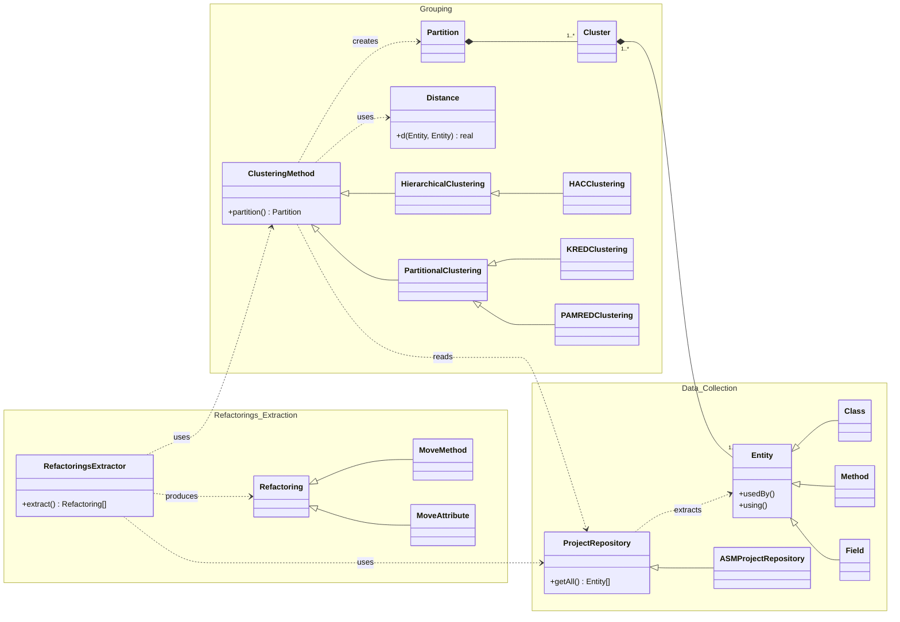
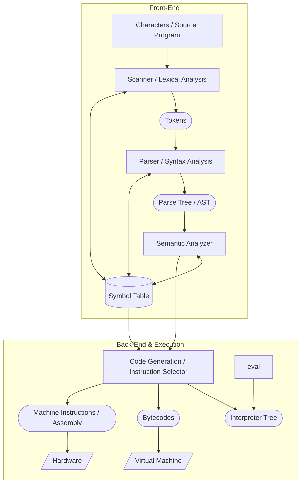
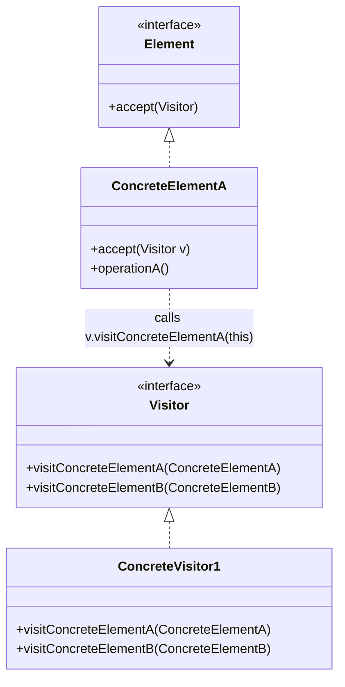
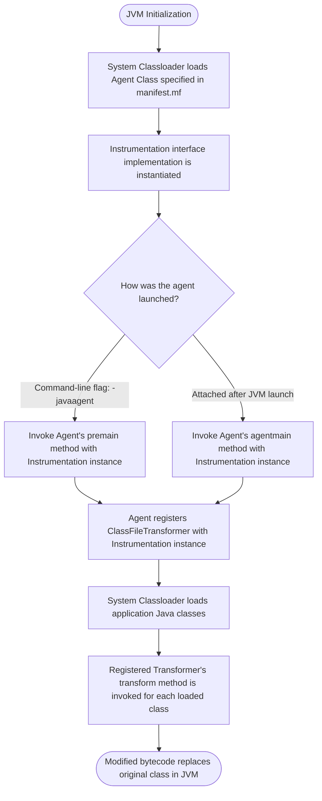
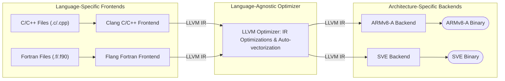
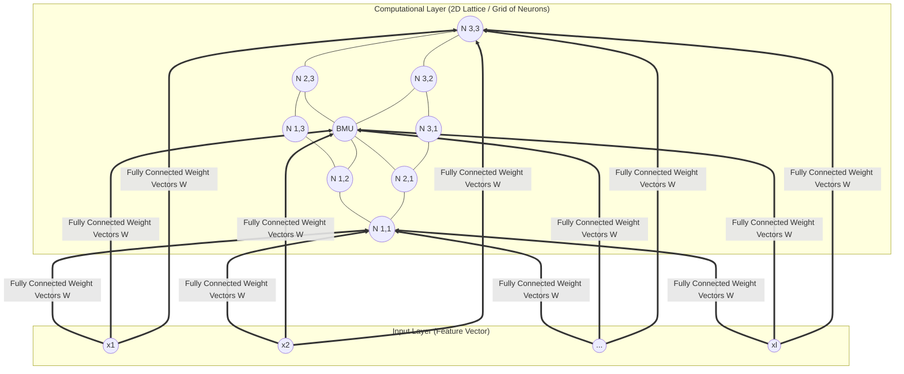

# CISE Course 5-6

## 1. Overview & Context: Refactoring Identification via Clustering

This module builds upon **Program Comprehension** and **Search-Based Software Engineering (SBSE)** by focusing on two core themes:
1. **Data Extraction:** Gathering static and dynamic information from source code repositories, source code, bytecode, and runtime environments.
2. **Self-Organizing Maps (SOM):** Applying unsupervised neural networks to cluster and restructure software systems.

### Refactoring Architecture Overview
To identify refactorings (such as moving misplaced methods or attributes), a software analysis system is divided into three main subsystems:



* **Data Collection:** Extracts software **Entities** (`Class`, `Method`, `Field`) and their usage relationships (`usedBy()`, `using()`) via a `ProjectRepository` (e.g., `ASMProjectRepository` using bytecode).
* **Grouping:** Uses a `ClusteringMethod` and a `Distance` metric $d(\text{Entity}, \text{Entity}) \to \text{real}$ to group entities into a `Partition` of `Clusters`. Includes **Hierarchical** (`HACClustering`) and **Partitional** (`KREDClustering`, `PAMREDClustering`) approaches.
* **Refactorings Extraction:** `RefactoringsExtractor` compares the clustered partition against the actual code structure to suggest `Refactoring` actions (`MoveMethod`, `MoveAttribute`).

---

## 2. Extracting Data from Source Code Repositories

A **Source Code Repository** (version control, revision control, or source control) is a software application that manages changes to software artifacts (source code, documentation, images, etc.).

### 4 Methods for Repository Data Extraction

| Method | Description | Examples / Tools |
| :--- | :--- | :--- |
| **1. Command-Line Tools / Batch Files** | Run shell scripts or CLI commands to pull history and structure. | **Git CLI:**<br>• `git clone <repo>`: Copy remote repo locally.<br>• `git branch -r`: List remote branches.<br>• `git log`: Print commit history. |
| **2. REST APIs** | Query hosted repository web services over HTTP. | **GitHub REST API** (`docs.github.com/en/rest`) |
| **3. Programmatic APIs** | Use language-specific client libraries to traverse repository trees and commits directly in code. | **SVNKit** for Apache Subversion (SVN). Connects via `SVNRepositoryFactory`, authenticates, and recursively iterates `SVNDirEntry` nodes. |
| **4. Client Applications** | Use existing GUI or web clients to inspect repository metadata. | **Bitbucket**, GitHub Web UI, GitKraken. |

---

## 3. Extracting Data from Source Code, Bytecode, & Runtime

### Compilation & Execution Pipeline
Understanding how source code becomes an executing program determines where and how data can be extracted.



* **Lexical Analysis (Scanner):** Reads raw source characters and groups them into **tokens** (keywords, identifiers, operators).
* **Syntax Analysis (Parser):** Checks token sequences against a formal grammar to build a **Parse Tree** or **Abstract Syntax Tree (AST)** (a tree representation of the code's structure).
* **Semantic Analysis:** Checks meaning and rules (e.g., type checking, variable declaration scope) using the **Symbol Table** (a data structure storing identifier metadata).
* **Back-End:** Translates the AST/Intermediate Representation into **Bytecode** (for a Virtual Machine like the JVM), **Machine Instructions / Assembly** (via Instruction Selector, Register Allocator, and Assembly Emitter for physical hardware), or an **Interpreter Tree**.

---

### Comparison of Code Extraction Techniques

| Technique | Mechanism | Pros | Cons / Limitations |
| :--- | :--- | :--- | :--- |
| **Textual Search / Regex** | Pattern matching on raw text files. | Fast, language-agnostic, easy to write. | Hard to extract semantic info (e.g., inheritance, method usage, type resolution). |
| **Source Code Parser** | Uses formal grammars to build an AST. | Captures complete syntactic structure. | Requires source code and language-specific grammar. |
| **Introspection (Reflection)** | Inspects class metadata (methods, fields, parameters) at runtime. | Built into many modern languages. | Not supported by all languages; shallow visibility (cannot inspect inside method bodies). |
| **Bytecode Analysis** | Parses compiled virtual machine instructions (e.g., Java `.class` or .NET IL). | **No source code needed**; provides deep instruction-level and dependency data. | Restricted to VM-based languages (Java, C#/.NET). |
| **Instrumentation** | Injects extra monitoring code (via macros, compiler hooks, or bytecode modification). | Captures dynamic runtime behavior (execution paths, profiling). | Adds runtime overhead; modifies program binaries. |

---

### Deep Dive 1: Source Code Parsers (ANTLR & Eclipse JDT)

* **ANTLR (ANother Tool for Language Recognition):** A parser generator that reads a grammar file (`.g4`) and generates lexers, parsers, and AST tree parsers for languages like C/C++, Java, Python, etc.
  * *Minimal Grammar Example (`Hello.g4`):*
    ```antlr
    grammar Hello;
    r  : 'hello' ID ;         // Rule: match keyword 'hello' followed by an ID
    ID : [a-z]+ ;             // Token: match lower-case identifiers
    WS : [ \t\r\n]+ -> skip ; // Token: skip whitespace
    ```
* **Eclipse JDT (`ASTParser`):** An existing Java parser (`org.eclipse.jdt.core.dom.ASTParser`) that converts a `char[]` source string directly into a manipulable `CompilationUnit` AST root node.

---

### Deep Dive 2: Bytecode Analysis with the ASM Framework

**ASM** (`asm.ow2.org`) is a Java bytecode manipulation and analysis framework used when reflection is insufficient.
* **Capabilities:** Performs static analysis at the instruction level; extracts dependencies, method calls, fields, and annotations directly from `.class` bytecode without needing source code.
* **Architecture:** Uses the **Visitor Design Pattern**.



* **Visitor Pattern in ASM:** Instead of loading an entire AST into memory, ASM parses a class file sequentially and triggers events on custom visitor classes (`ClassVisitor`, `FieldVisitor`, `MethodVisitor`, `AnnotationVisitor`).

#### Complete ASM Analyzer Implementation
```java
package asm.analysis;

import org.objectweb.asm.ClassVisitor;
import org.objectweb.asm.FieldVisitor;
import org.objectweb.asm.MethodVisitor;
import org.objectweb.asm.Opcodes;

/**
 * Collects structural information (classes, fields, and methods) from Java bytecode
 * by implementing the ASM ClassVisitor interface.
 */
public class ClassInfoCollector extends ClassVisitor {
    public static int allClasses = 0;
    public static int nrMethVisited = 0;
    
    private MClass currentClass;
    private InfoContainer infC;

    /**
     * Initializes the ClassInfoCollector with an ASM API version and data container.
     */
    public ClassInfoCollector(InfoContainer infC) {
        super(Opcodes.ASM9);
        this.infC = infC;
    }

    /**
     * Visits the header of the class. Filters out inner classes (containing '$')
     * and registers valid application classes in the repository container.
     */
    @Override
    public void visit(int version, int access, String name, String signature,
                      String superName, String[] interfaces) {
        if (name.contains("$")) {
            currentClass = null; // Inner classes are ignored
            return;
        }
        allClasses++;
        currentClass = infC.getCreateMClass(name, superName);
    }

    /**
     * Visits a field declaration of the class and registers its metadata
     * (name, type descriptor, and access flags) to the current class entity.
     */
    @Override
    public FieldVisitor visitField(int access, String name, String desc,
                                   String signature, Object value) {
        if (currentClass == null) {
            return null;
        }
        currentClass.addCreateField(name, desc, access);
        return null;
    }

    /**
     * Visits a method declaration of the class. Ignores default constructors ("<init>")
     * and entry-point "main" methods. Returns a MethodVisitor to inspect instructions
     * inside valid application methods.
     */
    @Override
    public MethodVisitor visitMethod(int access, String name, String desc,
                                     String signature, String[] exceptions) {
        nrMethVisited++;
        if (currentClass == null) {
            return null;
        }
        if (name.equals("<init>")) {
            return null; // Default constructors are skipped
        }
        if (name.equals("main") && desc.equals("([Ljava/lang/String;)V")) {
            currentClass = null; // Classes containing main entry points are skipped
            return null;
        }
        MMethod meth = currentClass.addCreateMethod(name, desc, access);
        return new MethodInfoCollector(infC, meth);
    }
}
```

---

### Deep Dive 3: Java Runtime Instrumentation (`java.lang.instrument`)

**Java Instrumentation** modifies method bytecodes at runtime on the JVM to monitor or profile execution.

#### Key Components
1. **Agent JAR:** A packaged `.jar` file containing the Agent and Transformer classes.
2. **Manifest (`manifest.mf`):** Defines the `Premain-Class` (or `Agent-Main-Class`) property.
3. **Agent Class:** Implements a `premain` method (executed before the application's `main` method) or `agentmain` (attached after JVM launch):
   * `public static void premain(String agentArgs, Instrumentation inst);`
   * `public static void premain(String agentArgs);`
4. **Transformer:** A class implementing `ClassFileTransformer` (`transform()` method) registered with the `Instrumentation` instance. It intercepts and modifies every class loaded by the system classloader.
5. **CLI Launch Flag:** `-javaagent:jarpath[=options]`



---

### Deep Dive 4: Assembly & Intermediate Representation (LLVM)

Compilers can emit low-level assembly or language-agnostic Intermediate Representations (IR) for analysis:
* **Compiler Explorer (`godbolt.org`):** Interactive tool to inspect assembly generated across different compilers and flags.
* **GCC Assembly Generation:** `g++ -S foo.cpp` (produces target assembly file).
* **Clang LLVM IR Generation:** `clang -emit-llvm foo.cpp` (produces LLVM IR).

#### LLVM Architecture
**LLVM** is a modular compiler and toolchain technology supporting static and Just-In-Time (JIT) compilation.



* **LLVM IR (Intermediate Representation):** The universal glue between frontends (C, C++, Rust, Swift, Python, Go, C#, Fortran) and hardware backends (x86, ARM, etc.), making it ideal for cross-language static analysis and optimization.

---

## 4. Self-Organizing Maps (SOM)

### Core Concepts & Definitions
* **Self-Organizing Map (SOM) / Kohonen Map / Self-Organizing Feature Map (SOFM):** An artificial neural network trained using **unsupervised, competitive learning** to map a high-dimensional input space onto a low-dimensional (typically 2D) discretized grid of neurons called a **map**.
* **Vector Space Model:** Each input object is represented as an $l$-dimensional feature vector: $x = (x_1, x_2, \dots, x_l)$.
* **Topology Preservation:** Unlike standard neural networks, SOM uses a **neighborhood function** so that data points close to each other in the high-dimensional input space are mapped to nearby neurons on the 2D grid.
* **Primary Use Cases:**
  1. **Dimensionality Reduction & Visualization** of high-dimensional data.
  2. **Clustering** (grouping similar instances without labels).
  3. **Classification** (if training instances are labeled, new instances take the label of the closest training instance mapped to their winning neuron).

### SOM Network Architecture



* **Input Layer:** Represents the $l$-dimensional input feature vector.
* **Computational Layer (Map Space):** A 2D lattice of **neurons (nodes)**. Arranged as a **rectangular grid**, **hexagonal grid**, or **toroidal grid** (where opposite edges wrap around and connect).
* **Weight Vector:** Every neuron in the computational layer is fully connected to all nodes in the input layer and holds a weight vector $W = (w_1, w_2, \dots, w_l)$ of the **exact same dimension** as the input vectors, plus a fixed $(x, y)$ coordinate on the 2D grid.

---

### SOM Training: The Kohonen Algorithm

SOM training is unsupervised (no target outputs) and alternates between two core operational phases over $N$ iterations:
1. **Similarity Matching Phase (Competitive Step):** Compute the distance between the input vector and every neuron's weight vector. The neuron with the **minimum distance** wins and is declared the **Best Matching Unit (BMU)**.
2. **Weight Adaptation Phase (Cooperative Step):** Update the weight vector of the BMU and the weight vectors of all neurons within a diminishing **topological neighborhood radius** around the BMU, pulling them closer to the input vector.

#### Step-by-Step Training Algorithm & Formulas
1. **Initialize** each neuron's weight vector (typically with small random values).
2. **Sample:** Pick an input vector $x$ at random from the training dataset.
3. **Find the BMU:** Calculate the distance (e.g., Euclidean distance) between $x$ and all neurons; select the neuron with the smallest distance:
   $$\text{BMU} = \arg\min_{j} \Vert{} x - W_j \Vert{}$$
4. **Decay Neighborhood Radius & Learning Rate:** Both the neighborhood radius $\sigma(t)$ and learning rate $\eta(t)$ start large (e.g., $\sigma_0$ equals the lattice radius) and decay exponentially over iteration $t \in [0, T]$ using the time constant $\lambda$:
   $$\lambda = \frac{T}{\ln(\sigma_0)}$$
   $$\sigma(t) = \sigma_0 \cdot \exp\left(-\frac{t}{\lambda}\right)$$
   $$\eta(t) = \eta_0 \cdot \exp\left(-\frac{t}{\lambda}\right)$$
5. **Adapt Weights:** Adjust the weights of the BMU and all neighboring neurons within radius $\sigma(t)$. The closer a neighbor is to the BMU, the stronger its weights are adjusted toward $x$.
6. **Repeat** from Step 2 for $T$ (`nrIteration`) iterations. Over time, a tangled random grid unfolds into a smooth, topology-preserving mesh.

---

#### Complete SOM Training Implementation
```java
package som.core;

import java.util.List;

/**
 * Implements the Kohonen Self-Organizing Map (SOM) training algorithm.
 * Manages exponential decay of hyperparameters, BMU search, and neighborhood adaptation.
 */
public class SOMTrainer {
    private ComputationLayer computationL;
    private DistanceMetric dist;

    /**
     * Initializes the SOMTrainer with a neuron lattice and a distance metric.
     */
    public SOMTrainer(ComputationLayer computationL, DistanceMetric dist) {
        this.computationL = computationL;
        this.dist = dist;
    }

    /**
     * Executes the main SOM training loop over a specified number of iterations.
     * Computes decaying learning rate and neighborhood radius at each epoch.
     */
    public void train(int nrIteration, SOMTrainData trData,
                      double startLearningRate, double startNeighborRadius,
                      SOMTrainingListener l, SOMTrainInputChooser inputChooser) {
        
        double lambdaTimeConstant = nrIteration / Math.log(startNeighborRadius);

        for (int iteration = 0; iteration < nrIteration; iteration++) {
            // Calculate exponentially decaying learning rate and neighborhood radius
            double learningRate = startLearningRate 
                    * Math.exp(-(double) iteration / lambdaTimeConstant);
            double neighborRadius = startNeighborRadius 
                    * Math.exp(-(double) iteration / lambdaTimeConstant);

            // Select training input vectors for the current iteration
            int[] inputIndexes = inputChooser.getNextInputIndex();
            for (int i = 0; i < inputIndexes.length; i++) {
                int inputIndex = inputIndexes[i];
                trainingStep2(iteration, trData.get(inputIndex), learningRate,
                        neighborRadius, l, trData.getLabel(inputIndex));
            }
        }
    }

    /**
     * Performs a single competitive and cooperative step for a given input vector:
     * locates the BMU, adapts the BMU weights, and updates all neurons within the radius.
     */
    public void trainingStep2(int curIter, double[] input, double learningRate,
                              double neighborRadius, SOMTrainingListener l, Object lbl) {
        // Phase 1: Similarity matching - locate the Best Matching Unit (BMU)
        BMU bmu = computeBestMatchingUnit(input);

        // Phase 2: Weight adaptation - adjust BMU weights toward the input vector
        bmu.getNeuron().adjustWeights(input, learningRate, l);

        // Retrieve neighboring neurons within the current topological radius
        List<NeighborSOMNeuron> neighbors = computationL.getNeighbors(
                bmu.getNeuron(), neighborRadius);

        // Adjust neighbor weights proportionally to their proximity to the BMU
        if (neighbors != null && neighbors.size() > 0) {
            updateNeighbors(input, learningRate, neighborRadius, neighbors);
        }
    }

    /**
     * Iterates through all neurons in the computational layer to find the neuron
     * whose weight vector has the minimum distance to the given input vector.
     */
    public BMU computeBestMatchingUnit(double[] input) {
        int nrNeurons = computationL.getNrNeurons();
        SOMNeuron bmuN = computationL.getNeuron(0);
        double minDist = dist.distance(input, bmuN.getWeights());

        for (int i = 1; i < nrNeurons; i++) {
            SOMNeuron neuron = computationL.getNeuron(i);
            double d = dist.distance(input, neuron.getWeights());
            if (d < minDist) {
                minDist = d;
                bmuN = neuron;
            }
        }
        return new BMU(bmuN, minDist, input);
    }

    /**
     * Updates the weight vectors of all neighboring neurons within the active radius.
     */
    private void updateNeighbors(double[] input, double learningRate,
                                 double neighborRadius, List<NeighborSOMNeuron> neighbors) {
        for (NeighborSOMNeuron neighbor : neighbors) {
            neighbor.getNeuron().adjustNeighborWeights(
                    input, learningRate, neighborRadius, neighbor.getDistance());
        }
    }
}
```

---

### Visualizing & Interpreting SOM: The U-Matrix

A trained SOM can be inspected via:
1. **Topology & BMU Mapping:** Plotting the 2D grid and marking which neuron is the BMU for each input instance.
2. **Weight Projection:** Plotting neuron weight vectors in 2D/3D space to observe mesh unfolding over training iterations.
3. **U-Matrix (Unified Distance Matrix):**
   * **Definition:** The U-Matrix value of a neuron is the **average distance between that neuron's weight vector and the weight vectors of its immediate topological neighbors** (e.g., the closest 4 or 8 neighbors in a rectangular grid, or 6 in a hexagonal grid).
   * **Landscape Interpretation:** Displayed as a heightmap or grayscale/color grid to define cluster boundaries:

| U-Matrix Feature | Visual Appearance (Grayscale) | Meaning / Interpretation |
| :--- | :--- | :--- |
| **Valleys (Low Altitude)** | **Dark / Black regions** | Neurons have very small weight distances to neighbors $\implies$ **Homogeneous clusters** of highly similar input vectors. |
| **Ridges / Peaks (High Altitude)** | **Bright / White lines** | Large weight distances between adjacent neurons $\implies$ **Cluster boundaries** separating dissimilar groups of data. |

---

## 5. Software Restructuring Using SOM

### Vector Space Model for Software Entities

To restructure a software system $S$ using a SOM, we first extract all classes $\text{Class}(S)$, methods $\text{Meth}(S)$, attributes $\text{Attr}(S)$, and their relationships (inheritance, composition, usage/dependency).

#### 1. Entity Property Set $p(e)$
For any software entity $e \in S$, its related entity set $p(e)$ is defined based on its type:

| Entity Type | Definition of Related Set $p(e)$ |
| :--- | :--- |
| **Attribute** $e \in \text{Attr}(S)$ | $\{e\} \cup \{\text{class where } e \text{ is defined}\} \cup \{\text{all methods in } \text{Meth}(S) \text{ that access } e\}$ |
| **Method** $e \in \text{Meth}(S)$ | $\{e\} \cup \{\text{class where } e \text{ is defined}\} \cup \{\text{attributes in } \text{Attr}(S) \text{ accessed by } e\} \cup \{\text{methods in } S \text{ called/used by } e\} \cup \{\text{methods in } S \text{ that override } e\}$ |
| **Class** $e \in \text{Class}(S)$ | $\{e\} \cup \{\text{all attributes and methods defined in } e\} \cup \{\text{interfaces implemented by } e\} \cup \{\text{classes extended by } e\}$ |

#### 2. Feature Vector Construction (Jaccard Similarity Coefficient)
Assume the system has $n$ total entities $\{s_1, s_2, \dots, s_n\}$ and $l$ application classes $\{C_1, C_2, \dots, C_l\}$.
Each entity $s_i$ ($1 \le i \le n$) is represented by an $l$-dimensional feature vector $(s_{i1}, s_{i2}, \dots, s_{il})$, where coordinate $s_{ij}$ ($1 \le j \le l$) measures the coupling between entity $s_i$ and class $C_j$:

$$s_{ij} = \begin{cases} \dfrac{\vert{}p(s_i) \cap p(C_j)\vert{}}{\vert{}p(s_i) \cup p(C_j)\vert{}} & \text{if } p(s_i) \cap p(C_j) \neq \emptyset \\ 0 & \text{otherwise} \end{cases}$$

---

### Worked Example: `Class_A` and `Class_B`

Consider a system with $l = 2$ classes (`Class_A`, `Class_B`):

```java
public class Class_A {
    public static int attributeA1;
    public static int attributeA2;
    public static void methodA1() { methodA2(); }
    public static void methodA2() { attributeA2 = 0; Class_A.attributeA1 = 12; }
    public static void methodA3() { attributeA2 = 0; methodA1(); methodA2(); }
}

public class Class_B {
    private static int attributeB1;
    private static int attributeB2;
    public static void methodB1() { attributeB1 = 0; Class_A.methodA1(); }
    public static void methodB2() { attributeB1 = 0; attributeB2 = 0; Class_A.attributeA1 = 12; }
    public static void methodB3() { attributeB1 = 0; methodB1(); methodB2(); Class_A.attributeA1 = 12; }
    public static void methodB4() { attributeB1 = 0; methodB2(); Class_A.attributeA1 = 12; }
}
```

#### Step 1: Compute $p(e)$ for Classes and Sample Entities
* $p(\text{Class\_A}) = \{\text{Class\_A}, \text{attributeA1}, \text{attributeA2}, \text{methodA1}, \text{methodA2}, \text{methodA3}\}$ (Size = 6)
* $p(\text{Class\_B}) = \{\text{Class\_B}, \text{attributeB1}, \text{attributeB2}, \text{methodB1}, \text{methodB2}, \text{methodB3}, \text{methodB4}\}$ (Size = 7)
* **Notice `attributeA1`:** Defined in `Class_A`, accessed by `methodA2`, `methodB2`, `methodB3`, `methodB4`.
  * $p(\text{attributeA1}) = \{\text{attributeA1}, \text{Class\_A}, \text{methodA2}, \text{methodB2}, \text{methodB3}, \text{methodB4}\}$ (Size = 6)

#### Step 2: Compute Feature Vector for `attributeA1`
* **Similarity with `Class_A` ($s_{\text{attrA1}, A}$):**
  * $p(\text{attributeA1}) \cap p(\text{Class\_A}) = \{\text{attributeA1}, \text{Class\_A}, \text{methodA2}\}$ (Size = 3)
  * $p(\text{attributeA1}) \cup p(\text{Class\_A})$ has $6 + 6 - 3 = 9$ elements.
  * $s_{\text{attrA1}, A} = \frac{3}{9} = 0.333$
* **Similarity with `Class_B` ($s_{\text{attrA1}, B}$):**
  * $p(\text{attributeA1}) \cap p(\text{Class\_B}) = \{\text{methodB2}, \text{methodB3}, \text{methodB4}\}$ (Size = 3)
  * $p(\text{attributeA1}) \cup p(\text{Class\_B})$ has 6 + 7 - 3 = 10 elements.
  * $s_{\text{attrA1}, B} = \frac{3}{10} = 0.300$
* **Result:** Vector for `attributeA1` is $(0.333, 0.300)$. When all entities are trained on a hexagonal SOM and segmented via the U-Matrix, the map separates into two distinct clusters (Red for `Class_A` entities, Green for `Class_B` entities), visually exposing entities that sit near cluster boundaries or belong in the opposite class (candidates for **Move Method** or **Move Attribute** refactoring).

---

### Architectural & Package Restructuring Applications

Beyond class-level refactoring (as demonstrated on large systems like **JHotDraw**), SOM clustering supports macro-level architectural restructuring:

1. **Package Restructuring:** Grouping strongly coupled classes into cohesive packages based on SOM U-Matrix valleys.
2. **Monolith to Microservices Migration:** Identifying isolated valleys in the U-Matrix to decompose a monolithic codebase into independent microservice boundaries.
3. **Language-Level Modularization:**
   * **Java 9+ (JPMS - Java Platform Module System):** Restructuring legacy applications into explicit `module-info.java` modules.
   * **C++20 Modules:** Grouping declarations and definitions across translation units into cohesive C++20 module units.

