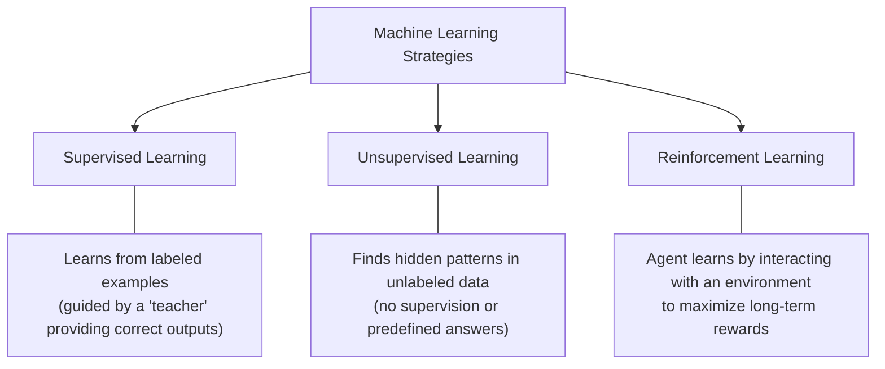
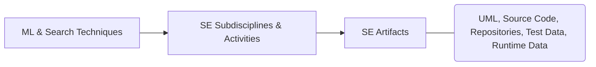
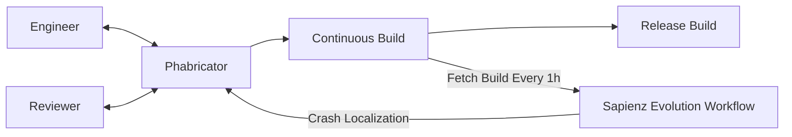
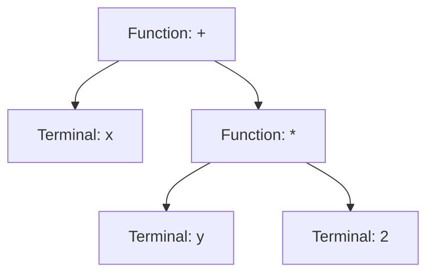
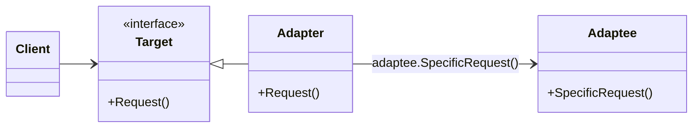
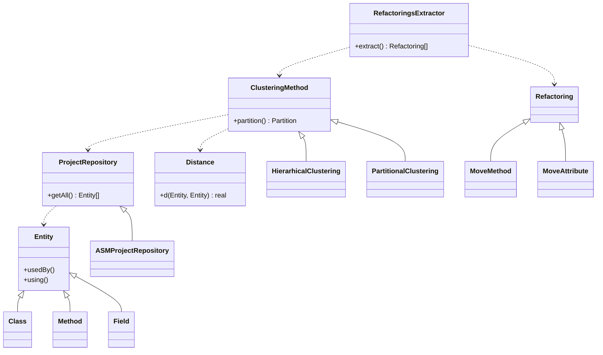

# Course 1 - Computational Intelligence in Software Engineering

## 1.1 Course Overview & Administration

### 1.1.1 Core Definitions
* **Computational Intelligence (CI):** A branch of artificial intelligence that uses nature-inspired computing methods (like machine learning and search algorithms) to solve complex problems where traditional math or logic is too slow or strict.
* **Software Engineering (SE):** The systematic, disciplined, and measurable approach to building, running, and maintaining software programs.
* **Search-Based Software Engineering (SBSE):** A field that reformulates software engineering tasks into search problems. Instead of writing exact rules to solve a problem, SBSE searches through many possible options to find a good solution.

### 1.1.2 Course Objectives & Competencies
* **Objectives:** Introduce SBSE, demonstrate why CI is needed for SE problems, and show how key SE tasks are solved using CI.
* **Professional Competencies:** Understand CI concepts/models, grasp SBSE principles, and conduct beginner-level original research in SBSE.
* **Transversal Competencies:** Apply CI to SE problems, complete lab and research reports responsibly, follow rigorous work rules, and respect ethical/scientific principles.

### 1.1.3 Course Topics
1. Search-Based Software Engineering (SBSE)
2. Machine Learning in Software Engineering
3. Program Comprehension (understanding how existing code works)
4. Refactoring (improving code structure without changing its behavior)
5. Defect Detection and Prediction (finding and forecasting software bugs)
6. Software Testing
7. Software Visualization
8. Effort Prediction and Cost Estimation
9. Software Reuse
10. Design Patterns Identification (finding standard reusable solutions in code)
11. Research Reports Presentation

### 1.1.4 Grading & Assessment Structure

| Component | Weight | Details & Deadlines | Retake Session Rules |
| :--- | :--- | :--- | :--- |
| **Class Attendance** | 10% | Weekly participation (Course: 2h/week, Lab: 1h/week). | Cannot be improved. |
| **Theoretical Research Report** | 30% | Written paper (~4 pages), oral presentation, and 1-page outline. Topic: ML/SBSE in SE. **Title due: Week 7**. **Presentations: Weeks 10–12**. | Can be improved up to a **maximum grade of 8** (written only; no oral presentation allowed). |
| **Laboratory Projects** | 30% | **Lab 1 (30% of Lab grade):** Due **Week 4**.<br>**Lab 2 (70% of Lab grade):** Due **Week 8**. | Cannot be improved. |
| **Final Exam** | 30% | Written paper during the regular exam session. | Can be improved. |

$$\text{Final Grade} = 0.10(\text{Attendance}) + 0.30(\text{Report}) + 0.30(0.30 \cdot \text{Lab}_1 + 0.70 \cdot \text{Lab}_2) + 0.30(\text{Exam})$$

---

## 1.2 Lab & Research Requirements

### 1.2.1 Theoretical Research Report Structure
A 4-page paper analyzing recent research on applying machine learning or search techniques to software development:
* **Suggestive Title:** Must clearly match the content.
* **Abstract:** Summary of the paper (~10 lines).
* **Introduction:** Explains the main purpose of the paper.
* **Context Section:** Connects the specific topic to the broader field of SE/CI.
* **Main Sections:** Core theoretical considerations, plus **advantages and disadvantages** of the chosen approach (must include personal opinions).
* **Concluding Remarks & Further Work:** Summary of findings and future directions.
* **Bibliography:** 5 to 10 complete, properly formatted references. Every listed item must be cited directly in the text.

### 1.2.2 Lab Project 1 (Due Week 4)
* **Part A (ML Framework):** Install an open-source Machine Learning (ML) framework (e.g., TensorFlow, PyTorch, Scikit-learn). Pick an existing public dataset (e.g., Kaggle, UCI Repository) or collect your own. Implement one ML technique:
  * Decision tree learning, Association rule learning, Artificial neural networks, Self-organizing maps, Clustering, Reinforcement learning, Bayesian networks, Support vector machines, or Genetic algorithms.
* **Part B (Rule-Based Baseline):** Solve the exact same problem in any programming language using simple branching logic (`if` or `case` statements).
  * **Constraint:** You may use **no more than $n$ `if` or `case` statements**, where $n$ is the number of **attributes** (features or data columns) in the dataset.
  * **Goal:** Match or beat the performance of the ML model from Part A.
* **Evaluation:** Compare both parts using standard evaluation metrics:
  * **Accuracy:** The percentage of total predictions the model got right.
  * **Precision:** Out of all items the model predicted as positive, how many were actually positive.
  * **Recall:** Out of all actual positive items in the data, how many the model successfully found.

### 1.2.3 Lab Project 2 (Due Week 8)
Apply a machine learning technique to automate, support, or enhance a real-world SE task (e.g., code review, bug detection, feature prediction, test case generation).


1. **Data Collection:** Gather representative training data from dev logs, user feedback, or system metrics.
2. **ML Approach:** Select supervised, unsupervised, or reinforcement learning based on the data and task.
3. **Implementation:** Preprocess data (clean and format it), train the model, and evaluate it. Document all choices.
4. **Validation:** Test the model on real-world examples, in a live development environment, or with real users to gather feedback.
5. **Reporting:** Document the problem overview, data collection method, ML implementation details, validation results/user feedback, and future improvements.

---

## 1.3 Software Engineering Research Papers (Mary Shaw's Framework)

A good research paper explains **what** was accomplished, **how** it was done, and **why** the reader should care. To get published, the result must be an interesting, sound, and significant contribution to SE knowledge.

### 1.3.1 Core Questions Every Paper Must Answer

1. **What, precisely, was your contribution?**
* What question did you answer? Why should the reader care? What larger question does this address?


2. **What is your new result?**
* What new, reusable knowledge did you contribute? What prior work do you build on or replace? How is your result different and better than previous work? What, in detail, is the result?


3. **Why should the reader believe your result?**
* What standard should be used to judge your claim? What concrete evidence proves your result meets that claim?


### 1.3.2 Types of SE Research Questions & ICSE Acceptance Rates

SE researchers study how to create/modify software (code, design, docs) and how to predict/estimate system properties (like speed or reliability). Based on submissions to **ICSE** (International Conference on Software Engineering):

| Type of Question | Core Meaning / Examples | Submitted | Accepted | Acceptance Ratio (Acc/Sub) |
| --- | --- | --- | --- | --- |
| **Method or means of development** | How can we build, modify, or automate $X$? What is a better way to build $X$? *(Most common submission)* | 142 (48%) | 18 (42%) | **13%** |
| **Method for analysis or evaluation** | How can we test the quality/correctness of $X$? How do we choose between $X$ and $Y$? *(Highest acceptance rate)* | 95 (32%) | 19 (44%) | **20%** |
| **Design, evaluation, or analysis of a particular instance** | How good is system $Y$? What is property $X$ of artifact $Y$? How does $X$ compare to $Y$? What is the current state/practice of $X$? | 43 (14%) | 5 (12%) | **12%** |
| **Generalization or characterization** | Given $X$, what will $Y$ necessarily be? What exactly does $X$ mean? What is a good formal/empirical model for $X$? | 18 (6%) | 1 (2%) | **6%** |
| **Feasibility study or exploration** | Does $X$ even exist? Is it possible to accomplish $X$ at all? | 0 (0%) | 0 (0%) | **0%** |
| **TOTAL** | — | **298 (100%)** | **43 (100%)** | **14%** |

### 1.3.3 Types of SE Research Results

| Type of Result | Definition & Examples |
| --- | --- |
| **Procedure or technique** | A practical, step-by-step method (not just general advice) to perform a task like design, coding, maintenance, or measurement. *(Most common result in ICSE papers).* |
| **Qualitative or descriptive model** | A non-mathematical structure or classification (taxonomy) for a problem area; includes architectural styles, design patterns, checklists, and informal generalizations. |
| **Empirical model** | A predictive model built from observed, real-world data (quantitative models have higher acceptance success than qualitative ones). |
| **Analytic model** | A strict mathematical or structural model that allows formal proof or automatic processing. |
| **Tool or notation** | A working software tool that implements a technique, or a formal language with strict rules (semantics/calculus) for computing or reasoning. *(Often presented alongside a procedure/technique).* |
| **Specific solution, prototype, answer, or judgment** | A concrete design, working prototype, or full system showing SE principles in action; or the outcome of a specific evaluation/comparison. |
| **Report** | Interesting observations or rules of thumb that are not systematic or general enough to be considered a full descriptive model. |

---

## 1.4 Search-Based Software Engineering (SBSE)

### 1.4.1 Core Principles (Harman & Jones, 2001)

* **Concept:** Turning SE tasks into search problems so they can be solved using computational intelligence.
* **Metaheuristic Search Techniques:** High-level problem-independent strategies that guide a search process to find near-optimal solutions efficiently. Key examples include:
* **Genetic Algorithms:** Search methods inspired by biological evolution (selection, crossover, mutation).
* **Simulated Annealing:** A probabilistic technique that searches for a global optimum by allowing occasional uphill moves (worse solutions) early on to escape local traps.
* **Tabu Search:** A local search method that keeps a memory list of recently visited ("tabu") solutions to avoid cycling back to them.


* **Why SBSE Works Well for SE:** Software engineering problems often have competing or inconsistent constraints (e.g., wanting maximum software testing coverage with minimum time and cost). Exact, perfect solutions are often theoretically impossible or too slow to compute. Search techniques balance these trade-offs to find **acceptable, practical solutions**.
* **Key SBSE Application Areas:** Testing, module clustering (grouping related code files), cost estimation, requirements analysis, systems integration, software maintenance, legacy system evolution, object-oriented transformation, and behavioral adaptation of systems.

---

## 1.5 Machine Learning (ML) Fundamentals

* **Machine Learning (ML):** A branch of AI focused on building computer systems that learn from **training data** (past examples) to improve their performance through experience and capture domain knowledge.

### 1.5.1 The Three Basic ML Strategies



### 1.5.2 Key Machine Learning Techniques

| Technique | Category / Nature | How It Works & Primary Use |
| --- | --- | --- |
| **Decision Tree Learning** | Supervised (Predictive Model) | Uses a tree-like flowchart where each branch represents a test on an item's observation (attribute) and each leaf node represents a conclusion about its target value. *Example: Predicting if a code file has a bug based on whether file size > 500 lines.* |
| **Association Rule Learning** | Unsupervised (Pattern Discovery) | Discovers interesting relationships or co-occurrences between variables in large databases. *Example: Finding that whenever File A is modified, File B is also modified 80% of the time.* |
| **Artificial Neural Networks (ANN)** | Supervised / Unsupervised (Non-linear Statistical Model) | Inspired by biological brains. Uses interconnected groups of artificial neurons (**connectionist approach**) to model complex, non-linear relationships between inputs and outputs, find patterns, or capture probability distributions. |
| **Support Vector Machines (SVM)** | Supervised (Classification & Regression) | Given training examples labeled as belonging to one of two categories, an SVM builds a boundary model that predicts which category a new, unseen example falls into. |
| **Clustering** | Unsupervised Classification | Groups a set of observations into subsets (**clusters**) so items in the same cluster are highly similar (**internal compactness**) and items in different clusters are very different (**separation**). Uses similarity metrics, estimated density, or graph connectivity. |
| **Reinforcement Learning** | Interaction-Based Learning | An **agent** takes actions in an **environment** to maximize a cumulative **long-term reward**. It learns a **policy** (a rule mapping world states to best actions). Unlike supervised learning, it is never shown correct input/output pairs, and sub-optimal actions are not explicitly corrected. |

---

## 1.6 Software Engineering Lifecycle, Activities & Data

### 1.6.1 Software Development Life Cycle (SDLC) & Methodologies

The standard sequence of stages to build and maintain software:


* **Common Development Methodologies:** Waterfall (strict linear phases), Prototyping, Iterative and Incremental Development, Feature Driven Development (FDD), Spiral Development (risk-driven iterations), Rapid Application Development (RAD), Extreme Programming (XP), and Agile Methodology.

### 1.6.2 Software Engineering Subdisciplines

* **Requirements Engineering:** Gathering (elicitation), analyzing, writing down (specification), and checking (validation) what the software must do.
* **Software Design:** Defining the system's overall structure (architecture), components, and interfaces.
* **Software Construction:** Building working software through coding, verification, unit testing (testing individual functions), integration testing (testing combined parts), and debugging.
* **Software Testing:** Running technical investigations to give stakeholders information about software quality.
* **Software Maintenance:** All activities needed to provide cost-effective support and updates after release.
* **Software Configuration Management:** Tracking and controlling changes to software files over time to maintain system integrity and **traceability** (linking requirements to code).
* **Software Engineering Management:** Planning, coordinating, measuring, monitoring, controlling, and reporting to keep development systematic and quantified.
* **Software Engineering Process:** Defining, measuring, managing, and improving the software development lifecycle itself.
* **Software Engineering Tools and Methods:** Computer-Aided Software Engineering (CASE) tools and structured methods that assist developers and make success more likely.
* **Software Quality Management:** Ensuring the software's characteristics fulfill its stated requirements.

### 1.6.3 Specific Activities Across SE Phases

| Phase | Key Activities |
| --- | --- |
| **Requirements Analysis** | Cost and time estimation, **traceability** (tracking how requirements connect to design and code). |
| **Design** | Breaking the system down (decomposition) into subsystems, components, classes, and **state machines** (models showing system states and transitions). |
| **Coding** | Implementing new features, repairing bugs, **refactoring** (cleaning up code structure), using a **source code repository** (version control like Git), and **continuous integration** (automatically building and testing code changes). |
| **Testing** | Creating test cases and unit tests, integration testing, and system testing (testing the complete, integrated software). |
| **Deployment** | Configuration management and application monitoring (watching system health in production). |
| **Maintenance** | **Program comprehension**, refactoring to improve overall design, fixing bugs/creating test cases, **concept location** (finding where a specific feature is implemented in the code), and **software visualization**. |

### 1.6.4 SE Data Sources for Machine Learning & CI

Any **artifact** (byproduct created during software development) can be used as input data for CI and ML algorithms.

| Data Category | Existing Artifacts Available to Use | Data We Can Produce or Collect |
| --- | --- | --- |
| **Design & Code** | • **Design Documents:** UML diagrams (class, sequence, use case), functional, architectural, and UI documents.
<br>• **Source Code:** Instructions, methods, classes, comments, modules, package structure, test cases, file metadata (size, creation/modification timestamps). | • **Software Metrics:** Quantitative measurements at the method, class, or package level (e.g., lines of code, complexity). |
| **Version Control & Config** | • **Source Code Repository:** Commit messages, commit timestamps, author/team member info, location, list of modified/moved/removed files.<br>• **Configuration/Deployment:** Config files, build scripts (e.g., Ant, Maven). | — |
| **Execution & Runtime** | — | • **Runtime Data:** Stack traces (active function calls during a crash), code coverage (percentage of code executed by tests), memory usage, error conditions. |
| **Project Management** | • **Management Data:** Tasks, task dependencies, staff allocation, estimated vs. actual time spent. | • **Management Metrics:** Project velocity (rate at which a team completes work). |
| **Users** | — | • **User Data:** User surveys, user behavior logs (clicks, selections, navigation paths). |

---

# CISE Course 2: Machine Learning & Search-Based Software Engineering

---

## 2.1 Core Concepts & Overview

**Machine Learning in Software Engineering (ML in SE)** applies machine learning algorithms (computer programs that learn patterns from data) to solve software engineering problems. 

### Dual Role of ML in SE
1. **Building SE Tools:** Automating and assisting software development and maintenance tasks (e.g., predicting bugs, estimating project costs);
2. **Enhancing Software Products:** Embedding ML directly into software products so they become **adaptive** (able to change behavior based on environment) and **self-configuring** (able to adjust settings automatically).

**Search-Based Software Engineering (SBSE)** is the practice of reformulating software engineering problems as **search problems** (finding the best solution from a massive set of possibilities using optimization algorithms).



---

## 2.2 Machine Learning Approaches Mapped to SE Tasks

### Definitions of Major Learning Types

* **Concept Learning (CL):** Inferring a general category definition from positive and negative examples;
* **Decision Trees (DT):** Tree-like models that make decisions by splitting data based on feature values;
* **Artificial Neural Networks (ANN):** Computing systems inspired by biological brains that learn complex patterns from data;
* **Bayesian Belief Networks (BBN):** Probabilistic graphical models representing cause-and-effect relationships between variables;
* **Reinforcement Learning (RL):** Learning how to act in an environment by receiving rewards or penalties;
* **Genetic Algorithms (GA) & Genetic Programming (GP):** Search methods inspired by natural evolution (selection, crossover, mutation) to evolve solutions or complete computer programs;
* **Instance-Based Learning (IBL) / Case-Based Reasoning (CBR):** Solving new problems by comparing them directly to stored past examples (cases);
* **Inductive Logic Programming (ILP):** Learning logical rules from examples and background knowledge;
* **Analytical Learning (AL) / Explanation-Based Learning (EBL):** Using prior domain theories and logical deduction to generalize from very few (or single) training examples;
* **Support Vector Machines (SVM):** Algorithms that classify data by finding the best boundary (hyperplane) separating different classes;
* **Association Rules (AR):** Discovering interesting relationships or co-occurrences between variables in large datasets;
* **Clustering (CU):** Grouping similar objects together without predefined labels (unsupervised learning).

### Mapping of SE Activities to ML Techniques

| Software Engineering Activity | Applicable ML Techniques |
| --- | --- |
| **Requirement Engineering** | AL, BBN, CL, DT, ILP |
| **Rapid Prototyping** | GP |
| **Component Reuse** | IBL (CBR) |
| **Cost / Effort Prediction** | IBL (CBR), DT, BBN, ANN |
| **Defect Prediction** | BBN, AR, Supervised Learning |
| **Design Defect Detection** | AR |
| **Test Oracle Generation** | AL (EBL) |
| **Test Data Adequacy** | CL |
| **Validation** | AL (EBL) |
| **Restructuring / Refactoring** | CU |
| **Design Patterns** | CU |
| **Data Structures** | ANN, SVM |
| **Reverse Engineering** | CL |

---

## 2.3 Trends, Benchmarks & Real-World Tools in SBSE

### Research & Publication Trends

* **Publication Growth:** SBSE publications have grown rapidly since 1976. **Search-Based Software Testing (SBST)** cumulative publications follow a 4th-degree polynomial growth trend:

$$
y = 0.0013x^4 - 0.061x^3 + 1.0008x^2 - 5.8636x + 10.443
$$

* **Topic Distribution:** Testing is the dominant topic in SBSE, though its relative share stabilized around **50%–54%** as non-testing areas grew:
* **Testing:** 54%
* **Maintenance:** 11%
* **Design:** 10%
* **Management:** 10%
* **Verification:** 4% | **General:** 4% | **Others:** 4% | **Requirements:** 3%

* **Non-Functional Properties Tested:**
* *1996–2007:* Dominated by Execution Time (43%), Usability (20%), Security (20%), Safety (11%), and Quality of Service / QoS (6%).
* *1996–2014:* Broadened significantly to include Execution Time (25%), Security (15%), Usability (12%), Robustness (12%), Efficiency (10%), Safety (9%), Scalability (6%), QoS (5%), Flexibility (4%), Energy Consumption (1%), and Availability (1%).

### Search-Based Optimization (SBO) Techniques by Usage

**Evolutionary Algorithms (EAs)** are by far the most widely used technique in SBSE literature, followed by **Simulated Annealing (SA)** and **Hill Climbing (HC)**.

| Category / Acronym | Full Technique Name |
| --- | --- |
| **EAs** | **Evolutionary Algorithms** (Umbrella category comprising GA, GP, ES, PSO, EDA, SS) |
| **GA** | Genetic Algorithms (Most popular EA) |
| **GP** | Genetic Programming |
| **ES** | Evolutionary Strategies |
| **PSO** | Particle Swarm Optimization |
| **EDA** | Estimation of Distribution Algorithms |
| **SS** | Scatter Search Algorithm |
| **SA** | Simulated Annealing |
| **HC** | Hill Climbing |
| **ACO** | Ant Colony Optimization |
| **GS** | Greedy Search |
| **IP** | Integer Programming |
| **TS** | Tabu Search |
| **AIS** | Artificial Immune Systems |
| **MA** | Memetic Algorithms |
| **SQP** | Sequential Quadratic Programming |

### Open-Source SBSE Challenge Projects

Standard real-world systems used to test, analyze, and apply SBSE techniques:

* **LibreOffice:** Large productivity suite (C++ and others), 8 MLOC (Million Lines of Code), 3 levels of regression testing;
* **SQLite:** Widely used database engine deployed as a single C source file, 338 KLOC (Thousand Lines of Code), 3 separate test suites;
* **Guava:** Google's core Java collections/utilities library, >252 KLOC, thorough performance tests;
* **Flask:** Minimalist Python web framework, 9 KLOC, full test suite.

### Major Tools, Frameworks & Benchmarks

#### 2.3.1 EvoSuite

An automated tool for Java that generates whole test suites with assertions. It uses a hybrid evolutionary search approach to optimize entire test suites simultaneously toward satisfying a coverage criterion.

#### 2.3.2 Defects4J

A database and extensible framework of real, reproducible bugs from open-source Java projects used for controlled software testing research.

| Identifier | Project Name | Number of Bugs (Total = 395) |
| --- | --- | --- |
| **Chart** | JFreeChart | 26 |
| **Closure** | Closure Compiler | 133 |
| **Lang** | Apache commons-lang | 65 |
| **Math** | Apache commons-math | 106 |
| **Mockito** | Mockito | 38 |
| **Time** | Joda-Time | 27 |

**Five Mandatory Properties of Every Defects4J Bug:**

1. **Tracked:** Reported in the project's issue tracker and referenced in the fixing commit message.
2. **Atomic:** Fixed in a single commit.
3. **Minimized:** Maintainers manually removed irrelevant changes (e.g., refactorings or new features).
4. **Source-Code Only:** Fixed by modifying source code (not configuration, documentation, or test files).
5. **Reproducible Triggering Test:** Accompanied by a deterministic test that fails before the fix and passes after the fix (independent of test execution order).

#### 2.3.3 Sapienz (at Facebook)

A multi-objective search-based Android testing system deployed in production at Facebook.

* **Goal:** Automatically explore and optimize test sequences to **minimize test length** while simultaneously **maximizing code coverage and fault revelation** (crashes).
* **Workflow:** Runs every 1 hour in a recurring loop: fetches the Continuous Build, evolves test cases, localizes crashes, reports them back to developers/reviewers via Phabricator, and monitors fixes prior to the Release Build.



---

## 2.4 Reformulating SE Problems as ML / Search Problems

### 2.4.1 Component Reuse (Instance-Based Learning / CBR)

**Goal:** Retrieve reusable software components from a repository to match a new task.

1. **Representation:** Represent repository components as points in an $n$-dimensional Euclidean space (or cases in a case base).
2. **Attribute Splitting:** Divide component information into:
* **Indexed attributes:** Used directly to search and retrieve components.
* **Unindexed attributes:** Used to provide background context.


3. **Querying:** Express desired component requirements as constraints on indexed attributes.
4. **Similarity Measurement:** Find nearest neighbors using standard Euclidean distance, distance-weighted measures, or symbolic measures.
5. **Retrieval Methods:** Use **K-Nearest Neighbor (KNN)**, **Inductive Retrieval**, or **Locally Weighted Regression (LWR)**.
6. **Component Adaptation:** Modify the retrieved component for the current task using:
* **Structural Adaptation:** Apply adaptation rules directly to the retrieved component.
* **Derivational Adaptation:** Reuse the rules that generated the original component to build a new solution.

---

### 2.4.2 Rapid Prototyping / Program Generation (Genetic Programming)

**Goal:** Automatically generate a working prototype program to understand and validate software requirements.

* **Tree Representation:** A computer program is represented as a tree where **internal nodes** are functions (e.g., `+`, `-`, `if`) and **leaf nodes (terminals)** are inputs/constants (e.g., `x`, `y`, `5`).



**7-Step GP Rapid Prototyping Framework:**

1. **Define Primitives:** Specify the set of functions (internal nodes) and terminals (leaf nodes).
2. **Define Fitness Function:** Create a scoring formula to evaluate how well a generated program works using test data (inputs and expected outputs).
3. **Initialize Population:** Randomly generate an initial group of program trees.
4. **Selection Strategy:** Choose which top-performing programs survive into the next generation.
5. **Genetic Operations:** Define how and how often **crossover** (swapping tree branches between two programs) and **mutation** (randomly altering a node/branch) occur.
6. **Termination Criteria:** Set the stopping condition (e.g., target fitness reached or maximum generations elapsed).
7. **Translation:** Convert the best evolved tree into the target programming language.

---

### 4.3 Requirement Engineering

#### Functional Requirement Learning (Supervised Learning)

* **Functional Requirement:** Describes a specific system service or function (how the system reacts to inputs).
* **Non-Functional Requirement:** A constraint placed on the system (e.g., speed, security).

**Formalization:**

1. Let $X$ be the input domain and $C$ be the output co-domain of a target system function $f$.
2. Define the empirical training dataset $D$:

$$
D = \{ \langle x_i, c_k \rangle \mid x_i \in X \text{ and } c_k \in C \}
$$

3. Learn the target function $f$ using supervised learning (AL, BBN, CL, DT, ILP) such that for any pair in $D$:

$$
f(x_i) = c_k
$$

#### Scenario-Based Requirement Engineering (Inductive Learning)

* **Goal:** Infer formal system goal specifications inductively from stakeholder interaction scenarios.
* **Mechanism:** Takes **positive scenarios** (examples of desired behavior) and **negative scenarios** (counterexamples of forbidden behavior) as inputs and generates formal goal specifications expressed as **temporal rules** (rules governing system behavior over time).

---

### 4.4 Reverse Engineering (Program Comprehension)

**Goal:** Recover the design or functional specification of a **legacy system** (an old, critical system that must be maintained despite poor structure and missing/outdated documentation) from its executable code.

**Formalization:**

1. Given executable program $p$, input dataset $X$, and output set $C$, construct the training dataset $D$ by running $p$ on inputs $x_i$:

$$
D = \{ \langle x_i, p(x_i) \rangle \mid x_i \in X \text{ and } p(x_i) \in C \}
$$

2. Use supervised learning (e.g., Concept Learning) to learn a human-understandable specification function $f$ such that:

$$
\forall x_i \in X, \quad f(x_i) = p(x_i)
$$

---

### 4.5 Software Validation (Analytical / Explanation-Based Learning)

**Goal:** Check whether an executable software implementation matches its formal specification.

**Formalization:**

1. Let executable implementation $p$ map inputs to outputs: $p: X \rightarrow C$.
2. Define the test execution dataset $D$:

$$
D = \{ \langle x_i, p(x_i) \rangle \mid x_i \in X \}
$$

3. Represent the system specification as the **domain theory** $B$.
4. **Validation Condition:** Implementation $p$ is valid if and only if for every pair in $D$, the specification $B$ and input $x_i$ logically imply the program's output $p(x_i)$:

$$
\forall \langle x_i, p(x_i) \rangle \in D, \quad (B \land x_i) \implies p(x_i)
$$

5. Carry out the logical verification using **Explanation-Based Learning (EBL)**.

---

### 4.6 Software Defect Prediction

**Goal:** Predict delivered software quality and required maintenance effort before deployment.

#### Approach 1: Bayesian Belief Networks (BBN)

Unifies multiple software lifecycle perspectives (size, complexity, testing metrics, process quality) into a single probabilistic cause-and-effect graph.

* **Lifecycle Stages Modeled:** Specification $\rightarrow$ Design $\rightarrow$ Implementation $\rightarrow$ Testing.
* **Key Lifecycle Variables:** `Problem-Complexity`, `Design-Effort`, `Design-Size`, `Defects-Introduced`, `Testing-Effort`, `Defects-Detected`, `Defects-Density-At-Testing`, `Residual-Defect-Count`, `Residual-Defect-Density`.
* **Mechanism:** Computes the probability distribution of unknown variables (e.g., probability that `Defects-Detected` is *"very low"*, *"low"*, *"medium"*, *"high"*, or *"very high"*) given observed metrics.

**3-Step BBN Construction Process:**

1. **Identify Variables:** Categorize variables into three types:
* **Hypothesis variables:** Unobservable or too costly to measure directly; the target values to predict.
* **Information variables:** Observable metrics and measurements collected during development.
* **Mediating variables:** Helper variables introduced to represent conditional independence and simplify probability calculations.

2. **Define Causal Relationships:** Connect variables with directed edges that reflect real-world cause-and-effect across the software lifecycle.
3. **Acquire Probability Distributions:** Assign conditional probabilities to each variable.

#### Approach 2: General Supervised Learning

1. **Collect Data:** Gather software metrics and resource allocation measurements for past modules/classes as input features.
2. **Train Model:** Train a classifier on historical modules labeled as *defective* or *non-defective*.
3. **Predict:** Use the trained model to predict the defect rate of new, unseen software systems.

---

### 4.7 Project Effort / Cost Estimation

**Goal:** Predict the development time and cost required for a new software project.

#### Instance-Based Learning (CBR) Workflow

1. **Define Features:** Characterize projects using attributes (e.g., number of interfaces, functional requirement size, tools/methods used).
2. **Build Case Base:** Store data from completed historical projects as instances.
3. **Define Distance Metric:** Measure similarity using Euclidean distance in $n$-dimensional space ($n =$ number of features). Apply **feature weighting** to combat the **curse of dimensionality** (where too many irrelevant features distort distance calculations).
4. **Retrieve & Predict:** For a new project, use **K-Nearest Neighbor (KNN)** or **Locally Weighted Regression (LWR)** to retrieve similar past projects and compute the effort estimate.

#### Decision Trees (DT) & Artificial Neural Networks (ANN)

* Competitive with traditional parametric estimation models like **COCOMO** and **Function Points**.
* **Key Advantages:** They are **adaptable** (adjust easily to new project data) and **nonparametric** (do not assume a fixed mathematical equation beforehand).

---

### 4.8 Software Restructuring, Refactoring & Transformation (Clustering)

**Goal:** Improve internal software structure and identify high-level architectural patterns without changing external behavior.

**Methodology:**

1. **Model as Objects:** Represent code entities (classes, modules, methods/functions, packages) as objects.
2. **Extract Features:** Describe each object using software metrics (e.g., coupling, cohesion, lines of code).
3. **Define Distance:** Use Euclidean distance or a **custom domain-specific distance metric** between objects.
4. **Cluster:** Run a clustering algorithm to partition objects into cohesive groups.
5. **Apply Results:** Use the resulting partition to:
* Identify a cleaner system architecture/structure.
* Derive automated refactoring transformations.
* Discover components, concepts, or **design patterns** in the source code.

---

## 2.5 Evaluation Criteria for Search-Based Software Engineering

To justify and validate any SBSE approach, researchers and engineers evaluate it against six core criteria:

| Evaluation Criterion | Core Requirement / Justification |
| --- | --- |
| **1. Baseline Validity** | Must find better solutions (or require less computational effort) than **Random Search**. If it fails, a different search algorithm or representation is needed. |
| **2. Discovery of Known Solutions** | When no general exact algorithm exists, the metaheuristic search must prove it can rediscover or match known individual high-quality solutions. |
| **3. Discovery of Desirable Solutions** | Must gather empirical data demonstrating the practical quality and usefulness of the newly generated solutions. |
| **4. Efficiency vs. Quality** | Metaheuristic search requires repeated trials and is often slower than analytical methods. It is justified when **solution quality overrides execution speed**. |
| **5. Validation Against Analytical Techniques** | Even when non-search analytical methods exist, SBSE remains valuable if existing analytical methods: <br>• Work on only a **subset of the problem space**. <br>• Produce **inconsistent solutions** (SBSE acts as a "second guess" / sanity check). <br>• Yield **sub-optimal solutions** (SBSE refines or improves upon them). |
| **6. Psychological Considerations** | • Provides an intuitive, aesthetic application of optimization. <br>• Enables **(semi-)automatization** of tedious SE tasks. <br>• Helps engineers **better understand** the problem space and trade-offs. |

---

# CISE Course 3&4: Program Comprehension & Search-Based Software Engineering

---

## 3.1 Program Comprehension in Software Engineering

### Core Concepts & Definitions
* **Maintenance and Evolution**: Stages in the software lifecycle that account for approximately **66% of the total cost** of software development.
* **Program Comprehension** (also called *program understanding* or *source code comprehension*): The subfield of software engineering focused on how software engineers understand existing high-level source code. It studies the cognitive and technical processes required to facilitate reuse, inspection, maintenance, migration, and extension.
* **Reverse Engineering**: Analyzing a software system to create representations of it at a higher level of abstraction (going backward through the development cycle to recover design).
* **Software Reengineering**: Inspecting and modifying a software system to rebuild and reimplement it in a new form (e.g., adding functionality or fixing errors) after it has been reverse-engineered.


### Key Research Directions in Program Comprehension
* **Automatic Documentation Generation**: Creating natural language summaries of code. Traditional tools only describe *what* a method does; modern context-aware approaches analyze how methods are invoked to explain *why* a method exists and its role in the system.
* **Measuring Programming Experience**: Experience is a major confounding factor in comprehension experiments. Self-estimation has been validated through factor analysis as a reliable metric for controlling this variable.
* **Common Empirical Research Topics**:
  * Identifier and variable naming conventions (e.g., single-letter variables vs. meaningful names).
  * Bug and fault localization (using Information Retrieval, Deep Learning, and execution traces).
  * Code clone detection (in source code, binary code, and system tests).
  * API changes, developer information-seeking behavior, and IDE interactions.

### Search-Based Software Engineering (SBSE) for Comprehension
SBSE applies metaheuristics and machine learning to automate and optimize comprehension tasks:
1. **Concept Location**: Identifying specific sections of code that implement high-level domain concepts.
2. **Design Pattern Identification**: Detecting structural/behavioral patterns and hidden dependencies.
3. **Optimizing Source Code**: Applying code transformations, pretty printing (improving readability), and software visualization.
4. **Optimizing Designs**: Modularization (decomposing systems into components/packages), migrating procedural code to object-oriented structures, introducing design patterns, identifying refactorings, and aspect mining (Aspect-Oriented Programming).

### Tool Architecture Comparison
| Stage | General Program Comprehension Tool | SBSE Program Comprehension Tool |
| :--- | :--- | :--- |
| **1. Input** | Extract data (source code, stack/memory traces, UML) | Extract data (source code, stack/memory traces, UML) |
| **2. Processing** | Store, handle, and transform extracted data | Store and handle extracted data |
| **3. Analysis** | *N/A (Direct transformation)* | **Apply machine learning / search techniques** |
| **4. Output** | Visualize / generate results | Visualize / generate results |

---

## 3.2 Clustering Fundamentals

### Core Principles
* **Clustering (Unsupervised Classification)**: A data mining activity that partitions a set of objects into distinct, non-empty groups (**clusters**) based on relevant attributes.
* **Vector-Space Model**: Each object is represented as a $k$-dimensional vector based on $k$ measured attributes.
* **Distance and Similarity**:
  * **Distance ($d(O_i, O_j)$)**: Measures the **dissimilarity** between two objects using a metric or semi-metric function (e.g., Euclidean, Manhattan, Minkowski, or Hamming distance).
  * **Similarity**: Inversely proportional to distance:
    $$\text{Similarity}(O_i, O_j) = \frac{1}{\text{distance}(O_i, O_j)}$$
* **Quality Criteria**: A high-quality clustering method produces:
  * **High intra-cluster similarity** (objects within the same cluster are very similar).
  * **Low inter-cluster similarity** (objects in different clusters are very distinct).

### Taxonomy of Clustering Methods
* **Partitioning Algorithms**: Divide data into $k$ partitions and evaluate them by a criterion function (e.g., *K-Means*, *K-Medoids*).
* **Hierarchical Algorithms**: Create a tree-like decomposition of data, either bottom-up (*agglomerative*) or top-down (*divisive*).
* **Density-Based Methods**: Group objects based on connectivity and local density functions.
* **Grid-Based Methods**: Quantize the object space into a finite number of cells that form a multi-level granularity grid structure.
* **Model-Based Methods**: Hypothesize a mathematical model for each cluster and find the best fit of the data to the models.

---

## 3.3 Clustering Algorithms & Implementations

### Partitioning Methods: K-Means vs. K-Medoids (PAM)
Both algorithms partition $n$ objects into $k$ clusters ($k \le n$) iteratively and heuristically to minimize a squared-error criterion (works best with isolated, compact clusters).

| Feature | K-Means (MacQueen '67) | K-Medoids / PAM (Kaufman & Rousseeuw '87) |
| :--- | :--- | :--- |
| **Cluster Center** | **Centroid**: The calculated mean (average value) of all attribute vectors in the cluster. | **Medoid**: An actual, representative object existing within the cluster. |
| **Data Requirement** | Requires numerical coordinates to compute averages. | Only requires a distance metric between any two objects. |
| **Optimization** | Minimizes intra-cluster distance to the centroid. | Minimizes the sum of distances (cost) to the medoid by testing non-medoid replacements. |
| **Disadvantages** | 1. Sensitive to initial centroids (no guarantee of global optimum).<br>2. $k$ must be specified in advance. | Higher computational cost per iteration due to pairwise replacement checks. |

#### K-Means Algorithm Workflow
1. Select $k$ objects randomly as initial centroids.
2. Assign each object to the cluster with the closest centroid.
3. Recalculate each cluster's centroid as the mean vector of its assigned objects.
4. Repeat Steps 2–3 until the change in centroids is less than a threshold $\epsilon$.

#### K-Means Implementation
```java
import java.util.List;
/**
 * Implements the K-Means clustering algorithm to partition a set of objects.
 */
public class KMeansClusterer<ObjType ObjectWithFeature extends> {
    private DistanceMetric dist;
    /**
     * Constructs a KMeansClusterer with a specified distance metric.
     *
     * @param dist The metric used to calculate distance between objects and centroids.
     */
    public KMeansClusterer(DistanceMetric dist) {
        this.dist = dist;
    }
    /**
     * Partitions a list of objects into a specified number of clusters using K-Means.
     * Iteratively assigns objects to the closest centroid and updates centroids until convergence.
     *
     * @param objects    The list of objects to be clustered.
     * @param nrClusters The target number of clusters (k).
     * @param list       A listener to record intermediate partitioning states.
     * @return           The final converged partition of objects.
     */
    public Partition<ObjType> partition(List<ObjType> objects, int nrClusters, ClusteringListener<ObjType> list) {
        double epsilon = 0.001;
        List<? extends ObjectWithFeature> centroidsOld = KMedoids.pickRandomSeeds(nrClusters, objects);
        Partition<ObjType> part;
        double centroidDist;
        do {
            part = KMedoids.computePartition(centroidsOld, objects, dist);
            if (list != null) {
                list.intermediatePartition(part);
            }
            List<Centroid> centroidsNew = computeCentroids(part);
            centroidDist = computeDistance(centroidsOld, centroidsNew);
            centroidsOld = centroidsNew;
        } while (centroidDist > epsilon);
        return part;
    }
    /**
     * Computes the new centroids by averaging the feature attributes of objects in each cluster.
     *
     * @param part The current partition of objects.
     * @return     A list of newly computed centroids.
     */
    private List<Centroid> computeCentroids(Partition<ObjType> part) {
        // Implementation computes mean attribute values per cluster
        return part.calculateClusterMeans();
    }
    /**
     * Calculates the total shift distance between the previous centroids and the updated centroids.
     *
     * @param oldCentroids The centroids from the previous iteration.
     * @param newCentroids The newly calculated centroids.
     * @return             The numeric distance representing centroid movement.
     */
    private double computeDistance(List<? extends ObjectWithFeature> oldCentroids, List<Centroid> newCentroids) {
        return dist.calculateSetDistance(oldCentroids, newCentroids);
    }
}
```

#### K-Medoids (PAM) Implementation
```java
import java.util.ArrayList;
import java.util.List;
/**
 * Implements the Partitioning Around Medoids (PAM / K-Medoids) clustering algorithm.
 */
public class KMedoidsClusterer<T> {
    private DistanceMetric<T> dist;
    /**
     * Constructs a KMedoidsClusterer with a given distance metric.
     *
     * @param dist The distance metric used to evaluate dissimilarity between objects.
     */
    public KMedoidsClusterer(DistanceMetric<T> dist) {
        this.dist = dist;
    }
    /**
     * Partitions a list of objects into k clusters by iteratively swapping medoids with
     * non-medoids to minimize the total distance cost.
     *
     * @param objects    The dataset of objects to partition.
     * @param nrClusters The desired number of clusters (k).
     * @param list       A listener for notifying intermediate partition updates.
     * @return           The optimal partition found upon convergence.
     */
    public Partition<T> partition(List<T> objects, int nrClusters, ClusteringListener<T> list) {
        List<T> medoids = KMedoids.<T>pickRandomSeeds(nrClusters, objects);
        Partition<T> part = computePartition(medoids, objects, dist);
        double cost = computeCost(part, medoids);
        boolean changed = false;
        do {
            changed = false;
            List<T> medoidCopy = new ArrayList<T>(medoids);

            for (int i = 0; i < medoids.size(); i++) {
                Cluster<T> cl = part.get(i);
                for (int j = 0; j < cl.getNRObjs(); j++) {
                    medoidCopy.set(i, cl.get(j));
                    Partition<T> partAux = computePartition(medoidCopy, objects, dist);
                    double costAux = computeCost(partAux, medoidCopy);

                    if (costAux < cost) {
                        changed = true;
                        part = partAux;
                        cost = costAux;
                        medoids = new ArrayList<T>(medoidCopy);
                        notifyNewPartition(list, part);
                    }
                }
            }
        } while (changed);
        return part;
    }
    /**
     * Assigns each object in the dataset to the cluster of the closest medoid.
     *
     * @param medoids The current list of cluster medoids.
     * @param objects The objects to assign.
     * @param dist    The distance metric.
     * @return        A new partition of objects.
     */
    private Partition<T> computePartition(List<T> medoids, List<T> objects, DistanceMetric<T> dist) {
        return Partition.assignToClosest(medoids, objects, dist);
    }
    /**
     * Calculates the total cost of a partition as the sum of distances from all objects to their medoids.
     *
     * @param part    The partition to evaluate.
     * @param medoids The active medoids for the partition.
     * @return        The total distance cost.
     */
    private double computeCost(Partition<T> part, List<T> medoids) {
        return part.sumDistancesToCenters(medoids, dist);
    }
    /**
     * Notifies the clustering listener when an improved partition is found.
     *
     * @param list The listener instance.
     * @param part The updated partition.
     */
    private void notifyNewPartition(ClusteringListener<T> list, Partition<T> part) {
        if (list != null) {
            list.intermediatePartition(part);
        }
    }
}
```

---

### Hierarchical Clustering Algorithms
* **Agglomerative (Bottom-Up)**: Starts with each object in its own atomic cluster and iteratively merges the closest pair of clusters until a stop condition is reached or all objects are in a single cluster. (Most common approach; variants differ by inter-cluster linkage metrics such as *MAX Link* or *AVG Link*).
* **Divisive (Top-Down)**: Starts with all objects in a single cluster and iteratively splits clusters into smaller pieces. (Rarely used in practice).
* **Major Weaknesses**:
  1. **Poor Scalability**: Time complexity is at least $O(n^2)$, where $n$ is the number of objects.
  2. **Irreversibility**: Merge or split decisions cannot be undone in subsequent steps.

#### Hierarchical Agglomerative Implementation
```java
import java.util.List;
/**
 * Implements the Hierarchical Agglomerative Clustering (HAC) algorithm.
 */
public class HierarchicalAgglomerativeClusterer<T> {
    private StopCondition<T> stopC;
    private LinkageMetric<T> linkMetric;
    /**
     * Constructs an agglomerative clusterer with a stop criterion and linkage metric.
     *
     * @param stopC      The condition determining when to halt cluster merging.
     * @param linkMetric The metric used to calculate distance between two clusters.
     */
    public HierarchicalAgglomerativeClusterer(StopCondition<T> stopC, LinkageMetric<T> linkMetric) {
        this.stopC = stopC;
        this.linkMetric = linkMetric;
    }
    /**
     * Executes bottom-up hierarchical clustering on a list of objects.
     *
     * @param objects The initial objects, each starting in its own cluster.
     * @param list    A listener to track intermediate partitions.
     * @return        The final partition after the stop condition is met.
     */
    public Partition<T> partition(List<T> objects, ClusteringListener<T> list) {
        Partition<T> part = new Partition<T>(objects);
        boolean change = true;
        while (change) {
            hierarhicStep(part);
            if (stopC.isStopConditionReached(part)) {
                change = false;
            }
            if (list != null) {
                list.intermediatePartition(part);
            }
        }
        return part;
    }
    /**
     * Searches for the two closest clusters in the current partition and merges them into a single cluster.
     *
     * @param part The current partition to modify in place.
     */
    private void hierarhicStep(Partition<T> part) {
        int nrClusters = part.getNRClusters();
        if (nrClusters < 2) {
            return;
        }
        Cluster<T> minCl1 = part.get(0);
        Cluster<T> minCl2 = part.get(1);
        double dmin = linkMetric.metric(minCl1, minCl2);
        for (int i = 0; i < nrClusters - 1; i++) {
            Cluster<T> cl1 = part.get(i);
            for (int j = i + 1; j < nrClusters; j++) {
                double auxDist = linkMetric.metric(cl1, part.get(j));
                if (auxDist < dmin) {
                    dmin = auxDist;
                    minCl1 = cl1;
                    minCl2 = part.get(j);
                }
            }
        }
        Cluster<T> c = new Cluster<T>(minCl1, minCl2);
        part.delete(minCl1);
        part.delete(minCl2);
        part.add(c);
    }
}
```

---

## 3.4 Software Design Patterns (GoF)

* **Definition**: A general, reusable solution template to a commonly occurring problem within a specific software design context. Popularized in 1994 by the **Gang of Four (GoF)**: *Erich Gamma, Richard Helm, Ralph Johnson, and John Vlissides*.

### GoF Pattern Classification
| Category | Pattern | Core Intent / Mechanism |
| :--- | :--- | :--- |
| **Creational**<br>*(Object instantiation)* | **Abstract Factory** | Provides an interface for creating families of related objects without specifying concrete classes. |
| | **Builder** | Separates the construction of a complex object from its representation. |
| | **Factory Method** | Defines an interface for creating an object, but lets subclasses decide which class to instantiate. |
| | **Prototype** | Creates new objects by cloning an existing prototypical instance. |
| | **Singleton** | Ensures a class has only one instance and provides a global point of access to it. |
| **Structural**<br>*(Class & object composition)* | **Adapter (Wrapper)** | Converts the interface of an existing class (*Adaptee*) into another interface (*Target*) that clients expect. |
| | **Aggregate** | A version of the Composite pattern with methods for aggregating children. |
| | **Bridge** | Decouples an abstraction from its implementation so the two can vary independently. |
| | **Composite** | Composes objects into tree structures where individual objects and compositions share the same interface. |
| | **Decorator** | Dynamically attaches additional responsibilities to an object at runtime without exponential subclassing. |
| | **Proxy** | Provides a surrogate or placeholder class functioning as an interface to another object (e.g., Remote Proxy). |
| **Behavioral**<br>*(Communication & algorithms)* | **Strategy** | Encapsulates interchangeable algorithms and selects them on the fly using **composition**. |
| | **Template Method** | Defines the skeleton of an algorithm in a base class, deferring steps to subclasses via **inheritance**. |
| | **Visitor** | Separates an algorithm from the object structure on which it operates. |
| | **Observer** | Publish/Subscribe mechanism where objects register to be notified of events raised by another object. |

### Structural Focus: Adapter vs. Proxy

* **Adapter Example**: A `DrawingEditor` expects a `Shape` interface (`BoundingBox()`), but `TextView` only provides `GetExtent()`. `TextShape` (the *Adapter*) subclasses `Shape` and holds a reference to `TextView` (the *Adaptee*), translating `BoundingBox()` calls into `text->GetExtent()`.

---

## 3.5 Case Study 1: Design Pattern Identification via Clustering

### Problem Formulation
* An object-oriented software system $S$ is modeled as a set of classes.
* A design pattern $p$ is defined as a pair $p = (C_p, R_p)$:
  * $C_p \subset S$: The set of component classes participating in pattern $p$.
  * $R_p = \{r_1, r_2, \dots, r_{nr_p}\}$: The set of binary constraints (structural or behavioral relations) between classes in $C_p$.
* **Constraint Satisfaction Problem (CSP)**: Finding all combinations of $C_p$ classes in $S$ that satisfy all binary constraints in $R_p$.
* **Objective**: Reduce the brute-force worst-case time complexity of $O(n^{\vert{}C_p\vert{}})$ down to **$O(n^3)$** using preprocessing and hierarchical clustering (agglomerative or divisive).

### 4-Step Identification Methodology

1. **Data Collection**: Extract classes, methods, attributes, and their relationships from the system $S$.
2. **Preprocessing**: Filter out classes from $S$ that cannot possibly participate in pattern $p$.
3. **Grouping**: Apply hierarchical clustering to group candidate classes into clusters representing pattern instances and non-instances.
4. **Design Pattern Instances Recovery**: Filter the resulting clusters to retain only valid instances of pattern $p$.

### Dissimilarity (Distance) Metric

The distance $d(C_i, C_j)$ between two classes is determined by the number of binary constraints in $R_p$ that are **not satisfied** between $C_i$ and $C_j$:

$$
d(C_i, C_j) = 1 + \lvert \{ k \mid 1 \leq k \leq nr_p,\ \neg(C_i \, r_k^p \, C_j \lor C_j \, r_k^p \, C_i) \} \rvert
$$

*The smaller the distance $d$, the more likely $C_i$ and $C_j$ belong to the same instance of pattern $p$.*

### Formal Example: Proxy Pattern Representation
* **Pattern Definition**: $\text{proxy} = (C_{\text{proxy}}, R_{\text{proxy}})$
* **Classes**: $C_{\text{proxy}} = \{\text{Sbj}, \text{Prx}, \text{RSbj}\}$ (*Subject*, *Proxy*, *RealSubject*)
* **Binary Constraints**: $R_{\text{proxy}} = \{r_1, r_2, r_3\}$
  * $r_1(\text{Sbj}, \text{Prx})$: `Prx` extends `Sbj`.
  * $r_2(\text{Sbj}, \text{RSbj})$: `RSbj` extends `Sbj`.
  * $r_3(\text{Prx}, \text{RSbj})$: `Prx` delegates any method inherited from a common superclass $C$ (`Sbj`) to `RSbj`.

### Conclusions
* Worst-case complexity is reduced to **$O(n^3)$**.
* The method is **pattern-independent** and can detect both **structural and behavioral** patterns since constraints can model both static relationships and method delegations.

---

## 3.6 Case Study 2: Refactoring Identification via Clustering

### Refactoring Fundamentals (Martin Fowler)
* **Refactoring**: Changing a software system to improve its internal structure **without altering its external behavior**. It improves design, readability, bug detection, and development speed.
* **Software Decay**: The gradual deterioration of software structure and responsiveness over time due to continuous modifications (e.g., fixing one bug introduces several new ones). Refactoring is the exact reverse of software decay.
* **Technical Debt** (Ward Cunningham): The implied cost of additional rework caused by choosing a quick, limited solution now instead of a better design that takes longer. Quantified as the refactoring effort needed to add a feature non-invasively.
* **Common Code Bad Smells**:
  * *Duplicated Code*, *Long Method*, *Large Class*, *Long Parameter List*, *Divergent Change*, *Shotgun Surgery*, *Feature Envy*, *Data Clumps*, *Primitive Obsession*, *Switch Statements*.
* **Standard Refactoring Example (Fowler's Movie Rental)**:
  * **Goal**: Add `htmlStatement()` and flexible pricing rules.
  * **Steps**: `Extract Method` (`amountFor`) $\rightarrow$ `Move Method` (to `Rental.getCharge()`) $\rightarrow$ `Replace Temp with Query` $\rightarrow$ `Replace Conditional with Polymorphism` (introduce `Price` state hierarchy: `ChildrensPrice`, `RegularPrice`, `NewReleasePrice`).

---

### Clustering-Based Refactoring Identification
* **System Model**: A software system is a set of entities $S = \{s_1, s_2, \dots, s_n\}$, where each entity $s_i$ is a **class**, a **method**, or an **attribute**.
* **Methodology**:
  1. **Data Collection**: Extract entities and their usage relationships (`usedBy()`, `using()`) via a `ProjectRepository` (e.g., `ASMProjectRepository` using bytecode analysis).
  2. **Grouping**: Apply a partitional or hierarchical clustering algorithm (`HACClustering`, `KREDClustering`, `PAMREDClustering`) with a heuristic for initial medoids to find a more cohesive class structure.
  3. **Refactorings Extraction**: Compare the clustered partition against the current system structure to suggest refactorings: **Move Method**, **Move Attribute**, **Inline Class**, and **Extract Class**.



### Cohesion-Based Dissimilarity (Distance) Metric
Let $p(s_i)$ be the set of relevant properties (e.g., accessed attributes, called methods, associated classes) of entity $s_i$. The semi-metric distance $d(s_i, s_j)$ is based on the Jaccard dissimilarity of their property sets:

$$d(s_i, s_j) = \begin{cases} 1 - \dfrac{\vert{}p(s_i) \cap p(s_j)\vert{}}{\vert{}p(s_i) \cup p(s_j)\vert{}} & \text{if } p(s_i) \cap p(s_j) \neq \emptyset \\ \infty & \text{otherwise} \end{cases}$$

* **Interpretation**: Measures **cohesion**. Low distance ($d \to 0$) indicates high cohesion (entities share many properties and belong in the same class); high distance ($d \to 1$ or $\infty$) indicates low cohesion.

### Empirical Case Studies & Results
| System Analyzed | System Characteristics | Clustering / Refactoring Results |
| :--- | :--- | :--- |
| **JHotDraw v5.1** | Open-source GUI framework renowned for clean design and extensive use of design patterns. | The algorithm produced an **identical structure** to the existing design (0 refactorings needed, validating accuracy). |
| **Medical PACS Subsystem** | Real-world DICOM and HL7-compliant radiological imaging system (1,015 classes, 8,639 methods, 4,457 attributes). | Suggested **84 refactorings** (76 *Move Method*, 6 *Move Attribute*, 1 *Inline Class*):<br>• **25 Accepted** by developers<br>• **18 Acceptable**<br>• **41 Rejected** |

---

## 3.7 Techniques for Extracting Information from Source Code

To populate models for program comprehension and clustering, tools extract static and dynamic data using five primary techniques:

1. **Textual Search & Regular Expressions**: Fast, lightweight pattern matching directly on raw source files; ignores deeper syntactic structure.
2. **Source Code Parser**: Builds an Abstract Syntax Tree (AST) to extract exact syntactic and semantic relationships from source files.
3. **Introspection (Reflection)**: Examines type metadata, classes, methods, and fields dynamically at runtime.
4. **Instrumentation**: Injects monitoring code (probes) into source code or bytecode to collect dynamic execution traces and memory profiles.
5. **Bytecode Analysis**: Parses compiled intermediate code (e.g., Java `.class` files via ASM) to extract structural dependencies and method calls without requiring original source code.

---
