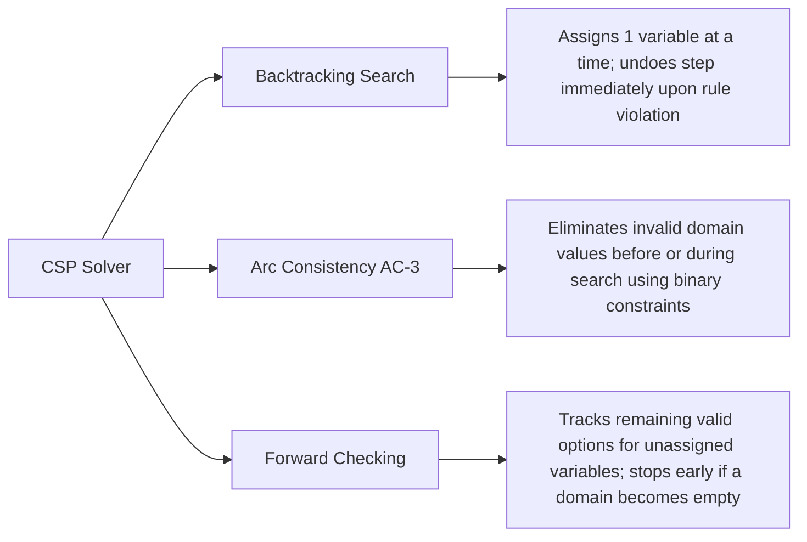

# DPML Course 2: Declarative Programming & CSPs Study Guide

## 2.1 Constraint Satisfaction Problems (CSP) Fundamentals

A **Constraint Satisfaction Problem (CSP)** is a mathematical problem where the goal is to find values for a set of objects that satisfy a specific set of rules or limitations.

### Core Components
1. **Variables ($V$):** The unknown items, positions, or entities that need to be determined (e.g., House 1, House 2, or Person 1, Person 2).
2. **Domains ($D$):** The set of possible values that each variable is allowed to take (e.g., Colors: Red, Green, Blue, Yellow, Ivory; Pets: Dog, Snails, Fox, Horse, Zebra).
3. **Constraints ($C$):** The rules that restrict which values can be assigned to which variables at the same time.

### Common Types of Constraints
* **Unary Constraint:** Relates to a single variable.
  * *Formula:* $X_1 \neq 3$
* **Binary Constraint:** Relates two variables to each other.
  * *Formula:* $X_1 > X_2$
* **Global / N-ary Constraint:** Relates three or more variables at once.
  * *Formula:* $\text{alldifferent}(X_1, X_2, X_3)$ (states that all listed variables must have unique values).

---

## 2.2 Common CSP Solving Techniques

Instead of using brute-force search (checking every possible combination blindly), algorithms solve CSPs efficiently by combining systematic search with **constraint propagation** (using rules to eliminate invalid choices early):



* **Backtracking Search:** A form of depth-first search (exploring one branch as deeply as possible before turning back) that assigns values one variable at a time and steps back ("backtracks") as soon as a constraint is violated.
* **Arc Consistency (AC-3):** An algorithm that shrinks the search space before or during the search by removing domain values that cannot possibly satisfy binary constraints.
* **Forward Checking:** A look-ahead method that tracks the remaining valid values for unassigned variables and stops early if any variable runs out of valid domain options.

---

## 3. Case Study 1: The Zebra Puzzle (Einstein Riddle)

The **Zebra Puzzle** is a classic logic puzzle modeled as a CSP where different attributes must be matched to specific positions (houses/people) based on positional and relational clues.

### Simplified 3-House Einstein Riddle
**Problem Setup & Clues:**
0. There are 3 houses, 3 nationalities (`eng`, `spa`, `rus`), 3 animals (`dog`, `wol`, `hor`), and 3 cigarette brands (`lm`, `ken`, `ls`).
1. The Englishman (`eng`) lives in the first house on the left (`p1`).
2. In the house immediately to the right of the wolf (`wol`), they smoke Lucky Strike (`ls`).
3. The Spaniard (`spa`) smokes Kent (`ken`).
4. The Russian (`rus`) has a horse (`hor`).
* **Goals:** Who smokes LM? Who has the dog?

**Valid Solutions:**

| Solution | House 1 (`p1`) | House 2 (`p2`) | House 3 (`p3`) |
| :--- | :--- | :--- | :--- |
| **Solution I** | Englishman, **Dog**, **LM** | Spaniard, Wolf, Kent | Russian, Horse, Lucky Strike |
| **Solution II** | Englishman, Wolf, **LM** | Russian, Horse, Lucky Strike | Spaniard, **Dog**, Kent |

### Prolog Implementation (Generate-and-Test Backtracking)
In **Prolog** (a declarative logic programming language where rules and facts are stated), the basic backtracking approach generates full candidate permutations first and then tests if they satisfy the constraints.

```prolog
% Main entry point: generates a candidate assignment, verifies constraints, and outputs a newline.
solve(N, A, C) :-
    candidate(N, A, C),
    constraints(N, A, C),
    nl.

% Generates candidate permutations for Nationalities (N), Animals (A), and Cigarettes (C).
candidate(N, A, C) :-
    perm([eng, spa, rus], N),
    perm([dog, wol, hor], A),
    perm([lm, ken, ls], C).

% Enforces all puzzle clues as positional constraints across lists N, A, and C.
constraints(N, A, C) :-
    pos(N, A, C, eng, _, _, p1),      % Clue 1: Englishman lives in house p1.
    pos(N, A, C, _, wol, _, H1),      % Clue 2a: Wolf is in house H1.
    posleft(H1, H2),                  % Clue 2b: House H1 is immediately to the left of H2.
    pos(N, A, C, _, _, ls, H2),       % Clue 2c: Lucky Strike is smoked in house H2.
    pos(N, A, C, spa, _, ken, _),     % Clue 3: Spaniard smokes Kent.
    pos(N, A, C, rus, hor, _, _).     % Clue 4: Russian has a horse.

% Base case for permutation: an empty list permutes to an empty list.
perm([], []).

% Recursive case for permutation: selects element A, deletes it to form Y1, and permutes the rest.
perm(Y, [A | X]) :-
    delete(A, Y, Y1),
    perm(Y1, X).

% Base case for element deletion: removes matching head element A from the list.
delete(A, [A | X], X).

% Recursive case for element deletion: keeps head element B and deletes A from the tail X.
delete(A, [B | X], [B | Y]) :-
    delete(A, X, Y).

% Maps the 1st elements of the three attribute lists to position p1.
pos([N1, _, _], [A1, _, _], [C1, _, _], N1, A1, C1, p1).

% Maps the 2nd elements of the three attribute lists to position p2.
pos([_, N2, _], [_, A2, _], [_, C2, _], N2, A2, C2, p2).

% Maps the 3rd elements of the three attribute lists to position p3.
pos([_, _, N3], [_, _, A3], [_, _, C3], N3, A3, C3, p3).

% Defines adjacency: p1 is immediately to the left of p2, and p2 is immediately to the left of p3.
posleft(p1, p2).
posleft(p2, p3).
```

### Extended Example: Inspiring Women Puzzle
A 5-entity variation of the Zebra Puzzle where five girls sit side-by-side.
* **Variables ($V$):** The 5 positions (`1` to `5`) and their associated attributes.
* **Domains ($D$):** 5 distinct values per category:
  * *Shirt Colors:* Green, Red, Blue, Yellow, etc.
  * *Names:* Jessie, Sabrina, Amy, Lindy, etc.
  * *Role Models (Inspirations):* Grandmother, Mother, Cousin, Aunt, Sister.
  * *Ages:* 8, 9, 10, 11, etc.
  * *Juices:* Grapefruit, Lemon, Pineapple, Orange, Cranberry.
  * *Future Professions:* Nurse, Writer, Teacher, Journalist, etc.
* **Constraints ($C$):**
  * **Unary Constraints:** Direct assignment to a single position (e.g., *"At the second position is the girl inspired by her Grandmother"*, *"At the fifth position is the girl who wants to become a Writer"*, *"At the third position is the girl who wants to be a Journalist"*, *"At one of the ends is the girl that likes Cranberry juice"*).
  * **Binary Constraints:** Direct links between two attributes or adjacent positions (e.g., *"Sabrina is 10 years old"*, *"Lindy is 11 years old"*, *"Jessie is exactly to the left of the girl that wants to become a Nurse"*, *"Amy is next to the girl inspired by her Grandmother"*, *"The girl that likes Pineapple juice is somewhere to the right of the girl wearing the Red shirt"*).
  * **Global / N-ary Constraints:** All attributes within each category are mutually exclusive ($\text{alldifferent}$), plus ordered three-variable positional clues (e.g., *"The girl wearing the Red shirt is somewhere between the girl who likes Lemon juice and Amy, in that order"*).

---

## 2.4 Case Study 2: The N-Queens Problem

The **N-Queens Problem** requires placing $N$ chess queens on an $N \times N$ chessboard so that no two queens can attack each other.

### CSP Formal Definition (for $N = 8$)
* **Variables ($V$):** The row positions of the 8 queens, where each queen $Q_i$ is assigned to column $i$:
  $$V = \{Q_1, Q_2, \dots, Q_8\}$$
* **Domains ($D$):** Possible row numbers for each queen $Q_i$ ($i \in \{1, \dots, 8\}$):
  $$D_i = \{1, 2, \dots, 8\}$$
* **Constraints ($C$):** For any two distinct queens $Q_i$ and $Q_j$ (where $i \neq j$):
  * **Row Constraint:** No two queens can share the same row:
    $$Q_i \neq Q_j$$
  * **Diagonal Constraint:** The vertical distance between two queens cannot equal their horizontal distance:
    $$|Q_i - Q_j| \neq |i - j|$$
    *(Note: In Prolog, this is tracked using upward diagonals $C = X - Y$ and downward diagonals $D = X + Y$, where $X$ is the column and $Y$ is the row).*

### Prolog Implementations: Version 1 vs. Version 2

| Feature | Version 1: Naive Backtracking (`queens_1`) | Version 2: Interleaved Search / AC (`queens_2`) |
| :--- | :--- | :--- |
| **Strategy** | **Generate-and-Test:** Generates a complete permutation of all $N$ queens first, then runs `test` to check diagonal constraints. | **Constraint Propagation during Search:** Tests diagonal constraints immediately as each queen row $Y$ is selected (`perm_test`). |
| **Efficiency** | Slow for large $N$; wastes time generating invalid full boards before checking diagonals. | Much faster; prunes invalid branches immediately when a single queen placement violates a diagonal rule. |

```prolog
% =====================================================================
% SHARED HELPER PREDICATES (Used by both Version 1 and Version 2)
% =====================================================================

% Base case: generates a single-element list when lower bound A equals upper bound A.
range(A, A, [A]).

% Recursive case: generates a list of integers from A to B inclusive.
range(A, B, [A | L]) :-
    A < B,
    A1 is A + 1,
    range(A1, B, L).

% Base case: deletes matching element X from the head of the list.
delete(X, [X | Xs], Xs).

% Recursive case: retains head Y and deletes element X from the tail Ys.
delete(X, [Y | Ys], [Y | Zs]) :-
    delete(X, Ys, Zs).

% Base case: succeeds if element E is the head of the list.
member(E, [E | _]).

% Recursive case: succeeds if element E is found in the tail L of the list.
member(E, [_ | L]) :-
    member(E, L).

% =====================================================================
% VERSION 1: Standard Backtracking (Generate-and-Test)
% =====================================================================

% Solves N-Queens by generating a full row permutation Qs first, then testing diagonals.
queens_1(N, Qs) :-
    range(1, N, Rs),
    perm(Rs, Qs),
    test(Qs).

% Base case: an empty list permutes to an empty list.
perm([], []).

% Recursive case: constructs permutation by deleting Y from available rows Qs and permuting Rs.
perm(Qs, [Y | Ys]) :-
    delete(Y, Qs, Rs),
    perm(Rs, Ys).

% Wrapper predicate: initializes diagonal testing starting at column 1 with empty diagonal lists.
test(Qs) :-
    test(Qs, 1, [], []).

% Base case: succeeds when all queens in the list have been verified without conflict.
test([], _, _, _).

% Recursive case: checks that diagonals C (X-Y) and D (X+Y) for column X and row Y are unused.
test([Y | Ys], X, Cs, Ds) :-
    C is X - Y,
    not(member(C, Cs)),
    D is X + Y,
    not(member(D, Ds)),
    X1 is X + 1,
    test(Ys, X1, [C | Cs], [D | Ds]).

% =====================================================================
% VERSION 2: Optimized Search with Early Constraint Checking
% =====================================================================

% Solves N-Queens by interleaving row selection and diagonal verification in perm_test.
queens_2(N, Qs) :-
    range(1, N, Rs),
    perm_test(Rs, Qs, 1, [], []).

% Base case: succeeds when no unassigned rows remain.
perm_test([], [], _, _, _).

% Recursive case: selects row Y for column X and immediately verifies diagonal constraints C and D.
perm_test(Qs, [Y | Ys], X, Cs, Ds) :-
    delete(Y, Qs, Rs),
    C is X - Y,
    not(member(C, Cs)),
    D is X + Y,
    not(member(D, Ds)),
    X1 is X + 1,
    perm_test(Rs, Ys, X1, [C | Cs], [D | Ds]).
```

---

## 2.5 Case Study 3: Sudoku

**Sudoku** is a logic-based number placement puzzle on a $9 \times 9$ grid divided into nine $3 \times 3$ sub-grids (blocks).

### CSP Formal Definition
* **Variables ($V$):** $9 \times 9 = 81$ grid cell variables:
  $$X = \{V_{1,1}, V_{1,2}, \dots, V_{i,j}, \dots, V_{9,9}\}$$
* **Domains ($D$):**
  * **Empty cell:** $D_{i,j} = \{1, 2, 3, 4, 5, 6, 7, 8, 9\}$
  * **Pre-filled cell (given clue):** $D_{i,j} = \{k\}$, where $k$ is the fixed starting digit.
* **Constraints ($C$):** For any two distinct variables $V_{a,b}$ and $V_{c,d}$ that share the same row, the same column, or the same $3 \times 3$ block:
  $$V_{a,b} \neq V_{c,d}$$

### Prolog Implementation (Using `clpfd` - Constraint Logic Programming over Finite Domains)
Instead of writing manual permutation loops, modern Prolog uses built-in finite domain constraint solvers (`ins`, `all_distinct`, `transpose`) to automatically apply arc consistency and constraint propagation.

```prolog
:- use_module(library(clpfd)).

% Defines the main Sudoku solver over a 9x9 list of lists (Rows).
sudoku(Rows) :-
    % Ensures Rows has 9 elements and every inner row also has length 9 (9x9 grid).
    length(Rows, 9), maplist(same_length(Rows), Rows),
    
    % Flattens the 9x9 grid into a single list Vs and restricts all variable domains to 1..9.
    append(Rows, Vs), Vs ins 1..9,
    
    % Applies the global constraint that every row must contain all distinct numbers.
    maplist(all_distinct, Rows),
    
    % Transposes rows into columns and requires every column to contain all distinct numbers.
    transpose(Rows, Columns),
    maplist(all_distinct, Columns),
    
    % Binds the 9 rows to variables As through Is and enforces 3x3 block constraints in groups of 3 rows.
    Rows = [As, Bs, Cs, Ds, Es, Fs, Gs, Hs, Is],
    blocks(As, Bs, Cs),
    blocks(Ds, Es, Fs),
    blocks(Gs, Hs, Is).

% Base case: succeeds when all columns of the three rows have been processed into 3x3 blocks.
blocks([], [], []).

% Recursive case: extracts the first 3 elements from each of the 3 rows to form a 3x3 block,
% enforces that all 9 elements are distinct, and recursively processes the remaining tails.
blocks([N1, N2, N3 | Ns1], [N4, N5, N6 | Ns2], [N7, N8, N9 | Ns3]) :-
    all_distinct([N1, N2, N3, N4, N5, N6, N7, N8, N9]),
    blocks(Ns1, Ns2, Ns3).

% Defines a sample puzzle instance where '_' represents an empty cell and integers represent fixed clues.
problem(1, [
    [_, _, _, _, _, _, _, _, _],
    [_, _, _, _, _, 3, _, 8, 5],
    [_, _, 1, _, 2, _, _, _, _],
    [_, _, _, 5, _, 7, _, _, _],
    [_, _, 4, _, _, _, 1, _, _],
    [_, 9, _, _, _, _, _, _, _],
    [5, _, _, _, _, _, _, 7, 3],
    [_, _, 2, _, 1, _, _, _, _],
    [_, _, _, _, 4, _, _, _, 9]
]).

% Query to load problem 1, solve the Sudoku grid, and print each completed row:
% ?- problem(1, Rows), sudoku(Rows), maplist(portray_clause, Rows).
```

---
