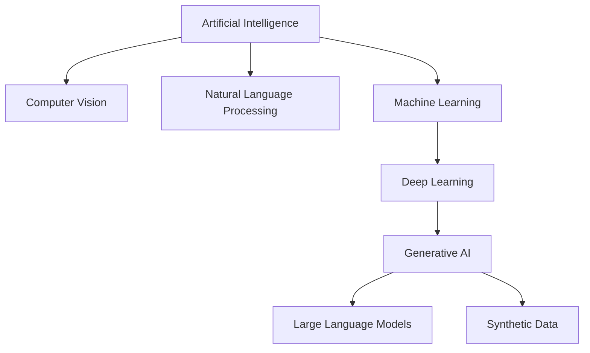
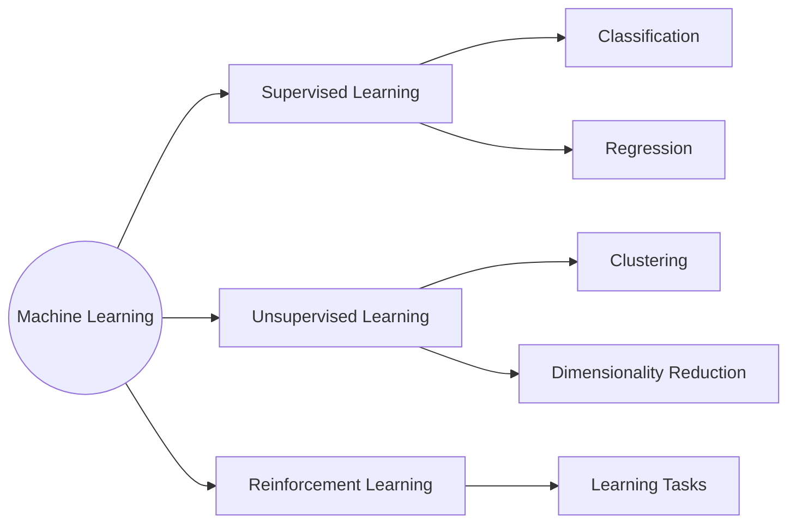
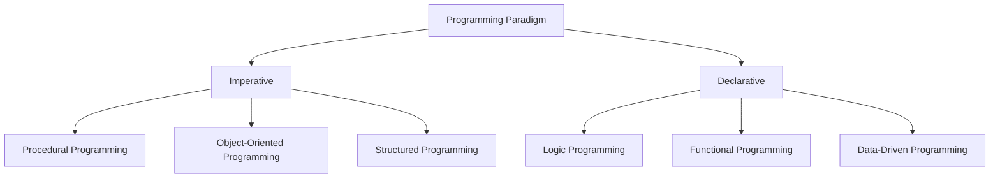
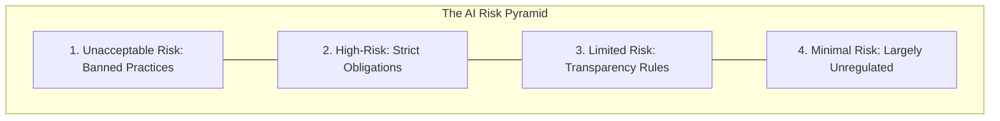

# DPML Course 1: Study Guide

## 1.1 Artificial Intelligence (AI) & Machine Learning (ML) Overview

### Core Concepts & Definitions
* **Artificial Intelligence (AI):** A broad field of computer science dedicated to creating systems capable of performing tasks that typically require human intelligence.
* **Machine Learning (ML):** A subset of AI that enables systems to learn and improve from experience (data) automatically without being explicitly programmed.
* **Deep Learning (DL):** A subset of ML that uses artificial neural networks with multiple layers to model and solve complex problems.
* **Generative AI (GenAI) / Generative Models:** A subset of DL consisting of models designed to generate new, previously unseen data (e.g., text, images, **Synthetic Data**) that is similar to their training data. Includes **Large Language Models (LLMs)**.
* **Computer Vision (CV):** Enables machines to interpret and understand the visual world (images and video) just like humans do.
* **Natural Language Processing (NLP):** Deals with the interaction between computers and humans using natural human language.
* **Predictive Maintenance:** Utilizes data and ML algorithms to predict when equipment or machinery is likely to fail so maintenance can be performed proactively.
* **Edge AI:** The deployment of AI algorithms and models directly on local devices at the edge of a network, such as Internet of Things (IoT) devices, rather than in a centralized cloud.

---

### Machine Learning Paradigms

ML is divided into three main learning paradigms based on how a model learns from data:

| Paradigm | Sub-Category | Core Purpose | Key Applications |
| :--- | :--- | :--- | :--- |
| **Supervised Learning** *(Learns from labeled data)* | **Classification** | Assigns data into specific categories. | Image Classification, Fraud Detection, Customer Retention, Diagnostics. |
| | **Regression** | Predicts continuous numerical values. | Forecasting, Predictions, Process Optimization, Generating New Insights. |
| **Unsupervised Learning** *(Finds hidden patterns in unlabeled data)* | **Clustering** | Groups similar data points together. | Recommender Systems, Targeted Marketing, Customer Segmentation. |
| | **Dimensionality Reduction** | Reduces the number of variables while keeping important data. | Meaningful Compression, Big Data Visualization, Feature Elicitation, Structure Discovery. |
| **Reinforcement Learning** *(Agent learns via trial, error, and rewards)* | **Decision & Control Tasks** | An agent interacts with an environment and receives rewards or punishments for actions. | Real-Time Decisions, Game AI, Robot Navigation, Skill Acquisition. |

---

## 1.2 Programming Paradigms in AI & ML

A **Programming Paradigm** is a fundamental style or approach to building and structuring computer programs.

* **Imperative Programming:** Focuses on *how* a program operates by giving the computer a step-by-step sequence of instructions to change its state.
* **Declarative Programming:** Focuses on *what* the program should accomplish without specifying the exact step-by-step control flow.
  * **Examples in AI:** Logic & Rule-Based AI (e.g., Prolog, CLisp), Constraint Satisfaction Problems (CSPs), and Prompt Engineering.

### Integration of Logic Programming in AI/ML
**Logic Programming** uses formal logic (facts and rules) to represent knowledge and solve problems through reasoning.
* **Symbolic Reasoning:** Using high-level symbols (words, concepts) to represent and solve problems logically.
* **Prolog Language:** A declarative logic programming language designed specifically for symbolic reasoning tasks.
* **Knowledge Representation:** The structured way information, facts, and rules are stored and organized so a computer can use them to reason.
* **Expert Systems:** Computer systems that emulate the decision-making ability of a human expert by applying inference rules to a knowledge base.
* **Natural Language Understanding (NLU):** A branch of NLP focused on enabling a computer to comprehend the meaning and grammar of human language.
* **Hybrid AI Systems:** Systems that combine different AI approaches (e.g., combining symbolic logic programming with neural networks) for better performance and interpretability.

### Functional Programming in AI/ML
**Functional Programming** builds programs by applying and composing pure mathematical functions, avoiding shared state and mutable data.

| Feature | Definition & Benefit in AI/ML |
| :--- | :--- |
| **Map-Reduce Operations** | High-level functions that process large datasets by mapping an operation across items and reducing the results into a summary. Enables concise expression of data operations. |
| **Parallelism Support** | Executing multiple computations at the same time. Facilitates efficient use of GPU clusters for training large models. |
| **Functional APIs** | Application Programming Interfaces built around functions. Provides clean and concise model creation (e.g., in deep learning frameworks). |
| **Modularity** | Breaking down complex tasks into smaller, independent, manageable parts that are easy to test and reuse. |
| **Immutability** | A rule where data cannot be modified after it is created. Ensures original data remains unchanged, preventing accidental side effects during data processing. |

---

## 1.3 Constraint Satisfaction Problems (CSPs)

A **Constraint Satisfaction Problem (CSP)** is a mathematical problem defined as a set of objects whose state must satisfy a number of rules or limitations. CSPs are a core application of declarative programming (e.g., solving the **Zebra Puzzle / Einstein's Riddle** in Prolog).

### Formal Components of a CSP
Every CSP consists of three core elements:
1. **Variables ($V$):** The unknown items, positions, or entities that need to be determined (e.g., $V = \{X_1, X_2, \dots, X_n\}$ such as House 1, House 2, or Person 1).
2. **Domains ($D$):** The set of possible values that each variable is allowed to take (e.g., Colors: Red, Green, Blue; or Pets: Dog, Fox, Zebra).
3. **Constraints ($C$):** The rules that restrict which values can be assigned to which variables at the same time.

### Types of Constraints
* **Unary Constraint:** Restricts the value of a single variable.
  * *Formula/Example:* $X_1 \neq 3$
* **Binary Constraint:** Relates two variables to each other.
  * *Formula/Example:* $X_1 > X_2$
* **Global (N-ary) Constraint:** Relates three or more (multiple) variables at once.
  * *Formula/Example:* $\text{alldifferent}(X_1, X_2, X_3)$ (meaning $X_1, X_2,$ and $X_3$ must all take different values).

### Real-World Examples of CSPs

### Real-World Examples of CSPs

| Application Domain | Variables (V) | Domain (D) | Constraints (C) |
|---|---|---|---|
| **Sudoku** | Grid cells (9 × 9) | Digits 1–9 | No repeated numbers in any row, column, or 3 × 3 box. |
| **Scheduling** | Tasks / Classes | Time slots, rooms, teachers | No double-booking of rooms or instructors; course prerequisites must be met. |
| **Map Coloring** | Map regions | Set of colors (e.g., Red, Green, Blue) | Neighboring regions sharing a border cannot share the same color. |
| **N-Queens Problem** | Board locations of N queens | Chessboard coordinates | No two queens can share the same row, column, or diagonal. |

### CSP Solving Techniques
Instead of checking every possible combination (brute-force search), CSP solvers combine systematic search with **constraint propagation** (using constraints to rule out invalid options early):

1. **Backtracking Search:** A depth-first search algorithm that assigns values to one variable at a time. As soon as an assignment violates a constraint, it undoes the last step ("backtracks") and tries a different value.
2. **Arc Consistency (AC-3):** A preprocessing or in-search algorithm that reduces the search space by removing values from variable domains that cannot possibly satisfy binary constraints with neighboring variables.
3. **Forward Checking:** A look-ahead technique used during search that tracks the remaining valid values for unassigned variables. If any unassigned variable runs out of valid domain options, the search backtracks immediately.

---

## 1.4 Trustworthy AI & The EU AI Act

**Trustworthy AI** refers to designing and deploying AI systems that are lawful, ethical, safe, and transparent.

### The EU Artificial Intelligence Act
The **EU AI Act** is the world's first comprehensive legal framework regulating artificial intelligence. It establishes harmonized rules across the European Union by classifying AI systems according to their **risk level**, where legal obligations increase based on the potential for harm to human rights and safety.

| Risk Level | Regulatory Stance | Description & Examples |
| :--- | :--- | :--- |
| **1. Unacceptable Risk** | **Banned Practices** | Systems considered a clear threat to people's safety, livelihoods, and fundamental rights are strictly prohibited.  *Examples:* Social scoring, cognitive behavioral manipulation, real-time remote biometric (facial) recognition in public spaces. |
| **2. High-Risk** | **Strict Obligations** | AI systems that can negatively affect safety or fundamental rights must undergo strict conformity assessments, risk management, and human oversight before deployment.  *Examples:* AI used in law enforcement, critical infrastructure, recruitment, medical devices, or education. |
| **3. Limited Risk** | **Transparency Rules** | Systems must adhere to specific transparency obligations so users know they are interacting with AI or viewing AI-generated content.  *Examples:* Generative AI, chatbots, and deepfakes. |
| **4. Minimal Risk** | **Largely Unregulated** | The vast majority of AI systems that pose little to no risk to citizens' rights or safety remain free from new legal obligations.  *Examples:* AI-enabled video games, spam filters. |

### Phased Rollout: Key Compliance Dates
* **February 2025 (Ban on Prohibited AI):** Rules banning AI systems that pose *Unacceptable Risks* begin to apply.
* **August 2025 (General-Purpose AI Rules):** Obligations and transparency requirements for *General-Purpose AI (GPAI)* models take effect.
* **August 2026 – 2027 (High-Risk System Rules):** Most remaining provisions, including strict rules for *High-Risk AI systems*, become fully applicable.

---
