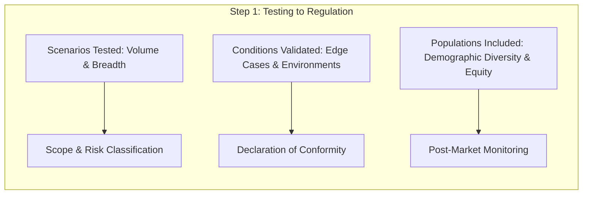
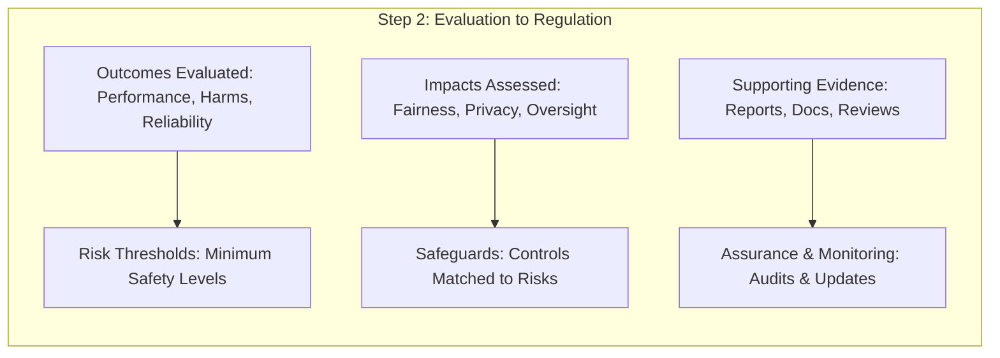

# DPML Course 3: Building Trustworthy & Ethical AI Study Guide

## 3.1 Ethical AI Principles & The EU AI Act

### Common Ground: Core Ethical AI Principles
Across global laws, policies, and recommendations (such as the EU AI Act, European Commission Ethics Guidelines, and UNESCO Recommendations), six core principles form the foundation of **Trustworthy AI**:
1. **Fairness and Bias Mitigation:** Preventing discriminatory outcomes across demographic groups.
2. **Transparency and "Explainability" (or Interpretability):** Being open about how a system operates and ensuring its decisions can be understood.
3. **Privacy and Data Sovereignty:** Protecting user data and respecting ownership/control over personal information.
4. **Accountability and Human Oversight:** Ensuring humans remain in control and that clear responsibility exists for system outcomes.
5. **Safety and Reliability:** Ensuring systems perform consistently as intended without causing unintended harm.
6. **Social and Environmental Well-being:** Designing systems that benefit society and remain environmentally sustainable.

### Key Concepts in the EU AI Act
* **Core Legal Definitions to Know:**
  * **AI System:** Software/machine-based system that infers from inputs how to generate outputs (predictions, content, recommendations, decisions).
  * **Risk:** The combination of the probability of an occurrence of harm and the severity of that harm.
  * **Reasonably Foreseeable Misuse:** The use of an AI system in a way not intended by the provider, but which may result from reasonably foreseeable human behavior or interaction with other systems.
  * **Serious Incident:** Any incident or malfunctioning of an AI system that directly or indirectly leads to death, serious harm to health, disruption of critical infrastructure, or breach of fundamental rights.
  * **Deep Fake:** AI-generated or manipulated image, audio, or video content that resembles existing persons, objects, places, or events and would falsely appear authentic or truthful to a person.
  * **Systemic Risk:** A risk specific to the high-impact capabilities of general-purpose AI models having a significant impact on the Union market due to their reach or negative effects on public health, safety, public security, and fundamental rights.
* **Key Articles:**
  * **Article 5 (Prohibited AI Practices):** Bans AI systems posing *Unacceptable Risk* (e.g., subliminal manipulation, social scoring).
  * **Article 50 (Transparency Obligations):** Requires clear disclosures for systems interacting with humans (e.g., chatbots) or generating synthetic media (e.g., deepfakes).

---

## 3.2 Ethical Frameworks, Traditions & Core Glossary

### Philosophical & Cultural Ethical Frameworks
* **Ethics:** The systematic study of what matters, what is right, and how choices are justified—not a fixed rulebook.
* **Normative Ethics:** The branch of ethics that asks, *"What should we do?"* and generates principles for action.
* **Applied Ethics:** Translating ethical principles into real decisions in specific domains such as medicine, law, journalism, and AI.
* **Ethical Pluralism:** The condition in which the same facts yield several defensible ethical verdicts because different traditions optimize different values.

| Ethical Framework / Tradition | Core Principle & Application to AI |
| :--- | :--- |
| **Utilitarianism** | Judges actions by their **outcomes**. Favors deploying an AI system if the net welfare (overall benefit minus harm) is positive. |
| **Deontology** | Judges actions by **duties and rights** regardless of outcomes. Holds that certain protections (dignity, due process, non-discrimination) are non-negotiable. |
| **Virtue Ethics** | Asks what a person or institution of **good character** would do—focusing on what kind of organization is built through design choices. |
| **Ubuntu** | African relational ethical concept (*"a person is a person through other persons"*). Shifts the focus from individual consent to **communal impact**. |
| **Communitarian Ethics** | Treats the **community**, rather than the individual, as the primary unit of moral concern. |
| **Confucian Role Ethics** | Holds that moral character is formed through **practice and relationship**, implying that no design culture is morally neutral. |
| **Buddhist Ethics** | Centers **non-harm and interdependence**—viewing an AI model within a connected network of data labelers, users, and downstream consequences rather than as an isolated object. |
| **Indian Dharmic Traditions** | Treats duty as **context-sensitive**—what is right depends on role, situation, and time, sometimes requiring responsible choice among imperfect options. |

### Diagnostic Lens: The Five-Question Framework
A diagnostic lens applied to evaluate the ethical impact of any AI system:
1. **Who benefits?**
2. **Who is harmed?**
3. **Who decides?**
4. **Who can challenge?**
5. **At what scale?**

### Technical & Governance Glossary
* **Hallucination:** When an AI system produces confident misinformation without reliable awareness of its own errors.
* **Parasocial Dependency:** An emotional attachment a user forms toward a non-human system that does not meaningfully reciprocate.
* **Algorithmic Bias:** When a model learns historical inequities from training data and replicates them as discriminatory outputs at scale.
* **Transparency vs. Explainability vs. Accountability:**
  * **Transparency:** Openness about how a system works, what data it uses, and where it fails (a precondition for accountability, but not identical to it).
  * **Explainability:** The property of a system whose decisions can be understood or traced (useful, but not a substitute for accountability).
  * **Accountability:** The ability to identify and challenge those responsible for a system's decisions.
* **Lifecycle Design Approaches:**
  * **Ethics by Design:** Embedding values into a system *before* it is built or deployed—across purpose, data, model architecture, and governance gates.
  * **Ethics in Use:** Monitoring, correcting, and remaining accountable *once* a system is deployed, feeding what is learned back into the next design cycle.
  * **Humanization (over Automation):** A design principle centering empathy, accountability, and cultural diversity so systems support whole persons rather than replacing human judgment and connection.

---

## 3.3 Harm, Risk, and Stakeholder Analysis

### The "Uncomfortable Truth" of AI Failures
* **Safety vs. Security:** *Safety* protects against unintended system failures and environmental hazards causing harm, whereas *Security* protects against intentional, malicious external attacks.
* **Invisible Failures:** Unlike traditional software that crashes visibly when it fails, AI failures are often silent and invisible. Silent algorithmic biases can negatively affect thousands of decisions over months or years before anyone notices, impacting both users and non-users.

### Case Study: Autonomous Driving (Uber Incident)

#### Promise vs. Reality of Autonomous Vehicles
* **The Promise:** Eliminate 94% of crashes caused by human error (~1.35M lives saved annually); provide mobility to elderly and disabled populations; reduce congestion through optimized routing; make transportation deaths rare exceptions.
* **The Reality:** Algorithmic life-or-death decisions; unpredictable failures; mixed-traffic danger; cybersecurity vulnerabilities; software update risks; sensor limitations; no fail-safe.

#### Stakeholder Impact & Agency Analysis

| Stakeholder | Impact | Level of Choice / Agency |
| :--- | :--- | :--- |
| **The Victim** | Fatal injury | **No choice** — involuntary participant |
| **Other Pedestrians & Drivers** | Exposed to deployment risks | **No choice** — involuntary participants |
| **Passengers** | Safety risks, but also service benefits | **Limited choice** — imperfect information |
| **Safety Driver** | Faced criminal charges, trauma | **Employment choice**, but subject to complex workplace pressures |
| **Uber (Deployer)** | Regulatory scrutiny | **Full decision-making power** |

#### Deployment Strategies & Risk Allocation
* **Core Ethical Question:** *What level of risk to non-consenting pedestrians and other drivers is acceptable during the learning phase?*

| Launch Approach | Core Trade-Off | Risk Allocation |
| :--- | :--- | :--- |
| **A: Aggressive Deployment** | Speed to market vs. safety validation | Risk shifted to drivers and the public (with legal disclaimers) |
| **B: Extended Testing** | Market delay vs. comprehensive safety | Risk retained by the company during long validation |
| **C: Geofenced Rollout** | Limited market vs. controlled environment | Phased risk — lower public exposure, but slower expansion |

#### Five Key Lessons Learned
1. **Rigorous Pre-Deployment Testing:** The question is not *"Has it been tested?"* but *"Has it been tested adequately for specific risks?"*
2. **Design Choices Encode Values:** Tuning an algorithm to reduce false positives (e.g., avoiding unnecessary braking) prioritizes *passenger comfort over pedestrian safety*—making it an ethical decision, not just a technical one.
3. **Post-Incident Transparency:** How a company responds to failures shapes public trust, regulation, and industry-wide learning.
4. **Regulatory Frameworks Matter:** An absence of regulatory standards does not equal freedom to innovate; it creates ambiguity around responsibility that serves neither companies nor the public.
5. **Multi-Stakeholder Governance:** Engineers, regulators, affected communities, and civil society all need seats at the design and governance table.

---

## 3.4 Testing, Evaluation, and Benchmarking

### Why AI Needs a Dedicated Testing Framework
1. **AI is Not Like Other Software:** AI systems learn from data, and their outputs shift across different contexts. Standard software Quality Assurance (QA) is insufficient.
2. **Harm Happens at Scale:** AI systems can reach millions of users simultaneously, meaning a single flaw affects everyone in scope at once.
3. **Accountability Has No Hook:** When AI causes harm, responsibility is often diffused across developers, deployers, and regulators. Formal testing establishes clear standards of accountability.

### Distinguishing Testing, Evaluation, and Benchmarking

| Term | Definition / What It Means | Main Question Answered |
| :--- | :--- | :--- |
| **Testing** | Checking how the system behaves under specific conditions, including edge cases and failures. | *Does it work safely and reliably in this scenario?* |
| **Evaluation** | Assessing overall performance, risks, and fitness for purpose using technical and non-technical criteria. | *Is this system good enough and appropriate to deploy or use?* |
| **Benchmarking** | Comparing a system against standardized datasets, tasks, or other peer models. | *How does it compare to a baseline or peer system?* |

### From Technical Assessment to Regulation

---

## 3.5 Practical Governance Tools: Datasheets & Model Cards

### Tool #1: Datasheets for Datasets

A **Datasheet for Datasets** is a standardized document accompanying a dataset that details its creation, characteristics, and limitations as part of an organization's Safety and Security stack.

#### The 5 Core Questions a Datasheet Answers

1. **Motivation:** Why was this dataset created? Who funded it?
2. **Composition:** What do the instances represent (e.g., images, text, people)?
3. **Collection:** How was the data acquired? Was it scraped from the web, or was there explicit consent?
4. **Preprocessing:** Was the data cleaned, normalized, or anonymized before release?
5. **Distribution:** Are there any copyrights, licenses, or usage restrictions?

#### Industry Implementations of Datasheets

* **Microsoft:** Transparency Notes
* **Hugging Face:** Dataset Cards
* **Google:** Data Cards Playbook
* **IBM:** AI FactSheets
* **Common Crawl:** Data Governance Docs

---

### Tool #2: Model Cards

A **Model Card** is a standardized, brief document that provides a structured overview of a machine learning model's purpose, design, and performance across different conditions.

#### Why Model Cards Are Critical for Safety & Security

* **Risk Management:** Identifies known limitations and failure modes before deployment.
* **Accountability:** Establishes clear ownership and intended boundaries of use.
* **Security Posture:** Highlights vulnerabilities and safety test results.
* **Regulatory Compliance:** Provides standardized documentation required by laws like the EU AI Act.

#### Standard Content of a Model Card

* **Model Details:** Model name, version, architecture (e.g., Transformer), and developer contact information.
* **Intended Use:** Primary tasks the model is designed for (e.g., sentiment analysis) and explicit **"out-of-scope" uses** (e.g., *"not for clinical diagnosis"*).
* **Factors & Demographics:** Subgroups on which the model was tested (e.g., race, gender, age) to highlight potential performance gaps or biases.
* **Metrics & Thresholds:** Performance measures such as Accuracy, F1-score, or False Positive rates, including the specific decision thresholds used.
* **Quantitative Analysis:** Disaggregated error analysis (such as a **confusion matrix**) to identify specific types of errors across categories.
* **Training & Evaluation Data:** References and links to the *Datasheets* for the datasets used to train and validate the model.
* **Safety Disclosures:** Results from red-teaming, safety testing, vulnerability assessments, and mitigation steps taken.

#### Industry Implementations of Model Cards

* **Google:** Gemma Model Card
* **OpenAI:** System Cards (e.g., GPT-4o)
* **Salesforce:** AI Transparency Notes
* **NVIDIA:** Model Card++
* **Hugging Face:** Standard Model Cards

---
