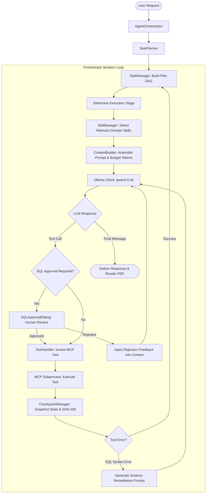
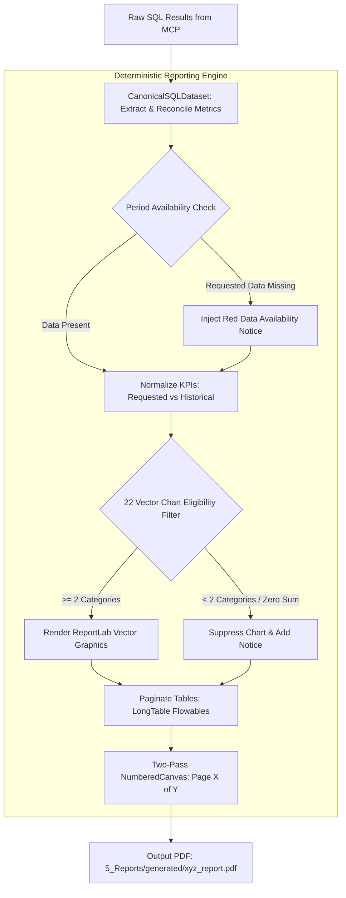

# Feature Specification & Technical Architecture: Local Report SQL Agent

This document provides a comprehensive, source-accurate technical specification of every significant feature implemented in the **Local Report SQL Agent**.

---

## Table of Contents
1. [Application Interface & Desktop Experience](#1-application-interface--desktop-experience)
2. [Natural-Language Interaction & Ollama Engine](#2-natural-language-interaction--ollama-engine)
3. [Agent Intelligence Layer & Orchestration](#3-agent-intelligence-layer--orchestration)
4. [Model Context Protocol (MCP) Architecture](#4-model-context-protocol-mcp-architecture)
5. [Database Engine & Multi-Tier SQL Security](#5-database-engine--multi-tier-sql-security)
6. [Deterministic Reporting Pipeline & Canonical Data Engine](#6-deterministic-reporting-pipeline--canonical-data-engine)
7. [Persistent Agent Memory & Crash Recovery](#7-persistent-agent-memory--crash-recovery)
8. [Configuration & Settings System](#8-configuration--settings-system)
9. [System Limitations & Boundary Conditions](#9-system-limitations--boundary-conditions)

---

## 1. Application Interface & Desktop Experience

The user interface is built on **PySide6 (Qt6)** using asynchronous event-driven worker threads to guarantee that the graphical interface remains responsive during long-running LLM inferences and SQL operations.

```text
+----------------------------------------------------------------------------------------------------+
| Local Report SQL Agent (MainWindow)                                                [Settings] [_][X] |
+-------------------------------------------------+--------------------------------------------------+
| CHAT ASSISTANT PANEL                            | EMBEDDED REPORT PREVIEW PANEL                    |
|                                                 |                                                  |
| [User]: Generate October 2026 sales report...   | Page: [ 1 / 7 ]   Zoom: [ 100% ] [-] [+] [Popout]|
|                                                 | +----------------------------------------------+ |
| [Agent]: Formulating analytical plan...         | |  E-COMMERCE OPERATIONS REPORT                | |
|   * [Pill: Plan Created (3 steps)]              | |  Period: October 2026 (No Data)              | |
|   * [Pill: Schema Discovery -> orders, items]   | |  Notice: Historical Comparison: Sept 2026    | |
|   * [Pill: SQL Executed -> 51 rows captured]    | |  [KPI Card 1]  [KPI Card 2]  [KPI Card 3]    | |
|   * [Pill: PDF Compiled -> 7 pages, 62 KB]      | |  +----------------------------------------+  | |
|                                                 | |  | Vector Chart: Revenue by Category     |  | |
| Executive Summary: October 2026 returned 0      | |  +----------------------------------------+  | |
| records; September 2026 historical comparison   | |  | LongTable: Orders & Gross Sales        |  | |
| metrics compiled successfully.                  | +----------------------------------------------+ |
|                                                 |                                                  |
| [Input Prompt Field: Ask a reporting question...] [Send]                                           |
+-------------------------------------------------+--------------------------------------------------+
| ACTIVITY INSPECTOR (Collapsible Bottom Drawer)                                                     |
| [DAG Task Tree]       [Tool Execution Stream]   [Checkpoint History]      [Context Window Gauge]   |
| v- Task: Report Oct26 * inspect_schema() -> OK  * chk_001 (TaskCreated)   128K Budget: [====    ]  |
|   |- Step 1: Introspect * execute_sql() -> 51 r * chk_002 (PlanReady)     Used: 14,250 tokens      |
|   |- Step 2: Query SQL  * generate_pdf() -> OK  * chk_003 (StepCompleted) Headroom: 116,822 tokens|
|   `- Step 3: Render PDF                                                                            |
+----------------------------------------------------------------------------------------------------+
```

### 1.1 Main Window (`app/main_window.py`)
- **Layout Architecture**: Horizontal `QSplitter` dividing the Left Panel (Chat & Activity) and Right Panel (Report Preview & History).
- **Concurrency Bridge**: Integrates `AgentWorker(QThread)` communicating with the UI via PySide6 signals (`plan_updated`, `step_started`, `tool_call_emitted`, `report_generated`, `error_occurred`, `token_streamed`). The GUI thread is completely decoupled from async I/O.
- **Offscreen Headless Mode**: Supports `--smoke-test` via `QT_QPA_PLATFORM=offscreen` to allow automated verification in CI pipelines without an X11/Wayland/Quartz display server.

### 1.2 Conversational Chat Panel (`app/chat_panel.py`)
- **Token Streaming**: Renders text chunks streamed directly from Ollama via asynchronous generators.
- **Activity Pill Badges**: Renders compact, visual badge pills representing agent state transitions (e.g., `Schema Discovered`, `SQL Prepared`, `Executing Query`, `Synthesizing PDF`).
- **Markdown Rendering**: Formats tables, bold text, lists, and code blocks using standard Qt rich text.

### 1.3 Embedded Report Preview Panel (`app/preview_panel.py`)
- **Native QtPdf Engine**: Embeds `QPdfView` and `QPdfDocument`, rendering vector PDF pages directly within the desktop window without external browser dependencies.
- **Controls**: Page forward/backward buttons, direct page jump input, zoom in/out/fit-to-page, and an "Open in System Viewer" button launching macOS Preview or Windows default PDF viewer.

### 1.4 Activity Inspector (`app/activity_inspector.py`)
- **Tab 1: DAG Task Tree**: Renders the acyclic graph of planning steps, updating node states in real time (`PENDING` -> `RUNNING` -> `COMPLETED` / `FAILED`).
- **Tab 2: Tool Execution Stream**: Logs every MCP tool invocation with incoming parameters, execution duration, and truncated JSON result payloads.
- **Tab 3: Checkpoint History**: Displays immutable SHA-256 state snapshots stored in SQLite working memory.
- **Tab 4: Context Token Gauge**: Visual progress bar tracking tokens used against the active context limit (32K, 64K, 128K, or 256K).

### 1.5 Report History Panel (`app/report_history_panel.py`)
- **Catalog Management**: Reads metadata from `5_Reports/report_history.json`.
- **Search & Filter**: Allows searching previously generated PDF and CSV reports by title, date range, and record count.
- **Quick Actions**: One-click reopening in the embedded previewer or revealing in the OS file manager.

### 1.6 Human-in-the-Loop SQL Approval Dialog (`app/sql_approval_dialog.py`)
- **Approval Modal**: Activated when `settings.agent.require_sql_approval = True`.
- **Inspection View**: Syntax-highlighted SQL editor displaying the query generated by the agent, accompanied by the agent's natural-language justification and estimated row impact.
- **Decision Controls**: **Approve** (schedules execution) or **Reject** (passes user refusal feedback back into the agent conversation loop).

---

## 2. Natural-Language Interaction & Ollama Engine

### 2.1 Local Ollama Client (`agent/ollama_client.py`)
- **Endpoint**: Connects to `http://localhost:11434` over persistent HTTP/1.1 connections using `httpx.AsyncClient`.
- **Model Discovery**: Probes `/api/tags` to confirm `qwen3.5:4b` is installed, and inspects `/api/show` to extract model parameter counts and architectural context capabilities.
- **Capability Detection**: Automatically tests whether the model supports native JSON function calling (`tool_mode="native"`) or requires markdown-based pseudo-tool emulation (`tool_mode="emulated"`).
- **Exponential Backoff**: Implements exponential retry logic (initial 1.0s, multiplier 2.0x, max 3 retries) on transient connection drops or engine warm-up delays.

### 2.2 Conversation State & Turn Management (`agent/conversation.py`)
- **Sliding Message Window**: Maintains conversational history while strictly pruning old message turns when the total prompt size approaches the active stage budget.
- **Role Invariants**: Enforces strict alternating role order (`system` -> `user` -> `assistant` -> `tool`) conforming to Ollama's expected API schema.

---

## 3. Agent Intelligence Layer & Orchestration



### 3.1 Task Planning & DAG Lifecycle (`agent/task_planner.py`, `agent/task_manager.py`)
- **Multi-Step Decomposition**: The planner analyzes the user request and formulates a plan composed of sequential or parallel steps:
  1. `SCHEMA_DISCOVERY`: Table and column identification.
  2. `SQL_GENERATION`: Query formulation and AST validation.
  3. `DATA_ANALYSIS`: Tabular retrieval and metric computation.
  4. `REPORT_SYNTHESIS`: Dynamic ReportLab PDF/CSV generation.
- **State Machine**: Step transitions follow: `PENDING` -> `RUNNING` -> `COMPLETED` / `FAILED` / `BLOCKED`.

### 3.2 Dynamic Context Builder & Token Budgeting (`agent/context_builder.py`)
- **Context Prioritization**: Classifies context items into three priority tiers:
  - `HIGH`: Mandatory system instructions, security boundaries, and active tool schemas.
  - `MEDIUM`: Stage-specific prompt templates, domain skills, and recent conversation turns.
  - `LOW`: Historical tool results, extensive table samples, and prior checkpoints.
- **Deterministic Budget Allocation**:
  $$\text{Stage Budget} = \text{Configured Context Window} \times \text{Stage Ratio}$$
  If prompt tokens exceed the budget, `ContextBuilder` drops `LOW` priority items first, truncates `MEDIUM` items, and strictly protects `HIGH` priority instructions.

### 3.3 Configurable Context Window
- **Supported Window Sizes**:
  - `32K` (32,768 tokens): Low-memory environments (< 8 GB RAM).
  - `64K` (65,536 tokens): Balanced development mode.
  - `128K` (131,072 tokens): **Certified Default Configuration**.
  - `256K` (262,144 tokens): Exhaustive multi-year analytics mode.
- **Runtime Reconfigurability**: Modifiable through `SettingsDialog` without restarting the application; settings persist across sessions.

### 3.4 Domain Skills Management (`agent/skill_manager.py`)
The system indexes four domain skills from `skills/` using YAML frontmatter:
1. `sql`: SQLite-specific query formulation, column definitions for all 7 tables, join rules, and aggregate functions.
2. `ecommerce`: Business KPI formulas (AOV, Conversion Rate, Gross vs Net Revenue, Return Rate).
3. `analytics`: Statistical methodology (time-series comparison, seasonal normalization, distribution binning).
4. `reporting`: ReportLab document layout rules, chart type selection guidelines, and executive summaries.

Skills are dynamically retrieved and injected into the prompt based on semantic intent matching.

### 3.5 SQL Error Remediation & Loop Detection
- **Schema Remediation**: When SQLite returns errors such as `no such column: oi.subtotal` or `ambiguous column name: status`, `_generate_sql_remediation()` intercepts the failure and injects corrective guidance into the next prompt turn.
- **Loop Prevention**: Detects identical failed SQL queries using hash sets (`seen_failed_sql`) and halts execution after 3 consecutive identical failures to prevent infinite retry loops.

---

## 4. Model Context Protocol (MCP) Architecture

The application decouples data operations into an independent FastMCP subprocess executing over standard input/output (`stdio`), completely isolating database drivers and PDF compilation from the UI.

```mermaid
flowchart LR
    subgraph MainProcess["Main Process (PySide6 Desktop Application)"]
        Orch[AgentOrchestrator]
        MCPClient[MCPStdioClient]
        Orch <--> MCPClient
    end

    subgraph Subprocess["Child Process: FastMCP Server (python -m mcp_layer.server)"]
        MCPServer[FastMCP Engine]
        DBTools[database_tools]
        SQLTools[sql_tools]
        RepTools[reporting_tools]
        
        MCPServer --- DBTools
        MCPServer --- SQLTools
        MCPServer --- RepTools
    end

    MCPClient <== "JSON-RPC 2.0 (stdio: stdin / stdout)" ==> MCPServer
    DBTools --> SQLite[(2_Database/ecommerce.db [RO])]
    SQLTools --> SQLite
    RepTools --> OutputDir[5_Reports/generated/ (*.pdf, *.csv)]
```

### 4.1 The Six MCP Tools

| Tool Name | Workflow Stage | Purpose | Input Parameters | Output Payload |
|:---|:---|:---|:---|:---|
| **`inspect_database_schema`** | Discovery | Introspects tables, columns, data types, and foreign keys. | `table_name: str` (`"ALL"` or specific table) | JSON schema list: columns, types, primary keys, relationships. |
| **`get_table_sample`** | Discovery | Retrieves representative rows to help the LLM understand value formats. | `table_name: str`, `limit: int` (default 5, max 20) | Column headers and list of sample row values. |
| **`prepare_sql_query`** | Planning | Pre-validates SQL syntax and registers analytical explanation. | `sql_query: str`, `explanation: str` | Validation status (`valid`/`invalid`), AST summary, and safety flags. |
| **`execute_readonly_sql`** | Execution | Executes verified SQL query on read-only SQLite database. | `sql_query: str` | Tabular dataset: `columns`, `rows`, row count, execution latency. |
| **`generate_pdf_report`** | Reporting | Compiles multi-page PDF report with vector charts and tables. | `title: str`, `description: str`, `kpis: list`, `charts: list`, `tables: list` | Report metadata: `file_name`, `output_path`, `page_count`, `file_size_bytes`. |
| **`generate_csv_report`** | Reporting | Exports structured tabular data to sanitized CSV file. | `title: str`, `description: str`, `columns: list`, `rows: list` | Export metadata: `file_name`, `output_path`, `record_count`, `file_size_bytes`. |

---

## 5. Database Engine & Multi-Tier SQL Security

The primary dataset `2_Database/ecommerce.db` contains **499,385 records across 7 relational tables**:
1. `customers` (5,000 rows): Customer profiles, signup dates, locations.
2. `products` (1,000 rows): Product IDs, categories, prices, inventory levels.
3. `orders` (50,000 rows): Order dates, customer IDs, status, channel, subtotal, discount, shipping, tax, total amount.
4. `order_items` (150,000 rows): Order references, product references, quantities, unit prices, line totals.
5. `payments` (50,000 rows): Payment methods, statuses, captured amounts, timestamps.
6. `shipments` (48,000 rows): Carrier details, tracking numbers, delivery statuses.
7. `returns` (4,500 rows): Return reasons, refunded amounts, approval flags.

### 5.1 Multi-Tier Security Controls

```text
[ Natural Language Request ]
            |
            v
[ 1. Agent System Instructions ]  --> Explicitly forbids non-SELECT queries
            |
            v
[ 2. AST Syntax Validator ]       --> SQLite AST parsing; checks only 1 statement; rejects DDL/DML
            |
            v
[ 3. Human Approval Gate ]       --> (Optional) User manually inspects SQL before execution
            |
            v
[ 4. SQLite Engine Authorizer ]   --> sqlite3.set_authorizer callback rejects unauthorized actions
            |
            v
[ 5. Read-Only File Connection ]  --> sqlite3.connect("file:2_Database/ecommerce.db?mode=ro", uri=True)
            |
            v
[ SQLite Database: ecommerce.db ] --> Hardware/OS read-only file handle
```

1. **Read-Only URI Connection**: All connections open using URI parameter `mode=ro`. Write operations fail at the OS driver level.
2. **SQLite Authorizer Callback**: Connects a C-level authorizer via `conn.set_authorizer(read_only_authorizer)` that rejects `SQLITE_INSERT`, `SQLITE_UPDATE`, `SQLITE_DELETE`, `SQLITE_CREATE_*`, `SQLITE_DROP_*`, `SQLITE_ALTER_TABLE`, and `SQLITE_ATTACH`.
3. **AST SQL Validator (`database/sql_guardrails.py`)**:
   - Ensures exactly one SQL statement is present (prevents query stacking injection).
   - Rejects statements not starting with `SELECT` or `WITH`.
   - Prohibits dangerous keywords: `EXEC`, `PRAGMA`, `ATTACH`, `DETACH`, `VACUUM`.
4. **Execution Timeouts**: Every query runs with a strict 30-second timeout to prevent denial-of-service from Cartesian product joins.

---

## 6. Deterministic Reporting Pipeline & Canonical Data Engine

A core architectural principle of this system is:
> **The LLM interprets intent and writes SQL. Deterministic Python validates, reconciles, and renders the PDF.**

The LLM is **never** permitted to fabricate metrics, compute unvalidated averages, or assemble arbitrary HTML/PDF binaries.



### 6.1 Period Availability & Historical Comparison
- **Requested Period Half-Open Interval**: Expressed as $[T_{\text{start}}, T_{\text{end}})$. E.g., October 2026 is $[2026-10-01, 2026-11-01)$.
- **Missing Data Handling**: When the requested period has zero records (e.g., database max date is `2026-09-29`), the engine:
  1. Displays verified `$0.00` and `0` for October KPIs.
  2. Renders a high-visibility Pink/Red **Data Availability Notice** banner.
  3. Promotes the latest available complete month (September 2026) to an explicit **Historical Comparison Section**.
  4. Never silently substitutes comparison data into requested period KPI cards.

### 6.2 Canonical Metric Reconciliations
- **Vertical Average Order Value (AOV)**: Strictly computed as:
  $$\text{AOV} = \frac{\text{Net Revenue}}{\text{Total Orders}}$$
  Row-level average summing is prohibited.
- **Metric Segregation**:
  - `Gross Sales`: Computed from item-level line totals ($\sum \text{quantity} \times \text{unit\_price}$).
  - `Net Revenue`: Computed from order-level captured totals ($\sum \text{subtotal} - \text{discounts} + \text{shipping} + \text{tax}$).
  - `Orders` vs `Transactions`: Unique orders are counted separately from payment transactions (which can have multiple attempts per order).

### 6.3 KPI Normalization Contract (`reporting/canonical_data.py`)
- **Mapping Input**: `{"label": "Gross Sales", "value": "$1,576,149.69", "note": "September 2026"}` passes through unchanged.
- **Delimited String Input**: `"Total Orders: 2,885"` is automatically parsed into `label="Total Orders"`, `value="2,885"`.
- **Plain String Input**: `"Total Orders (September 2026)"` is accepted as a label and its value is reconciled against computed metrics in `CanonicalSQLDataset`.
- **Invalid Types**: Non-mapping, non-string, or empty objects raise `ReportValidationError`.

### 6.4 22 Vector Chart Renderers (`reporting/advanced_visualizations.py`)
Built on pure ReportLab vector primitives (`Drawing`, `Rect`, `String`, `PolyLine`) — avoiding external rendering tools like matplotlib or web engines:
1. `VerticalBarChartRenderer`
2. `GroupedBarChartRenderer`
3. `StackedBarChartRenderer`
4. `HorizontalBarChartRenderer`
5. `HorizontalStackedBarChartRenderer`
6. `LineChartRenderer`
7. `MultiLineChartRenderer`
8. `AreaChartRenderer`
9. `StackedAreaChartRenderer`
10. `PieChartRenderer`
11. `DonutChartRenderer`
12. `MatrixHeatmapRenderer`
13. `ScatterPlotRenderer`
14. `BubbleChartRenderer`
15. `RadarChartRenderer`
16. `WaterfallChartRenderer`
17. `FunnelChartRenderer`
18. `GaugeChartRenderer`
19. `BulletChartRenderer`
20. `TreemapChartRenderer`
21. `BoxPlotRenderer`
22. `HistogramRenderer`

**Chart Eligibility Invariants**:
- Pie and Donut charts require at least 2 non-zero categories. Single-slice or 100% single-category distributions are automatically suppressed with explanatory warnings.
- Trend line/bar charts require at least 2 distinct temporal intervals.

### 6.5 Dynamic Table Pagination (`reporting/pdf_generator.py`)
- Utilizes ReportLab `LongTable` flowables.
- Dynamically calculates column widths based on cell text lengths.
- Repeats column headers at the top of every page during multi-page splits.
- Alternates row background colors for optimal executive readability.
- Implements two-pass `NumberedCanvas` to calculate total pages dynamically ("Page X of Y").

---

## 7. Persistent Agent Memory & Crash Recovery

Persistent memory is maintained in `2_Database/agent_memory.db` via `SQLiteMemoryRepository`:
- **WAL Mode**: `PRAGMA journal_mode = WAL` and `PRAGMA synchronous = NORMAL` for high concurrency.
- **Strict Isolation**: Explicitly verified that `agent_memory.db` never points to `ecommerce.db`.

```text
agent_memory.db (Schema Migrations 001 -> 003)
├── task_runs               # Top-level user requests and lifecycle status
├── task_plans              # Multi-step DAG decomposition and dependencies
├── task_steps              # Execution steps, tool inputs, and outputs
├── task_tool_calls         # Raw MCP tool inputs, outputs, and latencies
├── task_decisions          # Agent reasoning explanations and approval records
├── task_artifacts          # References to generated PDF and CSV file paths
├── task_checkpoints        # SHA-256 verified state snapshots for crash recovery
├── recovery_attempts       # Audit log of resume actions and recovery results
├── semantic_facts          # Long-term domain facts learned across sessions
└── skill_registry          # Discovered skills, metadata, and invocation counts
```

### 7.1 Checkpoint & Recovery Lifecycle (`agent/checkpoint_manager.py`)
- **Checkpoint Types**: `TASK_CREATED`, `PLAN_READY`, `APPROVAL_REQUESTED`, `APPROVAL_RESOLVED`, `STEP_STARTED`, `STEP_COMPLETED`, `TASK_COMPLETED`.
- **Integrity Verification**: Every checkpoint payload is hashed with SHA-256 upon creation. If a corrupted payload is detected during recovery, it is safely rejected.
- **Rollback Policy**: If a step fails mid-execution, the agent rolls back to the latest verified `STEP_COMPLETED` snapshot without re-executing completed operations.

---

## 8. Configuration & Settings System

Settings are centralized in `config/settings.py` using `pydantic_settings.BaseSettings`:

| Config Path | Environment Variable | Default Value | Description |
|:---|:---|:---|:---|
| `ollama.host` | `OLLAMA_HOST` | `http://localhost:11434` | Ollama daemon REST API endpoint. |
| `ollama.model` | `OLLAMA_MODEL` | `qwen3.5:4b` | Certified local LLM model name. |
| `ollama.timeout_s` | `OLLAMA_TIMEOUT_S` | `180.0` | Maximum wait time for single LLM generation. |
| `agent.context_window_size` | `AGENT_CONTEXT_WINDOW_SIZE`| `131072` (128K) | Effective token budget (`32768`, `65536`, `131072`, `262144`). |
| `agent.require_sql_approval`| `AGENT_REQUIRE_SQL_APPROVAL`| `False` | When True, displays GUI modal before SQL execution. |
| `agent.max_iterations` | `AGENT_MAX_ITERATIONS` | `25` | Maximum turns in a single multi-step task. |
| `database.path` | `DATABASE_PATH` | `2_Database/ecommerce.db` | Primary SQLite database path. |
| `database.timeout_s` | `DATABASE_TIMEOUT_S` | `30.0` | SQL execution timeout limit. |
| `reports.output_dir` | `REPORTS_OUTPUT_DIR` | `5_Reports/generated` | Target directory for generated PDF/CSV reports. |
| `gui.theme` | `GUI_THEME` | `dark` | Desktop interface theme (`dark` or `light`). |

---

## 9. System Limitations & Boundary Conditions

1. **Hardware & Quantization Latency**: On entry-level CPU systems without Apple Silicon Metal or NVIDIA CUDA acceleration, `qwen3.5:4b` may require 30–90 seconds per analytical turn.
2. **Schema Complexity Limits**: Complex analytical queries requiring 4-way joins (`orders` -> `order_items` -> `products` -> `payments`) require careful schema guidance; `ContextBuilder` dynamically injects explicit table definitions to avoid column misattributions.
3. **Database Immutability**: The primary database cannot be modified through the application. All analytical outputs are synthesized into reports rather than written back to the transactional tables.
4. **Single-Node Execution**: Designed for local workstation deployment; concurrent multi-user write sessions to `agent_memory.db` are bounded by SQLite WAL concurrency limits.

