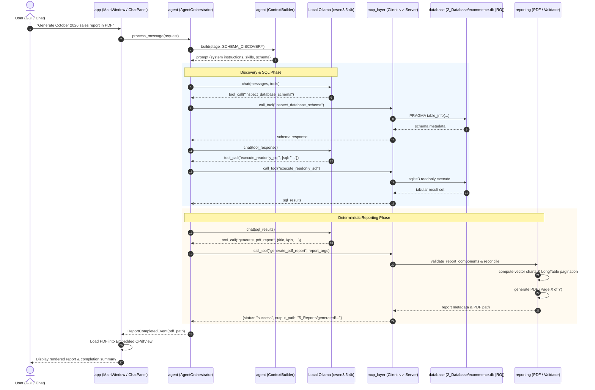

# Repository Structure: Local Report SQL Agent

This document details the code organization, architectural boundaries, module responsibilities, and directory layout of the **Local Report SQL Agent** project.

---

## 1. Top-Level Directory Tree

The repository is organized into six clearly separated, numbered top-level directories plus root configuration files:

```text
FinalProject_SQLAgent/
├── ReportSQLAgent.spec                # Unified cross-platform PyInstaller packaging specification
├── pytest.ini                         # Pytest root configuration (delegating to 1_Source)
├── .env.example                       # Template for environment configuration
│
├── 1_Source/                          # Complete Application Source Code & Packaging
│   ├── run_app.py                     # Single application entry point (GUI and --mcp-server modes)
│   ├── requirements.txt               # Production and build Python package dependencies
│   ├── pytest.ini                     # Package-level pytest configuration
│   │
│   ├── agent/                         # Autonomous Agent Intelligence Layer
│   │   ├── checkpoint_manager.py      # State snapshot creation, verification, and crash recovery
│   │   ├── checkpoint_models.py       # Pydantic models for checkpoints, state diffs, and recovery
│   │   ├── context_builder.py         # Stage-specific dynamic context construction and token budgeting
│   │   ├── context_models.py          # ContextItem, Priority, and ExecutionStage definitions
│   │   ├── conversation.py            # Turn tracking, message windowing, and session serialization
│   │   ├── ollama_client.py           # Asynchronous HTTP client for local Ollama REST API
│   │   ├── orchestrator.py            # Main orchestration loop, tool dispatch, and error remediation
│   │   ├── skill_manager.py           # Domain skill discovery, parsing, and intent-based selection
│   │   ├── skill_models.py            # Skill metadata models and invocation parameter schemas
│   │   ├── system_prompt.py           # Dynamic system prompt generation with runtime schema injection
│   │   ├── task_manager.py            # Task lifecycle, DAG dependency tracking, and step state transitions
│   │   ├── task_models.py             # Task, Step, Plan, and TaskStatus data models
│   │   ├── task_planner.py            # Natural-language plan formulation and JSON response parsing
│   │   └── tool_handler.py            # Discovered MCP tool registry and invocation bridge
│   │
│   ├── app/                           # PySide6 Desktop GUI Layer
│   │   ├── __init__.py
│   │   ├── main.py                    # GUI application entry point and CLI mode dispatcher
│   │   ├── main_window.py             # Main split-pane window coordinating chat, preview, and inspector
│   │   ├── style.py                   # Modern dark/light theme definitions and Qt stylesheets
│   │   ├── dialogs/                   # Human-in-the-loop modal dialogs
│   │   │   └── sql_approval_dialog.py # Dialog for reviewing prepared SQL queries and safety metadata
│   │   ├── models/                    # Qt item models for data presentation
│   │   │   └── csv_table_model.py     # QAbstractTableModel for tabular CSV previews
│   │   ├── views/                     # Primary user interface view panels
│   │   │   ├── chat_view.py           # Conversational chat view with streaming tokens & status pills
│   │   │   ├── history_view.py        # Searchable cards for previously generated PDF/CSV reports
│   │   │   └── settings_view.py       # Configuration view (Ollama host, context window, approval toggle)
│   │   ├── widgets/                   # Specialized UI components and visualizers
│   │   │   ├── activity_inspector_widget.py # Live DAG execution tree, tool execution log, token gauge
│   │   │   ├── message_widget.py      # Individual user and assistant message bubble component
│   │   │   ├── report_preview_widget.py # Embedded QtPdf document viewer with zoom & page controls
│   │   │   ├── sql_highlighter.py     # Syntax highlighter for SQL queries in approval dialog
│   │   │   └── sql_preview_widget.py  # Formatted SQL query preview component
│   │   └── workers/                   # Background QThread concurrency workers
│   │       ├── agent_worker.py        # Asynchronous worker bridging Qt UI and AgentOrchestrator
│   │       └── worker_signals.py      # Qt signals for streaming tokens, DAG updates, and completion
│   │
│   ├── config/                        # Application Configuration and Paths
│   │   ├── logging_setup.py           # Rotating file and console logging configuration
│   │   ├── paths.py                   # Centralized development and frozen cross-platform path resolution
│   │   ├── prompts.py                 # Baseline system instructions and fallback templates
│   │   └── settings.py                # Pydantic-based hierarchical application settings
│   │
│   ├── database/                      # Database Access and Security Layer
│   │   ├── __init__.py
│   │   ├── connection.py              # Thread-safe SQLite connection factory with read-only enforcement
│   │   ├── importer.py                # Raw CSV dataset import, validation, and schema builder
│   │   ├── query_executor.py          # Read-only query execution, latency tracking, and result tabularization
│   │   └── schema_inspector.py        # Schema introspection (tables, columns, types, foreign keys, row counts)
│   │
│   ├── mcp_layer/                     # Model Context Protocol (MCP) Subprocess Layer
│   │   ├── client.py                  # MCP stdio client communicating over standard input/output
│   │   ├── server.py                  # FastMCP stdio server exposing database and reporting tools
│   │   └── tools/                     # Modular MCP tool implementations
│   │       ├── database_tools.py      # inspect_database_schema, get_table_sample
│   │       ├── reporting_tools.py     # generate_pdf_report, generate_csv_report
│   │       └── sql_tools.py           # prepare_sql_query, execute_readonly_sql
│   │
│   ├── memory/                        # Persistent Memory Subsystem
│   │   ├── __init__.py
│   │   ├── models.py                  # Pydantic and dataclass models for memory entities
│   │   ├── repository.py              # SQLiteMemoryRepository implementing thread-safe CRUD methods
│   │   └── migrations/                # Versioned SQLite schema migrations package
│   │       ├── __init__.py            # Migration runner and version tracker (apply_migrations)
│   │       ├── 001_initial_schema.sql # Tasks, steps, tool calls, facts, and artifacts schema
│   │       ├── 002_checkpoint_recovery.sql # Checkpoint snapshots and recovery attempt logs
│   │       └── 003_skill_registry_enhancements.sql # Registered skills metadata and activation tracking
│   │
│   ├── reporting/                     # Deterministic Reporting Engine
│   │   ├── __init__.py
│   │   ├── canonical_data.py          # CanonicalSQLDataset, metric reconciliation, and KPI normalizers
│   │   ├── chart_builder.py           # Flowable vector chart construction and embedding
│   │   ├── chart_registry.py          # 22 vector chart renderers built on ReportLab graphics
│   │   ├── csv_generator.py           # RFC 4180-compliant CSV report synthesis and formula sanitization
│   │   ├── dataset_registry.py        # Tabular dataset collection registry
│   │   ├── date_utils.py              # Temporal range resolution and date formatting helpers
│   │   ├── dynamic_pdf_composer.py    # Multi-page layout, story compilation, and section builder
│   │   ├── pdf_generator.py           # ReportLab Platypus document synthesis with NumberedCanvas
│   │   ├── report_manager.py          # Report metadata tracking, history persistence, and file management
│   │   ├── report_spec.py             # Structured ReportSpecification model (sections, charts, tables)
│   │   └── report_validator.py        # Four-stage report validation, AOV checks, and chart eligibility
│   │
│   ├── skills/                        # Specialized Domain Knowledge Skills
│   │   ├── data_analysis/             # Statistical analysis, business metrics, and e-commerce KPI definitions
│   │   ├── data_validation/           # Canonical dataset reconciliation and numerical integrity rules
│   │   ├── reporting/                 # Executive report layout, typography, and chart selection guidelines
│   │   └── sql/                       # SQLite dialect optimization, schema maps, and join rules
│   │
│   ├── tests/                         # Automated Test Suite (463 tests across 36 modules)
│   │   ├── test_advanced_visualization_engine.py
│   │   ├── test_agent.py
│   │   ├── test_agent_intelligence_integration.py
│   │   ├── test_approval_config.py
│   │   ├── test_checkpoint_manager.py
│   │   ├── test_checkpoint_models.py
│   │   ├── test_checkpoint_repository.py
│   │   ├── test_context_builder.py
│   │   ├── test_context_models.py
│   │   ├── test_context_relevance.py
│   │   ├── test_context_security.py
│   │   ├── test_context_window.py
│   │   ├── test_database.py
│   │   ├── test_database_discovery_reporting.py
│   │   ├── test_dynamic_pdf_milestone9.py
│   │   ├── test_e2e_workflows.py
│   │   ├── test_gui.py
│   │   ├── test_macos_startup.py
│   │   ├── test_mcp_reliability.py
│   │   ├── test_mcp_tool_discovery_and_capability.py
│   │   ├── test_mcp_tools.py
│   │   ├── test_memory_migrations.py
│   │   ├── test_memory_repository.py
│   │   ├── test_reporting.py
│   │   ├── test_reporting_accuracy.py
│   │   ├── test_reporting_pipeline_fixes.py
│   │   ├── test_skill_manager.py
│   │   ├── test_skill_models.py
│   │   ├── test_skill_security.py
│   │   ├── test_skill_selection.py
│   │   ├── test_sql_validation.py
│   │   ├── test_task_manager.py
│   │   ├── test_task_manager_sqlite.py
│   │   ├── test_task_models.py
│   │   ├── test_task_planner.py
│   │   └── test_task_recovery.py
│   │
│   ├── scripts/                       # Maintenance and Packaging Scripts
│   │   ├── build_macos.sh             # 5-stage macOS packaging script (PyInstaller, smoke test)
│   │   ├── build_windows.ps1          # 5-stage Windows packaging script (PowerShell)
│   │   ├── import_dataset.py          # CLI utility for importing raw CSVs into SQLite
│   │   ├── verify_environment.py      # Diagnostic environment and database SHA-256 validator
│   │   ├── verify_milestone8_acceptance.py # Milestone 8 validation harness
│   │   ├── verify_milestone9_acceptance.py # Milestone 9 validation harness
│   │   └── verify_milestone10_acceptance.py# Milestone 10 acceptance verification harness
│   │
│   └── logs/                          # Application and Subprocess Execution Logs
│       ├── report_agent_app.log       # GUI and orchestrator execution log
│       ├── report_agent_import.log    # Raw data import log
│       └── report_agent_mcp_server.log# Child MCP stdio server log
│
├── 2_Database/                        # Databases and Raw Assets (Read-Only & Working)
│   ├── ecommerce.db                   # Primary SQLite database (7 tables, 499,385 records; immutable)
│   ├── agent_memory.db                # SQLite database for persistent agent memory (WAL mode)
│   └── raw/                           # Pristine raw CSV files for reproducible ETL
│
├── 3_Documentation/                   # Authoritative Documentation Suite & Solutions
│   ├── README.md                      # Project overview, quick start, and architectural entry point
│   ├── DEPLOY.md                      # Comprehensive macOS & Windows deployment guide
│   ├── STRUCTURE.md                   # Repository layout and module responsibilities (this file)
│   ├── FEATURE.md                     # Detailed technical specification of all system features
│   └── solution/                      # In-depth architectural references and diagrams
│
├── 4_Presentation/                    # Evaluation Slides and Presentation Artifacts
│   ├── PRESENTATION.md                # 10-minute university presentation script and defense Q&A
│   └── assets/                        # Supporting charts, screenshots, and visual exhibits
│
├── 5_Reports/                         # Output Artifacts & Catalog
│   ├── generated/                     # Generated PDF and CSV reports
│   └── report_history.json            # Persistent catalog of all generated report metadata
│
└── 6_Builds/                          # Packaged Standalone Binaries & Logs
    ├── macOS/                         # Native macOS Application Bundle (ReportSQLAgent.app)
    ├── Windows/                       # Windows Standalone Executable (ReportSQLAgent.exe)
    └── build_logs/                    # Packaging and smoke test logs (build_macos.log)
```

---

## 2. Core Packages and Responsibilities

### 2.1 `app/` — Desktop GUI Layer (PySide6)
- **Role**: Native presentation layer using Qt6 / PySide6.
- **Key Modules**:
  - `main.py`: Entry point that interprets CLI arguments (`--mcp-server`, `--smoke-test`, `--help`).
  - `main_window.py`: Orchestrates the primary split-screen UI (Chat on left, Report Preview on right, collapsible Activity Inspector at bottom).
  - `style.py`: Modern dark/light theme definitions, color palettes, and Qt stylesheets.
  - `views/chat_view.py`: Conversational chat panel with token streaming, activity badges, and prompt input.
  - `views/history_view.py`: Searchable cards for previously generated PDF and CSV reports.
  - `views/settings_view.py`: Configuration editor (Ollama host, context window size, approval toggle).
  - `widgets/activity_inspector_widget.py`: Live DAG task tree, tool execution log, checkpoint history, and token gauge.
  - `widgets/report_preview_widget.py`: Embedded `QPdfView` for real-time, in-app vector PDF previewing with multi-page navigation and zoom.
  - `widgets/message_widget.py`: Message bubble flowable component for user and assistant exchanges.
  - `dialogs/sql_approval_dialog.py`: Human-in-the-loop modal dialog presenting the generated SQL query and safety metadata before execution.
  - `workers/agent_worker.py`: Dedicated `QThread` bridging the asynchronous orchestrator and Qt event loop.

### 2.2 `agent/` — Autonomous Agent Intelligence Layer
- **Role**: Coordinates plan formulation, tool calling, context budgeting, and state recovery.
- **Key Modules**:
  - `orchestrator.py`: Implements `AgentOrchestrator`, driving the multi-turn execution loop between Ollama and the MCP client.
  - `context_builder.py`: Dynamically constructs the model prompt per execution stage (`SCHEMA_DISCOVERY`, `SQL_GENERATION`, `DATA_ANALYSIS`, `REPORT_SYNTHESIS`) constrained by the configured token budget.
  - `task_planner.py`: Translates high-level natural language requests into structured execution plans and DAG steps.
  - `task_manager.py`: Manages the lifecycle of tasks and steps (Pending, In Progress, Blocked, Completed, Failed).
  - `checkpoint_manager.py`: Captures SHA-256 verified state checkpoints, allowing task resumption after crashes.
  - `skill_manager.py`: Indexes markdown-based domain knowledge from `1_Source/skills/` and injects relevant snippets based on task intent.
  - `ollama_client.py`: Async HTTP client interfacing with Ollama REST API (`/api/chat`, `/api/show`, `/api/tags`).

### 2.3 `mcp_layer/` — Model Context Protocol (FastMCP)
- **Role**: Decouples database tools and report generators into an isolated subprocess communicating via standard input/output (stdio).
- **Key Modules**:
  - `server.py`: Instantiates `FastMCP("local-report-sql-agent-mcp")` and registers the six MCP tools.
  - `client.py`: Implements `MCPStdioClient` which launches the server subprocess (`python -m mcp_layer.server` or `executable --mcp-server`), manages JSON-RPC protocol handshakes, and provides async tool execution.
  - `tools/database_tools.py`: Exposes `inspect_database_schema` and `get_table_sample`.
  - `tools/sql_tools.py`: Exposes `prepare_sql_query` and `execute_readonly_sql`.
  - `tools/reporting_tools.py`: Exposes `generate_pdf_report` and `generate_csv_report`.

### 2.4 `database/` — Data Access & Security
- **Role**: Provides thread-safe, strictly read-only connections to SQLite with layered security guardrails.
- **Key Modules**:
  - `connection.py`: Thread-safe SQLite connection factory enforcing read-only access (`mode=ro`, `PRAGMA query_only = ON`, `DatabaseNotFoundError` on missing database).
  - `schema_inspector.py`: Queries table schemas, column data types, foreign keys, and row counts.
  - `query_executor.py`: Executes read-only queries with timeout safeguards, error capture, and tabular result formatting.
  - `importer.py`: Pristine dataset importer for reproducible SQLite generation from raw CSVs.

### 2.5 `reporting/` — Deterministic Reporting Engine
- **Role**: Validates, normalizes, and synthesizes multi-page executive PDF and CSV reports.
- **Key Modules**:
  - `canonical_data.py`: Normalizes KPI inputs (`normalize_kpi_entry`), enforces gross sales vs net revenue separation, and calculates vertical AOV.
  - `report_validator.py`: Executes four-stage component validation, period availability checks, and chart eligibility rules.
  - `chart_registry.py`: 22 vector chart renderers (bar, grouped bar, stacked bar, line, area, pie, donut, matrix heatmap, scatter, radar) built on ReportLab graphics.
  - `chart_builder.py`: Flowable chart construction and layout integration.
  - `pdf_generator.py`: ReportLab Platypus document synthesis, flowable layout, and two-pass `NumberedCanvas` ("Page X of Y").
  - `dynamic_pdf_composer.py`: Dynamic section layout and document composition.
  - `csv_generator.py`: RFC 4180-compliant CSV report synthesis with formula injection defenses.
  - `report_spec.py`: Pydantic models for structured report specifications.
  - `report_manager.py`: Catalogues generated reports in `5_Reports/report_history.json`.

### 2.6 `memory/` — Persistent Agent Memory
- **Role**: Long-term SQLite storage for task plans, step outputs, tool executions, semantic facts, and recovery checkpoints.
- **Key Modules**:
  - `repository.py`: `SQLiteMemoryRepository` managing `2_Database/agent_memory.db` in WAL mode.
  - `models.py`: Data models for memory entities, facts, decisions, and artifacts.
  - `migrations/__init__.py`: Applies versioned SQL migrations from `1_Source/memory/migrations/`.

---

## 3. Component Interaction Flow

The following diagram illustrates how the major packages interact during a reporting request:



---

## 4. Test Suite Organization

The project contains **463 automated tests across 36 modules**, partitioned into clean functional layers:

| Layer | Primary Test Modules | Test Count | Focus |
|:---|:---|:---:|:---|
| **MCP Subprocess & Discovery** | `test_mcp_tools.py` (4), `test_mcp_reliability.py` (5), `test_mcp_tool_discovery_and_capability.py` (8) | 17 | FastMCP stdio protocol, tool registration, subprocess reconnection, and live Ollama discovery. |
| **Agent Intelligence & Planning** | `test_agent.py` (54), `test_agent_intelligence_integration.py` (5), `test_task_planner.py` (18), `test_task_manager.py` (18), `test_task_models.py` (11), `test_task_manager_sqlite.py` (4) | 110 | Plan formulation, DAG dependency tracking, tool calling, JSON parsing, state transitions, and fallback modes. |
| **Context Window & Prompt Budgeting** | `test_context_builder.py` (13), `test_context_models.py` (8), `test_context_window.py` (36), `test_context_relevance.py` (5), `test_context_security.py` (6) | 68 | 32K–256K context scaling, priority budgeting (`HIGH`, `MEDIUM`, `LOW`), PII masking, injection defense. |
| **Memory, Checkpoints & Recovery** | `test_checkpoint_manager.py` (6), `test_checkpoint_models.py` (6), `test_checkpoint_repository.py` (5), `test_memory_migrations.py` (9), `test_memory_repository.py` (18), `test_task_recovery.py` (13) | 57 | SQLite WAL persistence, SHA-256 state serialization, checkpoint rollbacks, and schema migrations. |
| **Domain Skills System** | `test_skill_manager.py` (11), `test_skill_models.py` (14), `test_skill_security.py` (8), `test_skill_selection.py` (9) | 42 | Markdown skill indexing, YAML frontmatter validation, intent ranking, and sandbox path isolation. |
| **Database & SQL Security** | `test_database.py` (26), `test_database_discovery_reporting.py` (8), `test_sql_validation.py` (32), `test_approval_config.py` (8) | 74 | Read-only enforcement, SQLite authorizer, AST statement validation, DDL/DML blocking, human approval. |
| **Reporting Engine & Visualizations** | `test_reporting.py` (10), `test_reporting_accuracy.py` (15), `test_reporting_pipeline_fixes.py` (24), `test_advanced_visualization_engine.py` (5), `test_dynamic_pdf_milestone9.py` (5) | 59 | 22 vector chart renderers, canonical dataset reconciliation, KPI normalization, LongTable pagination, AOV logic. |
| **GUI & Packaging Verification** | `test_gui.py` (21), `test_macos_startup.py` (7), `test_e2e_workflows.py` (8) | 36 | Headless PySide6 widgets, thread safety, path resolution in frozen mode, and full analytical workflows. |
| **Total Test Suite** | **36 Specialized Test Modules** | **463** | **461 deterministic + 2 live Ollama workflows** |

